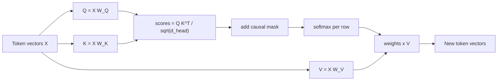

## The hook

Read this sentence: "The trophy didn't fit in the suitcase because it was too big." What does "it" refer to? Now change "big" to "small". The referent flips.

To get that right, a model must let the word "it" look back at the other words and decide which one matters. That lookup is **attention**, the mechanism at the center of the transformer (Vaswani et al., 2017, in the references). It is also the reason long contexts are expensive.

## The simple explanation

Attention is a soft, learned database lookup that happens for every token at every layer.

Each token writes three things:

- a **query**: "what am I looking for?"
- a **key**: "what do I contain?"
- a **value**: "what I will hand over if you pick me".

A token compares its query against every key. High match, high weight. It then collects a **weighted average of the values**. The result is a new vector for that token, now enriched with information from the tokens it paid attention to.

For a .NET engineer: imagine a dictionary lookup where, instead of exact key equality, every entry matches to some degree, and you get back a blend of all values weighted by match quality. A hash table returns one value. Attention returns a convex combination of all of them.

Where the analogy stops: the keys, queries and values are not hand-written. They are produced by learned matrices, and what "match" means is discovered during training.

## Under the hood

### The computation

For a sequence of `n` token vectors `X` (shape `n x d_model`) and learned matrices `W_Q`, `W_K`, `W_V`:

```
Q = X W_Q      K = X W_K      V = X W_V
scores  = Q K^T / sqrt(d_head)
weights = softmax(scores + mask)
output  = weights V
```



Walk through the pieces:

- **`Q K^T`** gives an `n x n` matrix. Cell `(i, j)` is how much token `i`'s query matches token `j`'s key (a dot product).
- **Dividing by `sqrt(d_head)`** keeps the scores in a sane range. The spread of a dot product between random vectors grows with the square root of their dimension, so the division keeps that spread constant whatever the head size. Without it, softmax saturates into near one-hot rows, and a saturated softmax has tiny gradients, so training stalls. Experiment B in the exercise shows this.
- **Softmax** turns each row of scores into positive weights that sum to 1.
- **The causal mask** sets scores for future positions to minus infinity before the softmax, so their weight is exactly 0. A token may look at itself and the past, never the future. This is what makes next-token prediction honest: during training the model cannot peek at the answer.
- **Weights times V** blends the values.

### Multi-head attention

One attention pattern is not enough. A token may need syntax from one place, a referent from another, a nearby word from a third. So the model runs several smaller attention computations in parallel, called **heads**, each with its own `W_Q`, `W_K`, `W_V` of width `d_head = d_model / number of heads`. Head outputs are concatenated and mixed by an output matrix. Heads are free to specialize, and in trained models some do, though most are not cleanly interpretable.

### The cost

The score matrix is `n x n`. Double the context and the matrix gets **four times** larger, for every head in every layer. That is the quadratic cost, and the reason long contexts are expensive in compute and memory. Real systems reduce it with optimized kernels, sparse or sliding-window patterns and other tricks, but the pressure is always there.

### The KV cache

When generating text one token at a time, the keys and values of earlier tokens do not change, because of the causal mask. So the server stores them, the **KV cache**, and for each new token computes only one new query, key and value, then attends over the cached keys and values. Experiment E in the exercise checks that cached decoding gives the same numbers as recomputing everything.

The trade: the cache saves compute but occupies GPU memory that grows with context length, number of layers and number of concurrent users. In serving, memory for the KV cache, not raw compute, is often what limits how many requests fit on one GPU.

## The engineering connection

- **Why prompts have a price.** A long prompt must be processed (the "prefill" phase) and then cached. Output tokens are generated one at a time, each attending over the whole cache. This is why providers price input and output differently and why latency has two parts: time to first token, then tokens per second.
- **Prompt caching.** If many requests start with the same long prefix (system prompt, documents), the provider can reuse its KV cache for that prefix. Put stable content first and variable content last to benefit.
- **"Lost in the middle".** Models often use information at the start and end of a long context better than information in the middle (Liu et al., 2023, in the references). One intuition, not a proven cause: attention weights sum to 1, so evidence in a huge context competes with everything else. Whatever the mechanism, a bigger window is not the same as better recall.
- **Information flows only backward.** Causal attention is why decoder-only models answer by continuing text, and why the order of content in your prompt matters.
- **Capacity planning.** For self-hosting, KV cache size per token multiplied by context length and concurrency is a first-order sizing number.

## Hands-on challenge

File: `lessons/lesson_03_attention.py`. Numpy only, a four-token toy with a fixed seed. About 10 minutes.

**Predict before you run:**

1. With the causal mask, which cells of the 4x4 weight matrix are exactly 0?
2. What does each row sum to?
3. What does the first row look like, and why?
4. If you change the last token, will the output of the first token change? What if you remove the mask?
5. With 256-dimensional heads, which is closer to a one-hot row: scaled or unscaled scores?
6. Doubling the context length multiplies the score matrix size by what factor?

The run command is at the bottom of this page.

<details>
<summary>What the script printed for me (open after predicting)</summary>

Weights (rows are queries):

```
            The     cat     sat    down
       The   1.000   0.000   0.000   0.000
       cat   0.696   0.304   0.000   0.000
       sat   0.001   0.984   0.015   0.000
      down   0.123   0.852   0.002   0.024
```

- Everything above the diagonal is exactly 0. Every row sums to 1.
- The first token can only see itself, so its row is `[1, 0, 0, 0]`.
- Changing the last token leaves the first output unchanged with the mask. Without the mask, the first output changes.
- Maximum weight per row, scaled: about 0.41 to 0.53. Unscaled: 1.0 in every row, which means almost no gradient.
- Score matrix entries: 1M at 1,000 tokens, 4M at 2,000, 16M at 4,000. Doubling gives 4x.
- Cached decoding equals full recompute: `True`.

The weights are random, not trained, so the pattern means nothing linguistically. The mechanics are the point.

</details>

Follow-ups: change `d_head` and see how unscaled saturation changes. Write the KV cache loop for two heads. Estimate the KV cache size in GB for a model with 32 layers, 8 key/value heads of dimension 128, 16-bit values and a 32,000-token context.

## Takeaways

1. Attention lets every token take a weighted blend of other tokens' values, with weights from query-key matches passed through softmax.
2. The causal mask makes weights for future tokens exactly zero. Scaling by `sqrt(d_head)` keeps softmax trainable.
3. The score matrix grows with the square of context length. The KV cache trades memory for compute during generation.

**Check question:** why does generating token 1,001 not require reprocessing the first 1,000 tokens, and what does avoiding that work cost in return?

**Next up:** the transformer block, which wraps attention with a feed-forward network, residual connections and normalization.

::: quiz
Q: In the causal weight matrix, why is the first row always `[1, 0, 0, 0]`?
A: The first token can only attend to itself. Every future position is masked to minus infinity, which softmax turns into exactly zero, and the one remaining weight must sum to 1.
Q: You double a model's context length. What happens to the attention score matrix per head per layer?
A: It grows four times, because the matrix is n by n. This is the quadratic cost of attention.
Q: What does the KV cache save, and what does it spend?
A: It saves recomputing keys and values for every earlier token on each generation step. It spends GPU memory that grows with context length, layers and concurrent requests.
:::

## References

- Vaswani et al., "Attention Is All You Need" (2017): https://arxiv.org/abs/1706.03762
- Liu et al., "Lost in the Middle: How Language Models Use Long Contexts" (2023): https://arxiv.org/abs/2307.03172
- Kwon et al., "Efficient Memory Management for Large Language Model Serving with PagedAttention" (2023), on KV cache memory in serving: https://arxiv.org/abs/2309.06180
