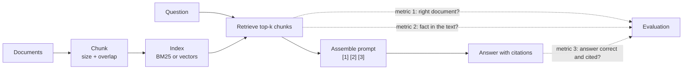

## The hook

The search team shows you their dashboard: for almost every question in the test set, the right document is in the top three results. The support team shows you theirs: the assistant built on that search gets about half of the same questions wrong.

Both dashboards are correct. The search team measures whether the right *document* came back. Nobody measures whether the right *sentence* made it into the prompt in one piece, or whether the model used it. In the exercise you will reproduce this exact gap with nothing but a word counter, and then close part of it by changing a single number: the chunk size.

## The simple explanation

A RAG pipeline is an open-book exam taken by someone who cannot see the bookshelf. A librarian (retrieval) photocopies a few pages and hands them over. The student (the LLM) answers from those pages and writes down which page each answer came from.

Three things can go wrong, and they are independent: the librarian brings the wrong book, the librarian brings the right book but the photocopy cuts the key paragraph in half, or the pages are perfect and the student still misreads them. A single "is the answer right" score cannot tell you which one happened.

Where the analogy breaks: the librarian here does not understand the question. It ranks text by word statistics or vector similarity. And the student is not neutral: an LLM may answer from its own memory and still cite a page, which looks grounded but is not.

## Under the hood



### Chunking: size, overlap and boundaries

You never index whole documents. A 40-page policy embedded as one vector is a blur of every topic it covers, and pasting it whole into every prompt is expensive. So you split it into chunks, and two numbers decide most of the behavior:

- **Size.** Small chunks are precise: each one is about one thing, so a match means something. But a fact that spans a boundary ends up half in one chunk and half in the next, and the half that gets retrieved may not contain the answer. Large chunks keep facts whole but carry more unrelated text, which costs tokens and gives the model more to misread.
- **Overlap.** Consecutive chunks share a few words or tokens so that a sentence near a boundary appears whole in at least one of them. Overlap only protects facts shorter than the overlap. It also duplicates text in the index and can fill the top-k with near-copies of the same passage.

Real systems split by tokens (lesson 1), not words, and prefer natural boundaries: headings, paragraphs, sentences, table rows. Framework defaults vary widely, from a few hundred to around a thousand tokens. Treat any default as a hypothesis to measure on your own documents, not as a recommendation. A common refinement is to retrieve small chunks for precision but send the larger surrounding section to the model.

### Two kinds of retrieval recall

Lesson 6 measured hit@k: is the right document in the top k? Once documents are chunked, that question has two versions:

| Metric | Question it answers | Needs labels for |
|---|---|---|
| Document recall@k | Did any chunk of the right document come back? | expected document |
| Context recall | Does the retrieved text actually contain the answer fact? | expected document and fact |

Document recall is cheap and is what most dashboards show. Context recall is what the model experiences. With small chunks the two can drift far apart, because "a chunk of the right document" may be the chunk that stops one word before the answer.

### Prompt assembly with numbered sources

The retrieved chunks are pasted into the prompt with a stable number each, plus enough metadata to trace them back:

```
Answer using only the sources below. Cite each statement with its source number, like [2].
If the sources do not contain the answer, reply "not found".

[1] (deploy-runbook, chunk 2) Deploys to production happen Monday to Thursday ...
[2] (access-policy, chunk 1) Engineers get production access only through ...

Question: Can I deploy on a Friday?
```

Details that matter in production: the numbers are assigned by your code, so you can map `[2]` back to a document ID and a URL. Clear delimiters separate instructions from sources, because the sources are untrusted text (lesson 12 covers prompt injection). Put the strongest source first or last rather than buried in the middle of a long list (lesson 3, "lost in the middle"). And the explicit "not found" instruction gives the model a legal way out when retrieval fails, instead of forcing it to guess.

### Answering with citations

A citation is only useful if you check it. After generation, parse the `[n]` markers and verify that each one points to a source that was actually in the prompt and that the cited source supports the statement. Exact checks are possible for extracted facts (does the number or name appear in source `[n]`?). For free-form answers you need an entailment model or an LLM judge (lesson 11). An answer can be correct but unsupported (the model knew it from training) or supported but wrong (it copied a stale or misleading sentence). Both matter, and they are different bugs.

The exercise replaces the LLM with a deterministic **extractive answerer**: it splits the retrieved chunks into sentences and returns the sentence that shares the most rare words with the question, with that chunk's number as the citation. It is far weaker than any LLM, and that is the point: it fails in visible, repeatable ways, and the evaluation code around it is exactly what you would use with a real model.

### Measuring answer quality separately

Score every labeled question at three points: document recall, context recall, and answer accuracy (the expected fact is in the answer and the citation points to the expected document). Then compute one more number: **answer accuracy restricted to questions where the fact was retrieved**. That is the quality of the generation step alone, with retrieval taken out of the picture.

The failures then sort themselves into three buckets, each with a different owner:

- **Retrieval missed:** fix the index, the query, hybrid search or reranking (lesson 6).
- **Right document, fact cut off:** fix chunking.
- **Fact retrieved, answer wrong:** fix the prompt, the model, or the citation check.

## The engineering connection

- **Instrument every stage.** Log the retrieved chunk IDs, the assembled prompt and the parsed citations for each request. Without them, a bad answer cannot be assigned to a stage, and teams argue instead of fixing.
- **Chunk size is a cost lever.** Bigger chunks mean more input tokens on every request, which is billed and adds prefill latency (lesson 3). In the exercise, moving from 20-word to 60-word chunks raises the text sent per question from {{claim:s_words}} to {{claim:l_words}} words. Measure whether the accuracy gain pays for it.
- **Re-chunking means re-indexing.** Changing size or overlap invalidates every stored vector. Version the chunking config alongside the embedding model so you can rebuild and compare side by side.
- **A labeled set needs facts, not just documents.** Recording the expected fact for each question is what makes context recall and automatic answer checks possible. It is a little more labeling work and it pays back on every experiment.
- **"Not found" is a feature.** Measure how often the system abstains when it should, not only how often it answers. A confident answer with a citation to an irrelevant source is worse than an honest refusal.

## Hands-on challenge

File: `courses/ai-engineering/exercises/lesson_07_rag_pipeline.py`. Python standard library only. It writes 12 short internal policies and runbooks, chunks them at 20 and 60 words, retrieves with a BM25 index built in the script, assembles a numbered prompt and answers with the extractive stand-in for an LLM. It scores 14 labeled questions at three points and prints every failure with its bucket. About 15 minutes.

**Predict before you run:**

1. With 20-word chunks and top 3, what share of questions will have the right document retrieved?
2. Will the 60-word chunks improve document recall, context recall, or both?
3. Retrieval looks equally good for both sizes. Which size gives better answer accuracy?
4. For "How long are database backups kept?" the right chunk is retrieved. Will the answerer get it right?

::: predict
P: s_recall | number | claim:s_recall | 0.1 | With 20-word chunks, what share of questions get the right document in the top 3?
P: better | choice:small=20-word chunks;large=60-word chunks;same=About the same | large | | Which chunk size gives higher answer accuracy?
P: l_acc | number | claim:l_acc | 0.1 | What is the answer accuracy with 60-word chunks?
P: backups | choice:yes=Yes;no=No | no | | The backups question retrieves the right chunk. Does the answerer get it right?
:::

The run command is at the bottom of this page.

<details>
<summary>What the script printed for me (open after predicting)</summary>

| Chunk size | Chunks | Words sent | Document recall@3 | Context recall | Answer accuracy | Accuracy when fact retrieved |
|---|---|---|---|---|---|---|
| 20 words, overlap 5 | {{claim:s_chunks}} | {{claim:s_words}} | {{claim:s_recall}} | {{claim:s_ctx}} | {{claim:s_acc}} | {{claim:s_accfact}} |
| 60 words, overlap 15 | {{claim:l_chunks}} | {{claim:l_words}} | {{claim:l_recall}} | {{claim:l_ctx}} | {{claim:l_acc}} | {{claim:l_accfact}} |

- Document recall is identical for both sizes. A dashboard showing only that number would call the two configurations equal.
- Context recall tells the real story. With 20-word chunks the right document often comes back as the wrong slice of it. For the SEV1 question the best sentence the answerer could find was "{{claim:sev1_answer}}": the chunk ends before the answer.
- At 60 words every document in this small corpus fits in one chunk, so the comparison is really "chunks versus whole documents". Accuracy goes up, and so does the text sent per question.
- Fact retrieved, answer wrong: for the backups question the answerer returned "{{claim:backup_answer}}". That sentence repeats "database backups" from the question, while the real answer says "Snapshots are kept for 35 days". Word overlap cannot see that snapshots are backups. An LLM would almost certainly get this one right, which is why the generation-only accuracy is the number to compare when you swap models.
- Retrieval missed: "How do I get a new laptop?" fails at both sizes. The document says "replacement machine" and "equipment", never "laptop", and BM25 matches "new" in the vendor policy instead. This is the vocabulary gap that vector or hybrid search (lesson 6) exists for.
- Some generation failures come from the missing stemmer: "Friday" does not match "Fridays". A real tokenizer or an LLM removes that class of error, but not the other two buckets.

</details>

Follow-ups: raise the overlap at 20 words until the SEV1 fact survives, and watch the chunk count and the near-duplicates in the top 3. Add an unanswerable question and make the answerer reply "not found" below a score threshold, then measure abstention. Swap BM25 for embeddings from lesson 2 and check whether the laptop question moves from "retrieval missed" to another bucket.

## Takeaways

1. Chunk size and overlap decide whether a fact reaches the model whole. Small chunks are precise but cut facts in half. Large ones keep facts whole but cost tokens.
2. Document recall can hide chunking failures. Measure context recall (is the fact in the retrieved text?) and answer accuracy separately, and compute accuracy on the questions where the fact was retrieved.
3. Number the sources in the prompt, give the model a "not found" exit, and verify every citation in code. Each failure then lands in a bucket with a clear owner: retrieval, chunking or generation.

**Check question:** your RAG system's document recall@5 is 0.95 and answer accuracy is 0.60. List the two measurements you would add first, and what each result would tell you to change.

**Next up:** structured outputs and function calling, so the model's answer and its citations come back as data your code can validate instead of free text.

::: quiz
Q: Why can document recall@k stay the same while answer accuracy changes when you change chunk size?
A: Document recall only asks whether any chunk of the right document was retrieved. With small chunks that chunk may be the slice that stops before the answer, so the fact never reaches the model. Context recall catches this; document recall does not.
Q: What does "answer accuracy when the fact was retrieved" isolate, and when is it the number to watch?
A: It removes retrieval failures and measures only the generation step. Watch it when you change the model or the prompt, because retrieval is unchanged and any movement comes from generation.
Q: Your answers cite [2], but the statement is not in source [2]. Name two possible causes.
A: The model answered from its own training data and attached a citation anyway, or it mixed up source numbers. Either way the answer is unsupported, which is why citations must be checked in code rather than trusted.
Q: What is the cost of making chunks larger?
A: More input tokens per request (price and prefill latency), more unrelated text for the model to misread, and less precise retrieval because each chunk covers more topics. It also requires re-indexing everything.
:::

## References

- Lewis et al., "Retrieval-Augmented Generation for Knowledge-Intensive NLP Tasks" (2020): https://arxiv.org/abs/2005.11401
- Gao et al., "Retrieval-Augmented Generation for Large Language Models: A Survey" (2023): https://arxiv.org/abs/2312.10997
- Es et al., "RAGAS: Automated Evaluation of Retrieval Augmented Generation" (2023), separate metrics for context and answer quality: https://arxiv.org/abs/2309.15217
- Liu et al., "Lost in the Middle: How Language Models Use Long Contexts" (2023): https://arxiv.org/abs/2307.03172
