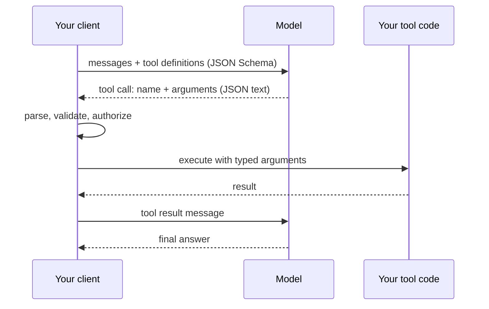

## The hook

You ask a model to triage support tickets and "reply only with JSON". It works in every test. In production, the deserializer starts throwing on a small fraction of responses: one starts with "Sure, here is the ticket:", one ends with a friendly sentence after the closing brace, one says `"priority": "urgent"` although your enum only has low, medium and high, and one sends `"estimate_hours": "3 hours"`.

None of this is a bug in your code. The model produces text one sampled token at a time (lesson 5), and nothing in that process knows about your C# record. Getting structured data out of a language model is an engineering problem with three tools: a schema that states the contract, a decoder that can be forced to respect it, and a client that checks it anyway.

## The simple explanation

Asking for "JSON please" is like handing someone a blank sheet and asking them to fill it in neatly. Most people will. Some will add a note in the margin.

A **schema plus validation** is the clerk who checks the sheet afterwards and hands it back when a field is missing. **Constrained decoding** is a printed form with boxes and dropdowns: you physically cannot write outside the boxes or pick an option that is not on the list.

Where the analogy breaks: a form guarantees shape, not truth. The model can pick a valid dropdown value that is wrong for this ticket, and the form will accept it. And the clerk is cheap, while asking the model to try again costs another full call.

## Under the hood

### JSON Schema is the contract

Most providers accept a JSON Schema, either for the final response ("structured output" or "JSON mode" with a schema) or for the parameters of each tool. The exercise uses this one:

```json
{
  "type": "object",
  "properties": {
    "title": { "type": "string" },
    "priority": { "type": "string", "enum": ["low", "medium", "high"] },
    "estimate_hours": { "type": "integer" },
    "tags": { "type": "array", "items": { "type": "string" } }
  },
  "required": ["title", "priority", "estimate_hours"],
  "additionalProperties": false
}
```

The schema does two jobs. It is usually placed in the model's context, so field names, enum values and descriptions act as instructions (and cost input tokens). And it is the machine-checkable definition of a valid answer. Providers usually support a subset of the full JSON Schema specification, and strict modes often add rules such as requiring `additionalProperties: false`. Check the documentation of the one you use instead of assuming every keyword works.

### Function calling is structured output with a name

A tool definition is a name, a description and a JSON Schema for its arguments. When the model decides to use a tool, it does not run anything. It emits a structured message saying "call `create_ticket` with these arguments". Your code parses that, validates it, decides whether it is allowed, executes it and sends the result back as another message. Then the model continues. Hosted models are trained for this on purpose; Toolformer (Schick et al., 2023) is an early study of a model learning when to call an API and what to pass.



The arguments arrive as model output, so they deserve the same suspicion as any request body from the internet. A model can also name a tool you never defined or one it should not be using for this user.

### Validate, then retry

A robust client checks in three layers: does it parse, does it match the schema, does it make sense for the business (does the ticket's project exist, is the estimate within limits). When a check fails, the usual move is to retry, ideally sending the validation errors back so the model can correct itself.

Retry math looks generous: if one attempt succeeds with probability `p`, three independent attempts fail together with probability `(1 - p)^3`. The catch is the word independent. Failures cluster on hard inputs, an odd ticket or an ambiguous field, and the same input tends to fail the same way again. The exercise models this with 20% hard inputs, and the gap between the independence estimate and the measured rate is the lesson. Track failures per input, cap retries, and decide what happens when the last one fails: a fallback model, a default, or a human queue.

### Constrained decoding

At each step the model produces a probability for every token in its vocabulary. A constrained decoder keeps a state machine compiled from the schema or grammar and, before sampling, sets to zero every token that cannot extend the text so far into a valid output. The remaining probabilities are rescaled to sum to 1, and sampling proceeds as usual (Willard and Louf, 2023, describe an efficient way to do this for regular expressions and grammars).

Three consequences follow. First, the output is valid by construction, so no syntax retries. Second, the mask keeps the model's relative preferences among the allowed tokens: probability that was on a forbidden token is spread over the allowed ones in proportion to what they already had. It does not move to the "right" answer, because the mask does not know what that is. Third, real tokenizers complicate the state machine, because one token can cover several JSON characters such as `{"` or `":`, so the mask must be computed over token strings, not characters.

You only get this if you control decoding, which means a local inference engine or a provider mode that offers schema-enforced output. A plain "reply in JSON" prompt is not constrained decoding. There is also a quality question: some studies report that forcing a rigid format can hurt reasoning on some tasks (Tam et al., 2024), so measure it on your own task.

### Typed contracts on the client

Mirror the schema in your own types and validate strictly. In TypeScript, zod gives you a runtime check plus a static type through `z.infer`:

```ts
import { z } from "zod";

const Ticket = z.object({
  title: z.string(),
  priority: z.enum(["low", "medium", "high"]),
  estimate_hours: z.number().int(),
  tags: z.array(z.string()).optional(),
}).strict();

const result = Ticket.safeParse(JSON.parse(text));
```

`JSON.parse` throws on trailing prose, so wrap it, and `result.error.issues` lists what failed. In C#, System.Text.Json is lenient by default: unknown properties are ignored and a missing constructor parameter silently becomes its default, so a missing `estimate_hours` turns into 0. Opt into strictness (.NET 9 or later for the last option):

```csharp
var options = new JsonSerializerOptions
{
    PropertyNamingPolicy = JsonNamingPolicy.SnakeCaseLower,
    UnmappedMemberHandling = JsonUnmappedMemberHandling.Disallow,
    RespectRequiredConstructorParameters = true,
    Converters = { new JsonStringEnumConverter(JsonNamingPolicy.SnakeCaseLower) },
};
var ticket = JsonSerializer.Deserialize<Ticket>(text, options);

public enum Priority { Low, Medium, High }
public sealed record Ticket(string Title, Priority Priority, int EstimateHours, string[]? Tags = null);
```

With these options, `"urgent"`, `"3 hours"`, an extra property, a missing required field and trailing text all throw a `JsonException` that you can catch, log and feed into a retry.

## The engineering connection

- **One source of truth.** Generate the JSON Schema from your types (for example .NET 9's `JsonSchemaExporter` or a zod-to-JSON-Schema converter) or the types from the schema. Hand-maintained duplicates drift, and the model follows the schema, not your C# record.
- **Validate even in strict mode.** Schema enforcement covers syntax and types. It does not cover business rules, provider-side gaps in keyword support, or output cut off by the token limit, which is invalid JSON no matter how it was decoded.
- **Tool calls are untrusted input.** Keep an allowlist of tools per user and per task, validate arguments, check authorization in your code, and require confirmation for anything destructive. The model asking for `delete_database` is a request, not a decision.
- **Retries cost latency and tokens.** Each one is another full call. Budget them, log every failure with the input that caused it, and treat a rising retry rate as a regression signal after a prompt or model change.
- **Constrained decoding changes the distribution.** It guarantees a parseable answer, which can hide the fact that the model wanted to say something else. If the model badly wants an option you do not offer, the schema is probably missing a case (an `"other"` or `"unknown"` value is often the honest fix). Closed enums, clear field names and short descriptions help the model more than free-form strings.

## Hands-on challenge

File: `courses/ai-engineering/exercises/lesson_08_structured_outputs.py`. Standard library and NumPy only. It implements a small JSON Schema validator, checks five tool calls against a tool schema, simulates a noisy model with retries, and runs constrained decoding on a ten-token vocabulary. About 15 minutes.

**Predict before you run:**

1. Part 1 validates five calls. Which ones fail, and does the call with a friendly sentence after the closing brace fail at parsing or at schema validation?
2. Part 2: 80% of inputs are easy and fail 15% of the time, 20% are hard and fail 85% of the time. Each failure picks one of four errors. What is the first-try validity?
3. With up to 2 retries, will validity reach what the formula `1 - (1 - p)^3` predicts? Why or why not?
4. Part 3: the toy model puts about as much probability on the invalid value `"urgent"` as on `"high"`. Without a mask, roughly what fraction of whole sequences will be valid?

::: predict
P: first | number | claim:first_try | 0.05 | First-try validity in Part 2 (0 to 1)?
P: retries | number | claim:after_retries | 0.05 | Validity after up to 2 retries (0 to 1)?
P: nomask | number | claim:nomask_valid | 0.1 | Fraction of valid sequences without the mask (0 to 1)?
P: urgent | choice:prop=Mostly to high, in proportion to existing probabilities;even=Split evenly across low, medium and high;low=Mostly to low, the safe choice | prop | | With the mask, where does the probability of urgent go?
:::

The run command is at the bottom of this page.

<details>
<summary>What the script printed for me (open after predicting)</summary>

- Trailing prose fails at parsing, before the schema is even consulted: `{{claim:call3_error}}`. Call 4 shows why a validator should collect all errors, not stop at the first: `{{claim:call4_errors}}`. The unknown tool is rejected before its arguments are read.
- First-try validity is {{claim:first_try}}, close to 0.8 × 0.85 + 0.2 × 0.15 = 0.71.
- After up to 2 retries it rises to {{claim:after_retries}}, well short of the independence estimate of {{claim:independence}}. Hard inputs end at only {{claim:hard_retry}}: retrying the same hard input mostly reproduces the failure. The client paid {{claim:calls_per_request}} model calls per request on average.
- After `:` the model gives `"urgent"` {{claim:urgent_p}} and `"high"` {{claim:high_raw}}. The mask sets `"urgent"` to 0 and `"high"` becomes {{claim:high_masked}}: its share of the allowed mass was already that large, so it absorbs most of what was removed.
- Without the mask {{claim:nomask_valid}} of sequences are valid, matching the exact path probability of {{claim:exact_valid}}. With the mask, validity is {{claim:mask_valid}}, and on average the mask removed {{claim:mass_removed}} of the probability per step.

</details>

Follow-ups: send the validation error back and lower the error rate on the retry to model self-correction, then see how much of the gap to the independence estimate it closes. Add an `"other"` value to the toy grammar and watch where `"urgent"`'s mass goes. Extend the validator with `minimum` and `maxLength`.

## Takeaways

1. A JSON Schema is both an instruction to the model and a contract for your client. Validate every response and every tool call against it, plus your business rules, even when the provider enforces the schema.
2. Retries help less than the independence formula suggests, because failures cluster on hard inputs. Cap them, log them and plan the fallback.
3. Constrained decoding guarantees valid structure by masking and renormalizing token probabilities. It keeps the model's relative preferences, so it fixes syntax, not judgment.

**Check question:** your schema has `priority` with values low, medium and high, decoding is constrained, and reviewers say "high" is chosen far too often for routine tickets. What is a likely cause, and what would you change in the schema?

**Next up:** tool calls in a loop become an agent (lesson 13), and lesson 12 covers what happens when the text that decides those calls is hostile.

::: quiz
Q: A response is `{"title": "Fix login", "priority": "low", "estimate_hours": 2} Done!`. Where does it fail, and does a schema validator see it?
A: It fails at parsing: a strict JSON parser rejects any non-whitespace text after the value. The schema validator never runs. Extracting the first JSON object is possible, but it hides a prompt problem.
Q: First-try validity is 0.7. Why might three attempts give much less than 1 - 0.3^3 = 0.973?
A: That formula assumes failures are independent. In practice the same hard inputs fail repeatedly, so the retries are correlated and most of the residual failures stay.
Q: In System.Text.Json with default options, the model omits a required `estimate_hours`. What happens?
A: Nothing throws. The constructor parameter gets its default value, 0, and bad data flows on. Enable required handling (`RespectRequiredConstructorParameters` in .NET 9, or required members) and `UnmappedMemberHandling.Disallow`, or validate against the schema first.
Q: Constrained decoding removes a forbidden token that had 40% of the probability. Where does that probability go?
A: It is spread over the allowed tokens in proportion to their existing probabilities, after renormalization. The mask does not know which allowed token is correct.
:::

## References

- JSON Schema specification: https://json-schema.org/specification
- Willard and Louf, "Efficient Guided Generation for Large Language Models" (2023), grammar-constrained decoding with finite-state machines: https://arxiv.org/abs/2307.09702
- Schick et al., "Toolformer: Language Models Can Teach Themselves to Use Tools" (2023): https://arxiv.org/abs/2302.04761
- Tam et al., "Let Me Speak Freely? A Study on the Impact of Format Restrictions on Performance of Large Language Models" (2024): https://arxiv.org/abs/2408.02442
- Microsoft, System.Text.Json overview: https://learn.microsoft.com/dotnet/standard/serialization/system-text-json/overview
