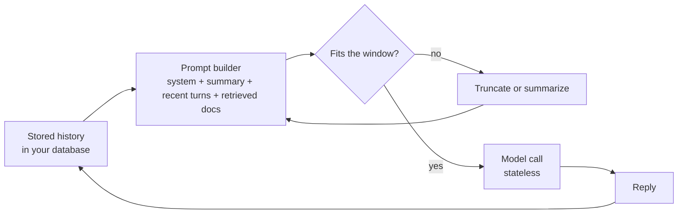

## The hook

A support bot works perfectly in testing. In production, a customer writes their order number in the second message, chats for twenty minutes, and then asks "so when does my order arrive?". The bot answers politely, confidently, and with an order number that does not exist.

Nothing crashed. No exception was logged. The order number simply was no longer in the text the model received, and a model that is trained to always produce a plausible next token produced one.

## The simple explanation

A language model call is a pure function. Text goes in, text comes out, and the model keeps nothing between calls. The **context window** is the maximum amount of text, measured in tokens, that one call can take in.

Think of a contractor who has no memory at all and works only from the folder you hand them each morning. If you want them to remember yesterday, you put yesterday's notes in the folder. The folder has a fixed size. When it is full, something has to come out, and the contractor will not tell you that a page is missing. They will fill the gap with a reasonable guess.

Where the analogy breaks: a human contractor reads every page with the same care. A model does not. Even when the page is in the folder, information in the middle of a long folder is used less reliably than information at the start or the end.

## Under the hood

### What a context window really is

The context window is a limit on the number of tokens in one forward computation: the system prompt, the conversation, any retrieved documents, tool results, and usually the tokens the model generates in reply. Everything the model "knows" about your situation must fit in that budget.

During generation the server keeps the keys and values of every token in the **KV cache** (lesson 3), so each new token attends over all earlier ones without recomputing them. That cache lives for the duration of the request. Provider-side prompt caching can reuse it across requests that share a prefix, which makes repeated prefixes cheaper and faster, but it does not change what the model sees. The model still only attends to the tokens of the current call.

### There is no memory, only resent text

A chat API is stateless. To continue a conversation, your application sends the entire history again on every turn. The prompt grows each turn, so the input tokens you pay for grow roughly linearly per call and roughly quadratically over a whole conversation.

When the history outgrows the window, your code, or the framework you use, must decide what to drop. Common strategies:

| Strategy | What is kept | What breaks |
|---|---|---|
| Drop oldest | The most recent messages | The system prompt and early facts disappear first |
| System prompt plus recent turns | Instructions and the latest turns | Anything said early that was not repeated |
| System prompt, running summary, recent turns | Instructions, a compressed past, the latest turns | Whatever the summarizer judged unimportant |
| Retrieval over past turns | The turns most similar to the current question | Facts phrased differently from the question |

Product "memory" features work the same way at a higher level: some text is stored somewhere and inserted into later prompts. If it is not in the tokens of this call, the model does not have it.



### Lost in the middle

Liu et al. (2023) placed the one document that contained the answer at different positions among many distractor documents. Accuracy was highest when the relevant document was at the beginning or the end of the context and dropped when it was in the middle, a U-shaped curve. Models with longer windows were not automatically better at using what was in them.

The exact causes are still studied. One part of the picture is plain arithmetic. Attention weights in a head sum to 1, so a relevant token competes with every other token. If the relevant key scores a margin `m` above `N` equally scored distractors, its weight is `e^m / (e^m + N)`. With `m = 3`, `e^m` is about 20, so at 1,000 distractors the relevant token gets about 2% of the attention. Real models have many heads and layers and learn sharper scores, so this is a pressure, not a law. Add any position-dependent bias on top and middle positions lose more.

### Where confident errors come from

A **hallucination** is fluent output that is not supported by the input or by the facts. It follows from how the model is built (lesson 5):

- **The objective rewards plausibility.** Training minimizes next-token cross-entropy. There is no "I don't know" token that the objective prefers when the training data is silent. Probability has to go somewhere, and a fluent guess is the most likely continuation.
- **Missing knowledge looks like any other gap.** A fact that was rare in training data, happened after the training cutoff, or was truncated out of the context produces the same kind of output as a fact the model knows: a confident sentence.
- **Calibration is imperfect.** A model is **calibrated** if, among answers given with 80% confidence, about 80% are right. Kadavath et al. (2022) found large pretrained models reasonably calibrated on some multiple-choice formats, and the GPT-4 technical report shows post-training reduced calibration on one benchmark. The tone of the text is not a confidence score at all.

The standard summary number is **expected calibration error** (Guo et al., 2017): bin predictions by confidence, and average the gap between mean confidence and accuracy in each bin, weighted by the bin size.

### Mitigations that work

None of these makes errors impossible. Each moves the odds.

- **Retrieval.** Put the relevant source text in the prompt instead of relying on what the weights memorized (Lewis et al., 2020, and lesson 7). This turns a knowledge problem into a reading problem, which models are much better at.
- **Shorter, focused context.** Retrieve the five best passages, not fifty. Put the instructions and the most important evidence at the start or the end. A bigger window is capacity, not attention.
- **Citations.** Ask the model to quote or reference the passage that supports each claim, then check programmatically that the quote exists in the source.
- **Abstention.** Give the model an explicit way out ("If the documents do not contain the answer, say so") and use a confidence signal, from token probabilities, agreement across samples or a separate check, to route low-confidence answers to a fallback or a human.
- **Verification.** Validate structured output against a schema, check facts against your database, run a second pass that compares the answer with the sources. Treat model output like user input: untrusted until checked.

## The engineering connection

- **Your app owns memory.** Store the conversation in your database and build each prompt deliberately. Decide in code what is always kept (system prompt, user identity, key facts) instead of letting a framework silently drop the oldest messages.
- **Pin the facts that matter.** Extract order numbers, names and decisions into structured state and inject them every turn. A summary is lossy and a summarizer can drop exactly the detail you need.
- **Budget tokens per turn.** Long chats get more expensive and slower every turn. Track input tokens per call in your telemetry, cap history, and alert on conversations approaching the window.
- **Overflow is a silent failure.** Some APIs reject an over-long request, some frameworks truncate without telling you. Neither produces an error the user sees, only a worse answer. Test long conversations explicitly.
- **Measure, do not trust tone.** Build an evaluation set where the right answer is "not in the documents" and measure how often the system abstains. Track accuracy at the coverage you actually ship.
- **Test position.** Put the key fact at the start, middle and end of a long prompt in your evals. If accuracy moves, reorder or shorten your context.

## Hands-on challenge

File: `courses/ai-engineering/exercises/lesson_09_context_hallucination.py`. Standard library and NumPy only. It simulates a 20-turn chat against a 4,096-token window under two truncation strategies, computes softmax attention dilution as distractors grow, and measures calibration and abstention on seeded synthetic predictions. It is a toy model of mechanisms, not a measurement of a real LLM. About 10 minutes.

**Predict before you run:**

1. After 20 turns, how big is the full history compared with the 4,096-token window?
2. Under "drop oldest", is the system prompt still there at turn 20?
3. One relevant key scores 3 above 1,000 distractors. What fraction of the attention does it get?
4. If the model only answers when its confidence is at least 0.9, does accuracy go up or down, and what happens to coverage?

::: predict
P: drop_system | choice:kept=Kept;lost=Lost | lost | | Under "drop oldest", is the system prompt still in the context at turn 20?
P: w1000 | number | claim:w1000 | 0.01 | Weight on the relevant key with 1,000 distractors and a margin of 3?
P: acc09 | number | claim:acc_09 | 0.05 | Accuracy of the overconfident model when it only answers at confidence 0.9 or above?
:::

The run command is at the bottom of this page.

<details>
<summary>What the script printed for me (open after predicting)</summary>

- The full history at turn 20 is {{claim:turn20_full}} tokens, about twice the window. Without truncation the call would not fit.
- Input tokens billed across the 20 turns: {{claim:billed_full}} if the whole history could be sent every time. That is the resent-text cost, and it grows faster than the conversation.
- Drop oldest at turn 20: system prompt kept = `{{claim:drop_system_kept}}`, and the oldest surviving turn is {{claim:drop_oldest_turn}}. The order number from turn 2 is gone, and so are the instructions. The summary strategy keeps the system prompt, but the fact survives only if the summary happened to record it.
- Attention dilution: weight {{claim:w10}} with 10 distractors and {{claim:w1000}} with 1,000. Every tenfold increase in distractors divides it by roughly ten once `N` dwarfs `e^m`. With noisy distractor scores at 1,000 it falls to {{claim:w1000_noisy}}, because a few distractors score high by chance.
- Position toy: with a U-shaped bias added on purpose, the relevant key gets {{claim:pos_start}} at the start and {{claim:pos_middle}} in the middle. The U-shape is an input of the toy, not evidence for it. It only shows that small positional preferences matter more once attention is diluted.
- Calibration of the synthetic overconfident model:

```
{{claim:calibration_table}}
```

- ECE is {{claim:ece_over}} for the overconfident model and {{claim:ece_cal}} for one whose confidence matches its accuracy. The gap is largest in the top bins, where it matters most.
- Answering everything gives accuracy {{claim:acc_all}}. Abstaining below 0.9 raises it to {{claim:acc_09}} but answers only {{claim:cov_09}} of the questions. Abstention trades coverage for accuracy, and even the answers it keeps are less accurate than the model's stated confidence in that bin.

</details>

Follow-ups: add a "pinned facts" list to the prompt builder and confirm the turn 2 fact survives. Change the margin to 5 and find how many distractors halve the weight. Recalibrate the overconfident model by fitting a mapping from confidence to bin accuracy and recompute ECE.

## Takeaways

1. A model call is stateless. The context window is everything it sees, and chat memory is your application resending and trimming text.
2. Being in the window is not the same as being used. Long contexts dilute attention and the middle is the weakest place for key evidence.
3. Hallucinations come from an objective that always produces a plausible token, imperfect calibration and missing knowledge. Retrieval, focused context, citations, abstention and verification reduce them.

**Check question:** a user says the bot "forgot" a constraint they gave at the start of a long conversation. Name two possible causes and one fix for each.

**Next up:** post-training, the stages that turn a next-token predictor into an assistant, and how they shape both helpfulness and calibration.

::: quiz
Q: Does a chat model remember the previous turn between API calls?
A: No. The API is stateless. The application resends the history, or a summary of it, as part of each new prompt. If a fact is not in the tokens of this call, the model does not have it.
Q: Why can adding more documents to a prompt make answers worse?
A: Attention weights sum to 1, so every extra token competes with the relevant one, and models use evidence in the middle of long contexts less reliably (Liu et al., 2023). More text can mean less weight on what matters.
Q: Among answers a model gives with 90% confidence, 70% are correct. What is that called, and what can you do about it?
A: Overconfidence, a calibration gap. Measure it with a calibration table or ECE on your own data, recalibrate the confidence signal, and abstain or verify below a threshold chosen on that data.
Q: Why does lowering the temperature not stop hallucinations?
A: Temperature changes how the distribution is sampled, not what it contains. If the most likely continuation is a fluent wrong answer, greedy decoding returns it every time.
:::

## References

- Liu et al., "Lost in the Middle: How Language Models Use Long Contexts" (2023): https://arxiv.org/abs/2307.03172
- Kadavath et al., "Language Models (Mostly) Know What They Know" (2022): https://arxiv.org/abs/2207.05221
- Guo et al., "On Calibration of Modern Neural Networks" (2017), expected calibration error: https://arxiv.org/abs/1706.04599
- Lewis et al., "Retrieval-Augmented Generation for Knowledge-Intensive NLP Tasks" (2020): https://arxiv.org/abs/2005.11401
- OpenAI, "GPT-4 Technical Report" (2023), calibration before and after post-training: https://arxiv.org/abs/2303.08774
