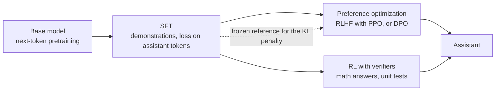

## The hook

Type "What is the capital of France?" into a freshly pretrained base model and a common result is not "Paris". It is more questions: "What is the capital of Germany? What is the capital of Spain?" The model has seen thousands of quiz pages, and continuing the list is a perfectly good next-token prediction.

In the InstructGPT paper, human labelers preferred the answers of a 1.3B-parameter model that had been post-trained over the answers of the 175B-parameter GPT-3 it was compared with, a model more than 100 times larger. Same architecture, same kind of pretraining. The difference was a few comparatively cheap training stages at the end. This lesson is about those stages, and about the ways they go wrong.

## The simple explanation

Pretraining produces someone who has read the whole library but has never had a job. Post-training is the job onboarding:

1. **Supervised fine-tuning (SFT):** shadow a senior colleague. You see example conversations and learn to produce the answer they gave.
2. **Preference optimization:** a manager reads two of your drafts and says which one is better. You learn what "better" means here.
3. **Reinforcement learning with verifiers:** you get tasks with an answer key, such as a sum or a failing test suite, and you are graded only on whether you got it right.

Where the analogy breaks: the model does not learn new facts in onboarding in any reliable way. Post-training mostly reshapes which of the behaviors it already has become likely. And a new hire who notices that the manager likes long reports will start writing long reports, whether or not they are correct. Models do exactly that.

## Under the hood

### Stage 1: supervised instruction tuning

SFT is the same objective as lesson 5: cross-entropy on the next token. Only the data changes. Each example is a conversation rendered into one token sequence with a **chat template**, special tokens that mark where the system, user and assistant turns begin and end.

One detail matters: the loss is **masked** so only assistant tokens count. The model reads the system prompt and the user turn as context, but it is not trained to produce them. In PyTorch this is usually done by setting those label positions to `-100`, the default `ignore_index` of the cross-entropy loss.

```
loss = mean over assistant tokens t of  -log p(token_t | all previous tokens)
```

What SFT changes: the model now answers instead of continuing, stops at the end of its turn, follows the format of the demonstrations and adopts their tone. Its ceiling is the quality of the demonstrations: it imitates them, mistakes included.

### Stage 2: preference optimization with a reward model

Writing perfect demonstrations is expensive. Comparing two answers is cheap and more reliable. InstructGPT collected rankings of model outputs and trained a **reward model**, a copy of the language model with a scalar head, so that the preferred answer `y_w` scores higher than the rejected one `y_l`:

```
reward_model_loss = -log sigmoid( r(x, y_w) - r(x, y_l) )
```

Then the SFT model is optimized with **PPO**, a policy-gradient reinforcement learning algorithm: sample answers, score them with the reward model, and push up the probability of high-scoring ones. That is **RLHF**. It works, but it runs four models at once (policy, reference, reward model and a value model) and it is sensitive to hyperparameters.

### Direct preference optimization

DPO (Rafailov et al., 2023) showed that the KL-constrained RLHF objective has a closed-form optimum, `pi*(y|x) ∝ pi_ref(y|x) · exp(r(x, y) / beta)`. Invert that and the reward is just `beta · log(pi / pi_ref)` plus a term that cancels in comparisons. Substituting into the reward model loss gives a loss on the policy itself:

```
margin   = beta * ( log pi(y_w)/pi_ref(y_w) - log pi(y_l)/pi_ref(y_l) )
dpo_loss = -log sigmoid(margin)
```

No reward model, no sampling, no value model: just two forward passes per pair (policy and frozen reference) and ordinary gradient descent. `beta` sets how far the policy may move. A small `beta` means a big change in log-probabilities is needed to produce the same margin, so the policy drifts further from the reference.

### Reinforcement learning with verifiers

For some tasks you do not need a learned judge: you can check the answer. A math problem has a final number, code has unit tests, a SQL query has an expected result set. The reward is 1 if the checker passes and 0 otherwise. This is how much of the recent reasoning-model training works: DeepSeek-R1-Zero was trained with rule-based rewards for answer correctness and output format only, and its authors reported that responses grew longer as training went on, without anyone asking for longer responses.

A verifier is much harder to fool than a learned reward model, but it only covers tasks with checkable answers, and it only checks what it checks. A test suite that does not cover an edge case rewards code that gets it wrong.

### The KL leash and reward hacking

A reward model is a neural network trained on a limited set of comparisons. Push a policy hard against it and the policy finds the places where the reward model is wrong: answers that score high and are not good. That is **reward hacking**. Gao et al. (2022) measured it: as optimization continues, the learned reward keeps rising while the true quality, judged by a stronger "gold" reward model, rises and then falls.

The standard defense is a penalty on the KL divergence from the reference model, usually the SFT model:

```
objective = E[ r(x, y) ] - beta * KL( pi || pi_ref )
```

It keeps the policy close to the distribution where the reward model was trained and is still roughly accurate, and it preserves the fluency and diversity of the reference. The penalty limits the damage. It does not fix a biased reward.



### What each stage changes

| Stage | Data | What it changes in behavior | Typical failure |
|---|---|---|---|
| Pretraining | Raw text | Knowledge, language, continuation | Continues instead of answering |
| SFT | Demonstration conversations | Answers in turns, format, stopping | Copies demonstration errors and style |
| Preferences (RLHF, DPO) | Pairs of better and worse answers | Tone, helpfulness, refusals, ranking among plausible answers | Verbosity, flattery, over-refusal |
| RL with verifiers | Problems with a checker | Accuracy on checkable tasks, longer reasoning | Gaming the checker, long outputs |

## The engineering connection

- **Base or instruct.** For chat, extraction or tools, use the instruct model. A base model is the right starting point only if you will run your own SFT.
- **Use the exact chat template.** The model was post-trained on one specific token layout. A hand-built prompt with the wrong role markers is out of distribution and quietly degrades quality. Let the tokenizer or the provider SDK render it.
- **Mask your fine-tuning loss.** If you fine-tune on conversations without masking, you also train the model to generate user turns and your system prompt.
- **Verbosity and flattery are trained in.** Raters and reward models tend to favor longer, more agreeable answers. Expect it, and when you use an LLM as a judge in your evaluations (next lesson), control for length.
- **Preference data is cheaper than demonstrations.** If your team can say "A is better than B" faster than it can write the ideal answer, DPO on those pairs is a practical next step after SFT. Open-source libraries such as Hugging Face TRL implement both.
- **Treat any automatic reward as an attack surface.** If you train or select outputs against a grader, a test suite or a judge model, keep a held-out check the optimizer never sees.

## Hands-on challenge

File: `courses/ai-engineering/exercises/lesson_10_post_training.py`. NumPy only, every gradient written by hand. A toy policy is a softmax over a short menu of candidate answers per prompt; the script runs SFT, then DPO against a frozen reference for two values of `beta`, then optimizes a flawed reward and a verifier with and without a KL penalty. About 12 minutes.

**Predict before you run:**

1. The toy conversation has a system prompt, a user turn and an assistant turn. What fraction of its words count in the SFT loss?
2. After 30 SFT steps, how likely are the demonstrated answers?
3. DPO with `beta = 0.5` and `beta = 0.1` on the same preferences: which ends farther from the reference? Will the implied reward margin differ?
4. The flawed reward adds 0.15 per word to correctness. With no KL penalty, what is the final accuracy?
5. Does a KL coefficient of 2.0 bring accuracy back to the reference level?

::: predict
P: sft30 | number | claim:sft30 | 0.1 | After 30 SFT steps, what is the mean probability of the demonstrated answers?
P: beta | choice:small=beta 0.1;large=beta 0.5;same=About the same | small | | Which beta ends with the larger KL to the reference?
P: hack | number | claim:acc_kl0 | 0.1 | Flawed reward, no KL penalty: what accuracy does the policy end with?
:::

The run command is at the bottom of this page.

<details>
<summary>What the script printed for me (open after predicting)</summary>

- Only {{claim:loss_words}} of the {{claim:total_words}} words are assistant words, so half of this conversation is context the loss ignores.
- SFT raises the mean probability of the demonstrated answer from {{claim:sft0}} to {{claim:sft30}} in 30 steps. It is plain cross-entropy with gradient `p - onehot(y)`, exactly as in lesson 5.
- DPO, 80% of raters prefer "example" over "terse": with `beta = 0.5` the policy puts {{claim:dpo_example_b05}} on "example". Both runs end with the same implied reward margin, {{claim:margin}}, which is `ln(0.8/0.2)`: DPO fits the preference odds. To get there, the log-ratio gap moves {{claim:gap_b05}} with `beta = 0.5` and {{claim:gap_b01}} with `beta = 0.1`, five times as far, and the KL to the reference grows from {{claim:kl_b05}} to {{claim:kl_b01}}.
- With `beta = 0.1` the "off-topic" answer, which is in no pair, also drops to almost nothing. In this toy it only changes through the softmax normalization, which is a reminder that DPO moves responses it was never shown.
- Flawed reward: the reference answers correctly {{claim:ref_acc}} of the time. With no KL penalty the policy puts {{claim:long_kl0}} on the long wrong answer and accuracy falls to {{claim:acc_kl0}}. With a KL coefficient of 2.0 accuracy is {{claim:acc_kl2}}: close to the reference, still below it. The leash limits the damage, it does not undo the bias.
- With the verifier as reward and a KL coefficient of 0.5, accuracy rises to {{claim:acc_verifier}}. A reward you can check beats a reward you have to learn, when you have one.

</details>

Follow-ups: change the 0.15 per-word bonus to 0.05 and find the smallest KL coefficient that keeps accuracy at the reference level. Make the DPO preferences 100% instead of 80% and watch the margin keep growing instead of converging. Replace the verifier with one that only checks that the answer contains "42" anywhere, and write a candidate that games it.

## Takeaways

1. SFT is ordinary next-token training on curated conversations with the loss masked to the assistant's tokens. It teaches format and turn-taking, and its ceiling is the demonstrations.
2. Preference optimization learns from "A is better than B". RLHF trains a reward model and optimizes it with PPO; DPO folds both into one loss against a frozen reference, with `beta` controlling how far the policy moves.
3. Any reward you optimize hard will be exploited where it is wrong. A KL penalty to the reference limits the drift, and a verifier with checkable answers is harder to fool than a learned judge.

**Check question:** after a round of preference tuning, your support assistant's answers are 40% longer and users rate them higher, but ticket resolution has not improved. What happened, and what would you change in the reward or the evaluation?

**Next up:** measuring what you built. Evaluating LLM applications, including how to keep an LLM judge from rewarding length.

::: quiz
Q: In SFT, why is the loss masked to the assistant tokens?
A: The goal is to train the model to produce answers, not to produce user turns or system prompts. Those tokens are context: the model reads them, but they do not contribute to the loss.
Q: What does DPO remove compared with RLHF with PPO?
A: The separately trained reward model, sampling from the policy during training, and the value model. DPO optimizes a classification-style loss on preference pairs directly, using a frozen reference model.
Q: What happens if you drop the KL penalty when optimizing against a learned reward model?
A: The policy drifts to wherever the reward model scores highest, including answers it scores wrongly. The learned reward keeps rising while real quality falls: reward hacking.
Q: Why is reinforcement learning with verifiers mostly used for math and code?
A: Those tasks have answers a program can check, such as a final number or a test suite, so the reward does not depend on a learned judge that can be fooled. Open-ended tasks rarely have such a checker.
:::

## References

- Ouyang et al., "Training language models to follow instructions with human feedback" (2022), InstructGPT, SFT then reward model then PPO: https://arxiv.org/abs/2203.02155
- Rafailov et al., "Direct Preference Optimization: Your Language Model is Secretly a Reward Model" (2023): https://arxiv.org/abs/2305.18290
- Schulman et al., "Proximal Policy Optimization Algorithms" (2017): https://arxiv.org/abs/1707.06347
- Gao, Schulman and Hilton, "Scaling Laws for Reward Model Overoptimization" (2022): https://arxiv.org/abs/2210.10760
- DeepSeek-AI, "DeepSeek-R1: Incentivizing Reasoning Capability in LLMs via Reinforcement Learning" (2025): https://arxiv.org/abs/2501.12948
