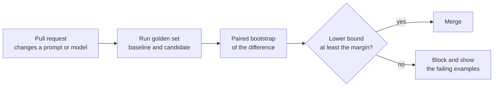

## The hook

You rewrite a system prompt, run your 50-example test set, and the score drops from 80% to 76%. You revert the change and move on.

In the exercise, that exact story happens to a prompt that is genuinely better: the candidate's true accuracy is 82% against the baseline's 80%. On 50 examples the candidate scored {{claim:n50_candidate}}, and the paired difference came out as {{claim:n50_diff}}. The interval is wide enough to hold a big regression and a big improvement at the same time. The test set did not tell you the prompt was worse. It told you nothing, and you read it as a verdict.

## The simple explanation

An evaluation set is a unit test suite whose assertions are probabilistic. Each example is one noisy sample of how the system behaves, and the score is an estimate with an error bar, the same way a p95 latency measured over 50 requests is an estimate.

The analogy breaks in two places. A unit test is deterministic and either passes or fails; an LLM answer can be partly right and the same input can produce different outputs. And for open-ended answers, the thing that decides "right" is often another model, which has its own systematic errors. So you have to measure the grader as well as the system.

## Under the hood

### Golden sets: building and labeling

A golden set is a fixed, versioned list of inputs with the expected output or the criteria a good output must meet.

- **Sources.** Sample real production inputs (stratified by intent, language and user segment), add hand-written edge cases, and add every bug a user ever reported. Synthetic inputs from an LLM are useful for coverage but drift toward what models find easy.
- **Labeling.** Write a labeling guide with examples of pass, fail and borderline. Have two people label the same subset, measure their agreement (Cohen's kappa, below), and fix the guide where they disagree. If two humans cannot agree, no metric will.
- **Hygiene.** Keep a held-out slice you never look at while tuning prompts, or you will overfit the prompt to the set. Version the set next to the code, and record which set version produced every score.

Size buys resolution. Around 50 examples catches outright breakage. A few hundred, scored in pairs, resolves changes of roughly 5 points. Seeing 2 points needs on the order of a thousand, as the next sections show.

### Metrics per task type

| Task | Primary metric | Notes |
|---|---|---|
| Classification, routing | Accuracy, per-class precision and recall | Look at the confusion matrix, not one number |
| Extraction, structured output | Exact match per field, schema validity rate | Normalize dates, casing and whitespace before comparing |
| Retrieval | hit@k, MRR, recall@k | Lesson 6 |
| RAG answers | Correctness against a reference, faithfulness to the retrieved context | Faithful but wrong usually means retrieval failed |
| Code generation | Share of unit tests passed | Execution beats text similarity |
| Open-ended text | Pairwise preference or rubric score, by humans or a judge model | Needs the judge checks below |

Track operational metrics next to quality: latency percentiles, tokens and cost per request, refusal rate and error rate. A prompt that is 1 point better and twice as long may be a bad trade.

### Confidence intervals and sample size

The standard error of an accuracy `p` measured on `n` examples is `sqrt(p(1-p)/n)`. At `p = 0.8` and `n = 50` that is 0.057, so the 95% interval is roughly plus or minus 11 points. A 2-point change is invisible inside that.

The **bootstrap** gets an interval without formulas: resample the examples with replacement thousands of times, recompute the metric each time, and take the 2.5th and 97.5th percentiles. When you compare two versions on the same examples, use a **paired** bootstrap: resample example indices once and compute both versions on the same resample. Pairing cancels the per-example difficulty that both versions share, and only the examples where the two versions disagree carry information.

In the exercise, the paired difference is {{claim:n500_diff}} at 500 examples and {{claim:n2000_diff}} at 2000. Only at 2000 does the interval exclude zero. The script also computes how many examples give a plus or minus 2 point interval on the difference: {{claim:paired_needed}} paired, {{claim:unpaired_needed}} if the two versions were scored on different examples.

### LLM as a judge and its biases

For open-ended outputs, a strong model can grade answers, either one at a time against a rubric or in pairs ("which answer is better?"). Zheng et al. (2023) studied this with MT-Bench and Chatbot Arena and found that a strong judge agreed with human preferences about as often as humans agreed with each other. They also documented systematic biases:

- **Position bias:** the judge favors the answer in a particular slot, often the first.
- **Verbosity bias:** longer answers are preferred even when the extra text adds nothing.
- **Self-enhancement bias:** a model tends to favor answers written by itself.
- **Weak grading of math and reasoning,** where the judge can be misled by a confident wrong solution.

In the exercise, a judge with a built-in preference for the first slot changes its verdict on {{claim:flip_rate}} of the pairs when you swap the order, and on {{claim:first_both}} it picked whichever answer was shown first both times.

### Mitigations: swap, rubrics, calibrate

- **Swap the order.** Judge every pair in both orders. Keep the verdict only when both agree, and count a disagreement as a tie. In the exercise, agreement with humans rises from {{claim:agree_one}} with one order to {{claim:agree_consistent}} on consistent verdicts, but those cover only {{claim:consistent_share}} of the pairs. The consistent pairs are also the easier ones, so part of that gain is selection: report coverage next to agreement.
- **Rubrics.** Ask for specific, checkable criteria ("cites a source from the context", "answers in under 100 words") with a score per criterion, instead of "rate 1 to 10". Provide a reference answer when you have one. Use a judge from a different model family than the system under test to limit self-preference.
- **Calibrate against humans.** Label a few hundred examples by hand and measure judge-human agreement with **Cohen's kappa**, `(observed - chance) / (1 - chance)`, which subtracts the agreement you would get by luck. When most answers are good, a judge that always says "pass" agrees with humans exactly as often as humans say pass, {{claim:raw_always}} in the exercise, and has a kappa of 0. The exercise's real judge has raw agreement {{claim:raw_real}} but kappa {{claim:kappa_real}}, because it waves through many of the failures. Recalibrate whenever the judge model or the rubric changes.

### Regression tests and observability

A regression gate turns this into a CI check: score the baseline and the candidate on the same golden set, compute a paired interval on the difference, and block the merge when the lower bound falls below a margin you chose in advance. The exercise uses a margin of minus 2 points.

A candidate that is truly 3 points worse, scored on 500 examples, gives {{claim:regressed_diff}}. The interval still includes zero, so a plain "is it significantly worse?" test would let it through. The margin gate blocks it. The cost of that strictness is visible in the first result: with only 50 examples even a better prompt fails the gate, because an uninformative interval cannot prove anything is safe.

This site does the same thing to its own search. The build runs a labeled set of learner questions against the "Ask the course" search and fails if hit@3 or MRR fall below per-language thresholds; the Quality page shows the latest numbers.

Offline sets only cover what you thought of. **Observability** covers the rest: for every production call, log the prompt template name and version, the model and its parameters, the full input and output (within your privacy policy), retrieved document IDs, tool calls, tokens, latency, cost and any user feedback, all tied together by a trace ID with one span per step. OpenTelemetry has semantic conventions for generative AI spans. Then close the loop: when a trace shows a failure, add that input to the golden set.

## The engineering connection

- **Never compare two scores without intervals.** A dashboard that shows 80% versus 82% with no error bars invites wrong decisions. Show the paired difference and its interval.
- **Size the set for the change you care about.** If product decisions hinge on 2-point changes, you need roughly a thousand paired examples. If you only have 50, use them as a smoke test for breakage and say so.
- **Pair everything.** Score both versions on the same inputs, with the same judge, in the same run. Unpaired comparisons need about three times as many examples for the same precision.
- **Treat the judge as a dependency.** Pin its model version, version the rubric, swap pair order, and track its kappa against a human-labeled slice. A judge upgrade can move every score without the product changing.
- **Gate on a margin chosen in advance.** Moving the threshold after seeing the result turns the gate into a formality.
- **Log prompt versions like deploy versions.** When quality drops in production, the first question is which prompt, model and retrieval index served that request.

## Hands-on challenge

File: `courses/ai-engineering/exercises/lesson_11_evaluating_llm_apps.py`. NumPy only, with seeded synthetic data. It simulates two versions of an app on golden sets of 50, 500 and 2000 examples with bootstrap intervals and a regression gate, then a pairwise judge with position bias, then judge-human agreement with Cohen's kappa. About 15 minutes.

**Predict before you run:**

1. The candidate is truly 2 points better. With 50 examples, how wide will the interval on the difference be, and could the candidate even score lower?
2. At what set size will the interval on the difference exclude zero: 50, 500 or 2000?
3. A judge has a fixed bonus for the first slot. In what share of pairs will swapping the order change its verdict?
4. A judge that always says "pass" on a set where most answers pass: what is its raw agreement with humans, and what is its kappa?

::: predict
P: needed | number | claim:paired_needed | 150 | How many paired examples give a plus or minus 2 point interval on a difference near 2 points?
P: flips | number | claim:flip_rate | 0.1 | In what share of pairs does the biased judge change its verdict when the order is swapped?
P: kappa | number | claim:kappa_real | 0.1 | The real judge matches the human labels on most items. What is its Cohen's kappa?
P: gate | choice:pass=Pass;fail=Fail | fail | | The truly 3-point-worse candidate on 500 examples: does the margin gate pass or fail it?
:::

The run command is at the bottom of this page.

What the script printed for me (open after predicting)

- Paired difference, true value +0.02: {{claim:n50_diff}} at n=50, {{claim:n500_diff}} at n=500, {{claim:n2000_diff}} at n=2000. At 50 examples the observed sign is wrong; only at 2000 is zero outside the interval.
- Examples for a plus or minus 2 point interval: {{claim:paired_needed}} paired, {{claim:unpaired_needed}} unpaired. The approximation uses the true rates, which is how you would size a set before collecting it.
- The truly worse candidate: {{claim:regressed_diff}}, blocked by the gate even though the interval includes zero.
- Position bias: verdict flips {{claim:flip_rate}}, first slot both times {{claim:first_both}}. Agreement with humans {{claim:agree_one}} for one order, {{claim:agree_consistent}} on consistent pairs, which are {{claim:consistent_share}} of all pairs.
- Kappa: the always-pass judge agrees {{claim:raw_always}} and scores 0; the real judge agrees {{claim:raw_real}} and scores {{claim:kappa_real}}.

Follow-ups: set `position_bias` to 0 and see how many flips remain from noise alone. Change the human pass probability from 0.85 to 0.5 and watch raw agreement and kappa move closer together. Find the smallest set size at which the truly better candidate passes the gate in most seeds.

## Takeaways

1. An evaluation score is an estimate with an interval. At 50 examples the 95% interval is about plus or minus 11 points, so 2-point changes need roughly a thousand paired examples.
2. LLM judges have position, verbosity and self-preference biases. Swap the order, use specific rubrics, and calibrate against human labels with kappa, not raw agreement.
3. Gate releases on the lower bound of a paired difference, and log prompt versions and traces in production so new failures feed the golden set.

**Check question:** your judge agrees with human labels 92% of the time on a set where 90% of answers are good. Is it a good judge? What would you compute before trusting it?

**Next up:** prompt injection and LLM security, where the inputs your evaluation never anticipated are written on purpose by an attacker.

::: quiz
Q: Version B scores 84% and version A 82% on the same 100 examples. Can you ship B as an improvement?
A: Not on that evidence. The standard error at 100 examples is around 4 points per version, and the paired interval on a 2-point difference will almost certainly include zero. Report the paired interval and either collect more examples or treat the change as neutral.
Q: Why does a paired bootstrap give a narrower interval than comparing two independent intervals?
A: Both versions are scored on the same examples, so the variation from easy and hard examples cancels. Only the examples where the versions disagree contribute to the uncertainty of the difference.
Q: How do you detect and reduce position bias in a pairwise judge?
A: Judge every pair in both orders and measure how often the verdict flips. Keep only verdicts that agree in both orders and count the rest as ties, and report how many pairs that leaves.
Q: Why use Cohen's kappa instead of raw agreement to validate a judge?
A: Raw agreement is inflated when one label dominates. Kappa subtracts the agreement expected by chance, so a judge that always gives the majority label scores 0 even with high raw agreement.
:::

## References

- Zheng et al., "Judging LLM-as-a-Judge with MT-Bench and Chatbot Arena" (2023): https://arxiv.org/abs/2306.05685
- Miller, "Adding Error Bars to Evals: A Statistical Approach to Language Model Evaluations" (2024): https://arxiv.org/abs/2411.00640
- Cohen, "A Coefficient of Agreement for Nominal Scales", Educational and Psychological Measurement (1960): https://doi.org/10.1177/001316446002000104
- OpenTelemetry, Semantic conventions for generative AI systems: https://opentelemetry.io/docs/specs/semconv/gen-ai/
