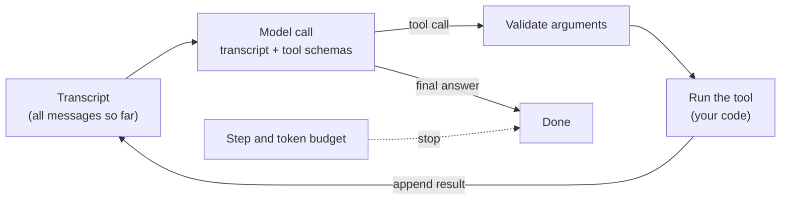

## The hook

The model never runs your tools. It cannot query your database, call your API or add two numbers with a calculator. All it can do is return a piece of structured output that says "I would like `inventory_lookup` called with `{"sku": "SKU-42"}`". Your code decides whether to run it, runs it, and pastes the result back into the conversation.

That is the whole trick behind an "agent": a `while` loop in your code, around a model that emits tool requests. And it has a cost that surprises most people the first time they read a bill. In this lesson's exercise, the same question answered by an agent and by a fixed sequence of code uses {{claim:ratio}} times as many tokens when an agent does it, for the identical answer.

## The simple explanation

Think of a support engineer on a phone call with a senior colleague who cannot see any screens. The colleague says "look up the order". The engineer reads the result aloud. "Now check stock for the dock." The engineer reads that back too. After a few rounds the colleague says "tell the customer it ships short by one". The colleague is the model, the engineer is your loop, and the call notes are the transcript.

A **workflow** is the opposite arrangement: the engineer follows a runbook (look up the order, check every line, compute the total) and only asks the colleague to phrase the final email.

Where the analogy breaks: the colleague has no memory between sentences. Every time you ask for the next step, you have to read the entire call notes back from the start. That is literally how chat APIs work, and it is why agent cost grows faster than the number of steps.

## Under the hood

### The loop

An agent is a model call inside a loop. Each iteration sends the full transcript plus the tool definitions, and the model replies with either a tool call or a final answer:

```python
messages = [{"role": "user", "content": task}]
for step in range(max_steps):
    reply = model(tools=TOOLS, messages=messages)
    messages.append(reply)
    if not reply.get("tool_calls"):
        return reply["content"]
    for call in reply["tool_calls"]:
        result = run_tool(call["name"], call["arguments"])
        messages.append({"role": "tool", "tool_call_id": call["id"], "content": json.dumps(result)})
return "stopped: step budget"
```

The ReAct paper (Yao et al., 2022) framed this pattern as interleaving reasoning with actions, where each observation from the environment shapes the next step. Provider APIs differ in field names (a `tool_use` content block and a `stop_reason` of `tool_use` in Anthropic's Messages API, a `tool_calls` list and a `tool` role in others), but the shape is the same: the model proposes, your code disposes.



### Tool schemas

A tool definition is a name, a description and a JSON Schema for its parameters. This is structured output (lesson 8) pointed at your own functions:

```json
{"name": "inventory_lookup",
 "description": "Return stock and unit price for a SKU.",
 "parameters": {"type": "object",
                "properties": {"sku": {"type": "string"}},
                "required": ["sku"]}}
```

The description is part of the prompt. The model picks tools by reading names and descriptions, so vague ones ("helper", "process data") produce wrong calls. The schema is also not a guarantee: validate the arguments in your loop before running anything, exactly as you would validate a request body in an ASP.NET controller. The exercise does this and returns a tool error instead of throwing. And every definition is resent on every call: the exercise's three small tools already cost {{claim:tooldefs}} tokens per call.

### The transcript is the state

The model is stateless. The only memory the agent has is the `messages` list your code keeps and resends. There is no hidden session on the provider side that "remembers" what the tool returned unless you put it back. That has three consequences:

- Every step makes the prompt longer. In the exercise the first call sends {{claim:prompt1}} tokens and the sixth sends {{claim:prompt6}}. Total tokens over `n` steps grow roughly with `n²`.
- To persist, resume or debug a run, you store the transcript. It is your audit log.
- Anything a tool returns, including text a stranger wrote, becomes model input on the next turn. Lesson 12 covers why that matters.

### Termination

A loop needs exit conditions you control. The normal exit is a reply with no tool call: the model's final answer. The others are budgets your code enforces:

| Exit | Who decides | What it protects |
|---|---|---|
| Final answer | The model | Nothing; it is the happy path |
| Step budget (`max_steps`) | Your code | Infinite loops, repeated failing calls |
| Token or cost budget | Your code | Your bill and latency |
| Wall-clock timeout | Your code | Users waiting, stuck tools |

When a budget fires, return a clear "stopped" result rather than a guess. A partial answer that pretends to be complete is worse than an honest failure.

### Agent versus workflow

Anthropic's "Building effective agents" (2024) draws the line this way: in a **workflow**, LLMs and tools are orchestrated through predefined code paths; in an **agent**, the model directs its own process and tool use. Put plainly: who chooses the next step, your code or the model?

If you can write the steps down in advance, as with "look up the order, check each line, sum the prices", code should choose them. You get one model call instead of several, deterministic control flow, unit tests, and errors that throw where you can see them. Agents earn their cost when the path genuinely depends on what the tools return and cannot be enumerated: open-ended debugging, research, multi-system investigations. The same article recommends starting with the simplest thing that works and adding agentic behavior only when it measurably helps.

## The engineering connection

- **Cost model.** Agent cost is the sum over steps of (system prompt + tool definitions + transcript so far). Long tool results, many tools and many steps multiply each other. Trim tool output to what the model needs, and use prompt caching where your provider offers it, since the prefix repeats on every call.
- **Always set budgets.** `max_steps`, a token ceiling and a timeout belong in the first version, not after the first incident. Log which one fired.
- **Validate, then execute.** Treat tool arguments as untrusted input. Check types and required fields, enforce permissions in the tool itself, and return errors as tool results so the model can recover.
- **Return useful errors.** `{"error": "unknown sku"}` gives the model nothing to act on. `"unknown sku SKU-99; valid SKUs look like SKU-08"` might. A model that keeps retrying the same failing call is a common, budget-burning failure.
- **Prefer workflows for known paths.** Most business processes (order checks, document pipelines, triage with fixed categories) are workflows with one or two model calls. Use an agent for the part where the path really is unknown, and keep it small.
- **Keep the trace.** Store every step (tool, arguments, result, tokens). It is the only way to debug an agent, and lesson 15 builds on it.

## Hands-on challenge

File: `courses/ai-engineering/exercises/lesson_13_first_agent.py`. Standard library only. It implements the agent loop with chat-style message dicts, three tools with JSON-Schema-like parameters (an order lookup, an inventory lookup over an in-script table and a safe calculator) and a scripted policy that reads the transcript and decides the next call. The policy is a deterministic stand-in for an LLM, so the run is repeatable; tokens are estimated as characters of the JSON payload divided by 4, which is a rough rule, not a real tokenizer. It solves one task as an agent and as a workflow, then hits a token budget and a step budget. About 10 minutes.

**Predict before you run:**

1. Order A-1001 has three lines. How many model calls will the agent need, counting the one that writes the final answer?
2. How many model calls does the workflow need for the same answer?
3. How many times more tokens will the agent use than the workflow?
4. In task 2 the order contains a SKU that is not in the inventory, and the policy retries failed lookups. Which exit stops it?

::: predict
P: calls | number | claim:agent_calls | 0 | How many model calls does the agent make for order A-1001?
P: ratio | number | claim:ratio | 4 | How many times more tokens does the agent use than the workflow?
P: exit | choice:answer=The final answer;steps=The step budget;tokens=The token budget | steps | | Which exit stops task 2?
:::

The run command is at the bottom of this page.

<details>
<summary>What the script printed for me (open after predicting)</summary>

- The agent's trace: one `order_lookup`, three `inventory_lookup` calls, then `calculator` with `{{claim:calc_expr}}`, then a final answer. {{claim:agent_calls}} model calls in total.
- Both paths answer "{{claim:agent_answer}}".
- Agent: {{claim:agent_calls}} model calls, {{claim:agent_tokens}} tokens. Workflow: {{claim:workflow_calls}} model call, {{claim:workflow_tokens}} tokens. Ratio {{claim:ratio}}. Part of the gap is that the workflow's single call needs no tool definitions; most of it is the transcript being resent on every step, from {{claim:prompt1}} tokens on the first call to {{claim:prompt6}} on the last.
- With a 1500-token budget the same task ends with "{{claim:token_budget}}". The loop checks the budget before each call, so it refuses to start a call it cannot afford.
- Task 2 repeats the same failing lookup until "{{claim:loop_result}}". A real model may well behave better, but nothing guarantees it; the budget does.

</details>

Follow-ups: make the inventory tool return a helpful error that lists valid SKUs and teach the policy to give up after one failure. Let the policy request all three inventory lookups in one reply (parallel tool calls) and compare the token count. Add a fourth tool that the policy never needs and watch every prompt grow.

## Takeaways

1. An agent is a loop in your code: call the model with the transcript and tool schemas, run the tool it asks for, append the result, repeat until a final answer or a budget stops it.
2. The transcript is the only state. Resending it on every step makes agent cost grow faster than the step count, so budgets and trimmed tool output are mandatory.
3. In a workflow your code chooses the steps; in an agent the model does. Use a workflow whenever you can write the steps down.

**Check question:** a teammate proposes an agent with ten tools to process incoming invoices, which always go through the same four checks. What would you build instead, and where, if anywhere, would a model call still belong?

**Next up:** MCP, a standard protocol for exposing tools and data to models so you do not hand-write every tool definition for every application.

::: quiz
Q: Who executes a tool call in an agent: the model or your code?
A: Your code. The model only returns structured output naming a tool and its arguments. Your loop validates the arguments, runs the tool and appends the result to the transcript.
Q: Why does an agent's token usage grow faster than its number of steps?
A: The model is stateless, so every call resends the whole transcript plus the tool definitions. Each step's prompt is longer than the last, and the total over `n` steps grows roughly with `n²`.
Q: Name two exit conditions your code should enforce, besides the model's final answer.
A: A step budget (maximum model calls) and a token or cost budget. A wall-clock timeout is a third. They stop loops such as a model retrying the same failing call.
Q: What separates an agent from a workflow?
A: Who decides the next step. In a workflow the steps are predefined in code and the model fills in parts; in an agent the model chooses which tool to call next based on the results so far.
:::

## References

- Yao et al., "ReAct: Synergizing Reasoning and Acting in Language Models" (2022), interleaving reasoning and tool actions: https://arxiv.org/abs/2210.03629
- Anthropic, "Building effective agents" (2024), workflows versus agents and when to use each: https://www.anthropic.com/research/building-effective-agents
- Schick et al., "Toolformer: Language Models Can Teach Themselves to Use Tools" (2023), models learning when to call APIs: https://arxiv.org/abs/2302.04761
- JSON Schema, the specification tool parameters are written in: https://json-schema.org/
