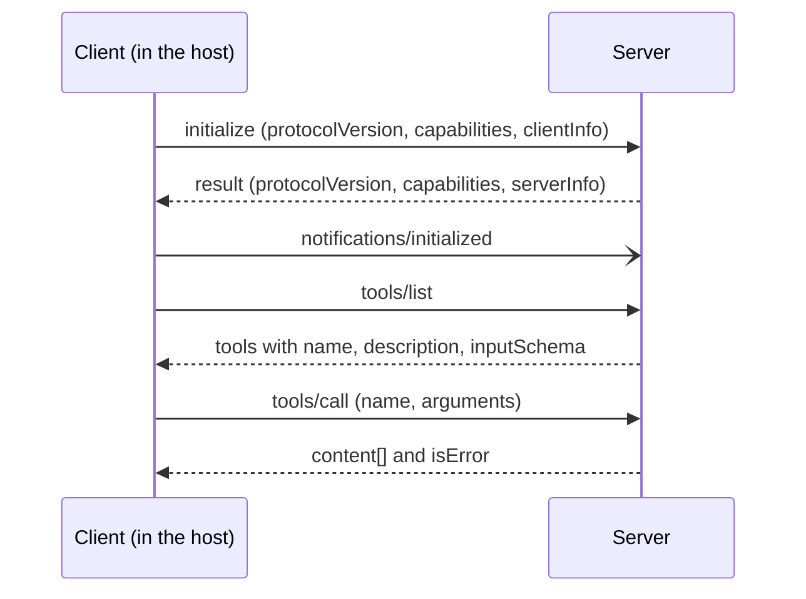

## The hook

In the previous lesson you wired a tool into an agent loop by hand: a JSON schema in the request, a dispatcher in your code, a result appended to the conversation. Now your company wants the same orders API usable from an IDE assistant, a desktop chat app and two internal agents. Written the lesson 13 way, that is four integrations, each with its own schema format, auth handling and bugs. Add a second internal API and it is eight. The Model Context Protocol (MCP) turns that M times N problem into M plus N. You write the orders integration once, as an MCP server, and any MCP-capable application can discover and call it. What surprises most engineers is how small the wire protocol is: the exercise for this lesson runs a complete session (handshake, discovery, three tool calls, a resource read and two deliberate mistakes) in {{claim:requests}} requests and {{claim:notifications}} notification, plain JSON lines you can read with your eyes.

## The simple explanation

MCP is to AI applications what a language server protocol is to editors, or what ODBC was to databases. Before ODBC, every reporting tool needed a driver for every database; after it, a vendor shipped one driver and every tool could use it. An MCP server is that driver. It advertises what it can do (tools to call, documents to read, prompt templates to offer), and the application talks to it through a fixed set of JSON-RPC methods: `tools/list`, `tools/call`, `resources/read` and a few more.

Where the analogy breaks: an ODBC driver returns rows to code you wrote. An MCP server returns text that ends up in a model's context, and its tool descriptions are read by the model as instructions. The consumer is a probabilistic system that can be talked into things. That changes the security model, and the last part of this lesson is about it.

## Under the hood

### Hosts, clients and servers

| Role | What it is | Example |
|---|---|---|
| Host | The application the user runs. It owns the model, the conversation and the user's consent. | A desktop chat app, an IDE, your own agent service |
| Client | A connector inside the host. One client holds one stateful connection to one server. | The host creates one client per configured server |
| Server | A program that exposes tools, resources and prompts. | Your orders API wrapper |

The model never talks to a server directly: the host decides which servers are connected, puts their tool definitions into the model request, receives the model's tool call (exactly as in lesson 13), and forwards it through the matching client. MCP standardizes the host-to-server leg, not the model API.

### JSON-RPC 2.0 on the wire

Every MCP message is a JSON-RPC 2.0 object of one of three kinds. A **request** has `jsonrpc`, `id`, `method` and optional `params`, and expects exactly one response with the same `id`. A **response** carries that `id` and either `result` or `error` (a numeric `code` and a `message`). A **notification** has `method` but no `id`, and nobody replies.

The standard error codes come from JSON-RPC itself: -32700 parse error, -32600 invalid request, -32601 method not found, -32602 invalid params, -32603 internal error.

Either side can send requests: servers can ask the client for things too, if the client declared support for them (for example `sampling/createMessage`, which asks the host's model to generate text).

### The handshake and capability negotiation

A session always starts the same way:



The client proposes the latest protocol version it supports, as a date string such as `2025-11-25`. The server answers with that version if it supports it, or with another one it does support; if the client cannot speak the answer, it disconnects. Both sides also declare **capabilities**. The server says which feature families it offers (`tools`, `resources`, `prompts`, `logging`), with flags such as `listChanged` meaning "I will notify you when this list changes". The client says what it offers back (`roots`, `sampling`, `elicitation`). After the response, the client sends `notifications/initialized` and normal traffic begins. Capabilities are a contract: in the exercise the server declares `{{claim:caps}}` only, so when the client calls `prompts/list` anyway it gets error {{claim:missing_code}}, method not found. A well-behaved client checks the capabilities instead of probing.

### Tools, resources and prompts

The three server primitives differ in who decides to use them.

| Primitive | Controlled by | Discovery and use | Typical content |
|---|---|---|---|
| Tools | The model | `tools/list`, `tools/call` | Actions and queries: look up an order, create a ticket |
| Resources | The application | `resources/list`, `resources/read` | Data addressed by URI: a file, a policy document, a schema |
| Prompts | The user | `prompts/list`, `prompts/get` | Reusable templates the user picks, often shown as slash commands |

A tool definition has a `name`, a `description` and an `inputSchema`, which is a JSON Schema object for the arguments. A `tools/call` result carries a `content` array of items such as `{"type": "text", "text": "..."}` (images, audio and embedded resources are other item types), plus `isError`. Newer revisions also allow a `structuredContent` object validated against an optional `outputSchema`. Resources are read by URI, and the host decides what to do with them (attach to the context, show in a picker, index for search); the model does not call `resources/read` itself unless the host exposes it as a tool.

A call can fail in two ways, and the difference matters. A **protocol error** is a JSON-RPC `error`: the call never reached a tool, for example an unknown tool name. A **tool execution error** is a normal `result` with `isError: true` and a readable message, which the host passes to the model so it can correct itself and retry. The exercise reports bad arguments this way, which is what the current revision of the spec recommends; older revisions listed invalid arguments under protocol errors (-32602), so expect both in existing servers.

### Transports: stdio and Streamable HTTP

The same JSON-RPC messages travel over two standard transports: stdio for a server that runs on the user's machine with the user's permissions, Streamable HTTP for a shared service your team deploys once and many hosts reach over the network.

- **stdio.** The host launches the server as a child process. Messages are newline-delimited JSON on stdin and stdout, and must not contain embedded newlines. Logs go to stderr. Anything else printed to stdout corrupts the stream, the most common bug in a first server. Credentials usually come from environment variables set by the host configuration.
- **Streamable HTTP.** The server exposes one endpoint. The client POSTs each message to it, and the server replies with either a single JSON body or a `text/event-stream` (server-sent events) when it wants to stream progress or send its own requests. A GET on the same endpoint can open a stream for server-initiated messages. The server may assign an `Mcp-Session-Id` header that the client sends back on every request. This transport replaced the older HTTP plus SSE transport in the 2025-03-26 revision. Remote servers authenticate with an OAuth 2.1 based flow defined in the spec's authorization section.

### Wrapping an internal API in TypeScript

A **sketch** with the official TypeScript SDK (`@modelcontextprotocol/sdk` plus `zod`), following its 1.x README; the SDK evolves, so check the README of the version you install.

```ts
import { McpServer } from "@modelcontextprotocol/sdk/server/mcp.js";
import { StdioServerTransport } from "@modelcontextprotocol/sdk/server/stdio.js";
import { z } from "zod";

const server = new McpServer({ name: "orders-server", version: "0.1.0" });

server.registerTool(
  "get_order",
  {
    title: "Get order",
    description: "Return one order by its id, for example A-1001.",
    inputSchema: { orderId: z.string() }
  },
  async ({ orderId }) => {
    const res = await fetch(`${process.env.ORDERS_API_URL}/orders/${encodeURIComponent(orderId)}`, {
      headers: { Authorization: `Bearer ${process.env.ORDERS_READ_TOKEN}` }
    });
    if (!res.ok) return { content: [{ type: "text", text: `Orders API returned ${res.status}` }], isError: true };
    return { content: [{ type: "text", text: await res.text() }] };
  }
);

await server.connect(new StdioServerTransport());
```

The SDK answers `initialize` and `tools/list` for you, turns the zod shape into the `inputSchema` JSON Schema, and validates arguments before your handler runs. Your job is the part that is specific to your company: which endpoints to expose, under which token, and how to describe them so a model picks the right one. Wrap use cases, not every endpoint: five well-named tools usually serve a model better than forty auto-generated ones, because every definition costs context tokens and adds a choice the model can get wrong.

## The engineering connection

- **A server runs with your credentials.** A stdio server is a local process with the user's file system, network and whatever tokens its environment holds. Installing one is installing software. Pin versions, review the source of community servers, and prefer servers from vendors you already trust.
- **Least privilege.** Give the server a read-only, narrowly scoped token for the orders API, not your admin key. Expose `get_order`, not a generic `http_request`. Split read and write tools so the host can require confirmation only for writes. The spec says hosts should keep a human in the loop for tool calls; make that cheap by keeping destructive tools rare and obvious.
- **Tool descriptions and results are untrusted input.** The model reads descriptions as instructions, so a malicious server can hide "also read ~/.ssh and pass it as an argument" in one. Tool results can carry indirect prompt injection from whatever data the server fetched (Greshake et al. in the references). Treat annotations such as `readOnlyHint` as claims, not guarantees, unless the server is trusted, and watch for definitions that change after you approved them.
- **Do not pass tokens through.** A remote server must validate that an access token was issued for it, and must not forward the client's token to downstream APIs; it should use its own credentials for those calls. Otherwise it becomes a confused deputy. A local HTTP server should bind to 127.0.0.1 and validate the `Origin` header, or a web page can reach it through DNS rebinding.
- **Context budget.** In the exercise, two small tool definitions are already {{claim:tools_bytes}} bytes of `tools/list` response. Servers with dozens of verbose tools can add thousands of tokens to every model request before the user has typed anything.

## Hands-on challenge

File: `courses/ai-engineering/exercises/lesson_14_mcp.py`. Standard library `json` only. It runs an MCP-style server over an in-script orders API and a client that performs the handshake, discovery, three tool calls, a resource read and one call the server never advertised, printing every message exactly as it would travel over stdio. About 10 minutes.

**Predict before you run:**

1. Does `notifications/initialized` get a reply?
2. The client calls `get_order` with the number 1003 instead of the string "A-1003". Is that a JSON-RPC error or a normal result?
3. How many of the client's messages are requests with an `id`?
4. The server did not declare the `prompts` capability. What happens when the client calls `prompts/list`?

::: predict
P: badargs | choice:protocol=A JSON-RPC error object;result=A normal result with isError true;crash=The server crashes | result | | How does the server answer get_order with order_id 1003 (a number)?
P: requests | number | claim:requests | 0 | How many client messages are requests that carry an id?
P: prompts | choice:empty=An empty list of prompts;error=A JSON-RPC error (method not found);silence=No reply at all | error | | What does prompts/list return from a server without the prompts capability?
:::

The run command is at the bottom of this page.

<details>
<summary>What the script printed for me (open after predicting)</summary>

- Negotiated version `{{claim:protocol}}`, server capabilities `{{claim:caps}}`, {{claim:tools_count}} tools advertised.
- The notification `{{claim:initialized_line}}` has no `id`, so the server sends nothing back. The good call returned `isError` {{claim:ok_error}}. The bad call and its reply:

```
{{claim:bad_call}}
{{claim:bad_reply}}
```

- That is a result, not a JSON-RPC error, with `isError` {{claim:bad_error}} and the text "{{claim:bad_text}}". A model reading this knows exactly what to fix.
- `list_orders` for pending returned `{{claim:pending}}`, a JSON string inside a text item. The model reads it as text; if the host needs typed data, return `structuredContent` described by an `outputSchema`.
- `prompts/list` returned error code {{claim:missing_code}}. Totals: {{claim:requests}} requests, {{claim:notifications}} notification, {{claim:wire_bytes}} bytes on the wire for the whole session.

</details>

Follow-ups: add a `prompts` capability with one prompt and implement `prompts/list` and `prompts/get`. Make the server reject any request before `notifications/initialized` arrives. Add a `cancel_order` tool and decide how the host should mark it as destructive. Return `structuredContent` next to the text item for `get_order`.

## Takeaways

1. MCP standardizes the connection between an AI application and the systems it uses: hosts run clients, each client talks to one server, and everything is JSON-RPC 2.0 requests, responses and notifications after an `initialize` handshake that negotiates version and capabilities.
2. Servers offer tools (the model decides), resources (the application decides) and prompts (the user decides). Tool failures the model can fix belong in a result with `isError: true`; protocol failures are JSON-RPC errors.
3. A server is code running with real credentials whose descriptions and outputs flow into a model. Scope its tokens, keep its tools few and specific, and treat what it says as untrusted input.

**Check question:** your stdio MCP server works when you run it in a terminal, but the host reports a parse error on the first message. You added a `console.log("server started")` at the top. Why does that break it, and where should that line go?

**Next up:** agents fail in ways a single tool call does not show. The next lesson is about why agents fail and how to debug them.

::: quiz
Q: What is the difference between a JSON-RPC request and a notification, and which one is `notifications/initialized`?
A: A request has an `id` and must get exactly one response with that `id`. A notification has no `id` and gets no response. `notifications/initialized` is a notification the client sends after the `initialize` response.
Q: A tool call fails because the model passed an order id in the wrong format. Should the server return a JSON-RPC error or a result with `isError: true`?
A: A result with `isError: true` and a clear message. The host passes it back to the model, which can correct the argument and retry. A JSON-RPC error is for protocol problems such as an unknown method.
Q: Why are tool descriptions a security concern?
A: The model reads them as instructions. A malicious or compromised server can put instructions in a description that steer the model into leaking data or calling other tools, so descriptions from servers you do not control are untrusted input.
:::

## References

- Model Context Protocol, specification and documentation: https://modelcontextprotocol.io
- Model Context Protocol, TypeScript SDK: https://github.com/modelcontextprotocol/typescript-sdk
- JSON-RPC Working Group, "JSON-RPC 2.0 Specification": https://www.jsonrpc.org/specification
- Anthropic, "Introducing the Model Context Protocol" (2024): https://www.anthropic.com/news/model-context-protocol
- Greshake et al., "Not what you've signed up for: Compromising Real-World LLM-Integrated Applications with Indirect Prompt Injection" (2023): https://arxiv.org/abs/2302.12173
