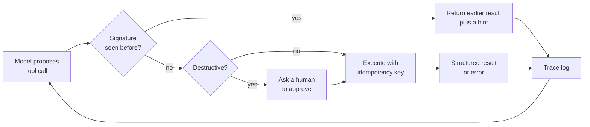

## The hook

Your support agent handles a refund ticket. It looks up the order, updates the address, issues the refund, and then a read call times out. On the next turn the model does not retry the read. It issues the refund again. And again. The harness keeps executing whatever the model asks for, the context window fills with identical tool results, and 40 calls later the run stops with "max iterations reached". The customer got refunded dozens of times, and the dashboard shows one failed task.

Nothing in that story requires a bad model. Each individual call looked reasonable. The failure lives in the loop around the model: what it executes, what it feeds back, and what it refuses to do twice.

## The simple explanation

An agent is a junior colleague working through a checklist with a phone, where every call costs money and some calls move money. A good manager does not just hope the colleague gets every step right. They keep a call log, notice when the same call is being placed for the fifth time, give clear error messages instead of "something went wrong", make the bank deduplicate payments, set a time limit, and require a signature before anything irreversible.

Where the analogy breaks: the colleague forgets. A model has no memory outside its context window, so its picture of "what I already did" is only as good as the history you feed it. And unlike a person, it can repeat the same mistake on the next run with a probability you can measure, so reliability is a statistic, not a personality trait.

## Under the hood

### Compounding error

If each step of a task succeeds independently with probability `p`, a task of `n` steps succeeds with probability `p**n`. That decays faster than intuition suggests:

| per-step success | 5 steps | 10 steps | 20 steps | 50 steps |
|---|---|---|---|---|
| 0.95 | 0.774 | 0.599 | 0.358 | 0.077 |
| 0.99 | 0.951 | 0.904 | 0.818 | 0.605 |

These are exact values of the formula. Two consequences. First, long tasks need per-step reliability far above what feels "good" in a chat demo. Second, the formula assumes no recovery: one failed step kills the run. Every guard in this lesson works by breaking that assumption, turning a fatal step into a recoverable one. Real step failures are also not independent (a misunderstanding at step 2 poisons step 7), which usually makes things worse than `p**n`.

### Traces: what to log

You cannot debug an agent from its final answer. Log one structured record per model turn and per tool call, linked by a run id:

- the exact messages sent to the model (or a hash plus a pointer to stored content), the model and its parameters, the raw response including tool calls;
- each tool call's name, arguments, result or error, latency, and whether it had side effects;
- token counts per turn, so you can see context growth;
- guard decisions: blocked as duplicate, denied by permissions, approved by a human, stopped by budget.

With that, the hook becomes readable in seconds: the same `(tool, arguments)` signature appears dozens of times in a row. Without it, you have "task failed". Tracing tools built on OpenTelemetry-style spans fit this well, but a table with run id, step number and JSON columns in your existing database is enough to start.

### Loops and repeated calls

Models repeat calls for ordinary reasons: a result was truncated or ambiguous, an error message gave no hint of what to change, or the history no longer shows that the step was done. A cheap, effective guard is a **signature check**: hash `(tool name, canonical arguments)`, and when the model issues a signature it already issued in this run, do not execute it. Return the earlier result with a short note ("you already called this with these arguments; here is the result"). Reads can be safely served from that cache; writes must not be re-executed silently.



A **step budget** (maximum turns, tokens or cost per run) is the backstop. It does not make the agent smarter. It bounds the damage of every failure you did not anticipate.

### Tool errors and context bloat

A tool error is input for the model, so write it for the model. `Error` or a 300-line stack trace gives it nothing to act on. A structured error says what failed, why, and what a valid call looks like:

```json
{"error": "invalid_argument", "field": "date", "got": "21/10/2026", "expected": "YYYY-MM-DD", "retryable": false}
```

Distinguish errors the model should fix (bad arguments, unknown id) from errors the harness should handle (timeouts, rate limits, 503s). The second kind should be retried by code with backoff, not by the model.

Context bloat is the slow version of the same problem. Every tool result stays in the history, so a few large JSON payloads or a loop of identical results push the original instructions far back, raise cost and latency on every later turn, and dilute the model's attention to what matters. Trim tool output to the fields the task needs, summarize or drop stale results, and store large artifacts outside the context with a handle the model can request.

### Side effects: permissions, approval and idempotency

Treat every tool as a capability with a blast radius. Give the agent the narrowest credentials that complete the task (a read-only database user for analysis, a refund tool capped at the order amount). Mark tools as read, write or destructive, and require explicit human approval before destructive or irreversible actions, showing the exact arguments. The model's own judgment is not a permission system, especially once untrusted text (lesson 12) is in the context.

Timeouts make writes ambiguous: the request may have committed before the connection dropped. A blind retry then charges twice. The standard fix from payment APIs is an **idempotency key**: the caller generates a unique key per logical operation, sends it with every attempt, and the server stores the first result for that key and returns it for repeats instead of executing again. Generate the key in the harness, derived from the run and step, not from the model, so a re-issued call maps to the same key.

### Evaluating agents: pass@k versus pass^k

Agents are stochastic, so one run per task tells you little. Run each task many times and report the **task success rate**. Then be clear about which question you are asking:

- **pass@k**: the probability that at least one of `k` attempts succeeds. Right when a cheap verifier can pick the good attempt (tests for generated code).
- **pass^k**: the probability that all `k` attempts succeed. The τ-bench paper introduced it for agents that face users, because a customer does not get to keep the best of three refunds.

With `c` successes in `n` trials of a task, the unbiased estimates are `1 - C(n-c, k) / C(n, k)` for pass@k and `C(c, k) / C(n, k)` for pass^k, averaged over tasks. As `k` grows, pass@k rises toward 1 and pass^k falls toward the fraction of tasks the agent solves every single time. That gap is your reliability problem.

## The engineering connection

- **Put guards in code, not in the prompt.** "Do not call the same tool twice" in a system prompt is a suggestion. A signature check in the harness is a guarantee. Same for budgets, permissions and approval.
- **Log first, debug second.** Ship the trace schema with the first version of the agent. Retrofitting it after an incident means the incident is undebuggable.
- **Idempotency is a backend requirement.** If a tool can move money, send messages or create records, the API behind it needs idempotency keys or a natural unique constraint. Agents make this urgent, because the caller re-issues calls far more often than a human-driven UI does.
- **Separate retry layers.** Transport errors: retried by the harness with backoff and the same idempotency key. Semantic errors: returned to the model as structured errors. Mixing them burns model turns on network blips.
- **Budget for cost, not only for success.** A run that loops to the cap costs several times a normal run. Alert on runs that hit the budget, they are your bug reports.
- **Report pass^k next to success rate.** An 85% average can hide tasks that pass one time in three. For anything customer facing, track the share of tasks that succeed on every one of `k` runs, and the regression suite from lesson 11 should run each case several times.

## Hands-on challenge

File: `courses/ai-engineering/exercises/lesson_15_agent_failures.py`. Python standard library only, and explicitly a seeded simulation, not a real model. A simulated agent solves an 8-call refund task where each call can pick the wrong tool, send malformed arguments, hit a transient timeout, or repeat its last completed call. It runs 1000 episodes per configuration with guards added one at a time, compares `p**n` with simulation, computes pass@3 and pass^3, and prints one failing trace. About 15 minutes.

**Predict before you run:**

1. With no guards, what fraction of 8-call tasks will succeed?
2. Adding only a step budget (16 calls instead of a 40-call context limit): will success go up or down?
3. Which guard removes duplicate side effects completely?
4. Over 50 tasks of varying difficulty with all guards on, how far apart will pass@3 and pass^3 be?

::: predict
P: none | number | claim:none_success | 0.08 | Success rate with no guards (0 to 1)?
P: budget | choice:up=Success goes up;same=About the same;down=Success goes down | down | | Adding only a step budget: what happens to success?
P: passhat | number | claim:passhat3 | 0.1 | pass^3 with all guards (0 to 1)?
:::

The run command is at the bottom of this page.

<details>
<summary>What the script printed for me (open after predicting)</summary>

- No guards: success {{claim:none_success}}, {{claim:none_calls}} calls per episode on average for an 8-call task, loop rate {{claim:none_loop_rate}}, and {{claim:none_dups}} duplicate side effects across 1000 episodes. Most duplicates come from loops that re-execute a write, the rest from re-issuing a write that had committed before a timeout.
- Step budget alone: success drops to {{claim:budget_success}}. Cutting runs at 16 calls kills some that would have recovered from a long loop or a stubborn malformed call. It still earns its place: fewer calls and far fewer duplicates, because loops are cut short. A budget limits cost, it does not add reliability.
- Loop detection: {{claim:loop_success}}. Structured errors: {{claim:struct_success}}, because malformed calls now get fixed within the budget. Idempotent retries: {{claim:retry_success}} with {{claim:retry_dups}} duplicate side effects and close to the minimum 8 calls.
- Compounding: at `p = 0.95` the simulation gives {{claim:p95n10_sim}} for 10 steps and {{claim:p95n50_sim}} for 50, next to the analytic 0.599 and 0.077. The gaps are sampling noise from 1000 episodes.
- Reliability with all guards: pass@1 {{claim:pass1}}, pass@3 {{claim:passat3}}, pass^3 {{claim:passhat3}}. Retrying until something works looks almost perfect; being right every time is much harder.
- The failing trace is the hook: one timeout, then `issue_refund` executed {{claim:trace_repeat}} more times until the 40-call limit. One refund issued many times, and the task still reported only as "step limit".

</details>

Follow-ups: change `STEPS` to 20 and watch which guard matters most. Set `P_FIX_STRUCTURED` equal to `P_FIX_OPAQUE` to measure what clear error messages are worth. Compute pass^k for k from 1 to 10 and plot how fast it falls.

## Takeaways

1. Per-step reliability compounds: `p**n` falls fast, so long tasks only work when failed steps are made recoverable.
2. The fixes live in the harness: traces, signature-based loop detection, structured errors, harness-level retries with idempotency keys, budgets, least-privilege tools and human approval for destructive actions.
3. Evaluate agents over many runs per task, and report pass^k for user-facing work. pass@k measures what is possible, pass^k measures what is dependable.

**Check question:** your agent's eval shows 90% pass@1, and users still complain it is unreliable. What would you measure next, and what would you look for in the traces of the failing runs?

**Next up:** a change of track. Building a small neural network from scratch in PyTorch, to see the training loop behind the models these agents call.

::: quiz
Q: A task needs 20 tool calls and each succeeds independently with probability 0.97, with no recovery. Roughly what is the task success rate?
A: 0.97 to the power 20, about 0.54. Nearly half of the runs fail even though each step looks very reliable.
Q: A payment tool call times out. Why is a plain retry dangerous, and what makes it safe?
A: The charge may have committed before the timeout, so a retry can charge twice. An idempotency key generated once per logical operation and sent on every attempt lets the server return the first result instead of executing again.
Q: Why should a guard against repeated calls live in the harness and not in the system prompt?
A: The prompt is a request the model may ignore, especially when its history is confusing. Code that checks the (tool, arguments) signature before executing is enforced on every call.
Q: An agent has pass@3 of 0.95 and pass^3 of 0.60. What does that mean for a customer-facing deployment?
A: Most tasks can be solved, but many are not solved consistently. A customer gets one attempt, so the lower number is closer to the experience. Work on the tasks that fail some of the time.
:::

## References

- Yao, Shinn, Razavi, Narasimhan, "τ-bench: A Benchmark for Tool-Agent-User Interaction in Real-World Domains" (2024), introduces pass^k: https://arxiv.org/abs/2406.12045
- Chen et al., "Evaluating Large Language Models Trained on Code" (2021), the unbiased pass@k estimator: https://arxiv.org/abs/2107.03374
- Yao et al., "ReAct: Synergizing Reasoning and Acting in Language Models" (2022), the reason-act-observe loop most agents use: https://arxiv.org/abs/2210.03629
- Anthropic, "Building effective agents" (2024), when to use agents, stopping conditions and tool design: https://www.anthropic.com/research/building-effective-agents
- Stripe API reference, "Idempotent requests": https://docs.stripe.com/api/idempotent_requests
