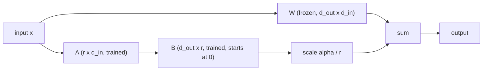

## The hook

A team fine-tunes an open model on 3,000 past support tickets so it will "know the product". A week later it answers in flawless house style, uses the right greeting, signs off correctly, and confidently quotes a return policy that was retired two years ago. It learned the voice perfectly and the facts badly.

That is the normal outcome, not a bug. Fine-tuning is very good at changing *how* a model behaves and surprisingly poor at reliably adding *what* it knows. Knowing which one you need saves weeks of GPU time.

## The simple explanation

Think of a senior contractor who joins your company. Prompting is handing them a style guide every morning. Retrieval is giving them access to the wiki so they can look things up. Fine-tuning is a month of on-the-job practice: afterwards they write reports in your format without being told, but their memory of specific numbers from that month is fuzzy, and some old habits from previous jobs have faded.

LoRA is the cheap version of that practice: instead of retraining the whole person, you give them a small set of extra habits clipped on top, which you can remove again at any time.

Where the analogy breaks: a person knows when they are unsure. A fine-tuned model that half-remembers a fact produces it with the same fluency as one it knows well, which is exactly the hook.

## Under the hood

### When fine-tuning is the right tool

Try the options in order of cost, and stop at the first one that meets your evaluation target:

| Need | First choice | Why |
|---|---|---|
| A fixed output format, tone or label set | Prompting with examples, then fine-tuning | Behavior is what tuning changes well |
| Facts that change, or must be cited | Retrieval (lessons 6 and 7) | Update the index, not the weights |
| A narrow task at high volume | Fine-tuning a smaller model | Shorter prompts, lower latency and cost |
| Knowledge the model must reason over | Retrieval plus a capable model | Tuned-in facts are hard to verify or delete |

Fine-tuning pays off when prompting works but is too long, too slow or too inconsistent, and you have examples of the exact behavior you want. It is the wrong tool for "the model should know our documents": those change, need citations, and may need to be removed for legal reasons, and none of that is possible once they are smeared across billions of weights.

### Full fine-tuning versus parameter-efficient methods

Full fine-tuning continues training every weight on your data with the same next-token loss as lesson 5, usually only on the answer tokens. It is the most expressive option and the most expensive. With the Adam optimizer in mixed precision, a common estimate is about 16 bytes per parameter for weights, gradients and optimizer state, before activations. A 7-billion-parameter model is then over 100 GB, and every tuned variant is another full copy of the model to store and serve.

Parameter-efficient fine-tuning (PEFT) freezes the pretrained weights and trains a small number of new ones. Adapters insert small layers; prompt tuning learns a few input vectors; LoRA, the dominant method today, learns a low-rank correction to existing weight matrices. Gradients and optimizer state exist only for the new parameters, so memory drops sharply, and each variant is a file of megabytes instead of a full checkpoint.

### LoRA: a low-rank update

Hu et al. (2021) hypothesized, and supported with experiments, that the change fine-tuning makes to a weight matrix has a low intrinsic rank. So instead of learning a full update `ΔW` of shape `d_out x d_in`, LoRA learns two thin matrices:

```
W_effective = W + (alpha / r) * B @ A
A: r x d_in    (random init)
B: d_out x r   (zero init)
W: frozen
```

- **Rank `r`** sets capacity. Trainable parameters are `r * (d_in + d_out)` instead of `d_in * d_out`. For one 4096 x 4096 projection at `r = 8` that is {{claim:r8_params}}, about 0.39% of the matrix's 16,777,216 weights. Adapting the query and value projections of a 32-layer model with that width gives {{claim:stack_params}} trainable parameters.
- **`B` starts at zero**, so `B @ A = 0` and the model on step 0 is exactly the pretrained model. Training starts from known behavior instead of a random perturbation.
- **`alpha`** scales the update. Dividing by `r` keeps the update size roughly comparable when you change the rank, so you do not have to retune the learning rate every time. Many recipes set `alpha` to `r` or `2r`.
- **Which layers.** The original paper adapted the attention query and value matrices. Later work, including QLoRA, found that adapting all linear layers of each block, attention and MLP, is needed to get close to full fine-tuning quality.
- **No inference cost if merged.** `W + (alpha / r) B A` is an ordinary matrix, so you can fold the adapter in before serving. Kept separate, one base model can serve many adapters, swapped per request.



### QLoRA: the same idea on a 4-bit base

Dettmers et al. (2023) store the frozen base model in 4 bits (their NormalFloat4 format, plus double quantization of the quantization constants) and backpropagate through it into LoRA adapters kept in higher precision. Paged optimizers absorb memory spikes. The paper fine-tuned a 65-billion-parameter model on a single 48 GB GPU. The trade-off is slower steps from dequantizing on the fly, and the adapter was trained against a quantized base, so serve it with the same quantized base or evaluate again after merging.

### Data, forgetting and the baseline

**Format.** Train on exactly what production will send: the same system prompt, chat template and output schema. A mismatch here is the most common reason a tuned model behaves well in the notebook and badly in the app.

**Size and quality.** For behavior and format, hundreds to a few thousand clean examples often suffice; the LIMA paper got a strong assistant from 1,000 carefully curated examples. Ten wrong examples teach the wrong thing as efficiently as ten right ones teach the right thing. Deduplicate, fix labels, and cover the hard cases deliberately.

**Held-out set.** Split before you look, and keep a test set that never touches training. With small datasets the model can memorize the training set completely, which the exercise shows.

**Catastrophic forgetting.** Gradient steps on task B move weights that task A depended on. You will not see it unless you measure it: keep a general evaluation (earlier capabilities, safety behavior, other languages) and run it before and after. Lower rank, fewer steps, a lower learning rate or mixing in some general data all reduce forgetting, usually at some cost on task B. Biderman et al. (2024) summarize it in their title: LoRA learns less and forgets less than full fine-tuning.

**Baseline.** Compare against the untuned model with your best prompt, on the same held-out set and metric. If the tuned model does not beat that by a margin you care about, you have bought a maintenance burden for nothing.

## The engineering connection

- **Version adapters like code.** An adapter is tied to one exact base model, tokenizer and chat template. Store the base model's identifier and hash with it; upgrading the base model means retraining the adapter.
- **Multi-tenant serving.** One base model in GPU memory plus small per-customer adapters is far cheaper than one full model per customer. Inference servers that support loading several LoRA adapters make this practical.
- **Evaluation is the product.** Build the held-out set and the scoring script before the first training run, exactly like writing tests before a refactor. The evaluation habits from lessons 6 and 11 apply unchanged.
- **Forgetting is a regression.** Treat a drop on the general set like a failing test. Track it per release, not once.
- **Data governance.** Whatever is in the training set can come back out of the model. Do not fine-tune on secrets or personal data you could not publish, because you cannot delete one record from the weights afterwards.
- **Cost check.** A fine-tuned small model can replace a large model with a long few-shot prompt. Compare the total cost per request, including the prompt tokens you no longer send.

## Hands-on challenge

File: `courses/ai-engineering/exercises/lesson_17_lora.py`. NumPy only, one 64 x 64 linear layer with a fixed seed and hand-written gradients. It pretrains on task A, then adapts to task B (a rank-4 change of behavior, only 48 training examples) with no tuning, full fine-tuning and LoRA at ranks 1, 4 and 16, and reports task B and task A test error. About 15 minutes.

**Predict before you run:**

1. What is the largest difference between `W + BA` and `W` before the first LoRA step?
2. With 4,096 trainable weights and only 48 examples, what will full fine-tuning's error on the task B *training* set be?
3. Which method will have the lowest task B *test* error?
4. Which method will forget the least of task A?

::: predict
P: gap | number | claim:init_gap | 0.001 | Max difference between W + BA and W before training?
P: best | choice:full=Full fine-tuning;r1=LoRA r=1;r4=LoRA r=4;r16=LoRA r=16 | r4 | | Lowest task B test error?
P: forget | choice:full=Full fine-tuning;r1=LoRA r=1;r4=LoRA r=4;r16=LoRA r=16 | r1 | | Which forgets the least of task A?
:::

The run command is at the bottom of this page.

<details>
<summary>What the script printed for me (open after predicting)</summary>

- Before any step, `max |(W + BA) - W| = {{claim:init_gap}}` at every rank. With a random `B` instead of zero the gap would be {{claim:random_gap}}, a model that is already damaged before training starts.
- The pretrained model scores {{claim:pre_b}} on task B. All errors are mean squared error; the label noise has standard deviation 0.3, so no model can score much below 0.09 on a test set.
- Full fine-tuning reaches {{claim:full_b_train}} on the task B training set (it memorizes the noise) but only {{claim:full_b}} on the task B test set.
- LoRA r=1 is too small for a rank-4 change: {{claim:r1_b}} on task B. LoRA r=4 matches the structure of the change and does best, {{claim:r4_b}}. LoRA r=16 has more room to fit noise and slips to {{claim:r16_b}}.
- Forgetting: task A error goes from {{claim:pre_a}} before tuning to {{claim:r1_a}} at r=1, {{claim:r4_a}} at r=4 and {{claim:full_a}} with full fine-tuning. The true task B weights themselves score {{claim:trueb_a}} on task A, because here task B really does contradict task A on the same inputs. Most of that forgetting is the price of the new behavior; r=1 forgets least because it also learns least.
- The parameter arithmetic at the bottom is the production picture: {{claim:r8_params}} trainable parameters per 4096 x 4096 matrix at r=8.

</details>

Follow-ups: raise task B to 500 examples and see whether full fine-tuning catches up. Set `alpha` to `2 * rank` and compare. Change `true_rank` to 1 and check which LoRA rank wins now.

## Takeaways

1. Fine-tune for behavior, format and cost; use retrieval for facts that change or need citations. Try prompting first and keep it as the baseline.
2. LoRA trains `B @ A` beside a frozen `W`. Zero-initialized `B` means training starts exactly at the pretrained model, and the rank sets both capacity and cost.
3. Measure on a held-out task set and a general set before and after. Fine-tuning always trades some old behavior for new behavior; you decide the price only if you measure it.

**Check question:** your LoRA adapter scores 98% on its training examples and no better than the prompted base model on the held-out set. What happened, and what are two things you would change?

**Next up:** quantization and memory, the same 4-bit idea QLoRA relies on, applied to serving.

::: quiz
Q: A LoRA adapter at rank 16 on a 4096 x 4096 matrix: how many trainable parameters, and what fraction of the matrix?
A: 16 x (4096 + 4096) = 131,072, about 0.78% of the 16,777,216 weights in the full matrix.
Q: Why is `B` initialized to zero and not to random values?
A: So that `B @ A` is zero and the adapted model is identical to the pretrained one at step 0. Training starts from known behavior instead of from a randomly perturbed model.
Q: A team wants the model to know this week's price list. Fine-tuning or retrieval?
A: Retrieval. Prices change, need to be exact and traceable, and fine-tuned facts are unreliable and cannot be updated or deleted without retraining.
Q: How do you detect catastrophic forgetting?
A: Keep a held-out evaluation of the capabilities you already had, run it on the base model and on the tuned model, and compare. Training loss on the new task says nothing about it.
:::

## References

- Hu et al., "LoRA: Low-Rank Adaptation of Large Language Models" (2021): https://arxiv.org/abs/2106.09685
- Dettmers et al., "QLoRA: Efficient Finetuning of Quantized LLMs" (2023): https://arxiv.org/abs/2305.14314
- Zhou et al., "LIMA: Less Is More for Alignment" (2023), data quality over quantity: https://arxiv.org/abs/2305.11206
- Biderman et al., "LoRA Learns Less and Forgets Less" (2024): https://arxiv.org/abs/2405.09673
