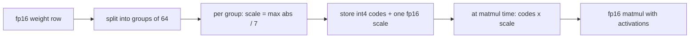

## The hook

A 70-billion-parameter model stored in 16-bit floats needs 140 GB just for its weights. A common data center GPU such as the A100 or H100 has 80 GB. Store the same weights in 4 bits and they take 35 GB, which fits on one card with room left for the KV cache.

Nothing about the architecture changed. You only changed how many bits each number gets. The surprising part is how little quality you lose when you do it carefully, and how much you lose when a few unusually large values are handled carelessly.

## The simple explanation

Quantization is lossy compression for numbers, close in spirit to storing a price as an integer number of cents instead of a `double`. You pick a **scale** (one cent), store each value as a small integer count of that scale, and multiply back when you need the value.

The trade is the classic one: a bigger scale covers a wider range but rounds more coarsely. With 8 bits you have 256 steps to work with; with 4 bits, only 16.

Where the analogy breaks: cents work because prices share a known range. Neural network weights and activations do not. Most values are tiny, a few are huge, and one shared scale must stretch to cover the huge ones, which wastes most of the 16 steps on empty space.

## Under the hood

### Number formats

| Format | Bits | Layout (sign, exponent, mantissa) | What it is for |
|---|---|---|---|
| fp32 | 32 | 1, 8, 23 | Training master weights, optimizer state |
| bf16 | 16 | 1, 8, 7 | Training and inference; same range as fp32, less precision |
| fp16 | 16 | 1, 5, 10 | Inference; more precision than bf16, max value 65,504, so overflow is possible |
| int8 | 8 | integer -128 to 127 plus a scale | Weights, and on supporting hardware activations too |
| int4 | 4 | integer -8 to 7 plus a scale | Weights only, in practice |

Floating point formats carry their own exponent per value, so they handle wide ranges by themselves. Integer formats carry none, so all range handling moves into the scale you choose. **fp8** sits between: two 8-bit float variants, E4M3 (more precision) and E5M2 (more range), were proposed by Micikevicius et al. (2022) and are supported in hardware on recent NVIDIA generations such as Hopper. If your GPU does not support it natively, fp8 saves memory but not compute.

### Memory arithmetic

Weight memory is parameters times bytes per parameter. A 7B model is 14 GB in fp16, 7 GB in int8, 3.5 GB in int4. Group-wise 4-bit formats also store one scale per group, so the real cost is slightly above 4 bits per weight.

The weights are not the whole bill. At inference you also pay for:

- **KV cache:** `2 x layers x kv_heads x head_dim x bytes` per token (the 2 is keys and values), multiplied by context length and by the number of concurrent sequences. It does not shrink when you quantize the weights.
- **Activations:** the intermediate tensors of the layer currently running. For single-user inference they are small next to the weights; they grow with batch size and with prompt length during prefill.
- **Runtime overhead:** framework buffers, CUDA context, fragmentation. Leave headroom and measure on the real machine.

The exercise prints both tables. A model that "fits" by weight size can still fail at your real context length and concurrency because of the KV cache.

### Scales and zero points

**Symmetric (absmax)** quantization uses `scale = max(|x|) / 127` for int8 (or `/ 7` for int4), stores `q = round(x / scale)`, and reconstructs `x ≈ q x scale`. Zero maps exactly to zero, and the matmul can run on integers with one multiplication by the scale at the end.

**Asymmetric** quantization adds a **zero point**: `scale = (max - min) / 15` for 4 bits, `q = round(x / scale) + zero_point`, with `q` in 0 to 15. It pays off when values are one-sided, such as outputs of ReLU, where a symmetric scheme wastes half its codes on negative numbers that never occur. The exercise shows that on ReLU outputs. The cost is a little extra arithmetic for the zero point.

### Granularity: per-tensor, per-channel, group-wise

The finer the scale, the less one large value can hurt its neighbors:

- **Per-tensor:** one scale for the whole matrix. Cheapest, most fragile.
- **Per-channel:** one scale per output row. The standard for int8 weights.
- **Group-wise:** one scale per block of 32, 64 or 128 consecutive weights along the input dimension. The standard for 4-bit weights.



### Outliers

Dettmers et al. (2022) found that large transformers develop **outlier features**: a small number of hidden dimensions whose activations are far larger than everything else, and that become systematic as models grow past several billion parameters. With one scale per tensor, those few values set the scale and every normal value is rounded to a handful of codes or to zero. Their LLM.int8() method keeps those outlier dimensions in fp16 and runs the rest of the matmul in int8.

The exercise plants the same pattern in a weight matrix: three input channels far larger than the rest. Two lessons come out of it. Clipping the outliers to save the scale is a disaster, because those values carry real signal. Keeping them aside in full precision, as LLM.int8() does, recovers almost everything.

### Weight-only methods: GPTQ and AWQ

Plain round-to-nearest at 4 bits leaves noticeable error. Two widely used post-training methods reduce it using a small calibration set, with no retraining:

- **GPTQ** (Frantar et al., 2022) quantizes a layer's weights a column at a time and adjusts the not-yet-quantized weights to compensate for the error just introduced, using second-order information from calibration activations. The goal is to keep the layer's output close, not each weight.
- **AWQ** (Lin et al., 2023) observes that a small fraction of weight channels matters most, identified by the magnitude of the activations that feed them. It scales those channels up before quantization (and the inputs down to match), so they get more resolution, instead of storing them in mixed precision.

Both are **weight-only**: weights are stored in 4 bits and dequantized to fp16 on the fly. Generation of each token reads every weight from memory, so decoding is usually limited by memory bandwidth, and fewer bytes per weight means faster tokens even though the arithmetic is still fp16.

## The engineering connection

- **Start with the memory bill.** Weights at your chosen format, plus KV cache at your real context and concurrency, plus headroom. If bf16 fits with that headroom, serve bf16 and stop.
- **Match the format to the hardware.** bf16 needs Ampere-class NVIDIA GPUs or newer; older cards use fp16. Native fp8 compute needs recent generations such as Hopper. On CPUs and Apple Silicon, runtimes such as llama.cpp use group-wise integer formats (GGUF files), and 4-bit is the usual choice.
- **What degrades first.** Average perplexity can move little while specific behaviors move more: long multi-step reasoning, arithmetic, code, less common languages. Below 4 bits, quality drops much faster; Dettmers and Zettlemoyer (2022) found 4 bits to be almost universally optimal for zero-shot accuracy at a fixed total number of model bits. Evaluate on your own task set, not a leaderboard.
- **The KV cache is a separate dial.** Quantizing the cache to 8 bits halves it and raises how many users fit, with its own quality check. Weight quantization does not touch it.
- **This site does it too.** The in-browser MiniLM that runs the embedding exercises and the meaning mode of Ask the course stores its word embedding table in int8 (one scale per row) and the rest of the weights in fp16. Full int8 was not an option: CI compares cosine similarities from the browser model against PyTorch, and with every matrix in int8 the error exceeded the budget. The mixed choice keeps most of the download savings, since the embedding table is the largest single matrix, and stays within the budget.
- **Prefer published quantized checkpoints** made with GPTQ or AWQ for popular models, and keep the full-precision weights so you can requantize when tools improve.

## Hands-on challenge

File: `courses/ai-engineering/exercises/lesson_18_quantization.py`. NumPy only. It builds a seeded 128x256 weight matrix with three outlier input channels and a batch of 64 activations, quantizes the weights to int8 and int4 with per-tensor, per-channel and group-wise scales, tries clipping versus keeping outliers aside, compares symmetric and asymmetric codes, and prints memory and KV cache tables from the formulas. About 15 minutes.

**Predict before you run:**

1. Which granularity gives the lowest int4 output error: per-tensor, per-channel or group-32?
2. The outliers are input columns. Will one scale per output row help much?
3. If you clip the scale at the 99th percentile, does int4 per-tensor get better or worse?
4. On ReLU outputs, which wins at 4 bits: symmetric or asymmetric?
5. How many GB is a 70B model in int4, and how big is the KV cache for 32 layers, 8 KV heads of dimension 128, 8,192 tokens and 8 users in fp16?

::: predict
P: perchannel | choice:much=Much better than per-tensor;little=Only a little better | little | | With outliers in input columns, how much does int4 per-channel improve on per-tensor?
P: clip | choice:better=Better;worse=Worse | worse | | Clipping the int4 per-tensor scale at the 99th percentile makes the output error...
P: kv | number | claim:kv_total | 0.1 | KV cache in GB for 32 layers, 8 KV heads, head dim 128, 8,192 tokens, 8 users, fp16?
:::

The run command is at the bottom of this page.

<details>
<summary>What the script printed for me (open after predicting)</summary>

- The outlier columns are {{claim:outlier_ratio}} times larger than a typical column.
- int8 output relative error: {{claim:int8_tensor_out}} per-tensor, {{claim:int8_g64_out}} with groups of 64. Even the crude version is usable at 8 bits.
- int4 output relative error: {{claim:int4_tensor_out}} per-tensor, {{claim:int4_channel_out}} per-channel, {{claim:int4_g32_out}} with groups of 32 (cosine {{claim:int4_g32_cos}}). Per-channel barely helps because every output row contains the outlier columns; groups along the input dimension confine each outlier to its own group.
- Removing the outliers entirely brings int4 per-tensor down to {{claim:clean_out}}, so they were the dominant problem. What remains is the plain cost of having only 16 levels, which is what GPTQ and AWQ attack.
- Clipping at the 99th percentile pushes the error to {{claim:clip99_out}}: the clipped values were signal. Keeping the three outlier columns in full precision and the rest in int4 per-tensor gives {{claim:mixed_out}}.
- ReLU outputs at 4 bits: symmetric {{claim:relu_sym}}, asymmetric {{claim:relu_asym}}.
- Memory table:

```
{{claim:memory_table}}
```

- Group-64 int4 with fp16 scales costs {{claim:group_bits}} bits per weight. The KV cache for the stated config is {{claim:kv_total}} GB in fp16, on top of the weights.

</details>

Follow-ups: change the group size to 128 and 16 and plot error against bits per weight including scales. Make the outliers appear in the activations instead of the weights and see which granularity still helps. Recompute the KV cache for 32 attention heads instead of 8 KV heads.

## Takeaways

1. Memory is parameters times bytes, plus a KV cache that grows with context and users and is unaffected by weight quantization.
2. A shared scale is only as good as its largest value. Finer granularity (per-channel, group-wise) and outlier handling decide whether 4-bit works.
3. Weight-only 4-bit with GPTQ or AWQ is the common choice when bf16 does not fit; verify quality on your own tasks, because some capabilities degrade before averages do.

**Check question:** a 13B model in int4 fits your 24 GB GPU with room to spare, yet requests fail at 32,000 tokens of context with several users. What did you leave out of the arithmetic, and what are two ways to fix it?

**Next up:** inference serving, where batching and the KV cache decide throughput.

::: quiz
Q: How much memory do the weights of a 13B model need in fp16, int8 and int4?
A: About 26 GB, 13 GB and 6.5 GB, from parameters times 2, 1 and 0.5 bytes. Group-wise int4 adds a little for scales, and KV cache and runtime overhead come on top.
Q: Why does one large outlier hurt per-tensor int4 quantization so much?
A: The scale is set by the largest absolute value, so the 16 levels are spread across a range that almost no value uses. Normal values round to a few codes or to zero.
Q: When is asymmetric quantization with a zero point worth it?
A: When the values are one-sided or off-center, such as ReLU outputs. Symmetric codes would waste half the range on values that never occur.
Q: Why does weight-only int4 speed up token generation even though the matmul still runs in fp16?
A: Decoding reads every weight once per token and is usually limited by memory bandwidth, so moving a quarter of the bytes speeds it up.
:::

## References

- Dettmers et al., "LLM.int8(): 8-bit Matrix Multiplication for Transformers at Scale" (2022): https://arxiv.org/abs/2208.07339
- Frantar et al., "GPTQ: Accurate Post-Training Quantization for Generative Pre-trained Transformers" (2022): https://arxiv.org/abs/2210.17323
- Lin et al., "AWQ: Activation-aware Weight Quantization for LLM Compression and Acceleration" (2023): https://arxiv.org/abs/2306.00978
- Micikevicius et al., "FP8 Formats for Deep Learning" (2022): https://arxiv.org/abs/2209.05433
- Dettmers and Zettlemoyer, "The case for 4-bit precision: k-bit Inference Scaling Laws" (2022): https://arxiv.org/abs/2212.09720
