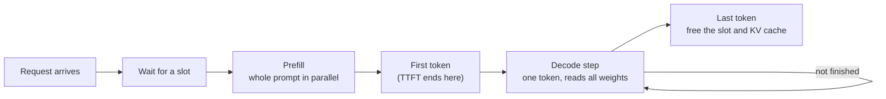

## The hook

You put a 7B model on a GPU and send it one request. If the GPU has, say, 2 TB/s of memory bandwidth, it generates at most about 140 tokens per second. You send it 32 requests at once and the total climbs to many times that, while each user sees only a modest slowdown.

In most software, running 32 jobs at once on one machine makes each of them slower. Here it is nearly free, up to a point. The reason is that a single decoding request leaves the GPU's arithmetic units idle most of the time, waiting for memory. Serving an LLM well is mostly about filling that idle capacity without blowing up latency or running out of memory.

## The simple explanation

Think of a bus that has to drive the whole route for every stop, no matter how many passengers are on board. The cost of the trip is the driving (reading every model weight from memory once per generated token). A passenger (one sequence) adds very little. Carrying one passenger per trip is wasteful; carrying 32 costs almost the same fuel.

**Static batching** is a bus that leaves with a full load and does not take new passengers until the last one has reached the final stop, even though most got off early. **Continuous batching** lets someone board at every stop the moment a seat frees up.

Where the analogy breaks: each passenger carries luggage that grows at every stop (the KV cache), and the luggage rack, GPU memory, is what usually runs out first, not the seats.

## Under the hood

### Prefill and decode

A request is served in two phases with very different costs.

- **Prefill** processes the whole prompt in one forward pass, all positions in parallel, exactly like teacher forcing in training. It writes the keys and values of every prompt token into the KV cache (lesson 3) and produces the first output token. It is a large matrix multiply, so it is **compute-bound**: cost grows with prompt length.
- **Decode** generates one token per step. Each step multiplies a single new vector per sequence by every weight matrix, so the GPU must stream all the weights from memory for very little arithmetic. It is **memory-bandwidth-bound**.

The two latencies users feel map onto these phases. **Time to first token (TTFT)** is queueing plus prefill. **Inter-token latency** (time per output token) is the decode step time. End-to-end latency is roughly TTFT plus output length times inter-token latency.



### A back-of-the-envelope bound

Assume a 7B-parameter model in fp16 (2 bytes per parameter, so 14 GB of weights) and assume 2 TB/s of memory bandwidth. Every decode step must read all 14 GB at least once:

```
step time >= bytes read per step / memory bandwidth = 14e9 / 2e12 = 7 ms
tokens per second per sequence <= 1 / 7 ms, about 143
```

This is an upper bound for one sequence; real systems reach some fraction of it. It also explains lesson 18: quantizing weights to 4 bits cuts the bytes read per step by about 4x, and the bound rises by the same factor. Faster arithmetic would not help at all.

### Arithmetic intensity and why batching helps

**Arithmetic intensity** is FLOPs performed per byte moved. A matrix-vector product with fp16 weights does 2 FLOPs (a multiply and an add) per 2-byte weight: 1 FLOP per byte. With a batch of `B` sequences, the same weights are read once and used `B` times, so intensity becomes `B` FLOPs per byte.

The roofline model compares this to the hardware's ratio of compute to bandwidth. Assume 300 TFLOP/s of compute: 300e12 / 2e12 = 150 FLOP/byte. Below that ridge point the step is memory-bound and its time barely changes as the batch grows, so throughput rises almost linearly with `B`. Above it the step becomes compute-bound and extra sequences start to cost real time. This is why the hook's 32 requests were nearly free.

Batching is not free forever, though. Each sequence also reads its own KV cache every step, and that traffic does grow with batch size and context length. The exercise models it as a small fixed cost per sequence.

### Static versus continuous batching

With **static batching** the server groups requests, runs them together and accepts no new work until the whole batch has finished. Output lengths vary a lot, so for most of the batch's life many slots hold sequences that are already done, and new requests wait in the queue behind the longest answer.

Yu et al. (2022) introduced **iteration-level scheduling** in Orca: the scheduler decides batch membership at every decode step. A finished sequence leaves immediately and a waiting request joins at the next step, after its prefill. This is now usually called **continuous batching**, and it is the default in modern serving engines. The cost is complexity: sequences in one batch have different lengths and positions, and a newcomer's prefill shares the step with everyone else's decode, which causes a short inter-token latency spike for them. Engines mitigate this by splitting long prompts into chunks (chunked prefill).

### KV cache memory and PagedAttention

For every token in context, every layer stores a key and a value vector. For a 7B-class model with 32 layers, hidden size 4096 and fp16, without grouped-query attention:

```
KV bytes per token = 2 (K and V) * 32 layers * 4096 * 2 bytes = 524,288 bytes = 0.5 MiB
```

A 2048-token conversation therefore holds 1 GiB of cache. With batching, the KV cache, not the weights, often decides how many requests fit.

Early servers reserved one contiguous block per request sized for the maximum length, because they could not know how long the answer would be. Most requests are far shorter, so most of that memory sat unused. Kwon et al. (2023) borrowed virtual memory from operating systems: **PagedAttention**, implemented in vLLM, stores the cache in small fixed-size blocks and keeps a per-sequence block table, so memory is allocated only as tokens are produced and the only waste is the unfilled tail of the last block. The paper reports that earlier systems used well under half of their KV memory for actual token states, and that freeing it lets the scheduler run larger batches. Blocks also make it cheap to share a common prompt prefix between requests.

### Speculative decoding

Decode leaves compute idle, so you can spend it on guessing. Leviathan et al. (2023) use a small **draft model** to propose several tokens, then run the large model once over all of them in parallel, like a short prefill, and accept the longest prefix it agrees with. A rejection-sampling rule keeps the output distribution exactly the same as the large model's. When the draft is often right, you get several tokens per expensive weight read; when it is often wrong, you pay for the draft and gain little.

## The engineering connection

- **Measure TTFT and inter-token latency separately, at p50 and p95.** Long prompts hurt TTFT (prefill); long outputs and large batches hurt inter-token latency. An average end-to-end number hides which one is the problem.
- **Throughput and latency trade off through batch size.** Larger batches raise tokens per second per GPU and lower cost per token, but each step gets slower once you leave the memory-bound region and the KV cache fills. Set a latency target and push batch size up to it, not past it.
- **Memory is the real capacity limit.** Free GPU memory after loading weights divided by KV bytes per token is the total number of tokens in flight. Long contexts reduce concurrency directly. Quantized weights, quantized KV cache and grouped-query attention all buy more concurrent tokens.
- **Use a serving engine, do not write the loop yourself.** Continuous batching and paged KV caches are standard in engines such as vLLM. A naive `generate()` call in a web handler processes one request at a time and wastes most of the GPU.
- **Shared prefixes are worth caching.** A long system prompt repeated for every request is prefill work you can do once; engines and hosted APIs offer prefix or prompt caching for exactly this.
- **Hosted API pricing reflects these costs.** Input tokens (prefill, parallel) are usually priced lower than output tokens (decode, sequential and bandwidth-bound).

## Hands-on challenge

File: `courses/ai-engineering/exercises/lesson_19_inference_serving.py`. NumPy only. It is a cost model, not a benchmark: it computes the bandwidth bound and arithmetic intensity for assumed hardware, simulates 300 seeded requests on 16 slots under static and continuous batching, and measures KV cache waste with contiguous reservation versus 16-token pages. About 15 minutes.

**Predict before you run:**

1. With 14 GB of weights and 2 TB/s, what is the best possible decode speed for a single sequence?
2. Which policy has the worse median time to first token, and by roughly how much?
3. What fraction of slot-steps does static batching spend on useful work?
4. If every request reserves 2048 tokens of KV cache, what fraction of that memory is wasted on this request mix?

::: predict
P: bound | number | claim:bound1 | 5 | Upper bound on decode tokens per second at batch 1
P: ttft | choice:static=Static batching;continuous=Continuous batching | static | | Which policy has the higher median time to first token?
P: waste | number | claim:waste_contig | 0.1 | Fraction of KV memory wasted with contiguous 2048-token reservation
:::

The run command is at the bottom of this page.

<details>
<summary>What the script printed for me (open after predicting)</summary>

- Weight read per step {{claim:weight_ms}} ms, so at most {{claim:bound1}} tokens/s for one sequence. Up to the ridge point the step time does not move as the batch grows.
- Throughput: static {{claim:static_tput}} tokens/s, continuous {{claim:cont_tput}} tokens/s. Requests arrive faster than static batching can serve them, so its queue grows for the whole run; continuous batching keeps up, and its throughput is set by the arrival rate.
- Median TTFT: static {{claim:static_ttft_p50}} s, continuous {{claim:cont_ttft_p50}} s. The continuous figure is little more than one prefill. The static figure is mostly queueing and grows with run length, because the system is overloaded.
- p95 end-to-end latency: static {{claim:static_lat_p95}} s, continuous {{claim:cont_lat_p95}} s.
- Slot utilization: static {{claim:static_util}}, continuous {{claim:cont_util}}. Static batching spends most slot-steps holding sequences that already finished. Continuous batching is not full either, which means it still has headroom at this load.
- KV cache is {{claim:kv_token}} MiB per token. Contiguous 2048-token reservation wastes {{claim:waste_contig}} of the reserved memory; 16-token pages waste {{claim:waste_paged}}. In a 40 GiB KV budget that is {{claim:fit_contig}} requests versus {{claim:fit_paged}} on average.

</details>

Follow-ups: halve the mean arrival gap and watch continuous batching saturate too. Raise `SLOTS` to 64 and compare it with how many requests the KV section says fit in 40 GiB. Set `BYTES_PER_PARAM = 0.5` to model 4-bit weights.

## Takeaways

1. Prefill is parallel and compute-bound; decode is sequential and bound by memory bandwidth. A first estimate of decode speed is bandwidth divided by bytes read per step.
2. Batching raises throughput almost for free while decode is memory-bound. Continuous batching keeps slots full by admitting new requests at every step instead of waiting for the slowest sequence.
3. The KV cache grows with every token and usually caps concurrency. Paged allocation removes most of the waste of reserving for the maximum length.

**Check question:** your service's time to first token is fine but users complain that answers stream slowly when traffic is high. Which phase is the bottleneck, and which two knobs would you look at first?

**Next up:** cost, latency and reliability in production: turning these mechanics into budgets, SLOs and fallbacks.

::: quiz
Q: Why does doubling the batch size from 1 to 2 barely change the decode step time?
A: At small batch sizes the step is dominated by reading all the weights from memory. A second sequence reuses the same weights, adding only a little arithmetic and its own KV cache reads, so the step stays memory-bound.
Q: With static batching, a batch has nine 50-token answers and one 800-token answer. What happens to the other nine slots?
A: They sit idle (or compute padding) until the 800-token answer finishes, and queued requests cannot use them. Continuous batching would hand each freed slot to a waiting request at the next step.
Q: A 7B model in fp16 runs on hardware with an assumed 1 TB/s of memory bandwidth. Roughly what is the single-sequence decode ceiling, and what does 4-bit quantization do to it?
A: 14 GB per step at 1 TB/s is 14 ms, so about 70 tokens per second. With 4-bit weights the model is about 3.5 GB, so the ceiling rises roughly fourfold, to about 280 tokens per second.
Q: What problem does PagedAttention solve?
A: Reserving one contiguous KV cache region per request at the maximum length wastes most of it, since real requests are shorter. Fixed-size blocks allocated on demand waste only part of the last block, so more requests fit in the same memory.
:::

## References

- Yu et al., "Orca: A Distributed Serving System for Transformer-Based Generative Models" (OSDI 2022), iteration-level scheduling: https://www.usenix.org/conference/osdi22/presentation/yu
- Kwon et al., "Efficient Memory Management for Large Language Model Serving with PagedAttention" (SOSP 2023), the vLLM paper: https://arxiv.org/abs/2309.06180
- Leviathan, Kalman and Matias, "Fast Inference from Transformers via Speculative Decoding" (ICML 2023): https://arxiv.org/abs/2211.17192
- Pope et al., "Efficiently Scaling Transformer Inference" (2022), memory and compute costs of prefill and decode: https://arxiv.org/abs/2211.05102
- Williams, Waterman and Patterson, "Roofline: An Insightful Visual Performance Model for Multicore Architectures" (Communications of the ACM, 2009): https://doi.org/10.1145/1498765.1498785
