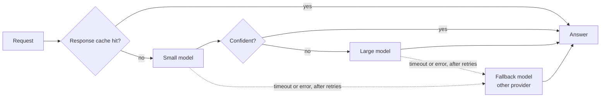

## The hook

Your LLM feature passed every evaluation, launched, and the first monthly invoice was three times the estimate. Nobody changed the code. Usage grew, the system prompt grew with every new rule someone added, and every request paid for those extra tokens again.

The same week your provider had a partial outage. Your clients retried immediately, all at the same moment, and the retries kept the provider overloaded for several extra minutes. Your dashboard showed an average latency of a few seconds, while one user in a hundred waited half a minute.

None of this is about model quality. It is ordinary distributed-systems engineering, with one new unit of account: the token.

## The simple explanation

Think of a model API as a metered, remote, sometimes slow dependency, like a payment gateway that bills by the character. You already know the playbook: cache what you can, send cheap work to cheap services, put a timeout on every call, retry carefully, have a plan B, and watch the slow tail rather than the average.

Where the analogy breaks: the output of an LLM call is not deterministic and not easily checked. A cache hit or a cheaper model can return a *wrong* answer that looks fine, and a fallback model may behave differently from the primary. Every cost or latency optimization is therefore also a quality decision, and it has to pass the same evaluations as a prompt change.

## Under the hood

### Token cost arithmetic

Providers price input tokens and output tokens separately, and output tokens usually cost several times more than input tokens. Many also offer a lower rate for cached input. The cost of one request is:

```
cost = (fresh_input * price_in + cached_input * price_cached + output * price_out) / 1_000_000
```

All prices in this lesson and in the exercise are invented, round numbers chosen to be in a plausible ratio. Never copy them into a budget; read your provider's current price page.

Two consequences follow. First, long prompts are not free just because answers are short: in RAG and agent workloads the input side (system prompt, tool definitions, retrieved chunks, history) often dominates. Second, `max_tokens` is a cost limit as well as a length limit. Estimate cost per request from real traffic logs, multiply by requests per month, and track it per feature.

### Prompt caching and response caching

These are two different things.

**Prompt caching** (also called prefix caching) is done by the provider or your serving stack. If many requests start with the same exact token prefix, the attention keys and values for that prefix (the KV cache from lesson 3) can be reused. You pay a lower rate for those input tokens and the time to first token usually drops. It only works for an identical prefix, so put stable content first (system prompt, tool definitions, fixed examples) and variable content last (user question, retrieved chunks). Caches expire after a period of inactivity, and some providers charge extra to write to the cache, so check the rules of yours.

**Response caching** is done by you: store the final answer keyed by a normalized request, and skip the model call entirely on a hit. It saves the whole cost and almost all the latency, but it can serve stale or wrong answers, and it is only safe when the same input really deserves the same output. Include the prompt version and model in the cache key, set a time to live, and never share cached answers across users when the answer depends on their data. A semantic cache (matching by embedding similarity instead of exact text) raises the hit rate and the risk of returning an answer to a different question.

### Model routing and escalation

Most traffic is easier than your hardest cases. A router sends each request to a small, cheap, fast model first, and escalates to a large model when a confidence signal is low. The signal can be a classifier on the input, the small model's own token probabilities, a self-check, or a validator (does the JSON parse, does the SQL compile). FrugalGPT studied this kind of cascade.

Escalated requests pay for both calls and wait for both, so routing lowers the median latency and cost but can raise the tail. The threshold is a dial between cost and quality, and the only honest way to set it is to run your evaluation set (lesson 11) at several thresholds and pick a point you can defend.



### Timeouts, retries and fallbacks

**Timeouts.** A call without a timeout can hold a thread, a connection and a user for as long as the provider likes. With streaming, set a short timeout on the time to first token, an idle timeout between chunks, and a generous cap on the total, because a long answer is legitimately slow while a silent connection is not.

**Retries.** Retry only what is transient: timeouts, connection errors, 429 (rate limited) and most 5xx responses. Do not retry a 400 or a content refusal; it will fail the same way. Use exponential backoff so each wait is longer than the last, and add **jitter** (a random part of the wait) so that clients that failed together do not retry together. Without jitter, an outage turns thousands of clients into synchronized waves that hit the provider at the same instant every time it tries to recover. Cap the number of attempts and keep a retry budget (for example, retries may not exceed a small share of total traffic) so that retries cannot multiply load during an incident. Honor a `Retry-After` header when the provider sends one.

**Fallbacks.** After the last retry, send the request to another model or another provider instead of failing. A fallback is a different model: its quality, format adherence and safety behavior differ, so it must be in your evaluation runs, and you should log which model actually answered. A circuit breaker that stops calling a primary that keeps failing saves the time you would spend timing out on it.

### Rate limits and streaming

Providers enforce limits such as requests per minute and tokens per minute per account or per model, and answer with HTTP 429 when you exceed them. Treat your quota as a shared resource: put a client-side limiter or queue in front of it, give interactive traffic priority over batch jobs, and move work that can wait to a batch interface if your provider has one.

Streaming does not make generation faster. It changes what the user waits for: the first tokens arrive after the prefill instead of after the whole answer. For a chat interface that is the latency people perceive. For a JSON response that your code must parse in full, streaming helps much less.

### Monitoring and versioning

Latency distributions of LLM calls are long-tailed, because output length varies and retries add whole seconds. Report percentiles: p50 for the typical user, p95 and p99 for the unlucky ones. An average hides exactly the requests that generate complaints. For every request log the model and its version, the prompt version, input, cached and output tokens, cost, time to first token, total latency, retries, whether a fallback answered, and the outcome. Then you can chart error rate, cost per request and cost per successful task per feature.

Treat the prompt and the model as one versioned unit, together with the retrieval settings and parameters such as temperature. Pin model versions or snapshots where the provider offers them, because an alias that silently moves to a newer model is an untested deploy. A change to any part goes through the evaluation gate: run the evaluation set, compare quality, cost and latency against the current version, and roll out to a small share of traffic before everyone.

## The engineering connection

- **Budget in tokens, not requests.** Cost per request is a distribution. Watch the input side: a system prompt that grows by a few hundred tokens is paid on every call.
- **Order prompts for caching.** Stable prefix first, variable content last. Moving a timestamp or user name to the top of the prompt can quietly disable prefix caching.
- **Every optimization is a quality change.** Routing thresholds, cache policies and fallback models go through the same evaluation gate as prompt edits.
- **Resilience settings belong in configuration.** Timeouts, attempt counts, backoff base and fallback order should be tunable during an incident without a deploy.
- **Failures can look cheap.** Requests that fail early often cost nothing, so a cost chart can improve during an outage. Always read cost next to availability and quality.
- **Alert on the tail.** p95 and p99 latency, error rate and cost per request per feature, with the model and prompt version as dimensions.

## Hands-on challenge

File: `courses/ai-engineering/exercises/lesson_20_cost_latency_reliability.py`. NumPy and the standard library only. It generates a seeded workload of 10,000 requests with token counts and a difficulty score, then simulates six configurations: one large model, a router that escalates on a simulated confidence, prompt caching, a 25% response cache, and a flaky primary provider with and without timeouts, retries with backoff and jitter, and a fallback. Every price, latency and failure rate is illustrative. It ends with a retry storm of 1,000 clients. About 15 minutes.

**Predict before you run:**

1. What will one large model cost per 1,000 requests, given the request size and illustrative prices printed at the top?
2. Will the router improve every column, or will it trade something away?
3. Which percentile will the flaky provider without safeguards damage most: p50 or p99?
4. When 1,000 clients retry with the same fixed backoff, how many land in the busiest 100 ms bucket?

::: predict
P: cost_large | number | claim:cost_large | 1.5 | Cost per 1,000 requests with one large model, in illustrative dollars?
P: router_tradeoff | choice:all=Better on every column;trade=Cheaper but lower quality and a worse tail | trade | | What does the router do?
P: flaky_tail | choice:p50=p50;p99=p99 | p99 | | Which percentile does the flaky provider without safeguards hurt most?
P: storm | number | claim:storm_plain | 0 | Requests in the busiest 100 ms bucket on the first retry, without jitter?
:::

The run command is at the bottom of this page.

<details>
<summary>What the script printed for me (open after predicting)</summary>

- Cost per 1,000 requests: {{claim:cost_large}} with one large model, {{claim:cost_router}} with the router, {{claim:cost_prompt_cache}} after adding prompt caching on the 1,200-token shared prefix, and {{claim:cost_response_cache}} with a 25% response cache on top.
- The router escalated {{claim:escal_router}} of the requests, and quality fell from {{claim:quality_large}} to {{claim:quality_router}}. The p95 latency rose from {{claim:p95_large}} to {{claim:p95_router}} s, because escalated requests wait for two models. Cheaper and faster at the median is not the same as better.
- Prompt caching changed cost only. The simulation does not model its effect on time to first token, which in real systems usually improves too.
- The flaky primary without safeguards answered only {{claim:avail_flaky}} of requests, and hung connections pushed p99 to {{claim:p99_flaky}} s. It also looks cheaper, because failed calls cost nothing here. With a 3 s first-token timeout, two retries with jittered backoff and a fallback, p99 came back to {{claim:p99_resilient}} s. Failures are drawn independently per attempt and the fallback provider is assumed healthy, so real outages, which are correlated, are harder.
- Streaming: the p50 time to first token for the large model was {{claim:ttft_p50}} s, a fraction of the full response time.
- Retry storm: without jitter, all {{claim:storm_plain}} clients retried in the same 100 ms bucket on every attempt. With full jitter the busiest bucket on the first retry held {{claim:storm_jitter}}, and the peak kept shrinking on later attempts as the waits grew.

</details>

Follow-ups: sweep the confidence threshold from 0.3 to 0.7 and plot cost against quality. Make failures correlated (an outage window instead of independent draws) and see what retries alone can and cannot fix. Add a retry budget and count how many extra calls the provider receives during the outage.

## Takeaways

1. Cost is token arithmetic: input, cached input and output priced separately. Prompt caching needs a stable prefix; response caching skips the call but can return stale or wrong answers.
2. Routing to a small model with escalation cuts cost and median latency but trades away some quality and tail latency. Set the threshold with your evaluation set.
3. Put timeouts on every call, retry only transient errors with capped exponential backoff and jitter, fall back to another model, and monitor p95, p99, error rate and cost per request with the model and prompt version recorded.

**Check question:** after you switch the fallback order, the monthly cost drops and the average latency improves, but support tickets rise. Which metrics would you check first, and what would you change?

**Next up:** reasoning models and test-time compute, where spending more output tokens per request can buy accuracy and moves the cost arithmetic of this lesson toward the output side.

::: quiz
Q: Why can a router make p95 latency worse while it makes p50 better?
A: Easy requests finish quickly on the small model, which lowers the median. Escalated requests run the small model and then the large one, so they wait for both, and they sit in the slow tail.
Q: What does jitter add to exponential backoff, and why does it matter during an outage?
A: A random part of each wait. Without it, clients that failed at the same moment retry at the same moment, in synchronized waves that keep an overloaded provider overloaded. Jitter spreads the retries over time.
Q: Your prompt starts with the current date and the user's name, followed by a long fixed system prompt. Why is prompt caching not helping?
A: Prefix caching only reuses an identical token prefix. Variable content at the start makes every prefix different. Put the fixed system prompt and tools first and the variable parts at the end.
Q: Why must a fallback model be included in your evaluation runs?
A: It is a different model with different quality, formatting and safety behavior. If it answers during an outage without having been evaluated, you are shipping an untested configuration to real users.
:::

## References

- Marc Brooker, "Exponential Backoff And Jitter", AWS Architecture Blog (2015): https://aws.amazon.com/blogs/architecture/exponential-backoff-and-jitter/
- Dean and Barroso, "The Tail at Scale", Communications of the ACM (2013): https://doi.org/10.1145/2408776.2408794
- Chen, Zaharia and Zou, "FrugalGPT: How to Use Large Language Models While Reducing Cost and Improving Performance" (2023): https://arxiv.org/abs/2305.05176
- Google, Site Reliability Engineering, "Addressing Cascading Failures": https://sre.google/sre-book/addressing-cascading-failures/
