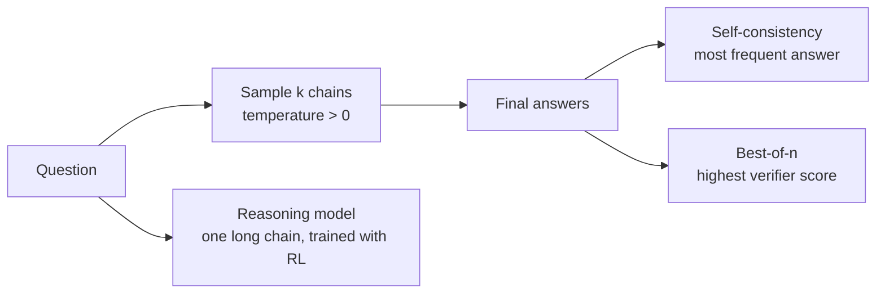

## The hook

You switch a support classifier to a reasoning model because it "reasons better". Accuracy does not move, the bill goes up by an order of magnitude and p95 latency goes from under a second to tens of seconds. The same week, a colleague runs the same switch on a pipeline that checks SQL migrations for ordering bugs, and it catches problems the old model missed.

Both outcomes are normal. Thinking tokens buy accuracy on problems that need several dependent steps, and buy almost nothing on problems that need one. This lesson is about telling the two apart, and about the cheaper ways of spending compute at inference time that came before reasoning models.

## The simple explanation

Ask a colleague to multiply 47 by 38 in their head and answer instantly, and they may get it wrong. Give them a piece of paper and they write partial products, add them, and get it right. Nothing about their brain changed; they got room to work. Ask them five times on five sheets and take the most common answer, and a slip on one sheet gets outvoted.

**Test-time compute** is that paper. You spend more tokens per question at inference instead of training a bigger model.

Where the analogy breaks: a person's scratch work is how they actually computed the answer. A model's written reasoning is more generated text, and it is not guaranteed to be the real cause of the final answer. And five sheets from the same person share the same misconceptions, so voting cannot fix an error everyone makes.

## Under the hood

### Chain of thought: tokens as working memory

A transformer does a fixed amount of computation per generated token: one forward pass through all its layers. A problem that needs ten dependent steps does not fit into the computation for one token. If the model writes the intermediate steps as text, each later token can attend to those earlier results (lesson 3), so the computation is spread across many forward passes.

Wei et al. (2022) showed this with **chain-of-thought prompting**: few-shot examples that include worked steps before the answer. It improved arithmetic, commonsense and symbolic reasoning tasks, and the gains appeared mainly in large models. Small models produced fluent but wrong chains. The prompt "Let's think step by step" gets a similar effect without examples.

The cost is direct: every step is an output token, generated sequentially.

### Self-consistency: sample many, vote

Wang et al. (2022) proposed **self-consistency**: sample several chains of thought at a non-zero temperature (lesson 5), extract the final answer from each and return the most frequent one. Different reasoning paths that reach the same answer are evidence for it.

Two conditions hide in that sentence:

- The final answers must be comparable. A number or a multiple-choice letter works. Two paragraphs of prose do not, unless you normalize them somehow.
- Voting converges to the **most likely single answer**, not to the correct answer. If the errors are spread over many different wrong values, the correct answer wins even when a single sample is right less than half the time. If the model tends to make the *same* mistake, a common trap, voting amplifies it.

Cost grows linearly with the number of samples `k`. Latency does not have to: the samples are independent and can run in parallel, so wall-clock time is roughly the longest sample.

### Best-of-n and verifiers

Instead of voting, generate `n` candidates and let a **verifier** pick the best one. Cobbe et al. (2021) trained a model to judge whether a solution to a math word problem was correct and used it to rank many sampled solutions. In code the verifier can be real: run the unit tests and keep a candidate that passes.

When the verifier is exact (tests, a type checker, a solver), best-of-n is the strongest of these techniques. When it is a learned model, it makes mistakes, and more candidates give it more chances to be fooled by a wrong answer that happens to score high. Cobbe et al. report that past a certain number of candidates, performance starts to fall for exactly that reason.

### Reasoning models: RL on verifiable rewards

Prompting and sampling use a model as is. **Reasoning models** are trained to think. After pretraining and the post-training of lesson 10, they get a reinforcement learning stage on problems whose answers can be checked automatically: math with a known result, code with tests. The model generates a long chain followed by an answer, a program checks the answer, and the reward pushes up the probability of whatever chains led to correct answers. No one writes the reasoning steps; only the outcome is graded.

DeepSeek-AI's DeepSeek-R1 report (2025) describes this openly. Their R1-Zero model was trained with RL directly from a base model, using rule-based rewards for answer accuracy and output format rather than a learned reward model, partly to avoid reward hacking. Over training its responses grew longer and it started rechecking its own work. R1-Zero's output had readability problems and mixed languages, so the released R1 added a small amount of curated "cold start" data and several more training stages. They also distilled R1's outputs into smaller open models.

In products, the thinking is usually a separate block before the answer. Some providers show it, some show a summary, some hide it, and many APIs expose a knob for how much to think (a token budget or an effort level). Thinking tokens are generated like any other output and you pay for them whether or not you see them; check your provider's pricing page for the exact rules.

### What benchmarks do and do not show

Reasoning models are announced with benchmark gains. Read them with three questions:

- **Contamination.** Popular test problems and their solutions are on the web, and the web is training data. A high score can be partly recall. Fresh problems released after the training cutoff are a better signal than old ones.
- **Saturation.** When several models are near the top of a benchmark, the differences between them are small compared with the noise. Some popular math benchmarks have only a few dozen problems, so one problem moves the score by several points.
- **Checkable answers.** RL on verifiable rewards works best where answers can be graded by a program, and so do benchmarks. A big gain on competition math says little about writing a good incident summary, following your style guide or making a judgment call.

The visible chain is also not an audit log. Research has shown that models can be influenced by cues in the prompt that their written reasoning never mentions. Treat the chain as a debugging hint, not as proof.

### When thinking is worth paying for

| Task | Extra thinking helps? | Why |
|---|---|---|
| Multi-step math, quantitative analysis | Usually | Many dependent steps, checkable result |
| Code with tests, debugging | Usually | Steps depend on each other; a verifier exists |
| Planning, scheduling, constraint problems | Often | Search over options, backtracking |
| Lookup, retrieval-grounded Q&A | Rarely | The answer is in the context or not; thinking cannot add facts |
| Extraction, reformatting | Rarely | One step; structured output matters more |
| Simple classification | Rarely | One decision; errors come from ambiguity, not from missing steps |

The rule of thumb: if a careful person would need scratch paper, thinking helps. If they would answer at a glance, you are paying for a longer path to the same answer. Snell et al. (2024) reach a similar conclusion for sampling and verifier search: the best way to spend inference compute depends on how hard the prompt is, so allocating it per prompt beats a fixed budget for every request.

## The engineering connection

- **Measure on your task, not on benchmarks.** Build a small eval set (lesson 11) and compare a fast model, a fast model with `k` votes and a reasoning model on accuracy, cost per item and p95 latency. Choose per route, not per company.
- **Budget the thinking.** Thinking tokens are output tokens: billed, usually at the higher output price, and generated sequentially. Set the thinking budget or effort level explicitly and cap total output tokens, or one hard request can take minutes.
- **Route by difficulty.** Send easy requests to a fast model and escalate when a cheap check fails (invalid JSON, failing tests, low agreement between two samples). This is the usual way to get most of the accuracy for a fraction of the cost.
- **Use real verifiers where they exist.** Tests, schema validation, a SQL `EXPLAIN`, a calculator. A program that checks the answer beats a model that judges it, and makes best-of-n safe.
- **Agreement is a signal, not a guarantee.** If five samples agree, the model is consistent, not necessarily right. Shared failure modes produce confident, unanimous wrong answers.
- **Do not show the chain to users as an explanation.** It can be wrong while the answer is right, and right-sounding while the answer is wrong. Some providers also restrict what you may do with it.

## Hands-on challenge

File: `courses/ai-engineering/exercises/lesson_21_reasoning_models.py`. NumPy only, a seeded simulation with no real model. A fake "solver" answers 3,000 arithmetic word problems at three difficulty levels, each sample right with a fixed probability `p` per level. It compares a direct answer, majority vote over `k` = 1, 3, 5, 9, 15 chains and best-of-k with a noisy verifier, in a world where errors are spread out (A) and one where hard problems share a trap answer (B). It then looks at a single problem with `p` = 0.40. About 15 minutes.

**Predict before you run:**

1. In world A, a single chain is right about 64% of the time on average. What will a 15-sample vote reach?
2. How many tokens per problem does that vote cost, if one chain averages about 440 tokens?
3. In world B, what happens to accuracy on hard problems when you go from 1 sample to a 15-sample vote?
4. One problem, right 40% of the time per sample. Does a 15-sample vote get better or worse than 0.40 if all errors land on the same trap answer? What if they are spread over 30 values?
5. Which configuration has the best accuracy per 1,000 tokens, and does that make it the best choice?

::: predict
P: vote15 | number | claim:a_vote15 | 0.05 | World A: accuracy of a 15-sample majority vote?
P: tokens | number | claim:a_vote15_tokens | 500 | World A: average tokens per problem for the 15-sample vote?
P: hardvote | choice:up=Goes up;flat=Stays about the same;down=Goes down | down | | World B, hard problems: from 1 sample to a 15-sample vote, accuracy...
P: trap | number | claim:c_trap15 | 0.1 | One problem, p = 0.40, every error on the same trap: accuracy of a 15-sample vote?
:::

The run command is at the bottom of this page.

What the script printed for me (open after predicting)

- Direct answer, no chain: accuracy {{claim:direct_acc}}. One chain: {{claim:single_acc}} for {{claim:single_tokens}} tokens per problem.
- World A, independent errors: the 15-sample vote reaches {{claim:a_vote15}} for {{claim:a_vote15_tokens}} tokens per problem. Best-of-15 with the noisy verifier reaches only {{claim:a_best15}}: with spread-out errors, voting is a better judge than an imperfect verifier.
- World B, correlated errors: the vote climbs to {{claim:b_vote9}} at k = 9 and then stalls at {{claim:b_vote15}} at k = 15. On hard problems it gets worse, from {{claim:b_hard_single}} with one sample to {{claim:b_hard_vote15}} with fifteen, because the trap is the most common answer there. Best-of-15 does better here, {{claim:b_best15}}, since the verifier still prefers correct answers on average.
- One problem at `p` = 0.40: with errors spread out, a 15-sample vote is right {{claim:c_spread15}} of the time. With every error on one trap it is right only {{claim:c_trap15}}, and it keeps falling as `k` grows. The threshold is not `p` > 0.5; it is whether the correct answer is the single most likely one.
- Accuracy per 1,000 tokens falls from {{claim:a_per1k_single}} for one chain to {{claim:a_per1k_vote15}} for the 15-sample vote, and the direct answer wins this column by far. Efficiency alone would pick the configuration that is wrong more than half the time; you need an accuracy target first, then the cheapest way to meet it.
- The latency column assumes the samples run in parallel: it grows far slower than the token cost. The verifier adds a step after the longest sample.
- The probabilities, token counts and trap shares are invented to show the mechanics. Real models sit somewhere between world A and world B, and only your own eval tells you where.

Follow-ups: make the verifier sharper (lower its noise) and find where best-of-k overtakes voting in world A. Add a router that sends only problems where the first two samples disagree to `k` = 9, and compare its tokens per problem with a flat `k` = 9. Raise the trap share on medium problems until voting starts to hurt there too.

## Takeaways

1. Chain of thought spreads computation over more tokens. It helps multi-step problems and costs output tokens and latency on every request.
2. Voting converges to the most common answer and a verifier is only as good as its judgment. Correlated errors break voting; a weak verifier gets fooled more as `k` grows.
3. Reasoning models are trained with RL on checkable answers to think longer. Benchmarks reflect exactly those checkable tasks, so measure on your own work before paying for the thinking.

**Check question:** five samples from a reasoning model agree on the same wrong answer for a scheduling problem. Would raising `k` to 25 help? What would you add instead?

**Next up:** models that see and hear. Multimodal models put images and audio into the same token stream.

::: quiz
Q: Why does writing intermediate steps help a transformer solve multi-step problems?
A: Each token gets a fixed amount of computation. Writing intermediate results as tokens lets later tokens attend to them, so a long computation is spread over many forward passes.
Q: A single sample is right 40% of the time. Can majority voting push accuracy toward 100%?
A: Only if no single wrong answer is more likely than the right one. If errors are spread over many values, yes. If 60% of samples land on the same wrong answer, voting converges to that wrong answer.
Q: When does best-of-n with a verifier beat voting, and when can it get worse with larger n?
A: It wins when the verifier is accurate, ideally exact like unit tests, and especially when errors are correlated. With a learned, noisy verifier, more candidates give more chances that a wrong one scores highest.
Q: Your task is extracting invoice fields into JSON. Should you use a reasoning model?
A: Probably not. It is a one-step task where errors come from ambiguity or missing context, not from missing steps. Structured output and a schema check help more, at a fraction of the cost and latency.
:::

## References

- Wei et al., "Chain-of-Thought Prompting Elicits Reasoning in Large Language Models" (2022): https://arxiv.org/abs/2201.11903
- Wang et al., "Self-Consistency Improves Chain of Thought Reasoning in Language Models" (2022): https://arxiv.org/abs/2203.11171
- Cobbe et al., "Training Verifiers to Solve Math Word Problems" (2021), verifiers and best-of-n on GSM8K: https://arxiv.org/abs/2110.14168
- DeepSeek-AI, "DeepSeek-R1: Incentivizing Reasoning Capability in LLMs via Reinforcement Learning" (2025): https://arxiv.org/abs/2501.12948
- Snell et al., "Scaling LLM Test-Time Compute Optimally can be More Effective than Scaling Model Parameters" (2024): https://arxiv.org/abs/2408.03314
