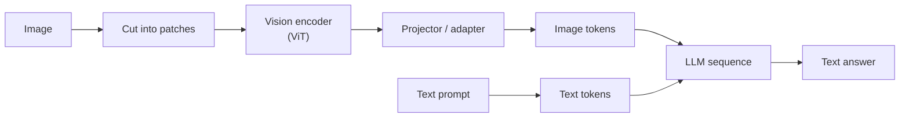

## The hook

You send a model a screenshot of an invoice and it reads the vendor, the line items and the total correctly. You then ask how many line items there are, and it says nine when there are eleven. Then you send a phone photo of a receipt, resized to save money, and it invents a total that is not on the paper.

None of that is random. A transformer only processes sequences of vectors, so an image has to be cut into pieces and turned into "tokens" before the model sees anything. How it is cut decides what it costs, what survives, and what gets lost.

## The simple explanation

Think of a photo mosaic made of square tiles. The model never looks at the picture as a whole. It receives a list of tiles, each one summarized as a vector, plus a note saying where on the grid that tile sat. From then on, those tile vectors sit in the same sequence as text tokens, and attention (lesson 3) mixes them like any other tokens.

Audio works the same way with time slices instead of tiles: chop the waveform into short overlapping frames and describe each one.

Where the analogy breaks: a tile is not a word. It carries no meaning on its own, and anything smaller than a tile, such as a thin stroke of a small letter, is blended into one vector with everything around it. The model has to learn, from huge amounts of paired data, what arrangements of tiles mean.

## Under the hood

### From pixels to patch tokens

The Vision Transformer (ViT, Dosovitskiy et al., 2020) made this concrete. Take a 224x224 image, cut it into 16x16 pixel patches, and you get a 14x14 grid of 196 patches. Flatten each patch (16 x 16 x 3 = 768 numbers for RGB) and multiply it by one learned matrix: that **linear projection** turns every patch into an embedding of the model's width. Add a **position embedding** so the model knows which patch came from where, then run an ordinary transformer encoder over the sequence.

Without positions, two identical patches of white background would be indistinguishable, and the image would be a bag of tiles. ViT learns its position embeddings; the exercise uses fixed sine and cosine positions, which do the same job for this demonstration.

```
patches   = image cut into (H/16) x (W/16) squares, each flattened
tokens    = patches @ W_proj + position_embeddings
sequence  = transformer_encoder(tokens)
```

### Image tokens grow with resolution

The patch count is `(H / p) x (W / p)` for patch size `p`. Double the side of a square image and you get four times the patches. Go from 224 to 1344 pixels, six times the side, and you get 36 times the patches. Attention cost over those patches grows with the square of that count (lesson 3).

That is why providers resize, tile or compress images before they reach the model, and why some architectures merge neighboring patches or resample them into a fixed number of tokens. The exact rule differs per model and per provider and changes over time, so read your provider's documentation and measure the token usage it reports instead of guessing.

### Contrastive image-text embeddings

CLIP (Radford et al., 2021) trains two encoders, one for images and one for text, so that a picture and its caption land close together in one shared embedding space (lesson 2). It was trained on 400 million image-text pairs collected from the internet.

The training signal is contrastive. In a batch of `N` pairs, compute the `N x N` matrix of cosine similarities. The diagonal holds the true pairs. Treat each row as a classification problem "which caption belongs to this image?" and each column as "which image belongs to this caption?", and apply cross-entropy to both (the InfoNCE loss), with similarities divided by a temperature. The loss pushes true pairs together and all other combinations apart.

The payoff is **zero-shot classification**: embed the captions "a photo of a cat", "a photo of an invoice" and so on, embed the image, and pick the caption with the highest similarity. No classifier was trained for those labels. The same space powers image search with a text query, and duplicate or near-duplicate image detection.

### Connecting a vision encoder to an LLM

A vision-language model (VLM) usually reuses a pretrained vision encoder, often a CLIP-style ViT, and a pretrained LLM. The new piece is a small **projector** or **adapter** that maps the encoder's output vectors into the LLM's input embedding space. In LLaVA (Liu et al., 2023) that projector was a single linear layer. The projected image vectors are inserted into the token sequence next to the text, and the LLM attends over them as if they were words it has never seen spelled out.



Other designs exist: some compress the image into a small fixed set of learned query tokens, others let the LLM read the image features through extra cross-attention layers instead of placing them in the sequence. Training typically first aligns the projector on image-caption pairs, then fine-tunes on instruction-style conversations about images.

### Audio becomes frames

Speech models usually start from a **spectrogram**. Cut the waveform into short overlapping windows, commonly 25 ms windows every 10 ms, apply a Fourier transform to each, and keep the magnitudes, usually mapped onto a mel frequency scale and taken in log. That gives about 100 frames per second, each a vector of frequency energies. Whisper (Radford et al., 2022) works this way on 16 kHz audio in 30-second chunks, and its encoder halves the frame rate with a strided convolution before the transformer.

The other route is a **neural audio codec**: a learned encoder compresses the waveform into a sequence of discrete codes, often several codebook indices per time step, and a decoder can turn codes back into sound. Discrete codes look like text tokens, which is what makes models that both understand and generate speech practical.

### What vision-language models get right and wrong

Strong: reading documents, forms, charts and tables, describing screenshots, transcribing clear printed text, and answering questions that combine an image with world knowledge.

Weak, and worth testing before you rely on them: **counting** many similar objects, **precise spatial relations** (left of, above, which cell a value is in on a dense grid), exact coordinates, and **small text at low resolution**. If a character stroke is thinner than what survives resizing, the information is gone before the model runs, and the model may still produce a fluent, plausible guess.

## The engineering connection

- **Invoices and forms.** A VLM can replace a template-based OCR pipeline for messy layouts. Ask for structured output (JSON with a schema) and validate it: totals must equal the sum of lines, dates must parse. Treat the model's reading as a draft that rules check.
- **Resolution is a cost dial.** Token count grows with pixel area. Crop to the region you need before upscaling the whole page. A cropped table at high resolution is usually cheaper and more accurate than a full page squeezed to fit.
- **Prefer text when you have it.** If the PDF has a text layer or the UI has an accessibility tree or DOM, send that. Use the image for layout and what text extraction misses.
- **UI screenshots and agents.** Screenshots let an agent see a UI, but coordinates and small labels are exactly the weak spots. Pair the image with element lists where possible, and verify actions by checking state, not by trusting the description.
- **Diagrams.** Models read architecture and flow diagrams reasonably well when labels are legible. Dense diagrams with crossing arrows hit the spatial-relation weakness.
- **Evaluate on your own images.** Build a small labeled set from real production inputs (phone photos, scans, rotated pages) and track accuracy per field, as in lesson 11. Public benchmark numbers rarely look like your data.
- **CLIP embeddings for search.** For "find images like this text" or deduplication, an embedding model plus a vector index is far cheaper than asking a VLM about every image.

## Hands-on challenge

File: `courses/ai-engineering/exercises/lesson_22_multimodal.py`. NumPy only. It cuts a synthetic image into 16x16 patch tokens at several resolutions, projects them into embeddings with positions, shows what downsampling does to thin strokes, runs a toy CLIP-style contrastive setup with InfoNCE and zero-shot classification, and frames a synthetic audio signal into a spectrogram. About 10 minutes.

**Predict before you run:**

1. How many 16x16 patches does a 224x224 image produce? And a 1344x1344 image?
2. Two background patches have identical pixels. Are their embeddings identical once positions are added?
3. Stripes one pixel wide are drawn at 896 px. What happens to their contrast when the image is averaged down to 448 px?
4. Is the InfoNCE loss for correctly matched pairs above or below `ln(4)`, the loss of a model that cannot tell four pairs apart? And for shuffled pairs?
5. How many frames does one second of 16 kHz audio produce with 25 ms windows and a 10 ms hop?

::: predict
P: tokens | number | claim:tokens1344 | 0 | How many 16x16 patch tokens does a 1344x1344 image produce?
P: stripes | choice:kept=Mostly kept;half=About half;gone=Gone | gone | | One-pixel stripes drawn at 896 px are averaged down to 448 px. What is left of their contrast?
P: frames | number | claim:frames1s | 3 | How many 25 ms frames with a 10 ms hop fit in one second of audio?
:::

The run command is at the bottom of this page.

<details>
<summary>What the script printed for me (open after predicting)</summary>

- 224x224 gives a grid of {{claim:grid224}} patches. 896 px gives {{claim:tokens896}} and 1344 px gives {{claim:tokens1344}}, which is {{claim:ratio1344}} times the 224 count. Six times the side, 36 times the tokens.
- The projection produces embeddings of shape `{{claim:embshape}}`, one vector per patch. Identical background patches get different embeddings only because of the positions.
- One-pixel stripes at 448 px have contrast {{claim:contrast448}}. Each averaged pixel covers one dark and one bright column, so every pixel becomes the same gray. This is the "small text at low resolution" failure in its purest form: no model can recover what the resize erased.
- Matched pairs give an InfoNCE loss of {{claim:nce_matched}}, shuffled pairs {{claim:nce_shuffled}}. The low temperature of 0.07 makes the loss very confident in both directions.
- Zero-shot accuracy is {{claim:zs1}} at low noise and drops to {{claim:zs6}} at high noise (chance is 0.25). The embeddings are random vectors around four anchors, not a trained model; the mechanics are the point.
- One second of audio gives {{claim:frames1s}} frames (the last partial window is dropped), and a 30-second clip gives {{claim:frames30}}. The dominant frequency in the second half is {{claim:dom2}} Hz, recovered from the FFT of each frame.

</details>

Follow-ups: change the patch size to 14 and recompute the token counts. Raise the temperature in `info_nce` to 1.0 and see how the matched loss moves toward `ln(4)`. Add a third tone at 1020 Hz and see whether a 40 Hz bin width can separate it from 1000 Hz.

## Takeaways

1. Images become tokens by cutting them into patches, projecting each patch to a vector and adding positions. The token count grows with pixel area, so resolution is a direct cost and accuracy trade.
2. CLIP-style contrastive training puts images and text in one embedding space, which gives zero-shot classification and text-to-image search. VLMs usually connect such a vision encoder to an LLM through a small projector.
3. Audio becomes about 100 spectrogram frames per second or a sequence of codec codes. VLMs read documents and screenshots well and fail at counting, precise spatial relations and detail lost to downsampling.

**Check question:** a receipt-parsing pipeline misreads totals on phone photos but not on scans. Name two causes rooted in how images become tokens, and one change to the pipeline for each.

**Next up:** take a multimodal feature to production with the evaluation habits from lesson 11 and the cost and latency budgeting from lesson 20.

::: quiz
Q: A model uses 16x16 patches. How many patch tokens does a 448x448 image produce, and what happens if you double the side to 896?
A: 28 x 28 = 784 patches. Doubling the side gives 56 x 56 = 3,136, four times as many, because the count grows with the area.
Q: In CLIP training, what does the InfoNCE loss push together and what does it push apart?
A: It pushes each image toward its own caption (the diagonal of the similarity matrix) and away from every other caption in the batch, in both directions.
Q: What does the projector in a vision-language model do?
A: It maps the vision encoder's output vectors into the LLM's input embedding space, so image features can sit in the same token sequence as text.
Q: Why can a VLM fail to read small text even though it reads large text perfectly?
A: If the image is downscaled before patching, strokes thinner than the new pixel size are averaged away. The information is gone before the model runs, and the model may still guess fluently.
:::

## References

- Dosovitskiy et al., "An Image is Worth 16x16 Words: Transformers for Image Recognition at Scale" (2020): https://arxiv.org/abs/2010.11929
- Radford et al., "Learning Transferable Visual Models From Natural Language Supervision" (2021), CLIP: https://arxiv.org/abs/2103.00020
- Liu et al., "Visual Instruction Tuning" (2023), LLaVA: https://arxiv.org/abs/2304.08485
- Radford et al., "Robust Speech Recognition via Large-Scale Weak Supervision" (2022), Whisper: https://arxiv.org/abs/2212.04356
