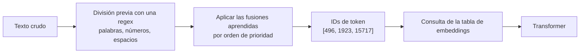

## El gancho

Pregúntale a un modelo de última generación cuántas veces aparece la letra «r» en «strawberry» y, durante mucho tiempo, muchos fallaban. El modelo es capaz de escribir un soneto, pero no de hacer con fiabilidad lo que hace un niño de primaria.

No es falta de inteligencia. Es un problema de interfaz, y el género ya lo conoces: es como preguntarle a una API REST por una propiedad que nunca serializó. El modelo nunca recibe las letras. Recibe una lista de enteros.

> **Predice:** ¿cuántos tokens ocupa la palabra `strawberry`? ¿Uno, tres, diez? Guarda tu apuesta para el ejercicio.

## La explicación sencilla

Un modelo de lenguaje no sabe leer texto. Antes de que ocurra cualquier otra cosa, un **tokenizer** trocea tu cadena en fragmentos llamados **tokens** y sustituye cada uno por un ID entero de un vocabulario fijo. El modelo solo ve esos IDs.

Piensa en un Scrabble con fichas poco habituales. En lugar de 26 letras sueltas tienes unas 100.000 fichas: palabras frecuentes (` the`), fragmentos de palabras (`berry`), caracteres sueltos e incluso trozos de código habituales. Para escribir algo aplicas las reglas de fusión del tokenizer, aprendidas una sola vez a partir de un corpus grande, y normalmente acabas con un puñado de fichas por palabra.

Dónde falla la analogía: un jugador de Scrabble elige sus fichas; un tokenizer no optimiza nada al codificar, sino que reproduce una lista fija de fusiones. La misma palabra puede cortarse de forma distinta según lleve un espacio delante o empiece por mayúscula.

Tres consecuencias que ya puedes predecir:

- El modelo ve `strawberry` como unos pocos trozos, no como diez letras, así que contar letras es una conjetura sobre una ortografía que tiene que haber memorizado.
- Pagas, y tienes límites, por token, no por carácter ni por palabra.
- Los idiomas poco frecuentes en los datos de entrenamiento del tokenizer se trocean en más fragmentos, así que cuestan más.

## Bajo el capó

### Byte Pair Encoding (BPE)

La mayoría de los tokenizers modernos usan alguna variante de **byte pair encoding**. Entrenar el tokenizer es un juego de contar sobre un corpus de texto grande:

1. Empieza por las unidades más pequeñas: bytes (o caracteres).
2. Cuenta todos los pares adyacentes. Fusiona el par más frecuente en un símbolo nuevo.
3. Repite hasta que el vocabulario alcance el tamaño objetivo (decenas o cientos de miles de entradas).

La lista ordenada de fusiones *es* el tokenizer. Para codificar texto nuevo, reproduces las fusiones en orden.

Los IDs del diagrama son ilustrativos. Verás los reales en el ejercicio.

### Detalles que sorprenden

- **Los espacios forman parte de los tokens.** ` strawberry` (con un espacio delante) y `strawberry` se dividen en secuencias de tokens distintas, con IDs distintos. Lo mismo ocurre con `Strawberry` y `strawberry`.
- **Los números se trocean por una regla, no por su valor.** La regex de división previa que usa `cl100k_base` corta las secuencias de dígitos en grupos de hasta tres, así que `12345678` no se queda en una sola unidad. Los modelos son malos en aritmética, en parte, porque para ellos «el número» no es un único objeto.
- **Es sin pérdidas.** La tokenización es una correspondencia reversible: `decode(encode(text))` devuelve el texto original. Como el alfabeto base son bytes, se puede codificar cualquier entrada UTF-8, incluidos emojis y cadenas que el tokenizer nunca vio.
- **Los vocabularios están ligados a los modelos.** Los IDs de token de un tokenizer no significan nada para otro modelo. Contar tokens con el tokenizer equivocado da costes equivocados.

### Reglas generales para el inglés

Según la propia guía de OpenAI, en inglés un token equivale aproximadamente a 4 caracteres o a tres cuartos de palabra (consulta las referencias). El código, el JSON con mucha puntuación y el texto en otros idiomas suelen necesitar más tokens por carácter. Toma estas cifras como estimaciones y mide con el tokenizer real.

## La conexión con la ingeniería

**Coste.** Las APIs cobran por token, normalmente con precios distintos para los tokens de entrada y los de salida. Una plantilla de prompt que desperdicia 300 tokens por llamada es un impuesto recurrente. Equivale a una consulta que devuelve 300 columnas innecesarias.

**Ventana de contexto.** La ventana de contexto es un presupuesto de tokens que comparten el prompt de sistema, la conversación, los documentos recuperados y la respuesta. Estimarla en caracteres es la forma más segura de acabar con un error en producción a las 3 de la madrugada.

**Equidad entre idiomas.** La misma frase en español suele necesitar más tokens que en inglés, porque el tokenizer se entrenó con más texto en inglés. Eso significa más coste y un contexto efectivo más pequeño para los usuarios hispanohablantes. El ejercicio lo mide con un par de frases.

**Fallos causados por los tokens:**

- contar letras, invertir cadenas, anagramas y pasatiempos de ortografía;
- aritmética con números largos y comparación exacta de IDs;
- comportamientos erráticos ante cadenas raras que el tokenizer dividió de forma extraña;
- prompts que a ti te parecen idénticos pero difieren en espacios en blanco, lo que cambia los tokens y puede cambiar la salida.

**Qué hacer en el código.** Cuenta los tokens antes de enviar. En Python, usa `tiktoken` para las codificaciones de la familia OpenAI. En .NET, el paquete `Microsoft.ML.Tokenizers` ofrece codificadores equivalentes. Usa siempre el tokenizer que corresponde al modelo de destino y deja un margen de seguridad, porque el formato de chat añade unos cuantos tokens por mensaje.

## Reto práctico

Archivo: `lessons/lesson_01_tokenization.py`. Imprime el número de tokens, los IDs y los fragmentos de seis cadenas, y después compara una frase en inglés con otra en español. Unos 10 minutos. La primera ejecución descarga el archivo de vocabulario de `cl100k_base` (unos 2 MB), así que necesita acceso a la red una vez.

Antes de ejecutarlo, escribe tus respuestas a estas preguntas en el cuadro del final de la página:

1. ¿Cuántos tokens ocuparán `strawberry`, ` strawberry` (con un espacio delante) y `Strawberry`? ¿Serán iguales?
2. ¿Cómo se dividirá `12345678`?
3. ¿Necesitará `fresa` (strawberry en español) más o menos tokens que `strawberry`?
4. ¿Qué ocupa más tokens, la frase en inglés sobre el reembolso o su traducción al español? ¿En qué porcentaje, aproximadamente?

Después ejecútalo (el comando está al final de esta página).

Para profundizar, si tienes tiempo:

- Añade tu nombre y el de tu empresa. ¿Cuál se trocea en más fragmentos?
- Codifica un objeto JSON pequeño y los mismos datos redactados como una frase. Compara los recuentos.
- Explica, a partir de los fragmentos que se imprimen para `strawberry`, por qué es difícil acertar cuando le preguntas por el número de erres.

Pistas, sin spoilers

La regex de división previa separa letras, dígitos y espacios antes de aplicar las fusiones. Fíjate en dónde ha ido a parar el espacio en los fragmentos de la salida. En la comparación con el español, compara los tokens por carácter, no solo los totales.

## Ideas clave

1. El modelo ve IDs de token de un vocabulario fijo, nunca letras. Las tareas a nivel de letra le resultan indirectas.
2. BPE construye el vocabulario fusionando una y otra vez el par adyacente más frecuente. Los espacios, las mayúsculas y el idioma cambian los tokens.
3. Los tokens son la unidad de coste, de velocidad y de contexto. Cuéntalos con el tokenizer correcto en lugar de hacer suposiciones.

**Pregunta de control:** un cliente informa de que, con el mismo valor de `max_tokens`, las respuestas en español de tu bot de soporte se cortan antes que las respuestas en inglés. Explica la causa y da dos formas de solucionarlo.

**A continuación:** los embeddings. Una vez que el texto es una lista de IDs, ¿cómo se convierte un número como 15717 en algo que tiene significado? Lo vemos en la lección 2.

::: quiz
Q: ¿Por qué un modelo que escribe prosa con soltura puede fallar al contar las letras de una palabra?
A: Porque nunca ve letras. El tokenizer le pasa IDs enteros de trozos como `str`, `aw`, `berry`, así que la información sobre la ortografía tiene que haberla memorizado, no puede leerla en la entrada.
Q: Pasas un prompt del inglés al español. ¿Qué ocurre con el coste y con el contexto efectivo, y por qué?
A: Ambos empeoran. El vocabulario se entrenó sobre todo con inglés, así que el texto en español se trocea en más fragmentos y más pequeños. Más tokens implica más coste por llamada y menos margen antes de que se llene la ventana de contexto.
Q: ¿Elige BPE la división que produce menos tokens?
A: No. Reproduce una lista fija y ordenada de fusiones aprendidas durante el entrenamiento del tokenizer. El resultado suele ser compacto, pero nada optimiza el recuento al codificar.
:::

## Referencias

- Sennrich, Haddow y Birch, "Neural Machine Translation of Rare Words with Subword Units" (2016), el artículo que introdujo BPE en el procesamiento del lenguaje natural: https://arxiv.org/abs/1508.07909
- OpenAI, repositorio de `tiktoken` y la guía "What are tokens" (unos 4 caracteres por token en inglés): https://github.com/openai/tiktoken y https://platform.openai.com/tokenizer
- Microsoft, paquete `Microsoft.ML.Tokenizers` para .NET: https://www.nuget.org/packages/Microsoft.ML.Tokenizers
