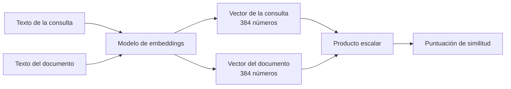

## El gancho

Buscas «¿Cómo recupero mi dinero?» y el mejor resultado es un documento titulado «Política de reembolsos: devoluciones en un plazo de 30 días». Casi no comparten palabras y, aun así, la búsqueda lo encontró. ¿Cómo puede saber una máquina que «recuperar mi dinero» y «reembolso» son vecinos?

La respuesta es también el origen del bug de búsqueda más extraño que te vas a encontrar: el mismo sistema puede considerar casi idénticos «El pedido #48213 se ha enviado» y «El pedido #48231 se ha enviado», porque para el modelo lo son.

## La explicación sencilla

Un **embedding** es una lista de números (un vector) que representa un fragmento de texto. La propiedad clave: los textos con significados parecidos obtienen vectores que apuntan en direcciones parecidas.

Imagina un mapa en el que cada frase es una chincheta. «Reembolso» y «recuperar mi dinero» son chinchetas del mismo barrio; «un gato en el alféizar» está en otra ciudad. Buscar se convierte en «encontrar las chinchetas más cercanas a mi pregunta».

Dónde falla la analogía: un mapa tiene dos dimensiones y la distancia se mide en kilómetros. Un embedding tiene cientos de dimensiones, nadie ha etiquetado los ejes y «cerca» significa *parecido en los aspectos a los que el modelo aprendió a dar importancia*, que no siempre son los que te importan a ti.

## Bajo el capó

### De tokens a vectores

Un modelo de embeddings es una red neuronal entrenada para que los textos relacionados acaben cerca unos de otros. En el ejercicio, `all-MiniLM-L6-v2` convierte cualquier texto en **384 números**. El entrenamiento acerca los pares que van juntos (una pregunta y su respuesta, dos paráfrasis) y aleja los pares sin relación. El significado no está almacenado de forma explícita en ningún sitio. Es geometría que surge de esa presión.

### Similitud coseno

Para comparar dos vectores nos preguntamos hasta qué punto están alineados:

```
cosine(a, b) = (a . b) / (|a| * |b|)
```

Vale 1 si tienen la misma dirección, 0 si no guardan relación (son perpendiculares) y es negativa si apuntan en sentidos opuestos. Si los vectores están normalizados a longitud 1, la fórmula se reduce a un simple producto escalar. El ejercicio pasa `normalize_embeddings=True`, así que `va @ vb` *es* la similitud coseno.



### Dos tipos de embeddings

No confundas la tabla de embeddings que hay *dentro* de un LLM (una tabla de consulta que asigna un vector a cada ID de token, aprendida durante el entrenamiento; la lección 4 muestra en qué punto de la arquitectura se sitúa) con un *modelo* de embeddings como MiniLM, que es una red completa que produce un único vector para un texto entero. Comparten una idea, no una API.

### Lo que estos vectores hacen mal

Un modelo de embeddings comprime una frase en un resumen de tamaño fijo. Y al comprimir se pierden cosas:

- **La negación.** «La película era genial» y «La película no era genial» tratan del mismo tema, así que tienden a quedar cerca.
- **Los identificadores y los valores exactos.** Los números de pedido, los códigos de error, los SKU y las fechas difieren en unos pocos caracteres, lo que apenas mueve el vector.
- **Las palabras poco frecuentes y los nombres** que el modelo apenas vio.
- **La dirección de las relaciones.** «A demandó a B» y «B demandó a A» parecen muy similares.

Similitud significa *relacionado temáticamente*, no *equivalente* ni *verdadero*.

## La conexión con la ingeniería

Los embeddings son la columna vertebral de la búsqueda semántica, los sistemas de recomendación, la detección de duplicados, el clustering y la recuperación de información para LLM (consulta la nota conceptual sobre RAG). El flujo de trabajo en la práctica:

1. Calcula el embedding de cada documento una sola vez, offline, y guarda los vectores.
2. En el momento de la consulta, calcula el embedding de la consulta y busca los vectores más cercanos.
3. Devuelve los primeros resultados.

Opciones de almacenamiento que ya conoces: una tabla con una columna `VARBINARY` o de tipo array para volúmenes pequeños; el tipo nativo `vector` de las versiones recientes de SQL Server y Azure SQL; PostgreSQL con pgvector; o una base de datos vectorial dedicada. Para unos pocos miles de documentos, un producto escalar por fuerza bruta sobre un array de NumPy es suficiente. Los índices de vecinos más cercanos aproximados (HNSW y similares) solo importan a gran escala.

Compromisos que conviene recordar:

- **Dependencia del modelo.** Los vectores de modelos distintos son incompatibles. Cambiar de modelo implica volver a calcular todos los embeddings.
- **Las dimensiones cuestan memoria.** 384 floats de 4 bytes son unos 1,5 KB por documento, sin contar la sobrecarga del índice.
- **Chunking.** Los documentos largos hay que dividirlos. El tamaño de cada chunk cambia lo que significa cada vector.
- **Sin garantía de coincidencia exacta.** Una búsqueda vectorial puede pasar por alto el documento que contiene exactamente tu cadena. La lección 6 lo mide y lo corrige.

## Reto práctico

Archivo: `lessons/lesson_02_embeddings.py`. Calcula los embeddings de cinco pares de frases e imprime sus similitudes coseno. La primera ejecución descarga un modelo de unos 90 MB. Unos 10 minutos.

Los pares:

1. "The movie was great" frente a "The film was wonderful"
2. "The movie was great" frente a "The movie was not great"
3. "Order #48213 has shipped" frente a "Order #48231 has shipped"
4. "How do I get my money back?" frente a "Refund policy: returns within 30 days"
5. "How do I get my money back?" frente a "The cat sat on the warm windowsill"

**Predice antes de ejecutar:**

1. Ordena los cinco pares de mayor a menor similitud.
2. ¿Qué par resulta más sorprendente si entiendes la similitud como «significa lo mismo»?
3. ¿El par 2 obtendrá una puntuación más alta o más baja que el par 4? ¿Qué te dice eso sobre usar un umbral para decidir qué es «relevante»?

::: predict
P: top | choice:paraphrase=Paráfrasis de la película;negation=Negación de la película;orders=Números de pedido;refund=Dinero y reembolso;cat=Dinero y gato | orders | | ¿Qué pareja puntúa más alto?
P: negation | choice:negation=La pareja con negación;refund=La pareja del reembolso | negation | | ¿Cuál puntúa más: la pareja con negación o la del reembolso?
P: dims | number | claim:dims | 0 | ¿Cuántas dimensiones tiene cada embedding?
:::

El comando para ejecutarlo está al final de esta página.

Para profundizar:

- Añade un par que solo se diferencie en la cifra de un precio ("costs $10" frente a "costs $1000").
- Añade un par en español y en inglés con el mismo significado. ¿Los relaciona el modelo?
- Imprime los cinco primeros números de un vector. ¿Puedes deducir algo de ellos? (No deberías poder.)

<details>
<summary>Lo que imprimió el script (ábrelo después de predecir)</summary>

- La más alta de todas: las dos confirmaciones de pedido, {{claim:pair_orders}}. Para el modelo son casi la misma frase; un dígito transpuesto apenas mueve el vector.
- Paráfrasis, "great" frente a "wonderful": {{claim:pair_paraphrase}}. Negación, "great" frente a "not great": {{claim:pair_negation}}, casi igual de cerca. Significados opuestos, mismo tema.
- La pregunta frente a la política de reembolsos: {{claim:pair_refund}}, relacionadas y casi sin palabras en común. Frente al gato: {{claim:pair_cat}}.
- La pareja con negación puntúa por encima de la del reembolso, así que ningún umbral único separa lo relevante de lo irrelevante: un corte lo bastante bajo para conservar la política de reembolsos también conserva la negación.
- Cada vector tiene {{claim:dims}} dimensiones.

</details>

## Ideas clave

1. Un embedding asigna a un texto un vector de forma que la cercanía aproxima la afinidad de significado.
2. La similitud coseno compara direcciones. Con vectores normalizados, es simplemente un producto escalar.
3. Los embeddings son ciegos a la negación, a los identificadores exactos y a los valores precisos. Nunca des por hecho que una similitud alta significa «correcto».

**Pregunta de control:** tu buscador de soporte devuelve el artículo sobre el estado de los pedidos cuando el usuario escribe un número de pedido concreto que no existe. ¿Por qué ocurre esto con el enfoque basado en embeddings y qué otra señal añadirías?

**A continuación:** la atención, el mecanismo que permite a un modelo decidir qué tokens anteriores importan para el siguiente.

::: quiz
Q: Dos frases obtienen una similitud coseno de 0,85. ¿Qué puedes concluir y qué no?
A: Que tratan de cosas muy relacionadas en los aspectos a los que el modelo aprendió a dar importancia. No puedes concluir que signifiquen lo mismo, que una de ellas sea verdadera ni que estén de acuerdo: las negaciones y los identificadores intercambiados suelen puntuar así de alto.
Q: ¿Por qué basta con el producto escalar para comparar los vectores del ejercicio?
A: Porque los vectores están normalizados a longitud 1, así que el denominador de la fórmula del coseno vale 1 y el producto escalar es la similitud coseno.
Q: Cambias el modelo de embeddings en producción. ¿Qué tiene que pasar con los vectores almacenados?
A: Hay que recalcularlos todos. Los vectores de modelos distintos viven en espacios sin relación entre sí, así que mezclarlos hace que la búsqueda de vecinos más cercanos pierda todo sentido.
:::

## Referencias

- Reimers y Gurevych, "Sentence-BERT: Sentence Embeddings using Siamese BERT-Networks" (2019), la idea de entrenamiento en la que se basan los modelos tipo MiniLM: https://arxiv.org/abs/1908.10084
- Documentación de Sentence-Transformers y ficha del modelo `all-MiniLM-L6-v2`: https://www.sbert.net y https://huggingface.co/sentence-transformers/all-MiniLM-L6-v2
- pgvector, búsqueda por similitud vectorial para PostgreSQL: https://github.com/pgvector/pgvector
