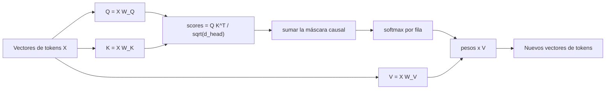

## El gancho

Lee esta frase: "The trophy didn't fit in the suitcase because it was too big." («El trofeo no cabía en la maleta porque era demasiado grande»). ¿A qué se refiere "it"? Ahora cambia "big" por "small". El referente se invierte.

Para acertar, un modelo tiene que dejar que la palabra "it" mire hacia atrás, a las demás palabras, y decida cuál importa. Esa búsqueda es la **atención**, el mecanismo central del transformer (Vaswani et al., 2017, en las referencias). También es la razón por la que los contextos largos son caros.

## La explicación sencilla

La atención es una búsqueda en una base de datos, suave y aprendida, que ocurre para cada token en cada capa.

Cada token escribe tres cosas:

- una **consulta** (query): "¿qué estoy buscando?"
- una **clave** (key): "¿qué contengo?"
- un **valor** (value): "lo que te entregaré si me eliges".

Un token compara su consulta con todas las claves. A más coincidencia, más peso. Después recoge una **media ponderada de los valores**. El resultado es un nuevo vector para ese token, ahora enriquecido con información de los tokens a los que ha prestado atención.

Para un ingeniero de .NET: imagina una búsqueda en un diccionario en la que, en lugar de exigir igualdad exacta de clave, cada entrada coincide en cierto grado, y recibes una mezcla de todos los valores ponderada por la calidad de la coincidencia. Una tabla hash devuelve un valor. La atención devuelve una combinación convexa de todos ellos.

Dónde falla la analogía: las claves, las consultas y los valores no se escriben a mano. Los producen matrices aprendidas, y lo que significa "coincidir" se descubre durante el entrenamiento.

## Bajo el capó

### El cálculo

Para una secuencia de `n` vectores de tokens `X` (de forma `n x d_model`) y las matrices aprendidas `W_Q`, `W_K`, `W_V`:

```
Q = X W_Q      K = X W_K      V = X W_V
scores  = Q K^T / sqrt(d_head)
weights = softmax(scores + mask)
output  = weights V
```



Repasemos las piezas:

- **`Q K^T`** da una matriz `n x n`. La celda `(i, j)` indica cuánto coincide la consulta del token `i` con la clave del token `j` (un producto escalar).
- **Dividir entre `sqrt(d_head)`** mantiene las puntuaciones (scores) en un rango razonable. La dispersión del producto escalar entre vectores aleatorios crece con la raíz cuadrada de su dimensión, así que la división mantiene esa dispersión constante sea cual sea el tamaño de la cabeza. Sin ella, la softmax se satura en filas casi one-hot, y una softmax saturada tiene gradientes diminutos, de modo que el entrenamiento se estanca. El experimento B del ejercicio lo muestra.
- **La softmax** convierte cada fila de puntuaciones en pesos positivos que suman 1.
- **La máscara causal** fija en menos infinito las puntuaciones de las posiciones futuras antes de la softmax, de modo que su peso es exactamente 0. Un token puede mirarse a sí mismo y al pasado, nunca al futuro. Esto es lo que hace honesta la predicción del siguiente token: durante el entrenamiento, el modelo no puede asomarse a la respuesta.
- **Los pesos por V** mezclan los valores.

### Atención de múltiples cabezas (multi-head)

Un solo patrón de atención no basta. Un token puede necesitar sintaxis de un sitio, un referente de otro y una palabra cercana de un tercero. Por eso el modelo ejecuta en paralelo varios cálculos de atención más pequeños, llamados **cabezas** (heads), cada uno con sus propias `W_Q`, `W_K`, `W_V` de anchura `d_head = d_model / number of heads`. Las salidas de las cabezas se concatenan y se mezclan mediante una matriz de salida. Las cabezas son libres de especializarse, y en los modelos entrenados algunas lo hacen, aunque la mayoría no son interpretables de forma limpia.

### El coste

La matriz de puntuaciones es `n x n`. Si duplicas el contexto, la matriz se hace **cuatro veces** más grande, para cada cabeza de cada capa. Ese es el coste cuadrático, y la razón por la que los contextos largos son caros en cómputo y en memoria. Los sistemas reales lo reducen con kernels optimizados, patrones dispersos o de ventana deslizante y otros trucos, pero la presión siempre está ahí.

### La caché KV

Al generar texto token a token, las claves y los valores de los tokens anteriores no cambian, gracias a la máscara causal. Así que el servidor los almacena (la **caché KV**) y, para cada token nuevo, calcula solo una consulta, una clave y un valor nuevos, y luego atiende sobre las claves y los valores en caché. El experimento E del ejercicio comprueba que la decodificación con caché da los mismos números que recalcularlo todo.

El compromiso: la caché ahorra cómputo, pero ocupa memoria de GPU que crece con la longitud del contexto, el número de capas y el número de usuarios concurrentes. Al servir modelos, a menudo es la memoria de la caché KV, y no el cómputo bruto, lo que limita cuántas peticiones caben en una GPU.

## La conexión con la ingeniería

- **Por qué los prompts tienen precio.** Un prompt largo tiene que procesarse (la fase de "prefill") y después guardarse en caché. Los tokens de salida se generan de uno en uno, y cada uno atiende sobre toda la caché. Por eso los proveedores cobran de forma distinta la entrada y la salida, y por eso la latencia tiene dos componentes: el tiempo hasta el primer token y, después, los tokens por segundo.
- **Caché de prompts (prompt caching).** Si muchas peticiones empiezan con el mismo prefijo largo (prompt de sistema, documentos), el proveedor puede reutilizar su caché KV para ese prefijo. Para aprovecharlo, pon el contenido estable al principio y el variable al final.
- **"Lost in the middle" (perdido en el medio).** Los modelos suelen aprovechar mejor la información que está al principio y al final de un contexto largo que la que está en el medio (Liu et al., 2023, en las referencias). Una intuición, no una causa demostrada: los pesos de atención suman 1, así que la evidencia dentro de un contexto enorme compite con todo lo demás. Sea cual sea el mecanismo, una ventana más grande no equivale a recordar mejor.
- **La información solo fluye hacia atrás.** La atención causal es la razón por la que los modelos de solo decodificador (decoder-only) responden continuando el texto, y por la que importa el orden del contenido en tu prompt.
- **Planificación de capacidad.** Si alojas tú mismo el modelo, el tamaño de la caché KV por token multiplicado por la longitud del contexto y por la concurrencia es una cifra de dimensionamiento de primer orden.

## Reto práctico

Archivo: `lessons/lesson_03_attention.py`. Solo numpy: un ejemplo de juguete de cuatro tokens con semilla fija. Unos 10 minutos.

**Predice antes de ejecutar:**

1. Con la máscara causal, ¿qué celdas de la matriz de pesos 4x4 son exactamente 0?
2. ¿Cuánto suma cada fila?
3. ¿Cómo es la primera fila y por qué?
4. Si cambias el último token, ¿cambiará la salida del primer token? ¿Y si quitas la máscara?
5. Con cabezas de 256 dimensiones, ¿qué se acerca más a una fila one-hot: las puntuaciones escaladas o las no escaladas?
6. Si duplicas la longitud del contexto, ¿por qué factor se multiplica el tamaño de la matriz de puntuaciones?

::: predict
P: firstrow | choice:changed=Cambia;same=No cambia | same | | Con la máscara causal cambias el último token. ¿Qué pasa con la salida del primer token?
P: onehot | choice:scaled=Con escalado;unscaled=Sin escalado | unscaled | | Con cabezas de 256 dimensiones, ¿qué puntuaciones dan filas más cercanas a one-hot?
P: factor | number | 4 | 0 | ¿Por cuánto se multiplica el tamaño de la matriz de puntuaciones al duplicar el contexto?
:::

El comando para ejecutarlo está al final de esta página.

<details>
<summary>Lo que el script me imprimió (ábrelo después de predecir)</summary>

Pesos (las filas son las consultas):

```
{{claim:weights_table}}
```

- Todo lo que queda por encima de la diagonal es exactamente 0. Cada fila suma 1.
- El primer token solo puede verse a sí mismo, así que su fila es `[1, 0, 0, 0]`.
- Al cambiar el último token, ¿cambió la primera salida con la máscara? `{{claim:first_row_changed}}`. ¿Y sin la máscara? `{{claim:nomask_first_changed}}`.
- Peso máximo por fila, con escalado: `{{claim:scaled_max}}`. Sin escalar: `{{claim:unscaled_max}}`, filas one-hot, lo que significa casi ningún gradiente.
- Elementos de la matriz de puntuaciones por cabeza y capa: {{claim:entries_1k}} con 1000 tokens, {{claim:entries_2k}} con 2000 y {{claim:entries_4k}} con 4000. Duplicar el contexto da 4x.
- La decodificación con caché coincide con el recálculo completo: `{{claim:kv_equal}}`.

Los pesos son aleatorios, no entrenados, así que el patrón no significa nada desde el punto de vista lingüístico. Lo que importa es la mecánica.

</details>

Para ir más allá: cambia `d_head` y observa cómo varía la saturación sin escalado. Escribe el bucle de la caché KV para dos cabezas. Estima el tamaño de la caché KV en GB para un modelo con 32 capas, 8 cabezas de clave/valor de dimensión 128, valores de 16 bits y un contexto de 32 000 tokens.

## Ideas clave

1. La atención permite que cada token tome una mezcla ponderada de los valores de otros tokens, con pesos que salen de las coincidencias entre consulta y clave pasadas por una softmax.
2. La máscara causal hace que los pesos de los tokens futuros sean exactamente cero. Escalar por `sqrt(d_head)` mantiene la softmax entrenable.
3. La matriz de puntuaciones crece con el cuadrado de la longitud del contexto. Durante la generación, la caché KV cambia memoria por cómputo.

**Pregunta de control:** ¿por qué generar el token 1001 no obliga a reprocesar los primeros 1000 tokens, y qué cuesta a cambio ahorrarse ese trabajo?

**A continuación:** el bloque transformer, que envuelve la atención con una red feed-forward, conexiones residuales y normalización.

::: quiz
Q: En la matriz de pesos causal, ¿por qué la primera fila es siempre `[1, 0, 0, 0]`?
A: El primer token solo puede atender a sí mismo. Todas las posiciones futuras se enmascaran con menos infinito, que la softmax convierte en exactamente cero, y el único peso restante tiene que sumar 1.
Q: Duplicas la longitud de contexto de un modelo. ¿Qué le ocurre a la matriz de puntuaciones de atención de cada cabeza en cada capa?
A: Se hace cuatro veces más grande, porque la matriz es de n por n. Este es el coste cuadrático de la atención.
Q: ¿Qué ahorra la caché KV y qué gasta a cambio?
A: Ahorra recalcular las claves y los valores de todos los tokens anteriores en cada paso de generación. Gasta memoria de GPU, que crece con la longitud del contexto, el número de capas y las peticiones concurrentes.
:::

## Referencias

- Vaswani et al., "Attention Is All You Need" (2017): https://arxiv.org/abs/1706.03762
- Liu et al., "Lost in the Middle: How Language Models Use Long Contexts" (2023): https://arxiv.org/abs/2307.03172
- Kwon et al., "Efficient Memory Management for Large Language Model Serving with PagedAttention" (2023), sobre la memoria de la caché KV al servir modelos: https://arxiv.org/abs/2309.06180
