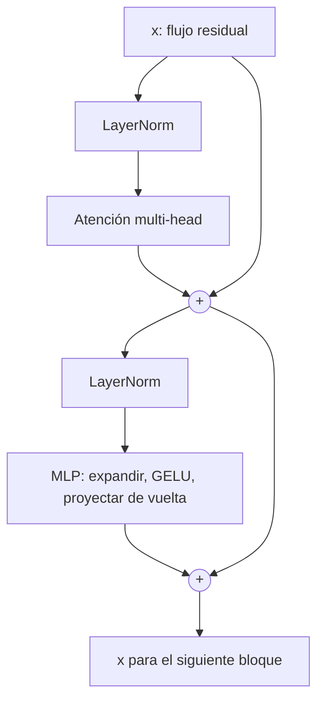

## El gancho

Los modelos de estilo GPT, tengan 7000 millones o 700 000 millones de parámetros, son estructuralmente la misma receta pequeña copiada decenas de veces. No hay un módulo especial para la gramática, ni otro para los hechos, ni otro para el razonamiento. Solo un bloque que se repite.

Si entiendes ese bloque, y la idea de un **flujo residual** (residual stream) que lo atraviesa, podrás leer el diagrama de casi cualquier LLM moderno.

## La explicación sencilla

Imagina una cinta transportadora que lleva un vector por token. En cada estación de la cinta (un **bloque**), dos operarios pueden *añadir notas* al vector, pero nunca borrarlo:

1. El operario de **atención** deja que el token mire a otros tokens y escriba en la cinta lo que ha aprendido.
2. El operario del **MLP** piensa en el token por separado y escribe de vuelta una versión refinada.

La cinta es el **flujo residual**. Tras muchas estaciones, el vector de la última posición contiene lo suficiente para predecir el siguiente token, y un paso final lo convierte en probabilidades sobre el vocabulario.

Dónde falla la analogía: las "notas" son vectores que se suman, no texto, y muchos hechos están repartidos entre muchas dimensiones en lugar de guardados en lugares legibles.

## Bajo el capó

### Un bloque

Una disposición moderna habitual (pre-norm):

```
x = x + Attention(LayerNorm(x))
x = x + MLP(LayerNorm(x))
```



### La conexión residual

El `x + ...` es el truco clave. Cada subcapa calcula una *actualización* y la suma. Consecuencias:

- La información original del token sobrevive hasta lo alto de la pila, siempre que las actualizaciones sean moderadas. La sección de ablación del ejercicio muestra una similitud coseno de alrededor de 0.9 entre el vector final y el embedding original con residuales, y cercana a 0 sin ellos.
- Los gradientes tienen un camino directo desde la pérdida hasta las primeras capas, que es lo que hace entrenables las pilas muy profundas.
- Puedes ver las capas como si *leyeran de un espacio de trabajo compartido y escribieran en él*. Esta visión es la base de buena parte de la investigación en interpretabilidad.

### El MLP

El MLP procesa cada posición de forma independiente: una capa lineal que expande la dimensión (normalmente 4x), una no linealidad (GELU o una variante con compuertas) y, después, una capa lineal que la devuelve a su tamaño. La atención mueve información *entre* tokens. El MLP transforma la información *dentro* de un token, y concentra la mayor parte de los parámetros. Con la expansión 4x, el MLP tiene el doble de parámetros que las proyecciones de atención (`8d^2` frente a `4d^2`), y el ejercicio imprime exactamente esa proporción. Una visión muy extendida, respaldada por trabajos de interpretabilidad (Geva et al., 2021; Meng et al., 2022, en las referencias) pero todavía parcial, es que los MLP almacenan buena parte de las asociaciones factuales del modelo.

### Normalización de capa (layer norm)

La layer norm reescala cada vector de token para que tenga media cero y varianza unitaria a lo largo de sus dimensiones y, en los modelos reales, aplica después una escala y un desplazamiento aprendidos por dimensión. Así evita que el tamaño de las activaciones se desvíe a medida que crece la profundidad. En el ejercicio, filas con desviaciones típicas de 0.6, 6.5 y 93 salen todas con 1.00 redondeando a dos decimales (el pequeño `eps` dentro de la raíz cuadrada impide que sea exactamente 1).

El esquema pre-norm (normalizar *antes* de cada subcapa, como arriba) entrena de forma más estable en pilas profundas que el diseño post-norm original (Xiong et al., 2020), y es el que usan la mayoría de los modelos modernos, a menudo con RMSNorm, una variante más barata.

### De dónde viene la entrada

Antes del primer bloque, cada ID de token selecciona una fila de la **tabla de embeddings**, una matriz aprendida de forma `vocab_size x d_model`. Esa fila es el vector inicial del token en el flujo residual. La tabla se entrena junto con todo lo demás, así que los tokens relacionados acaban con filas relacionadas; esta es la tabla de embeddings que mencionaba la lección 2, no un modelo de embeddings.

### Apilado y unembedding

Apila `L` bloques idénticos (cada uno con sus propios pesos): 12 en GPT-2 small, de 32 a más de 100 en los modelos grandes. Tras el último bloque:

1. Normaliza el vector final.
2. Multiplícalo por la matriz de **unembedding**, de forma `d_model x vocab_size`. Muchos modelos reutilizan aquí la traspuesta de la matriz de embeddings de tokens, como hace el ejercicio.
3. El resultado es un **logit** por cada token del vocabulario. La softmax convierte los logits en probabilidades.

Para elegir el siguiente token solo se usa la salida de la última posición, pero durante el entrenamiento todas las posiciones se calculan en paralelo (lección 5).

### Lo que todavía falta

La información de posición. La atención por sí sola ignora el orden, así que los modelos añaden información posicional, por ejemplo con embeddings rotatorios (rotary embeddings) en muchos modelos actuales. El ejercicio de juguete la deja fuera.

## La conexión con la ingeniería

- **Dónde viven los parámetros.** Cada bloque tiene unos `12 d^2` parámetros; el total es aproximadamente `12 * L * d^2` más los embeddings. Eso te da una forma de comprobar a ojo cualquier especificación de modelo.
- **Profundidad frente a anchura.** Más capas dan más procesamiento secuencial; más anchura da más capacidad por capa. Las familias de modelos eligen proporciones que escalen bien.
- **Aritmética de memoria.** Los pesos en 16 bits ocupan 2 bytes por parámetro, así que un modelo de 7B necesita unos 14 GB solo para los pesos, antes de la caché KV (lección 3). Por eso la cuantización tiene tanta importancia en lecciones posteriores.
- **Modelo mental para depurar.** Las primeras capas tienden a ocuparse de rasgos locales y sintácticos, y las posteriores, de rasgos más abstractos. Es una tendencia, no una regla.
- **MoE.** Los modelos de mezcla de expertos (mixture-of-experts) sustituyen el MLP único por muchos MLP expertos y enrutan cada token a unos pocos. El mismo bloque, con más capacidad condicional.

## Reto práctico

Archivo: `lessons/lesson_04_transformer_block.py`. Solo numpy. Construye una pila de 4 bloques con pesos aleatorios, así que las *predicciones no significan nada*, pero la estructura es real. Unos 10 minutos.

**Predice antes de ejecutar:**

1. ¿Qué subcapa tiene más parámetros, la atención o el MLP, y en qué proporción?
2. A medida que el vector atraviesa los 4 bloques, ¿su norma crece, disminuye o se mantiene?
3. Quita las conexiones residuales. ¿Seguirá la salida pareciéndose al embedding de entrada?
4. ¿Qué hace la layer norm con una fila cuyos valores son 100 veces mayores?
5. ¿Qué forma tienen los logits y cuánto suman las probabilidades?

El comando para ejecutarlo está al final de esta página.

<details>
<summary>Lo que el script me imprimió (ábrelo después de predecir)</summary>

- Atención, 1024 parámetros; MLP, 2048 por bloque: proporción 2.0.
- Norma media del flujo: 3.44 en los embeddings, y después 3.47, 3.55, 3.57 y 3.61. Cada bloque suma una actualización de tamaño 0.8 a 0.9, una cuarta parte de la longitud del flujo, y aun así la norma apenas se mueve. Las actualizaciones aleatorias son casi ortogonales al flujo, así que apenas añaden nada a su longitud; en un modelo entrenado las actualizaciones no son aleatorias, y la norma del flujo sí crece con la profundidad.
- Coseno con el embedding original: de 0.87 a 0.94 con residuales; entre -0.21 y 0.18 sin ellos.
- Layer norm: las desviaciones típicas de entrada 0.63, 6.49 y 92.89 pasan todas a 1.0, con media 0.
- Forma de los logits `(8,)`, las probabilidades suman 1.0. La predicción más probable es arbitraria porque los pesos son aleatorios.

</details>

Para ir más allá: cambia `scale` de 0.1 a 0.3 y observa cómo la norma del flujo crece unas 4x a lo largo de los cuatro bloques. Cambia `n_heads` a 4 y comprueba que las formas siguen cuadrando. Calcula el número de parámetros de un modelo de 12 capas y anchura 768 con la regla `12 * L * d^2` y compáralo con la cifra conocida de GPT-2 small (unos 124 millones, incluidos los embeddings).

## Ideas clave

1. Un bloque es atención más MLP, y cada uno se suma a un flujo residual. El flujo lleva la información hacia arriba por la pila.
2. La layer norm mantiene la escala estable. El camino residual mantiene viva la identidad del token y hace posible entrenar redes profundas.
3. Apilar bloques idénticos y terminar con un unembedding más una softmax es toda la receta para obtener la distribución del siguiente token.

**Pregunta de control:** si eliminaras el MLP de todos los bloques, ¿qué capacidad conservaría el modelo y cuál perdería?

**A continuación:** entrenamiento y generación. ¿Cómo se vuelven útiles unos pesos aleatorios y cómo muestreamos texto a partir de las probabilidades?

::: quiz
Q: ¿Qué aporta la conexión residual? Responde con una frase para el entrenamiento y otra para el flujo de información.
A: Para el entrenamiento, un camino directo del gradiente desde la pérdida hasta cada capa, que es lo que permite aprender a las pilas profundas. Para el flujo de información, el vector original del token sobrevive hasta lo alto de la pila porque cada bloque suma una actualización en lugar de sustituir el vector.
Q: Atención o MLP: ¿cuál mueve información entre tokens y cuál tiene más parámetros?
A: La atención mueve información entre posiciones. El MLP trabaja sobre cada posición por separado y, con la expansión 4x habitual, tiene aproximadamente el doble de parámetros que las proyecciones de atención.
Q: ¿Cuántos parámetros tiene, aproximadamente, en sus bloques un modelo de 32 capas con d_model 4096?
A: Unos 12 por 32 por 4096 al cuadrado, alrededor de 6400 millones, sin contar los embeddings. Encaja con la conocida categoría de los "7B".
:::

## Referencias

- Xiong et al., "On Layer Normalization in the Transformer Architecture" (2020), sobre por qué pre-norm entrena de forma más estable: https://arxiv.org/abs/2002.04745
- Geva et al., "Transformer Feed-Forward Layers Are Key-Value Memories" (2021): https://arxiv.org/abs/2012.14913
- Meng et al., "Locating and Editing Factual Associations in GPT" (2022): https://arxiv.org/abs/2202.05262
- Radford et al., "Language Models are Unsupervised Multitask Learners" (2019), el informe de GPT-2 con la configuración de 124M: https://cdn.openai.com/better-language-models/language_models_are_unsupervised_multitask_learners.pdf
