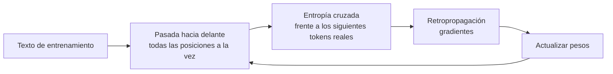

## El gancho

Nadie programa un modelo de lenguaje para responder preguntas. Lo único que se le pide, billones de veces, es esto: dado el texto hasta ese punto, asignar una probabilidad alta a la palabra que realmente venía a continuación.

Todo lo demás (traducir, programar, un comportamiento que parece razonamiento) surge de hacer esa única cosa extraordinariamente bien. Y cuando chateas con él, el "mismo" modelo da respuestas distintas en cada ejecución, porque la salida se *muestrea*, no se calcula.

## La explicación sencilla

**El entrenamiento** es practicar con el solucionario delante. Toma un texto de internet. En cada posición, haz que el modelo estime las probabilidades de todos los tokens siguientes posibles y luego mide cuánta probabilidad ha asignado al token que realmente viene después. Ajusta ligeramente los pesos para que la próxima vez ponga un poco más ahí. Repite con una cantidad enorme de texto.

**La generación** va en la dirección opuesta: pide al modelo las probabilidades del siguiente token, elige uno, añádelo al final y repite.

Dónde deja de funcionar la analogía: el modelo nunca "sabe" que se le está examinando sobre el significado. Se le recompensa por reproducir la estadística de su texto de entrenamiento, y de ahí salen tanto sus capacidades como sus errores cometidos con total aplomo.

## Bajo el capó

### El objetivo de entrenamiento

En cada posición el modelo produce logits, softmax los convierte en probabilidades `p`, y la pérdida en esa posición es la **entropía cruzada** (cross-entropy) respecto al token siguiente real `y`:

```
loss = -log p[y]
```

Si el modelo asigna probabilidad 1 al token correcto, la pérdida es 0. Si le asigna probabilidad 0.1, la pérdida es de aproximadamente 2.3. La pérdida se promedia sobre todas las posiciones y todos los ejemplos.

Un modelo que no sabe nada asigna la misma probabilidad a todos los tokens de un vocabulario de tamaño `V`. Su pérdida es `ln(V)`. Para `V = 10` eso da 2.3026, y el ejercicio lo confirma: un modelo recién inicializado empieza casi exactamente ahí. El entrenamiento la va reduciendo.

### Teacher forcing (forzado del maestro)

Durante el entrenamiento, en cada posición se alimenta al modelo con los tokens anteriores *reales*, no con sus propias predicciones previas. Gracias a la máscara causal (lección 3), una sola pasada hacia delante sobre una secuencia de longitud `n` produce `n - 1` predicciones y términos de pérdida a la vez. Ese paralelismo es lo que permite escalar el entrenamiento a cantidades enormes de datos. En la generación no existe ese lujo: cada token depende del anterior que se ha muestreado, así que la decodificación es secuencial.

### Descenso de gradiente

La pérdida es una función de los pesos. La retropropagación (backpropagation) calcula su gradiente, es decir, la dirección en la que debería moverse cada peso para reducir la pérdida, y el optimizador desplaza cada peso en `lr` (la tasa de aprendizaje) multiplicado por su gradiente, en sentido contrario. Para softmax con entropía cruzada, el gradiente respecto a los logits tiene una forma muy limpia: `p - onehot(y)`. El ejercicio usa exactamente eso para entrenar un modelo de bigramas con unas pocas líneas de NumPy.



### El suelo de la pérdida

La pérdida no llega a 0 con texto natural, ni tampoco en el ejercicio. El ejercicio entrena un modelo de **bigramas**: solo ve el token anterior. Después de "the", el corpus continúa con cat, dog, mat o rug, y un único token de contexto no basta para saber cuál. Lo mejor que puede conseguir un modelo de bigramas en este corpus es la entropía condicional dado un token, aproximadamente 0.59. El ejercicio se acerca: alrededor de 0.64 tras 300 pasos. Un modelo con dos tokens de contexto lo haría mejor ("on the" siempre va seguido de mat o rug, y "to the", de cat o dog), y esa es la ampliación que se propone al final. Los modelos de lenguaje reales se enfrentan al mismo tipo de incertidumbre irreducible, y por eso mismo una pérdida de entrenamiento de 0 significa memorización, no comprensión.

### De probabilidades a texto

El modelo te da una distribución. Tú eliges cómo extraer muestras de ella:

- **Voraz (greedy):** toma siempre el token de mayor probabilidad. Determinista y, a menudo, repetitivo.
- **Temperatura `T`:** divide los logits entre `T` antes de softmax. `T < 1` agudiza la distribución (más predecible) y `T > 1` la aplana (más aleatoria). Cuando `T` tiende a 0 se vuelve voraz; a medida que `T` crece, se aproxima a la uniforme.
- **Top-k:** conserva solo los `k` tokens más probables.
- **Top-p (núcleo):** conserva el menor conjunto de tokens cuya probabilidad acumulada alcanza `p`, de modo que el corte se adapta a lo seguro que esté el modelo.

Una temperatura baja no hace que el modelo acierte. Hace que sea consistente. Una respuesta errónea puede salir en el muestreo todas las veces.

## La conexión con la ingeniería

- **Por qué varían las salidas.** El muestreo viene de serie. Pon la temperatura cerca de 0 para extracción, clasificación o pruebas. Usa valores más altos para la lluvia de ideas. Incluso a 0, un hardware distinto o una agrupación en lotes (batching) distinta pueden introducir un ligero no determinismo, así que nunca confíes en repeticiones idénticas bit a bit.
- **Por qué existen las alucinaciones.** El objetivo recompensa las continuaciones plausibles, no la verdad. Cuando los datos de entrenamiento no determinan la respuesta, el modelo tiene que poner su probabilidad en algún sitio de todos modos.
- **La economía del entrenamiento frente a la de la inferencia.** El entrenamiento es un trabajo enorme, puntual y paralelo. La inferencia es repetida, secuencial token a token y limitada por la memoria. Esto condiciona tanto los precios como la arquitectura.
- **Fases más allá del entrenamiento con el siguiente token.** El preentrenamiento es lo que cubre esta lección. El ajuste por instrucciones (instruction tuning) continúa con la misma pérdida del siguiente token sobre conversaciones seleccionadas; después, las etapas de aprendizaje por preferencias y por refuerzo pasan a optimizar una recompensa. Todas parten de los pesos preentrenados, y por eso el preentrenamiento marca el techo.
- **Salida estructurada.** La decodificación restringida enmascara, antes de muestrear, los tokens que romperían una gramática o un esquema JSON. Igual que top-p, pone a cero parte de la distribución, pero el filtro es la validez, no la masa de probabilidad.

## Reto práctico

Archivo: `lessons/lesson_05_training_generation.py`. Solo Numpy. Entrena un modelo de bigramas diminuto sobre un corpus de 42 palabras con gradientes escritos a mano y después genera texto con distintas configuraciones de muestreo. Unos 10 minutos.

**Predice antes de ejecutar:**

1. ¿Cuál es la pérdida del modelo sin entrenar? Calcula primero `ln(V)`.
2. ¿Llegará el entrenamiento a una pérdida de 0? Si no, ¿cuál es el mínimo que puede alcanzar y por qué?
3. Después de la palabra "the", ¿qué aspecto tendrá la distribución aprendida?
4. ¿Qué efecto tiene la temperatura sobre la entropía de esa distribución con 0.2 y con 5?
5. ¿Qué configuración producirá el texto más repetitivo y cuál el más caótico?

El comando para ejecutarlo está al final de esta página.

<details>
<summary>Lo que el script me imprimió (ábrelo después de predecir)</summary>

- `V = 10`, `ln(V) = 2.3026`, pérdida sin entrenar 2.3027.
- Pérdida: 2.24 tras el paso 1, 1.45 en el paso 20, 0.99 en el paso 50, 0.78 en el paso 100 y 0.64 en el paso 300. Se estanca y no baja a 0.
- Después de "the": cat 0.33, dog 0.33, mat 0.16, rug 0.16.
- Entropía después de "the": 0.82 con T=0.2, 1.47 con T=1 y 2.23 con T=5 (el máximo posible para 10 tokens es 2.30).
- Una temperatura baja produce bucles como "sat on the cat sat on the cat". Una temperatura alta sin top-p produce una ensalada de palabras ("cat mat sat on sat mat"). Top-p 0.5 reduce el daño con T=3, pero no lo elimina: la distribución es lo bastante plana como para que top-p conserve varios tokens, y "ran to mat" es una transición que nunca aparece en el corpus.
- Las líneas muestreadas son idénticas en cada ejecución porque ambas semillas son fijas. El entrenamiento y el muestreo usan generadores distintos, así que cambiar la semilla de muestreo no altera las pérdidas.

</details>

Ampliaciones: aumenta el corpus y observa cómo se desplaza el suelo. Sustituye la tabla de bigramas por un contexto de dos tokens. Implementa top-k y compáralo con top-p a la misma temperatura.

## Ideas clave

1. El entrenamiento minimiza la entropía cruzada en la predicción del siguiente token. Un modelo que no sabe nada tiene una pérdida de `ln(V)`, y el suelo de la pérdida es la impredecibilidad de los datos.
2. El teacher forcing permite paralelizar el entrenamiento entre posiciones. La generación es intrínsecamente secuencial.
3. La temperatura remodela la distribución y top-p recorta su cola. Controlan la aleatoriedad, no la corrección.

**Pregunta de control:** pones la temperatura a 0 en una tarea de clasificación y aun así, para una entrada concreta, ves una respuesta errónea todas las veces. ¿Qué te dice eso y qué cambiarías en lugar de la temperatura?

**A continuación:** ponerlo a trabajar. La recuperación (retrieval) y el contexto son la forma de dar a un modelo congelado conocimiento con el que nunca se entrenó.

::: quiz
Q: Un modelo recién inicializado con un vocabulario de 50 000 tokens: ¿cuál es su pérdida aproximada y por qué?
A: Alrededor de ln(50000), cerca de 10.8. Sin conocimiento, reparte la probabilidad por igual, así que cada token correcto recibe probabilidad 1/50000 y la pérdida es menos el logaritmo de eso.
Q: ¿Por qué el entrenamiento puede procesar un documento entero en una sola pasada hacia delante mientras que la generación va token a token?
A: El teacher forcing le da el texto real y la máscara causal oculta el futuro, así que todas las posiciones son predicciones simultáneas. En la generación, cada token siguiente depende del token que se acaba de muestrear, así que los pasos son secuenciales.
Q: Temperatura 0 y la respuesta sigue siendo errónea todas las veces. ¿Qué te dice eso?
A: El token más probable del modelo es erróneo para esa entrada. La temperatura solo controla la aleatoriedad. Corrige el prompt, el contexto recuperado o el modelo, no el muestreo.
:::

## Referencias

- Holtzman et al., "The Curious Case of Neural Text Degeneration" (2019), el artículo del muestreo de núcleo (top-p): https://arxiv.org/abs/1904.09751
- Radford et al., "Language Models are Unsupervised Multitask Learners" (2019), preentrenamiento con el siguiente token a gran escala: https://cdn.openai.com/better-language-models/language_models_are_unsupervised_multitask_learners.pdf
- Ouyang et al., "Training language models to follow instructions with human feedback" (2022), las etapas posteriores al preentrenamiento: https://arxiv.org/abs/2203.02155
