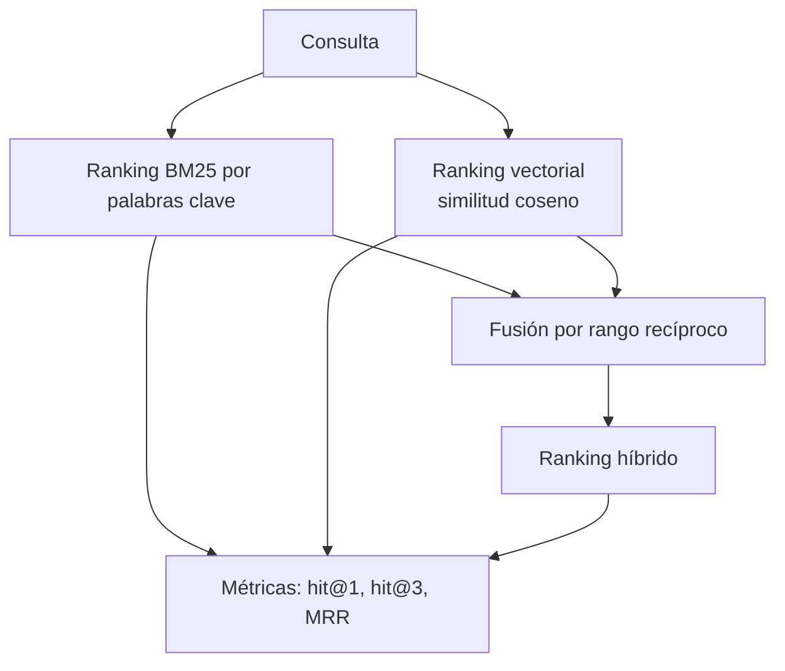

## El gancho

Todo el mundo dice que "la búsqueda semántica es mejor que la búsqueda por palabras clave". ¿Lo es? ¿Mejor en qué, y medido cómo?

Sin medir, la calidad de la búsqueda se juzga a ojo. Alguien prueba tres consultas, le gustan los resultados y lo pone en producción. Una semana después, un cliente escribe `ERR-4012` y recibe la página de `ERR-4021`. Esta lección te da la forma más sencilla y honesta de descubrirlo antes que el cliente.

## La explicación sencilla

Construye un pequeño **conjunto de evaluación**: consultas de aspecto realista, cada una emparejada con el único documento que debería salir primero. Ejecuta cada método de búsqueda y cuenta con qué frecuencia el documento correcto queda en primera posición, entre los tres primeros y, de media, a qué altura. Así ya puedes comparar métodos con números.

Después, combina dos métodos que fallan en consultas distintas. La búsqueda por palabras clave es precisa con cadenas exactas y ciega ante las paráfrasis. La búsqueda vectorial entiende las paráfrasis y desdibuja las cadenas exactas. Un enfoque híbrido se queda con lo mejor de ambas.

Es la misma disciplina que los tests unitarios, con una diferencia: los resultados son listas ordenadas y no un simple aprobado o suspenso, así que las métricas son algo más ricas.

## Bajo el capó

### La configuración del ejercicio

- 12 documentos de soporte breves (reembolso, contraseña, envío, dos códigos de error casi idénticos, factura, cancelación, productos dañados, privacidad, verificación en dos pasos, dirección, descuento para estudiantes).
- El ranker por palabras clave solo devuelve documentos con puntuación distinta de cero. Una consulta sin palabras en común obtiene una lista vacía, y eso es honesto: BM25 no tiene opinión, y no conviene alimentar la fusión con ruido en orden alfabético.
- 12 consultas, cada una etiquetada con exactamente un documento correcto. Algunas son paráfrasis: "Stop my plan" («detén mi plan») debería encontrar el documento "cancel"; otras son códigos exactos (`ERR-4012`).
- Tres rankers: **BM25** (palabras clave), **vectorial** (embeddings de MiniLM, lección 2) e **híbrido**.



### BM25 en un párrafo

BM25 puntúa un documento sumando, para cada palabra de la consulta que contiene, tres factores: lo rara que es la palabra en toda la colección (**IDF**: las palabras raras pesan más), cuántas veces aparece en el documento, con rendimientos decrecientes (parámetro `k1`), y una normalización por longitud para que los documentos largos no ganen solo por ser largos (parámetro `b`). El script lo implementa en unas veinte líneas de NumPy y Python puro. Su tokenizador conserva los guiones dentro de los tokens, así que `err-4021` es un único token y `ERR-4012` solo coincide con el documento correcto.

### Fusión por rango recíproco (RRF)

Los dos rankers producen puntuaciones en escalas distintas, así que no basta con sumarlas. RRF ignora las puntuaciones y usa solo las posiciones:

```
score(doc) = sum over rankers of 1 / (k + rank)
```

Aquí `k` vale 60 en el script y `rank` empieza en 1. Un documento bien situado en *ambas* listas gana; un documento que solo una lista pone primero sigue puntuando bien. El único parámetro ajustable es `k`, y el artículo original concluyó que los resultados apenas dependen de él (Cormack et al., 2009, en las referencias). Que apenas requiera ajuste ni calibración de puntuaciones es lo que la ha convertido en la opción por defecto de la búsqueda híbrida en producción.

### Las métricas

- **hit@1**: proporción de consultas en las que el documento correcto sale primero.
- **hit@3**: proporción en la que está entre los tres primeros. Es lo que importa si pasas tres fragmentos (chunks) a un LLM.
- **MRR** (mean reciprocal rank, rango recíproco medio): media de `1 / position of the correct document`. La primera posición vale 1; la segunda, 0,5; la tercera, 0,33. Premia estar cerca de la cima, no solo aparecer.

Tu conjunto de 12 consultas es demasiado pequeño para fiarte de una diferencia de una sola consulta. Úsalo como herramienta didáctica y como plantilla. Los conjuntos de evaluación reales tienen de decenas a cientos de consultas, extraídas de logs reales.

## La conexión con la ingeniería

**Evaluar antes de optimizar.** Tamaño de los fragmentos, modelo de embeddings, top-k, reranker, pesos de la búsqueda híbrida: cada uno es una hipótesis. Un conjunto etiquetado convierte cada una en un experimento medible y en un test de regresión que puedes ejecutar en CI cuando alguien cambie el modelo.

**Dónde falla cada método:**

| Método | Gana en | Pierde en |
|--------|---------|----------|
| Palabras clave (BM25) | códigos exactos, nombres, términos poco frecuentes | paráfrasis, sinónimos, otros idiomas |
| Vectorial | paráfrasis, intención, formulaciones vagas | identificadores casi idénticos, negación |
| Híbrido | en ambos, por lo general | latencia adicional y más piezas móviles |

**Notas prácticas:**

- Etiqueta a partir de consultas reales. Las consultas inventadas hacen quedar bien a tu sistema.
- Guarda la lista de fallos. El ejercicio imprime los fallos top-1 de cada método. Los diez minutos que dediques a leerlos serán los más valiosos de todo el proceso.
- La siguiente mejora tras la búsqueda híbrida suele ser un **reranker**, un modelo más lento que vuelve a puntuar los 20 mejores candidatos. Mídelo con el mismo conjunto.
- La mayoría de los stacks de búsqueda te dan las piezas: Azure AI Search, Elasticsearch y OpenSearch incluyen recuperación híbrida con RRF integrada; PostgreSQL te ofrece búsqueda de texto completo y pgvector, y la fusión la escribes tú en SQL. El arnés de evaluación sigue siendo cosa tuya en todos los casos.

## Reto práctico

Archivo: `lessons/lesson_06_semantic_search.py`. Construye BM25 desde cero, genera los embeddings de los documentos, evalúa los tres métodos e imprime los fallos top-1 de cada uno. Unos 15 minutos (el modelo que se descarga es el mismo que en la lección 2).

**Predice antes de ejecutar:**

1. ¿Qué método tendrá el hit@1 *más bajo* y en qué consultas fallará?
2. ¿Qué consultas no encontrará en absoluto la búsqueda por palabras clave? Nombra dos.
3. ¿Acertará el ranker vectorial tanto `ERR-4021` como `ERR-4012`? ¿Por qué sí o por qué no?
4. ¿Superará el híbrido al mejor método individual en todas las métricas o solo en algunas? ¿Podría llegar a ser peor que el mejor método individual?

El comando para ejecutarlo está al final de esta página. En esta lección no hay, a propósito, un bloque de "lo que imprimió el script": pega las tres líneas de métricas y los fallos en tus notas de abajo y compáralos con tus predicciones.

Después, experimenta:

- Cambia `k` en la fusión de 60 a 5 y luego a 1000. ¿Qué efecto tiene en el resultado?
- Añade tres consultas propias con sus etiquetas. ¿Se mueven las métricas?
- Escribe una consulta que engañe a *ambos* métodos y añádela al conjunto.
- Sustituye la fusión por una suma ponderada de puntuaciones. ¿Por qué es más difícil acertar con ella?

## Ideas clave

1. La calidad de la búsqueda necesita un conjunto de consultas etiquetadas y métricas (hit@k, MRR). Sin ellas, ajustar es ir a ciegas.
2. La búsqueda por palabras clave y la búsqueda vectorial fallan en consultas distintas, así que combinarlas es una opción por defecto sólida.
3. La fusión por rango recíproco combina rankings por posición, así que no hay ninguna calibración de puntuaciones que mantener.

**Pregunta de control:** tras cambiar el modelo de embeddings, hit@3 sube pero hit@1 baja. Con el MRR y los fallos impresos, ¿cómo decides si el cambio es una mejora?

**A continuación:** qué ocurre después de la recuperación. Lee la nota conceptual sobre RAG para ver cómo encajan la búsqueda, el prompt y el LLM.

::: quiz
Q: Tras un cambio, hit@3 sube y hit@1 baja. ¿Ha mejorado el sistema?
A: Depende de quién consuma los resultados. Si se envían tres fragmentos a un LLM, lo que importa es hit@3. Usa el MRR como cifra única que premia la posición y lee los fallos para ver qué consultas se han movido.
Q: ¿Por qué fusionar por posición en lugar de sumar las puntuaciones de BM25 y del coseno?
A: Las puntuaciones están en escalas distintas (la de BM25 no está acotada; la del coseno está en [-1, 1]), así que en la suma domina la que sea mayor. Las posiciones son comparables sin calibración.
Q: Nombra un tipo de consulta en el que gane la búsqueda por palabras clave y otro en el que gane la búsqueda vectorial.
A: La búsqueda por palabras clave gana con identificadores exactos como `ERR-4012`. La vectorial gana con paráfrasis como "Stop my plan" para el documento de cancelación.
:::

## Referencias

- Cormack, Clarke y Buettcher, "Reciprocal Rank Fusion outperforms Condorcet and individual Rank Learning Methods" (SIGIR 2009): https://doi.org/10.1145/1571941.1572114
- Robertson y Zaragoza, "The Probabilistic Relevance Framework: BM25 and Beyond" (2009): https://doi.org/10.1561/1500000019
- Reimers y Gurevych, "Sentence-BERT" (2019), la familia de modelos de embeddings que se usa aquí: https://arxiv.org/abs/1908.10084
