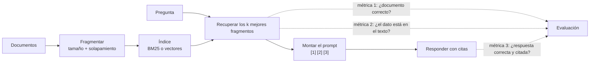

## El gancho

El equipo de búsqueda te enseña su panel: para casi todas las preguntas del conjunto de prueba, el documento correcto aparece entre los tres primeros resultados. El equipo de soporte te enseña el suyo: el asistente construido sobre esa búsqueda falla aproximadamente la mitad de esas mismas preguntas.

Los dos paneles son correctos. El equipo de búsqueda mide si ha vuelto el *documento* correcto. Nadie mide si la *frase* correcta ha llegado entera al prompt, ni si el modelo la ha usado. En el ejercicio vas a reproducir exactamente esa brecha con nada más que un contador de palabras, y después vas a cerrar parte de ella cambiando un solo número: el tamaño del fragmento.

## La explicación sencilla

Un pipeline RAG es un examen a libro abierto que hace alguien que no puede ver la estantería. Un bibliotecario (la recuperación) fotocopia unas cuantas páginas y se las entrega. El estudiante (el LLM) responde a partir de esas páginas y anota de qué página sale cada respuesta.

Pueden fallar tres cosas, y son independientes: el bibliotecario trae el libro equivocado, el bibliotecario trae el libro correcto pero la fotocopia corta el párrafo clave por la mitad, o las páginas son perfectas y aun así el estudiante las lee mal. Una única puntuación de "la respuesta es correcta" no te dice cuál de las tres ha pasado.

Dónde deja de funcionar la analogía: aquí el bibliotecario no entiende la pregunta. Ordena el texto por estadística de palabras o por similitud de vectores. Y el estudiante no es neutral: un LLM puede responder de memoria y aun así citar una página, lo que parece fundamentado pero no lo está.

## Bajo el capó



### Fragmentación: tamaño, solapamiento y límites

Nunca indexas documentos completos. Una política de 40 páginas convertida en un solo vector es una mezcla borrosa de todos los temas que trata, y pegarla entera en cada prompt sale caro. Así que la divides en fragmentos (chunks), y dos números deciden casi todo el comportamiento:

- **Tamaño.** Los fragmentos pequeños son precisos: cada uno trata de una sola cosa, así que una coincidencia significa algo. Pero un dato que cruza un límite queda mitad en un fragmento y mitad en el siguiente, y la mitad que se recupera puede no contener la respuesta. Los fragmentos grandes mantienen los datos enteros pero arrastran más texto ajeno, que cuesta tokens y le da al modelo más cosas que malinterpretar.
- **Solapamiento (overlap).** Los fragmentos consecutivos comparten unas cuantas palabras o tokens para que una frase cercana a un límite aparezca entera en al menos uno de ellos. El solapamiento solo protege los datos más cortos que él. Además duplica texto en el índice y puede llenar el top-k con copias casi idénticas del mismo pasaje.

Los sistemas reales dividen por tokens (lección 1), no por palabras, y prefieren límites naturales: encabezados, párrafos, frases, filas de tabla. Los valores por defecto de los frameworks varían mucho, desde unos cientos hasta alrededor de mil tokens. Trata cualquier valor por defecto como una hipótesis que medir sobre tus propios documentos, no como una recomendación. Un refinamiento habitual es recuperar fragmentos pequeños por precisión pero enviar al modelo la sección más amplia que los rodea.

### Dos tipos de recall de recuperación

La lección 6 medía hit@k: ¿está el documento correcto entre los k primeros? Una vez fragmentados los documentos, esa pregunta tiene dos versiones:

| Métrica | Pregunta que responde | Necesita etiquetas de |
|---|---|---|
| Recall de documento@k | ¿Ha vuelto algún fragmento del documento correcto? | documento esperado |
| Recall de contexto | ¿El texto recuperado contiene realmente el dato de la respuesta? | documento y dato esperados |

El recall de documento es barato y es lo que muestran la mayoría de los paneles. El recall de contexto es lo que experimenta el modelo. Con fragmentos pequeños los dos pueden separarse mucho, porque "un fragmento del documento correcto" puede ser justo el que termina una palabra antes de la respuesta.

### Montaje del prompt con fuentes numeradas

Los fragmentos recuperados se pegan en el prompt con un número estable cada uno, más los metadatos suficientes para rastrear su origen:

```
Answer using only the sources below. Cite each statement with its source number, like [2].
If the sources do not contain the answer, reply "not found".

[1] (deploy-runbook, chunk 2) Deploys to production happen Monday to Thursday ...
[2] (access-policy, chunk 1) Engineers get production access only through ...

Question: Can I deploy on a Friday?
```

Detalles que importan en producción: los números los asigna tu código, así que puedes traducir `[2]` a un ID de documento y una URL. Unos delimitadores claros separan las instrucciones de las fuentes, porque las fuentes son texto no confiable (la lección 12 trata la inyección de prompts). Pon la fuente más fuerte al principio o al final, no enterrada en medio de una lista larga (lección 3, "lost in the middle"). Y la instrucción explícita de responder "not found" le da al modelo una salida legítima cuando la recuperación falla, en lugar de obligarlo a adivinar.

### Responder con citas

Una cita solo sirve si la compruebas. Después de generar, extrae los marcadores `[n]` y verifica que cada uno apunta a una fuente que de verdad estaba en el prompt y que la fuente citada respalda la afirmación. Para datos extraídos se pueden hacer comprobaciones exactas (¿aparece el número o el nombre en la fuente `[n]`?). Para respuestas libres necesitas un modelo de implicación (entailment) o un LLM como juez (lección 11). Una respuesta puede ser correcta pero no estar respaldada (el modelo lo sabía por su entrenamiento) o estar respaldada pero ser errónea (copió una frase obsoleta o engañosa). Las dos cosas importan, y son errores distintos.

El ejercicio sustituye el LLM por un **respondedor extractivo** determinista: divide los fragmentos recuperados en frases y devuelve la frase que comparte más palabras poco frecuentes con la pregunta, con el número de ese fragmento como cita. Es muchísimo más débil que cualquier LLM, y precisamente de eso se trata: falla de formas visibles y repetibles, y el código de evaluación que lo rodea es exactamente el que usarías con un modelo real.

### Medir la calidad de la respuesta por separado

Puntúa cada pregunta etiquetada en tres puntos: recall de documento, recall de contexto y exactitud de la respuesta (el dato esperado está en la respuesta y la cita apunta al documento esperado). Después calcula un número más: **la exactitud de la respuesta restringida a las preguntas en las que el dato se recuperó**. Esa es la calidad del paso de generación por sí solo, con la recuperación fuera de la ecuación.

Los fallos se reparten entonces en tres grupos, cada uno con un responsable distinto:

- **Recuperación fallida:** arregla el índice, la consulta, la búsqueda híbrida o el reranking (lección 6).
- **Documento correcto, dato cortado:** arregla la fragmentación.
- **Dato recuperado, respuesta errónea:** arregla el prompt, el modelo o la comprobación de citas.

## La conexión con la ingeniería

- **Instrumenta cada etapa.** Registra en cada petición los IDs de los fragmentos recuperados, el prompt montado y las citas extraídas. Sin eso, una mala respuesta no se puede asignar a ninguna etapa, y los equipos discuten en lugar de arreglar.
- **El tamaño del fragmento es una palanca de coste.** Fragmentos más grandes significan más tokens de entrada en cada petición, que se facturan y añaden latencia de prefill (lección 3). En el ejercicio, pasar de fragmentos de 20 palabras a fragmentos de 60 eleva el texto enviado por pregunta de {{claim:s_words}} a {{claim:l_words}} palabras. Mide si la mejora de exactitud lo compensa.
- **Refragmentar implica reindexar.** Cambiar el tamaño o el solapamiento invalida todos los vectores almacenados. Versiona la configuración de fragmentación junto con el modelo de embeddings para poder reconstruir y comparar en paralelo.
- **Un conjunto etiquetado necesita datos, no solo documentos.** Anotar el dato esperado de cada pregunta es lo que hace posibles el recall de contexto y las comprobaciones automáticas de la respuesta. Es un poco más de trabajo de etiquetado y se amortiza en cada experimento.
- **"Not found" es una funcionalidad.** Mide con qué frecuencia el sistema se abstiene cuando debe, no solo con qué frecuencia responde. Una respuesta segura con una cita a una fuente irrelevante es peor que una negativa honesta.

## Reto práctico

Archivo: `courses/ai-engineering/exercises/lesson_07_rag_pipeline.py`. Solo la biblioteca estándar de Python. Escribe 12 políticas y runbooks internos breves, los fragmenta a 20 y a 60 palabras, recupera con un índice BM25 construido en el propio script, monta un prompt numerado y responde con el sustituto extractivo de un LLM. Puntúa 14 preguntas etiquetadas en tres puntos e imprime cada fallo con su grupo. Unos 15 minutos.

**Predice antes de ejecutar:**

1. Con fragmentos de 20 palabras y top 3, ¿en qué proporción de preguntas se recuperará el documento correcto?
2. ¿Los fragmentos de 60 palabras mejorarán el recall de documento, el recall de contexto o ambos?
3. La recuperación parece igual de buena con los dos tamaños. ¿Qué tamaño da mejor exactitud en las respuestas?
4. Para "How long are database backups kept?" se recupera el fragmento correcto. ¿Acertará el respondedor?

::: predict
P: s_recall | number | claim:s_recall | 0.1 | Con fragmentos de 20 palabras, ¿en qué proporción de preguntas aparece el documento correcto en el top 3?
P: better | choice:small=Fragmentos de 20 palabras;large=Fragmentos de 60 palabras;same=Más o menos igual | large | | ¿Qué tamaño de fragmento da mayor exactitud en las respuestas?
P: l_acc | number | claim:l_acc | 0.1 | ¿Cuál es la exactitud de las respuestas con fragmentos de 60 palabras?
P: backups | choice:yes=Sí;no=No | no | | La pregunta sobre las copias de seguridad recupera el fragmento correcto. ¿Acierta el respondedor?
:::

El comando para ejecutarlo está al final de esta página.

<details>
<summary>Lo que imprimió el script en mi ejecución (ábrelo después de predecir)</summary>

| Tamaño de fragmento | Fragmentos | Palabras enviadas | Recall de documento@3 | Recall de contexto | Exactitud | Exactitud con el dato recuperado |
|---|---|---|---|---|---|---|
| 20 palabras, solapamiento 5 | {{claim:s_chunks}} | {{claim:s_words}} | {{claim:s_recall}} | {{claim:s_ctx}} | {{claim:s_acc}} | {{claim:s_accfact}} |
| 60 palabras, solapamiento 15 | {{claim:l_chunks}} | {{claim:l_words}} | {{claim:l_recall}} | {{claim:l_ctx}} | {{claim:l_acc}} | {{claim:l_accfact}} |

- El recall de documento es idéntico con los dos tamaños. Un panel que solo mostrara ese número diría que las dos configuraciones son equivalentes.
- El recall de contexto cuenta la historia real. Con fragmentos de 20 palabras, el documento correcto vuelve a menudo como el trozo equivocado de sí mismo. Para la pregunta del SEV1, la mejor frase que encontró el respondedor fue "{{claim:sev1_answer}}": el fragmento termina antes de la respuesta.
- A 60 palabras, cada documento de este corpus pequeño cabe en un solo fragmento, así que la comparación es en realidad "fragmentos frente a documentos completos". La exactitud sube, y también el texto enviado por pregunta.
- Dato recuperado, respuesta errónea: para la pregunta de las copias de seguridad, el respondedor devolvió "{{claim:backup_answer}}". Esa frase repite "database backups" de la pregunta, mientras que la respuesta real dice "Snapshots are kept for 35 days". La coincidencia de palabras no puede ver que los snapshots son copias de seguridad. Un LLM casi seguro acertaría esta, y por eso la exactitud solo de generación es el número que hay que comparar cuando cambias de modelo.
- Recuperación fallida: "How do I get a new laptop?" falla con los dos tamaños. El documento dice "replacement machine" y "equipment", nunca "laptop", y BM25 empareja "new" con la política de proveedores. Esta es la brecha de vocabulario para la que existe la búsqueda vectorial o híbrida (lección 6).
- Algunos fallos de generación vienen de que no hay stemming: "Friday" no coincide con "Fridays". Un tokenizador real o un LLM eliminan ese tipo de error, pero no los otros dos grupos.

</details>

Ampliaciones: con fragmentos de 20 palabras, sube el solapamiento hasta que el dato del SEV1 sobreviva, y observa el número de fragmentos y los casi duplicados en el top 3. Añade una pregunta sin respuesta y haz que el respondedor conteste "not found" por debajo de un umbral de puntuación; después mide la abstención. Cambia BM25 por los embeddings de la lección 2 y comprueba si la pregunta del portátil pasa de "recuperación fallida" a otro grupo.

## Ideas clave

1. El tamaño y el solapamiento de los fragmentos deciden si un dato llega entero al modelo. Los fragmentos pequeños son precisos pero parten los datos por la mitad. Los grandes los mantienen enteros pero cuestan tokens.
2. El recall de documento puede ocultar fallos de fragmentación. Mide por separado el recall de contexto (¿está el dato en el texto recuperado?) y la exactitud de la respuesta, y calcula la exactitud sobre las preguntas en las que el dato se recuperó.
3. Numera las fuentes en el prompt, dale al modelo una salida "not found" y verifica cada cita en código. Así cada fallo cae en un grupo con un responsable claro: recuperación, fragmentación o generación.

**Pregunta de comprobación:** el recall de documento@5 de tu sistema RAG es 0.95 y la exactitud de las respuestas es 0.60. Enumera las dos mediciones que añadirías primero y qué te diría cada resultado que debes cambiar.

**A continuación:** salidas estructuradas y function calling, para que la respuesta del modelo y sus citas vuelvan como datos que tu código puede validar en lugar de texto libre.

::: quiz
Q: ¿Por qué el recall de documento@k puede quedarse igual mientras la exactitud de las respuestas cambia al modificar el tamaño de fragmento?
A: El recall de documento solo pregunta si se recuperó algún fragmento del documento correcto. Con fragmentos pequeños, ese fragmento puede ser el trozo que termina antes de la respuesta, así que el dato nunca llega al modelo. El recall de contexto lo detecta; el recall de documento, no.
Q: ¿Qué aísla "la exactitud cuando el dato se recuperó", y cuándo es el número que hay que vigilar?
A: Elimina los fallos de recuperación y mide solo el paso de generación. Vigílalo cuando cambies el modelo o el prompt, porque la recuperación no cambia y cualquier variación viene de la generación.
Q: Tus respuestas citan [2], pero la afirmación no está en la fuente [2]. Indica dos causas posibles.
A: El modelo respondió con sus datos de entrenamiento y añadió una cita de todos modos, o confundió los números de las fuentes. En ambos casos la respuesta no está respaldada, y por eso las citas hay que comprobarlas en código en lugar de fiarse de ellas.
Q: ¿Qué cuesta hacer los fragmentos más grandes?
A: Más tokens de entrada por petición (precio y latencia de prefill), más texto ajeno que el modelo puede malinterpretar y una recuperación menos precisa porque cada fragmento cubre más temas. Además obliga a reindexarlo todo.
:::

## Referencias

- Lewis et al., "Retrieval-Augmented Generation for Knowledge-Intensive NLP Tasks" (2020): https://arxiv.org/abs/2005.11401
- Gao et al., "Retrieval-Augmented Generation for Large Language Models: A Survey" (2023): https://arxiv.org/abs/2312.10997
- Es et al., "RAGAS: Automated Evaluation of Retrieval Augmented Generation" (2023), métricas separadas para la calidad del contexto y de la respuesta: https://arxiv.org/abs/2309.15217
- Liu et al., "Lost in the Middle: How Language Models Use Long Contexts" (2023): https://arxiv.org/abs/2307.03172
