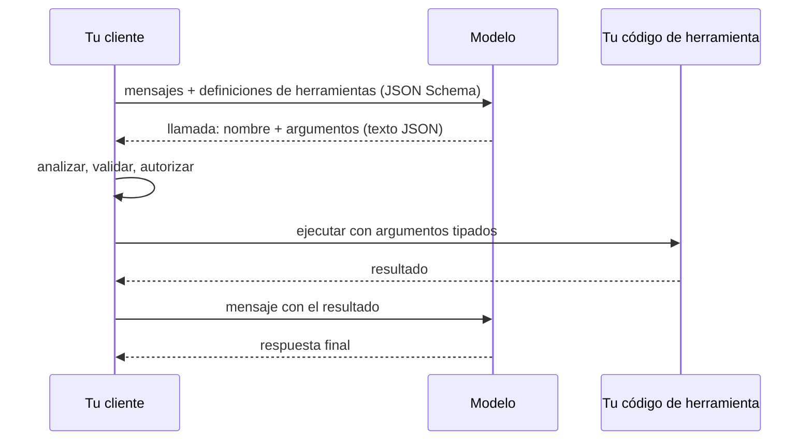

## El gancho

Le pides a un modelo que clasifique tickets de soporte y que "responda solo con JSON". Funciona en todas las pruebas. En producción, el deserializador empieza a lanzar excepciones en una pequeña fracción de las respuestas: una empieza con "Claro, aquí tienes el ticket:", otra termina con una frase amable después de la llave de cierre, otra dice `"priority": "urgent"` aunque tu enum solo tiene low, medium y high, y otra envía `"estimate_hours": "3 hours"`.

Nada de esto es un fallo de tu código. El modelo produce texto token a token, muestreando cada uno (lección 5), y nada en ese proceso conoce tu record de C#. Sacar datos estructurados de un modelo de lenguaje es un problema de ingeniería con tres herramientas: un esquema que fija el contrato, un decodificador al que se puede obligar a respetarlo y un cliente que lo comprueba de todos modos.

## La explicación sencilla

Pedir "JSON, por favor" es como dar a alguien una hoja en blanco y pedirle que la rellene con orden. La mayoría lo hará. Alguno añadirá una nota en el margen.

Un **esquema más validación** es el funcionario que revisa la hoja después y te la devuelve si falta un campo. La **decodificación restringida** es un formulario impreso con casillas y desplegables: físicamente no puedes escribir fuera de las casillas ni elegir una opción que no esté en la lista.

Dónde deja de funcionar la analogía: un formulario garantiza la forma, no la verdad. El modelo puede elegir un valor válido del desplegable que sea erróneo para ese ticket, y el formulario lo aceptará. Y el funcionario sale barato, mientras que pedirle al modelo que lo intente de nuevo cuesta otra llamada completa.

## Por dentro

### JSON Schema es el contrato

La mayoría de los proveedores aceptan un JSON Schema, ya sea para la respuesta final ("salida estructurada" o "modo JSON" con esquema) o para los parámetros de cada herramienta. El ejercicio usa este:

```json
{
  "type": "object",
  "properties": {
    "title": { "type": "string" },
    "priority": { "type": "string", "enum": ["low", "medium", "high"] },
    "estimate_hours": { "type": "integer" },
    "tags": { "type": "array", "items": { "type": "string" } }
  },
  "required": ["title", "priority", "estimate_hours"],
  "additionalProperties": false
}
```

El esquema cumple dos funciones. Normalmente se coloca en el contexto del modelo, así que los nombres de campo, los valores del enum y las descripciones actúan como instrucciones (y cuestan tokens de entrada). Y es la definición, comprobable por una máquina, de lo que es una respuesta válida. Los proveedores suelen admitir un subconjunto de la especificación completa de JSON Schema, y los modos estrictos a menudo añaden reglas, como exigir `additionalProperties: false`. Consulta la documentación del que uses en lugar de suponer que funciona cualquier palabra clave.

### Function calling es salida estructurada con nombre

Una definición de herramienta es un nombre, una descripción y un JSON Schema para sus argumentos. Cuando el modelo decide usar una herramienta, no ejecuta nada. Emite un mensaje estructurado que dice "llama a `create_ticket` con estos argumentos". Tu código lo analiza, lo valida, decide si está permitido, lo ejecuta y devuelve el resultado como otro mensaje. Después el modelo continúa. Los modelos alojados se entrenan expresamente para esto; Toolformer (Schick et al., 2023) es uno de los primeros estudios sobre un modelo que aprende cuándo llamar a una API y qué pasarle.



Los argumentos llegan como salida del modelo, así que merecen la misma desconfianza que cualquier cuerpo de petición que llegue de internet. Un modelo también puede nombrar una herramienta que nunca definiste o una que no debería usar para este usuario.

### Validar y luego reintentar

Un cliente robusto comprueba en tres capas: ¿se puede analizar?, ¿cumple el esquema?, ¿tiene sentido para el negocio? (¿existe el proyecto del ticket?, ¿está la estimación dentro de los límites?). Cuando una comprobación falla, lo habitual es reintentar, idealmente devolviendo los errores de validación para que el modelo pueda corregirse.

Las cuentas de los reintentos parecen generosas: si un intento sale bien con probabilidad `p`, tres intentos independientes fallan a la vez con probabilidad `(1 - p)^3`. La trampa está en la palabra independientes. Los fallos se concentran en entradas difíciles, un ticket raro o un campo ambiguo, y la misma entrada tiende a fallar otra vez de la misma manera. El ejercicio lo modela con un 20 % de entradas difíciles, y la distancia entre la estimación por independencia y la tasa medida es la lección. Registra los fallos por entrada, limita los reintentos y decide qué ocurre cuando falla el último: un modelo alternativo, un valor por defecto o una cola para una persona.

### Decodificación restringida

En cada paso el modelo produce una probabilidad para cada token de su vocabulario. Un decodificador restringido mantiene una máquina de estados compilada a partir del esquema o la gramática y, antes de muestrear, pone a cero todos los tokens que no pueden prolongar el texto generado hasta ese momento hacia una salida válida. Las probabilidades restantes se reescalan para que sumen 1, y el muestreo sigue como siempre (Willard y Louf, 2023, describen una forma eficiente de hacerlo para expresiones regulares y gramáticas).

De ahí salen tres consecuencias. Primera: la salida es válida por construcción, así que no hay reintentos por sintaxis. Segunda: la máscara conserva las preferencias relativas del modelo entre los tokens permitidos; la probabilidad que estaba en un token prohibido se reparte entre los permitidos en proporción a la que ya tenían. No va a parar a la respuesta "correcta", porque la máscara no sabe cuál es. Tercera: los tokenizadores reales complican la máquina de estados, porque un token puede abarcar varios caracteres JSON, como `{"` o `":`, así que la máscara se calcula sobre las cadenas de los tokens, no sobre caracteres.

Solo tienes esto si controlas la decodificación, es decir, con un motor de inferencia local o con un modo del proveedor que ofrezca salida forzada por esquema. Un simple "responde en JSON" en el prompt no es decodificación restringida. También hay una cuestión de calidad: algunos estudios indican que imponer un formato rígido puede perjudicar el razonamiento en ciertas tareas (Tam et al., 2024), así que mídelo en tu propia tarea.

### Contratos tipados en el cliente

Refleja el esquema en tus propios tipos y valida de forma estricta. En TypeScript, zod te da una comprobación en tiempo de ejecución y además un tipo estático mediante `z.infer`:

```ts
import { z } from "zod";

const Ticket = z.object({
  title: z.string(),
  priority: z.enum(["low", "medium", "high"]),
  estimate_hours: z.number().int(),
  tags: z.array(z.string()).optional(),
}).strict();

const result = Ticket.safeParse(JSON.parse(text));
```

`JSON.parse` lanza una excepción si hay prosa al final, así que envuélvelo, y `result.error.issues` enumera lo que ha fallado. En C#, System.Text.Json es permisivo por defecto: ignora las propiedades desconocidas y un parámetro de constructor ausente toma en silencio su valor por defecto, así que un `estimate_hours` que falta se convierte en 0. Activa el modo estricto (.NET 9 o posterior para la última opción):

```csharp
var options = new JsonSerializerOptions
{
    PropertyNamingPolicy = JsonNamingPolicy.SnakeCaseLower,
    UnmappedMemberHandling = JsonUnmappedMemberHandling.Disallow,
    RespectRequiredConstructorParameters = true,
    Converters = { new JsonStringEnumConverter(JsonNamingPolicy.SnakeCaseLower) },
};
var ticket = JsonSerializer.Deserialize<Ticket>(text, options);

public enum Priority { Low, Medium, High }
public sealed record Ticket(string Title, Priority Priority, int EstimateHours, string[]? Tags = null);
```

Con estas opciones, `"urgent"`, `"3 hours"`, una propiedad de más, un campo obligatorio ausente y el texto al final lanzan todos una `JsonException` que puedes capturar, registrar y usar en un reintento.

## La conexión con la ingeniería

- **Una única fuente de verdad.** Genera el JSON Schema a partir de tus tipos (por ejemplo, con `JsonSchemaExporter` de .NET 9 o con un conversor de zod a JSON Schema) o los tipos a partir del esquema. Los duplicados mantenidos a mano divergen, y el modelo sigue el esquema, no tu record de C#.
- **Valida incluso en modo estricto.** Forzar el esquema cubre sintaxis y tipos. No cubre las reglas de negocio, las palabras clave que el proveedor no admite ni la salida cortada por el límite de tokens, que es JSON inválido se haya decodificado como se haya decodificado.
- **Las llamadas a herramientas son entrada no confiable.** Mantén una lista de herramientas permitidas por usuario y por tarea, valida los argumentos, comprueba la autorización en tu código y exige confirmación para cualquier cosa destructiva. Que el modelo pida `delete_database` es una petición, no una decisión.
- **Los reintentos cuestan latencia y tokens.** Cada uno es otra llamada completa. Asígnales un presupuesto, registra cada fallo con la entrada que lo causó y trata una tasa de reintentos al alza como señal de regresión tras un cambio de prompt o de modelo.
- **La decodificación restringida cambia la distribución.** Garantiza una respuesta analizable, y eso puede ocultar que el modelo quería decir otra cosa. Si el modelo insiste en una opción que no ofreces, probablemente al esquema le falta un caso (un valor `"other"` o `"unknown"` suele ser la solución honesta). Los enums cerrados, los nombres de campo claros y las descripciones breves ayudan al modelo más que las cadenas libres.

## Reto práctico

Archivo: `courses/ai-engineering/exercises/lesson_08_structured_outputs.py`. Solo biblioteca estándar y NumPy. Implementa un pequeño validador de JSON Schema, comprueba cinco llamadas a herramientas contra el esquema de una herramienta, simula un modelo ruidoso con reintentos y ejecuta decodificación restringida sobre un vocabulario de diez tokens. Unos 15 minutos.

**Predice antes de ejecutar:**

1. La parte 1 valida cinco llamadas. ¿Cuáles fallan? La llamada con una frase amable después de la llave de cierre, ¿falla al analizar el JSON o en la validación del esquema?
2. Parte 2: el 80 % de las entradas son fáciles y fallan el 15 % de las veces; el 20 % son difíciles y fallan el 85 % de las veces. Cada fallo elige uno de cuatro errores. ¿Cuál es la validez al primer intento?
3. Con hasta 2 reintentos, ¿llegará la validez a lo que predice la fórmula `1 - (1 - p)^3`? ¿Por qué?
4. Parte 3: el modelo de juguete pone en el valor inválido `"urgent"` más o menos tanta probabilidad como en `"high"`. Sin máscara, ¿qué fracción aproximada de las secuencias completas será válida?

::: predict
P: first | number | claim:first_try | 0.05 | ¿Validez al primer intento en la parte 2 (de 0 a 1)?
P: retries | number | claim:after_retries | 0.05 | ¿Validez tras hasta 2 reintentos (de 0 a 1)?
P: nomask | number | claim:nomask_valid | 0.1 | ¿Fracción de secuencias válidas sin máscara (de 0 a 1)?
P: urgent | choice:prop=Sobre todo a high, en proporción a las probabilidades que ya tenían;even=Repartida por igual entre low, medium y high;low=Sobre todo a low, la opción prudente | prop | | Con la máscara, ¿adónde va la probabilidad de urgent?
:::

El comando para ejecutarlo está al final de esta página.

<details>
<summary>Lo que el script me imprimió (ábrelo después de predecir)</summary>

- La prosa al final falla al analizar el JSON, antes incluso de consultar el esquema: `{{claim:call3_error}}`. La llamada 4 muestra por qué un validador debe reunir todos los errores y no detenerse en el primero: `{{claim:call4_errors}}`. La herramienta desconocida se rechaza antes de leer sus argumentos.
- La validez al primer intento es {{claim:first_try}}, cerca de 0.8 × 0.85 + 0.2 × 0.15 = 0.71.
- Tras hasta 2 reintentos sube a {{claim:after_retries}}, muy por debajo de la estimación por independencia de {{claim:independence}}. Las entradas difíciles se quedan en solo {{claim:hard_retry}}: reintentar la misma entrada difícil casi siempre reproduce el fallo. El cliente pagó de media {{claim:calls_per_request}} llamadas al modelo por petición.
- Después de `:` el modelo da a `"urgent"` {{claim:urgent_p}} y a `"high"` {{claim:high_raw}}. La máscara pone `"urgent"` a 0 y `"high"` pasa a {{claim:high_masked}}: su parte de la masa permitida ya era así de grande, de modo que absorbe la mayor parte de lo eliminado.
- Sin máscara son válidas {{claim:nomask_valid}} de las secuencias, en línea con la probabilidad exacta del camino, {{claim:exact_valid}}. Con máscara, la validez es {{claim:mask_valid}}, y de media la máscara eliminó {{claim:mass_removed}} de la probabilidad por paso.

</details>

Ampliaciones: devuelve el error de validación y baja la tasa de error en el reintento para modelar la autocorrección; luego mira cuánta distancia recorta respecto a la estimación por independencia. Añade un valor `"other"` a la gramática de juguete y observa adónde va la masa de `"urgent"`. Amplía el validador con `minimum` y `maxLength`.

## Ideas clave

1. Un JSON Schema es a la vez una instrucción para el modelo y un contrato para tu cliente. Valida cada respuesta y cada llamada a herramienta contra él, además de tus reglas de negocio, incluso cuando el proveedor fuerza el esquema.
2. Los reintentos ayudan menos de lo que sugiere la fórmula de independencia, porque los fallos se concentran en las entradas difíciles. Limítalos, regístralos y planifica la alternativa.
3. La decodificación restringida garantiza una estructura válida enmascarando y renormalizando las probabilidades de los tokens. Conserva las preferencias relativas del modelo, así que arregla la sintaxis, no el criterio.

**Pregunta de control:** tu esquema tiene `priority` con los valores low, medium y high, la decodificación está restringida y los revisores dicen que se elige "high" demasiadas veces para tickets rutinarios. ¿Cuál es una causa probable y qué cambiarías en el esquema?

**A continuación:** las llamadas a herramientas en bucle se convierten en un agente (lección 13), y la lección 12 trata de lo que pasa cuando el texto que decide esas llamadas es hostil.

::: quiz
Q: Una respuesta es `{"title": "Fix login", "priority": "low", "estimate_hours": 2} Done!`. ¿Dónde falla y llega a verla un validador de esquema?
A: Falla al analizar el JSON: un analizador estricto rechaza cualquier texto que no sea espacio en blanco después del valor. El validador de esquema nunca se ejecuta. Se puede extraer el primer objeto JSON, pero eso oculta un problema del prompt.
Q: La validez al primer intento es 0.7. ¿Por qué tres intentos podrían dar mucho menos que 1 - 0.3^3 = 0.973?
A: Esa fórmula supone que los fallos son independientes. En la práctica las mismas entradas difíciles fallan una y otra vez, así que los reintentos están correlacionados y la mayoría de los fallos residuales se quedan.
Q: Con System.Text.Json y las opciones por defecto, el modelo omite el campo obligatorio `estimate_hours`. ¿Qué pasa?
A: No se lanza nada. El parámetro del constructor recibe su valor por defecto, 0, y los datos erróneos siguen adelante. Activa el tratamiento de obligatorios (`RespectRequiredConstructorParameters` en .NET 9, o miembros required) y `UnmappedMemberHandling.Disallow`, o valida antes contra el esquema.
Q: La decodificación restringida elimina un token prohibido que tenía el 40 % de la probabilidad. ¿Adónde va esa probabilidad?
A: Se reparte entre los tokens permitidos en proporción a sus probabilidades, tras renormalizar. La máscara no sabe cuál de los tokens permitidos es el correcto.
:::

## Referencias

- Especificación de JSON Schema: https://json-schema.org/specification
- Willard y Louf, "Efficient Guided Generation for Large Language Models" (2023), decodificación restringida por gramáticas con máquinas de estados finitos: https://arxiv.org/abs/2307.09702
- Schick et al., "Toolformer: Language Models Can Teach Themselves to Use Tools" (2023): https://arxiv.org/abs/2302.04761
- Tam et al., "Let Me Speak Freely? A Study on the Impact of Format Restrictions on Performance of Large Language Models" (2024): https://arxiv.org/abs/2408.02442
- Microsoft, introducción a System.Text.Json: https://learn.microsoft.com/dotnet/standard/serialization/system-text-json/overview
