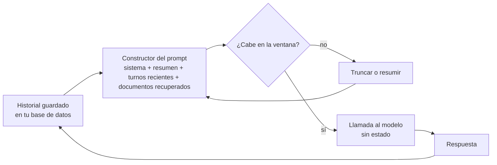

## El gancho

Un bot de soporte funciona a la perfección en las pruebas. En producción, un cliente escribe su número de pedido en el segundo mensaje, conversa durante veinte minutos y luego pregunta "¿y cuándo llega mi pedido?". El bot responde con educación, con seguridad y con un número de pedido que no existe.

No ha fallado nada. No se ha registrado ninguna excepción. Sencillamente, el número de pedido ya no estaba en el texto que recibió el modelo, y un modelo entrenado para producir siempre un siguiente token plausible produjo uno.

## La explicación sencilla

Una llamada a un modelo de lenguaje es una función pura. Entra texto, sale texto y el modelo no guarda nada entre llamadas. La **ventana de contexto** es la cantidad máxima de texto, medida en tokens, que puede recibir una llamada.

Piensa en un contratista sin ninguna memoria que solo trabaja con la carpeta que le entregas cada mañana. Si quieres que recuerde lo de ayer, metes en la carpeta las notas de ayer. La carpeta tiene un tamaño fijo. Cuando se llena, algo tiene que salir, y el contratista no te avisará de que falta una página. Rellenará el hueco con una suposición razonable.

Dónde deja de funcionar la analogía: un contratista humano lee todas las páginas con el mismo cuidado. Un modelo no. Incluso cuando la página está en la carpeta, la información que queda en mitad de una carpeta larga se aprovecha de forma menos fiable que la del principio o la del final.

## Por dentro

### Qué es de verdad una ventana de contexto

La ventana de contexto es un límite al número de tokens de un único cálculo hacia delante: el prompt de sistema, la conversación, los documentos recuperados, los resultados de herramientas y, normalmente, los tokens que el modelo genera como respuesta. Todo lo que el modelo "sabe" de tu situación tiene que caber en ese presupuesto.

Durante la generación, el servidor guarda las claves y los valores de cada token en la **caché KV** (lección 3), de modo que cada token nuevo atiende a todos los anteriores sin recalcularlos. Esa caché vive mientras dura la petición. La caché de prompts del proveedor puede reutilizarla entre peticiones que comparten un prefijo, lo que abarata y acelera los prefijos repetidos, pero no cambia lo que ve el modelo. El modelo sigue atendiendo solo a los tokens de la llamada actual.

### No hay memoria, solo texto reenviado

Una API de chat no tiene estado. Para continuar una conversación, tu aplicación vuelve a enviar todo el historial en cada turno. El prompt crece en cada turno, así que los tokens de entrada que pagas crecen más o menos linealmente por llamada y más o menos cuadráticamente a lo largo de toda la conversación.

Cuando el historial supera la ventana, tu código, o el framework que uses, tiene que decidir qué descartar. Estrategias habituales:

| Estrategia | Qué se conserva | Qué se rompe |
|---|---|---|
| Descartar lo más antiguo | Los mensajes más recientes | El prompt de sistema y los datos iniciales desaparecen primero |
| Prompt de sistema más turnos recientes | Las instrucciones y los últimos turnos | Todo lo dicho al principio que no se repitió |
| Prompt de sistema, resumen acumulado y turnos recientes | Las instrucciones, un pasado comprimido y los últimos turnos | Lo que el resumidor consideró poco importante |
| Recuperación sobre turnos anteriores | Los turnos más parecidos a la pregunta actual | Los datos formulados de forma distinta a la pregunta |

Las funciones de "memoria" de los productos funcionan igual a un nivel más alto: se guarda algo de texto en algún sitio y se inserta en prompts posteriores. Si no está en los tokens de esta llamada, el modelo no lo tiene.



### Perdido en el medio

Liu et al. (2023) colocaron el único documento que contenía la respuesta en distintas posiciones entre muchos documentos de distracción. La precisión era máxima cuando el documento relevante estaba al principio o al final del contexto y caía cuando estaba en el medio: una curva en forma de U. Los modelos con ventanas más largas no aprovechaban automáticamente mejor lo que había en ellas.

Las causas exactas se siguen estudiando. Una parte del panorama es pura aritmética. Los pesos de atención de una cabeza suman 1, así que un token relevante compite con todos los demás. Si la clave relevante puntúa un margen `m` por encima de `N` distractores con la misma puntuación, su peso es `e^m / (e^m + N)`. Con `m = 3`, `e^m` vale unos 20, así que con 1000 distractores el token relevante recibe alrededor del 2 % de la atención. Los modelos reales tienen muchas cabezas y capas y aprenden puntuaciones más marcadas, así que esto es una presión, no una ley. Si además añades cualquier sesgo que dependa de la posición, las posiciones centrales salen perdiendo todavía más.

### De dónde salen los errores dichos con seguridad

Una **alucinación** es una salida fluida que no está respaldada ni por la entrada ni por los hechos. Se deriva de cómo está construido el modelo (lección 5):

- **El objetivo premia la plausibilidad.** El entrenamiento minimiza la entropía cruzada del siguiente token. No existe un token de "no lo sé" que el objetivo prefiera cuando los datos de entrenamiento no dicen nada. La probabilidad tiene que ir a algún sitio, y una suposición fluida es la continuación más probable.
- **El conocimiento que falta parece un hueco más.** Un dato que era raro en los datos de entrenamiento, que ocurrió después de la fecha de corte o que se truncó fuera del contexto produce el mismo tipo de salida que un dato que el modelo conoce: una frase segura.
- **La calibración es imperfecta.** Un modelo está **calibrado** si, entre las respuestas que da con un 80 % de confianza, aciertan más o menos el 80 %. Kadavath et al. (2022) encontraron que los grandes modelos preentrenados estaban razonablemente calibrados en algunos formatos de opción múltiple, y el informe técnico de GPT-4 muestra que el post-entrenamiento redujo la calibración en un benchmark. El tono del texto no es en absoluto una puntuación de confianza.

La cifra resumen habitual es el **error de calibración esperado** (expected calibration error, ECE; Guo et al., 2017): agrupa las predicciones por confianza y promedia la diferencia entre la confianza media y la precisión de cada grupo, ponderada por su tamaño.

### Mitigaciones que funcionan

Ninguna hace imposibles los errores. Cada una mejora las probabilidades.

- **Recuperación.** Pon el texto fuente relevante en el prompt en lugar de depender de lo que memorizaron los pesos (Lewis et al., 2020, y la lección 7). Así un problema de conocimiento se convierte en un problema de lectura, que a los modelos se les da mucho mejor.
- **Contexto más corto y enfocado.** Recupera los cinco mejores fragmentos, no cincuenta. Pon las instrucciones y la evidencia más importante al principio o al final. Una ventana más grande es capacidad, no atención.
- **Citas.** Pide al modelo que cite o referencie el fragmento que respalda cada afirmación y luego comprueba por programa que la cita existe en la fuente.
- **Abstención.** Dale al modelo una salida explícita ("Si los documentos no contienen la respuesta, dilo") y usa una señal de confianza, ya sea de las probabilidades de los tokens, del acuerdo entre varias muestras o de una comprobación aparte, para desviar las respuestas de baja confianza a una alternativa o a una persona.
- **Verificación.** Valida la salida estructurada contra un esquema, contrasta los datos con tu base de datos, ejecuta una segunda pasada que compare la respuesta con las fuentes. Trata la salida del modelo como la entrada de un usuario: no es fiable hasta que se comprueba.

## La conexión con la ingeniería

- **La memoria es cosa de tu aplicación.** Guarda la conversación en tu base de datos y construye cada prompt de forma deliberada. Decide en código qué se conserva siempre (prompt de sistema, identidad del usuario, datos clave) en lugar de dejar que un framework descarte en silencio los mensajes más antiguos.
- **Fija los datos que importan.** Extrae números de pedido, nombres y decisiones a un estado estructurado e inyéctalos en cada turno. Un resumen pierde información y un resumidor puede descartar justo el detalle que necesitas.
- **Presupuesta tokens por turno.** Los chats largos son más caros y más lentos en cada turno. Registra en tu telemetría los tokens de entrada por llamada, limita el historial y genera alertas para las conversaciones que se acercan a la ventana.
- **El desbordamiento es un fallo silencioso.** Algunas APIs rechazan una petición demasiado larga y algunos frameworks truncan sin avisarte. Ninguna de las dos cosas produce un error que vea el usuario, solo una respuesta peor. Prueba explícitamente conversaciones largas.
- **Mide, no te fíes del tono.** Crea un conjunto de evaluación en el que la respuesta correcta sea "no está en los documentos" y mide con qué frecuencia se abstiene el sistema. Sigue la precisión con la cobertura que de verdad pones en producción.
- **Prueba la posición.** En tus evaluaciones, pon el dato clave al principio, en el medio y al final de un prompt largo. Si la precisión cambia, reordena o acorta el contexto.

## Reto práctico

Archivo: `courses/ai-engineering/exercises/lesson_09_context_hallucination.py`. Solo biblioteca estándar y NumPy. Simula un chat de 20 turnos con una ventana de 4096 tokens bajo dos estrategias de truncado, calcula la dilución de la atención softmax a medida que crecen los distractores y mide la calibración y la abstención sobre predicciones sintéticas con semilla fija. Es un modelo de juguete de los mecanismos, no una medición de un LLM real. Unos 10 minutos.

**Predice antes de ejecutar:**

1. Tras 20 turnos, ¿cómo de grande es el historial completo comparado con la ventana de 4096 tokens?
2. Con "descartar lo más antiguo", ¿sigue ahí el prompt de sistema en el turno 20?
3. Una clave relevante puntúa 3 por encima de 1000 distractores. ¿Qué fracción de la atención recibe?
4. Si el modelo solo responde cuando su confianza es de al menos 0.9, ¿la precisión sube o baja, y qué pasa con la cobertura?

::: predict
P: drop_system | choice:kept=Se conserva;lost=Se pierde | lost | | Con "descartar lo más antiguo", ¿sigue el prompt de sistema en el contexto en el turno 20?
P: w1000 | number | claim:w1000 | 0.01 | ¿Qué peso recibe la clave relevante con 1000 distractores y un margen de 3?
P: acc09 | number | claim:acc_09 | 0.05 | ¿Qué precisión tiene el modelo sobreconfiado cuando solo responde con confianza de 0.9 o más?
:::

El comando para ejecutarlo está al final de esta página.

<details>
<summary>Lo que el script me imprimió (ábrelo después de predecir)</summary>

- El historial completo en el turno 20 ocupa {{claim:turn20_full}} tokens, más o menos el doble de la ventana. Sin truncado, la llamada no cabría.
- Tokens de entrada facturados en los 20 turnos: {{claim:billed_full}} si se pudiera enviar todo el historial cada vez. Ese es el coste del texto reenviado, y crece más deprisa que la conversación.
- Descartar lo más antiguo en el turno 20: prompt de sistema conservado = `{{claim:drop_system_kept}}`, y el turno más antiguo que sobrevive es el {{claim:drop_oldest_turn}}. El número de pedido del turno 2 ha desaparecido, y las instrucciones también. La estrategia del resumen conserva el prompt de sistema, pero el dato solo sobrevive si el resumen lo recogió.
- Dilución de la atención: peso {{claim:w10}} con 10 distractores y {{claim:w1000}} con 1000. Cada vez que los distractores se multiplican por diez, el peso se divide más o menos por diez en cuanto `N` es mucho mayor que `e^m`. Con puntuaciones de distracción ruidosas y 1000 distractores baja a {{claim:w1000_noisy}}, porque unos pocos distractores puntúan alto por azar.
- Juguete de posición: con un sesgo en U añadido a propósito, la clave relevante recibe {{claim:pos_start}} al principio y {{claim:pos_middle}} en el medio. La forma de U es una entrada del juguete, no una prueba de ella. Solo muestra que las pequeñas preferencias de posición pesan más cuando la atención está diluida.
- Calibración del modelo sintético sobreconfiado:

```
{{claim:calibration_table}}
```

- El ECE es {{claim:ece_over}} para el modelo sobreconfiado y {{claim:ece_cal}} para uno cuya confianza coincide con su precisión. La diferencia es mayor en los grupos superiores, justo donde más importa.
- Responder a todo da una precisión de {{claim:acc_all}}. Abstenerse por debajo de 0.9 la sube a {{claim:acc_09}}, pero solo responde a {{claim:cov_09}} de las preguntas. La abstención cambia cobertura por precisión, e incluso las respuestas que conserva aciertan menos de lo que indica la confianza declarada por el modelo en ese grupo.

</details>

Ampliaciones: añade una lista de "datos fijados" al constructor del prompt y comprueba que el dato del turno 2 sobrevive. Cambia el margen a 5 y busca cuántos distractores reducen el peso a la mitad. Recalibra el modelo sobreconfiado ajustando una correspondencia entre la confianza y la precisión de cada grupo, y vuelve a calcular el ECE.

## Ideas clave

1. Una llamada al modelo no tiene estado. La ventana de contexto es todo lo que ve, y la memoria del chat es tu aplicación reenviando y recortando texto.
2. Estar en la ventana no es lo mismo que ser usado. Los contextos largos diluyen la atención, y el medio es el peor sitio para la evidencia clave.
3. Las alucinaciones vienen de un objetivo que siempre produce un token plausible, de una calibración imperfecta y del conocimiento que falta. La recuperación, el contexto enfocado, las citas, la abstención y la verificación las reducen.

**Pregunta de control:** un usuario dice que el bot "se olvidó" de una restricción que le dio al principio de una conversación larga. Nombra dos causas posibles y una solución para cada una.

**A continuación:** el post-entrenamiento, las etapas que convierten un predictor del siguiente token en un asistente, y cómo moldean tanto la utilidad como la calibración.

::: quiz
Q: ¿Recuerda un modelo de chat el turno anterior entre llamadas a la API?
A: No. La API no tiene estado. La aplicación reenvía el historial, o un resumen, como parte de cada prompt nuevo. Si un dato no está en los tokens de esta llamada, el modelo no lo tiene.
Q: ¿Por qué añadir más documentos a un prompt puede empeorar las respuestas?
A: Los pesos de atención suman 1, así que cada token extra compite con el relevante, y los modelos aprovechan peor la evidencia situada en mitad de contextos largos (Liu et al., 2023). Más texto puede significar menos peso para lo que importa.
Q: De las respuestas que un modelo da con un 90 % de confianza, acierta el 70 %. ¿Cómo se llama eso y qué puedes hacer?
A: Sobreconfianza, una brecha de calibración. Mídela con una tabla de calibración o con el ECE sobre tus propios datos, recalibra la señal de confianza y abstente o verifica por debajo de un umbral elegido con esos datos.
Q: ¿Por qué bajar la temperatura no evita las alucinaciones?
A: La temperatura cambia cómo se muestrea la distribución, no lo que contiene. Si la continuación más probable es una respuesta errónea pero fluida, la decodificación voraz la devuelve todas las veces.
:::

## Referencias

- Liu et al., "Lost in the Middle: How Language Models Use Long Contexts" (2023): https://arxiv.org/abs/2307.03172
- Kadavath et al., "Language Models (Mostly) Know What They Know" (2022): https://arxiv.org/abs/2207.05221
- Guo et al., "On Calibration of Modern Neural Networks" (2017), error de calibración esperado: https://arxiv.org/abs/1706.04599
- Lewis et al., "Retrieval-Augmented Generation for Knowledge-Intensive NLP Tasks" (2020): https://arxiv.org/abs/2005.11401
- OpenAI, "GPT-4 Technical Report" (2023), calibración antes y después del post-entrenamiento: https://arxiv.org/abs/2303.08774
