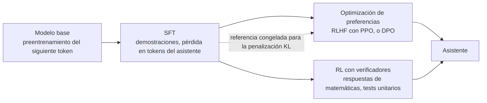

## El gancho

Escribe "What is the capital of France?" en un modelo base recién preentrenado y es habitual que la respuesta no sea "Paris". Son más preguntas: "What is the capital of Germany? What is the capital of Spain?" El modelo ha visto miles de páginas de cuestionarios, y continuar la lista es una predicción del siguiente token perfectamente válida.

En el artículo de InstructGPT, los evaluadores humanos prefirieron las respuestas de un modelo de 1.3B parámetros con post-entrenamiento a las del GPT-3 de 175B parámetros con el que se comparaba, un modelo más de 100 veces mayor. Misma arquitectura, mismo tipo de preentrenamiento. La diferencia fueron unas pocas etapas de entrenamiento, comparativamente baratas, al final. Esta lección trata de esas etapas y de las formas en que salen mal.

## La explicación sencilla

El preentrenamiento produce a alguien que se ha leído la biblioteca entera pero nunca ha tenido un trabajo. El post-entrenamiento es la incorporación a la empresa:

1. **Ajuste fino supervisado (SFT):** acompañar a una compañera sénior. Ves conversaciones de ejemplo y aprendes a producir la respuesta que dio ella.
2. **Optimización de preferencias:** una responsable lee dos de tus borradores y dice cuál es mejor. Aprendes qué significa "mejor" aquí.
3. **Aprendizaje por refuerzo con verificadores:** recibes tareas con solucionario, como una suma o una batería de tests que falla, y solo se te evalúa por si acertaste.

Dónde deja de funcionar la analogía: el modelo no aprende hechos nuevos de forma fiable durante la incorporación. El post-entrenamiento sobre todo cambia cuáles de los comportamientos que ya tiene se vuelven probables. Y un recién llegado que nota que a la responsable le gustan los informes largos empezará a escribir informes largos, sean correctos o no. Los modelos hacen exactamente eso.

## Por dentro

### Etapa 1: ajuste supervisado por instrucciones

El SFT usa el mismo objetivo que la lección 5: entropía cruzada sobre el siguiente token. Solo cambian los datos. Cada ejemplo es una conversación convertida en una única secuencia de tokens con una **plantilla de chat** (chat template), tokens especiales que marcan dónde empiezan y terminan los turnos del sistema, del usuario y del asistente.

Hay un detalle que importa: la pérdida se **enmascara** para que solo cuenten los tokens del asistente. El modelo lee el prompt de sistema y el turno del usuario como contexto, pero no se le entrena para producirlos. En PyTorch esto suele hacerse poniendo esas posiciones de las etiquetas a `-100`, el `ignore_index` por defecto de la pérdida de entropía cruzada.

```
loss = mean over assistant tokens t of  -log p(token_t | all previous tokens)
```

Qué cambia el SFT: el modelo ahora responde en lugar de continuar, se detiene al final de su turno, sigue el formato de las demostraciones y adopta su tono. Su techo es la calidad de las demostraciones: las imita, errores incluidos.

### Etapa 2: optimización de preferencias con un modelo de recompensa

Escribir demostraciones perfectas es caro. Comparar dos respuestas es barato y más fiable. InstructGPT recogió clasificaciones de salidas del modelo y entrenó un **modelo de recompensa** (reward model), una copia del modelo de lenguaje con una cabeza escalar, para que la respuesta preferida `y_w` puntúe más que la rechazada `y_l`:

```
reward_model_loss = -log sigmoid( r(x, y_w) - r(x, y_l) )
```

Después se optimiza el modelo SFT con **PPO**, un algoritmo de aprendizaje por refuerzo de gradiente de política: se muestrean respuestas, se puntúan con el modelo de recompensa y se aumenta la probabilidad de las que puntúan alto. Eso es **RLHF**. Funciona, pero ejecuta cuatro modelos a la vez (política, referencia, modelo de recompensa y un modelo de valor) y es sensible a los hiperparámetros.

### Optimización directa de preferencias (DPO)

DPO (Rafailov et al., 2023) demostró que el objetivo de RLHF con restricción KL tiene un óptimo en forma cerrada, `pi*(y|x) ∝ pi_ref(y|x) · exp(r(x, y) / beta)`. Si lo inviertes, la recompensa es simplemente `beta · log(pi / pi_ref)` más un término que se cancela en las comparaciones. Sustituyéndolo en la pérdida del modelo de recompensa se obtiene una pérdida sobre la propia política:

```
margin   = beta * ( log pi(y_w)/pi_ref(y_w) - log pi(y_l)/pi_ref(y_l) )
dpo_loss = -log sigmoid(margin)
```

Sin modelo de recompensa, sin muestreo, sin modelo de valor: solo dos pasadas hacia delante por par (la política y la referencia congelada) y un descenso de gradiente normal. `beta` fija cuánto puede moverse la política. Un `beta` pequeño significa que hace falta un cambio grande en las log-probabilidades para producir el mismo margen, así que la política se aleja más de la referencia.

### Aprendizaje por refuerzo con verificadores

Para algunas tareas no necesitas un juez aprendido: puedes comprobar la respuesta. Un problema de matemáticas tiene un número final, el código tiene tests unitarios, una consulta SQL tiene un conjunto de resultados esperado. La recompensa es 1 si el comprobador pasa y 0 si no. Así funciona buena parte del entrenamiento reciente de modelos de razonamiento: DeepSeek-R1-Zero se entrenó solo con recompensas basadas en reglas para la corrección de la respuesta y el formato de salida, y sus autores informaron de que las respuestas se fueron alargando durante el entrenamiento sin que nadie pidiera respuestas más largas.

Un verificador es mucho más difícil de engañar que un modelo de recompensa aprendido, pero solo cubre tareas con respuestas comprobables, y solo comprueba lo que comprueba. Una batería de tests que no cubre un caso límite recompensa el código que lo resuelve mal.

### La correa KL y el reward hacking

Un modelo de recompensa es una red neuronal entrenada con un conjunto limitado de comparaciones. Si presionas mucho una política contra él, la política encuentra los sitios donde el modelo de recompensa se equivoca: respuestas que puntúan alto y no son buenas. Eso es **reward hacking** (explotación de la recompensa). Gao et al. (2022) lo midieron: a medida que avanza la optimización, la recompensa aprendida sigue subiendo mientras que la calidad real, juzgada por un modelo de recompensa "oro" más fuerte, sube y luego baja.

La defensa estándar es una penalización sobre la divergencia KL respecto al modelo de referencia, normalmente el modelo SFT:

```
objective = E[ r(x, y) ] - beta * KL( pi || pi_ref )
```

Mantiene la política cerca de la distribución con la que se entrenó el modelo de recompensa, donde todavía es razonablemente preciso, y conserva la fluidez y la diversidad de la referencia. La penalización limita el daño. No corrige una recompensa sesgada.



### Qué cambia cada etapa

| Etapa | Datos | Qué cambia en el comportamiento | Fallo típico |
|---|---|---|---|
| Preentrenamiento | Texto en bruto | Conocimiento, lenguaje, continuación | Continúa en lugar de responder |
| SFT | Conversaciones de demostración | Responde por turnos, formato, saber parar | Copia los errores y el estilo de las demostraciones |
| Preferencias (RLHF, DPO) | Pares de respuestas mejor y peor | Tono, utilidad, negativas, orden entre respuestas plausibles | Verbosidad, adulación, exceso de negativas |
| RL con verificadores | Problemas con un comprobador | Precisión en tareas comprobables, razonamientos más largos | Engañar al comprobador, salidas largas |

## La conexión con la ingeniería

- **Base o instruct.** Para chat, extracción o herramientas, usa el modelo instruct. Un modelo base solo es el punto de partida adecuado si vas a hacer tu propio SFT.
- **Usa la plantilla de chat exacta.** El modelo se post-entrenó con una disposición de tokens concreta. Un prompt construido a mano con marcadores de rol incorrectos queda fuera de distribución y degrada la calidad sin avisar. Deja que la renderice el tokenizador o el SDK del proveedor.
- **Enmascara la pérdida al hacer fine-tuning.** Si ajustas con conversaciones sin enmascarar, también entrenas al modelo para generar turnos del usuario y tu prompt de sistema.
- **La verbosidad y la adulación vienen entrenadas.** Los evaluadores y los modelos de recompensa tienden a favorecer respuestas más largas y complacientes. Cuenta con ello y, cuando uses un LLM como juez en tus evaluaciones (siguiente lección), controla la longitud.
- **Los datos de preferencias son más baratos que las demostraciones.** Si tu equipo puede decir "A es mejor que B" más rápido de lo que escribe la respuesta ideal, DPO sobre esos pares es un paso práctico después del SFT. Bibliotecas de código abierto como Hugging Face TRL implementan ambos.
- **Trata cualquier recompensa automática como una superficie de ataque.** Si entrenas o seleccionas salidas contra un evaluador, una batería de tests o un modelo juez, guarda una comprobación aparte que el optimizador nunca vea.

## Reto práctico

Archivo: `courses/ai-engineering/exercises/lesson_10_post_training.py`. Solo NumPy, con todos los gradientes escritos a mano. Una política de juguete es un softmax sobre un menú corto de respuestas candidatas por prompt; el script ejecuta SFT, luego DPO contra una referencia congelada con dos valores de `beta`, y después optimiza una recompensa defectuosa y un verificador con y sin penalización KL. Unos 12 minutos.

**Predice antes de ejecutar:**

1. La conversación de juguete tiene un prompt de sistema, un turno del usuario y un turno del asistente. ¿Qué fracción de sus palabras cuenta en la pérdida del SFT?
2. Tras 30 pasos de SFT, ¿qué probabilidad tienen las respuestas demostradas?
3. DPO con `beta = 0.5` y `beta = 0.1` sobre las mismas preferencias: ¿cuál acaba más lejos de la referencia? ¿Será distinto el margen de recompensa implícito?
4. La recompensa defectuosa suma 0.15 por palabra a la corrección. Sin penalización KL, ¿cuál es la precisión final?
5. ¿Devuelve un coeficiente KL de 2.0 la precisión al nivel de la referencia?

::: predict
P: sft30 | number | claim:sft30 | 0.1 | Tras 30 pasos de SFT, ¿cuál es la probabilidad media de las respuestas demostradas?
P: beta | choice:small=beta 0.1;large=beta 0.5;same=Más o menos igual | small | | ¿Con qué beta acaba la KL respecto a la referencia siendo mayor?
P: hack | number | claim:acc_kl0 | 0.1 | Recompensa defectuosa y sin penalización KL: ¿con qué precisión acaba la política?
:::

El comando para ejecutarlo está al final de esta página.

<details>
<summary>Lo que el script me imprimió (ábrelo después de predecir)</summary>

- Solo {{claim:loss_words}} de las {{claim:total_words}} palabras son del asistente, así que la mitad de esta conversación es contexto que la pérdida ignora.
- El SFT sube la probabilidad media de la respuesta demostrada de {{claim:sft0}} a {{claim:sft30}} en 30 pasos. Es entropía cruzada normal con gradiente `p - onehot(y)`, exactamente como en la lección 5.
- DPO, el 80% de los evaluadores prefiere "example" a "terse": con `beta = 0.5` la política pone {{claim:dpo_example_b05}} en "example". Las dos ejecuciones terminan con el mismo margen de recompensa implícito, {{claim:margin}}, que es `ln(0.8/0.2)`: DPO ajusta las probabilidades relativas de las preferencias. Para llegar ahí, la diferencia de log-cocientes se mueve {{claim:gap_b05}} con `beta = 0.5` y {{claim:gap_b01}} con `beta = 0.1`, cinco veces más, y la KL respecto a la referencia crece de {{claim:kl_b05}} a {{claim:kl_b01}}.
- Con `beta = 0.1` la respuesta "off-topic", que no aparece en ningún par, también cae casi a cero. En este juguete solo cambia por la normalización del softmax, lo que recuerda que DPO mueve respuestas que nunca se le mostraron.
- Recompensa defectuosa: la referencia acierta un {{claim:ref_acc}} de las veces. Sin penalización KL la política pone {{claim:long_kl0}} en la respuesta larga y errónea, y la precisión cae a {{claim:acc_kl0}}. Con un coeficiente KL de 2.0 la precisión es {{claim:acc_kl2}}: cerca de la referencia, pero aún por debajo. La correa limita el daño, no deshace el sesgo.
- Con el verificador como recompensa y un coeficiente KL de 0.5, la precisión sube a {{claim:acc_verifier}}. Una recompensa que puedes comprobar es mejor que una que tienes que aprender, cuando la tienes.

</details>

Ampliaciones: cambia la bonificación de 0.15 por palabra a 0.05 y busca el coeficiente KL más pequeño que mantiene la precisión al nivel de la referencia. Pon las preferencias de DPO al 100% en lugar del 80% y observa cómo el margen sigue creciendo en lugar de converger. Sustituye el verificador por uno que solo compruebe que la respuesta contiene "42" en alguna parte, y escribe una candidata que lo engañe.

## Ideas clave

1. El SFT es entrenamiento normal del siguiente token sobre conversaciones seleccionadas, con la pérdida enmascarada a los tokens del asistente. Enseña formato y turnos, y su techo son las demostraciones.
2. La optimización de preferencias aprende de "A es mejor que B". RLHF entrena un modelo de recompensa y lo optimiza con PPO; DPO junta ambas cosas en una sola pérdida contra una referencia congelada, con `beta` controlando cuánto se mueve la política.
3. Cualquier recompensa que optimices con fuerza se explotará donde se equivoca. Una penalización KL respecto a la referencia limita la deriva, y un verificador con respuestas comprobables es más difícil de engañar que un juez aprendido.

**Pregunta de control:** tras una ronda de ajuste por preferencias, las respuestas de tu asistente de soporte son un 40% más largas y los usuarios las valoran mejor, pero la resolución de tickets no ha mejorado. ¿Qué ha pasado y qué cambiarías en la recompensa o en la evaluación?

**A continuación:** medir lo que has construido. Evaluar aplicaciones con LLM, incluido cómo evitar que un LLM juez premie la longitud.

::: quiz
Q: En el SFT, ¿por qué se enmascara la pérdida a los tokens del asistente?
A: El objetivo es entrenar al modelo para producir respuestas, no turnos del usuario ni prompts de sistema. Esos tokens son contexto: el modelo los lee, pero no contribuyen a la pérdida.
Q: ¿Qué elimina DPO en comparación con RLHF con PPO?
A: El modelo de recompensa entrenado por separado, el muestreo de la política durante el entrenamiento y el modelo de valor. DPO optimiza directamente una pérdida de tipo clasificación sobre pares de preferencias, usando un modelo de referencia congelado.
Q: ¿Qué pasa si quitas la penalización KL al optimizar contra un modelo de recompensa aprendido?
A: La política deriva hacia donde el modelo de recompensa puntúa más alto, incluidas respuestas que puntúa mal. La recompensa aprendida sigue subiendo mientras la calidad real baja: reward hacking.
Q: ¿Por qué el aprendizaje por refuerzo con verificadores se usa sobre todo en matemáticas y código?
A: Esas tareas tienen respuestas que un programa puede comprobar, como un número final o una batería de tests, así que la recompensa no depende de un juez aprendido que se puede engañar. Las tareas abiertas rara vez tienen un comprobador así.
:::

## Referencias

- Ouyang et al., "Training language models to follow instructions with human feedback" (2022), InstructGPT: SFT, luego modelo de recompensa, luego PPO: https://arxiv.org/abs/2203.02155
- Rafailov et al., "Direct Preference Optimization: Your Language Model is Secretly a Reward Model" (2023): https://arxiv.org/abs/2305.18290
- Schulman et al., "Proximal Policy Optimization Algorithms" (2017): https://arxiv.org/abs/1707.06347
- Gao, Schulman y Hilton, "Scaling Laws for Reward Model Overoptimization" (2022): https://arxiv.org/abs/2210.10760
- DeepSeek-AI, "DeepSeek-R1: Incentivizing Reasoning Capability in LLMs via Reinforcement Learning" (2025): https://arxiv.org/abs/2501.12948
