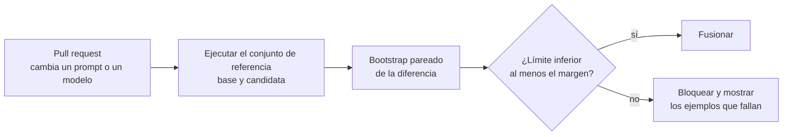

## El gancho

Reescribes un prompt de sistema, ejecutas tu conjunto de 50 ejemplos de prueba y la puntuación baja del 80% al 76%. Deshaces el cambio y sigues con otra cosa.

En el ejercicio, esa misma historia le ocurre a un prompt que es realmente mejor: la precisión real del candidato es del 82% frente al 80% de la versión base. Con 50 ejemplos, el candidato obtuvo {{claim:n50_candidate}} y la diferencia pareada salió {{claim:n50_diff}}. El intervalo es tan ancho que cabe a la vez una gran regresión y una gran mejora. El conjunto de prueba no te dijo que el prompt fuera peor. No te dijo nada, y tú lo leíste como un veredicto.

## La explicación sencilla

Un conjunto de evaluación es una batería de pruebas unitarias cuyas aserciones son probabilísticas. Cada ejemplo es una muestra ruidosa de cómo se comporta el sistema, y la puntuación es una estimación con su barra de error, igual que un p95 de latencia medido sobre 50 peticiones es una estimación.

La analogía falla en dos sitios. Una prueba unitaria es determinista y pasa o falla; una respuesta de un LLM puede ser correcta en parte, y la misma entrada puede producir salidas distintas. Y, para respuestas abiertas, lo que decide qué es "correcto" suele ser otro modelo, que tiene sus propios errores sistemáticos. Así que tienes que medir también al evaluador, no solo al sistema.

## Por dentro

### Conjuntos de referencia: construcción y etiquetado

Un conjunto de referencia (golden set) es una lista fija y versionada de entradas con la salida esperada o con los criterios que debe cumplir una buena salida.

- **Fuentes.** Toma muestras de entradas reales de producción (estratificadas por intención, idioma y segmento de usuarios), añade casos límite escritos a mano y añade cada error que haya reportado un usuario. Las entradas sintéticas generadas por un LLM sirven para ampliar la cobertura, pero tienden hacia lo que a los modelos les resulta fácil.
- **Etiquetado.** Escribe una guía de etiquetado con ejemplos de aprobado, suspenso y casos dudosos. Haz que dos personas etiqueten el mismo subconjunto, mide su acuerdo (kappa de Cohen, más abajo) y corrige la guía donde discrepen. Si dos personas no se ponen de acuerdo, ninguna métrica lo hará.
- **Higiene.** Reserva una parte que nunca mires mientras ajustas prompts, o acabarás sobreajustando el prompt al conjunto. Versiona el conjunto junto al código y registra qué versión del conjunto produjo cada puntuación.

El tamaño compra resolución. Unos 50 ejemplos detectan roturas evidentes. Unos cientos, puntuados por pares, distinguen cambios de unos 5 puntos. Ver 2 puntos exige del orden de mil, como muestran las secciones siguientes.

### Métricas por tipo de tarea

| Tarea | Métrica principal | Notas |
|---|---|---|
| Clasificación, enrutado | Precisión (accuracy), precision y recall por clase | Mira la matriz de confusión, no un único número |
| Extracción, salida estructurada | Coincidencia exacta por campo, tasa de validez del esquema | Normaliza fechas, mayúsculas y espacios antes de comparar |
| Recuperación | hit@k, MRR, recall@k | Lección 6 |
| Respuestas RAG | Corrección frente a una referencia, fidelidad al contexto recuperado | Fiel pero incorrecta suele indicar que falló la recuperación |
| Generación de código | Proporción de pruebas unitarias superadas | Ejecutar vale más que la similitud textual |
| Texto abierto | Preferencia por pares o puntuación con rúbrica, por personas o un modelo juez | Necesita las comprobaciones del juez de más abajo |

Sigue las métricas operativas junto a las de calidad: percentiles de latencia, tokens y coste por petición, tasa de rechazos y tasa de errores. Un prompt que es 1 punto mejor y el doble de largo puede ser un mal negocio.

### Intervalos de confianza y tamaño de muestra

El error estándar de una precisión `p` medida sobre `n` ejemplos es `sqrt(p(1-p)/n)`. Con `p = 0.8` y `n = 50` vale 0.057, así que el intervalo del 95% es de aproximadamente más o menos 11 puntos. Un cambio de 2 puntos es invisible ahí dentro.

El **bootstrap** obtiene un intervalo sin fórmulas: remuestrea los ejemplos con reemplazo miles de veces, recalcula la métrica cada vez y toma los percentiles 2.5 y 97.5. Cuando comparas dos versiones sobre los mismos ejemplos, usa un bootstrap **pareado**: remuestrea los índices de los ejemplos una sola vez y calcula ambas versiones sobre el mismo remuestreo. El emparejamiento cancela la dificultad de cada ejemplo, que ambas versiones comparten, y solo aportan información los ejemplos en los que las dos versiones discrepan.

En el ejercicio, la diferencia pareada es {{claim:n500_diff}} con 500 ejemplos y {{claim:n2000_diff}} con 2000. Solo con 2000 el intervalo excluye el cero. El script también calcula cuántos ejemplos dan un intervalo de más o menos 2 puntos sobre la diferencia: {{claim:paired_needed}} pareados, {{claim:unpaired_needed}} si las dos versiones se puntuaran sobre ejemplos distintos.

### El LLM como juez y sus sesgos

Para salidas abiertas, un modelo potente puede calificar respuestas, una a una con una rúbrica o por pares ("¿qué respuesta es mejor?"). Zheng et al. (2023) lo estudiaron con MT-Bench y Chatbot Arena y encontraron que un juez potente coincidía con las preferencias humanas aproximadamente tanto como las personas coincidían entre sí. También documentaron sesgos sistemáticos:

- **Sesgo de posición:** el juez favorece la respuesta de una posición concreta, a menudo la primera.
- **Sesgo de verbosidad:** prefiere las respuestas más largas aunque el texto extra no aporte nada.
- **Sesgo de autopromoción:** un modelo tiende a favorecer las respuestas escritas por él mismo.
- **Calificación débil en matemáticas y razonamiento,** donde una solución errónea pero segura de sí misma puede engañar al juez.

En el ejercicio, un juez con una preferencia incorporada por la primera posición cambia su veredicto en {{claim:flip_rate}} de los pares cuando intercambias el orden, y en {{claim:first_both}} eligió las dos veces la respuesta que se mostraba primero.

### Mitigaciones: intercambiar, rúbricas, calibrar

- **Intercambia el orden.** Juzga cada par en los dos órdenes. Quédate con el veredicto solo cuando ambos coinciden y cuenta la discrepancia como empate. En el ejercicio, el acuerdo con las personas sube de {{claim:agree_one}} con un solo orden a {{claim:agree_consistent}} en los veredictos consistentes, pero estos cubren solo {{claim:consistent_share}} de los pares. Los pares consistentes son además los más fáciles, así que parte de esa mejora es selección: informa de la cobertura junto al acuerdo.
- **Rúbricas.** Pide criterios concretos y comprobables ("cita una fuente del contexto", "responde en menos de 100 palabras") con una puntuación por criterio, en lugar de "puntúa de 1 a 10". Proporciona una respuesta de referencia cuando la tengas. Usa un juez de una familia de modelos distinta a la del sistema evaluado para limitar la autopreferencia.
- **Calibra frente a personas.** Etiqueta a mano unos cientos de ejemplos y mide el acuerdo entre juez y personas con la **kappa de Cohen**, `(observado - azar) / (1 - azar)`, que resta el acuerdo que obtendrías por suerte. Cuando la mayoría de las respuestas son buenas, un juez que siempre dice "aprobado" coincide con las personas exactamente tantas veces como ellas aprueban, {{claim:raw_always}} en el ejercicio, y tiene una kappa de 0. El juez real del ejercicio tiene un acuerdo bruto de {{claim:raw_real}} pero una kappa de {{claim:kappa_real}}, porque deja pasar muchos de los suspensos. Recalibra cada vez que cambien el modelo juez o la rúbrica.

### Pruebas de regresión y observabilidad

Una puerta de regresión convierte todo esto en una comprobación de CI: puntúa la versión base y la candidata sobre el mismo conjunto de referencia, calcula un intervalo pareado de la diferencia y bloquea la fusión cuando el límite inferior cae por debajo de un margen elegido de antemano. El ejercicio usa un margen de menos 2 puntos.

Una candidata que es realmente 3 puntos peor, puntuada sobre 500 ejemplos, da {{claim:regressed_diff}}. El intervalo aún incluye el cero, así que una prueba simple de "¿es significativamente peor?" la dejaría pasar. La puerta con margen la bloquea. El coste de esa exigencia se ve en el primer resultado: con solo 50 ejemplos, incluso un prompt mejor no supera la puerta, porque un intervalo que no informa no puede demostrar que nada sea seguro.

Este sitio hace lo mismo con su propia búsqueda. La compilación ejecuta un conjunto etiquetado de preguntas de alumnos contra la búsqueda de "Pregunta al curso" y falla si hit@3 o MRR caen por debajo de umbrales por idioma; la página de Calidad muestra las cifras más recientes.

Los conjuntos offline solo cubren lo que se te ocurrió. La **observabilidad** cubre el resto: en cada llamada de producción, registra el nombre y la versión de la plantilla de prompt, el modelo y sus parámetros, la entrada y la salida completas (dentro de tu política de privacidad), los ID de los documentos recuperados, las llamadas a herramientas, los tokens, la latencia, el coste y cualquier valoración del usuario, todo unido por un ID de traza con un span por paso. OpenTelemetry tiene convenciones semánticas para spans de IA generativa. Después cierra el ciclo: cuando una traza muestre un fallo, añade esa entrada al conjunto de referencia.

## La conexión con la ingeniería

- **Nunca compares dos puntuaciones sin intervalos.** Un panel que muestra 80% frente a 82% sin barras de error invita a decisiones equivocadas. Muestra la diferencia pareada y su intervalo.
- **Dimensiona el conjunto para el cambio que te importa.** Si las decisiones de producto dependen de cambios de 2 puntos, necesitas del orden de mil ejemplos pareados. Si solo tienes 50, úsalos como prueba de humo para roturas y dilo.
- **Empareja todo.** Puntúa ambas versiones con las mismas entradas, el mismo juez y en la misma ejecución. Las comparaciones no pareadas necesitan unas tres veces más ejemplos para la misma precisión.
- **Trata al juez como una dependencia.** Fija la versión de su modelo, versiona la rúbrica, intercambia el orden de los pares y sigue su kappa frente a una parte etiquetada por personas. Actualizar el juez puede mover todas las puntuaciones sin que el producto cambie.
- **Usa una puerta con un margen elegido de antemano.** Mover el umbral después de ver el resultado convierte la puerta en un trámite.
- **Registra las versiones de prompt como las versiones de despliegue.** Cuando la calidad cae en producción, la primera pregunta es qué prompt, qué modelo y qué índice de recuperación atendieron esa petición.

## Reto práctico

Archivo: `courses/ai-engineering/exercises/lesson_11_evaluating_llm_apps.py`. Solo NumPy, con datos sintéticos con semilla. Simula dos versiones de una aplicación sobre conjuntos de referencia de 50, 500 y 2000 ejemplos con intervalos bootstrap y una puerta de regresión; después, un juez por pares con sesgo de posición, y por último el acuerdo entre juez y personas con la kappa de Cohen. Unos 15 minutos.

**Predice antes de ejecutar:**

1. La candidata es realmente 2 puntos mejor. Con 50 ejemplos, ¿qué anchura tendrá el intervalo de la diferencia? ¿Podría la candidata incluso puntuar menos?
2. ¿Con qué tamaño de conjunto excluirá el cero el intervalo de la diferencia: 50, 500 o 2000?
3. Un juez tiene una bonificación fija para la primera posición. ¿En qué proporción de pares cambiará su veredicto al intercambiar el orden?
4. Un juez que siempre dice "aprobado" en un conjunto donde aprueba la mayoría de las respuestas: ¿cuál es su acuerdo bruto con las personas y cuál es su kappa?

::: predict
P: needed | number | claim:paired_needed | 150 | ¿Cuántos ejemplos pareados dan un intervalo de más o menos 2 puntos sobre una diferencia cercana a 2 puntos?
P: flips | number | claim:flip_rate | 0.1 | ¿En qué proporción de pares cambia su veredicto el juez sesgado al intercambiar el orden?
P: kappa | number | claim:kappa_real | 0.1 | El juez real coincide con las etiquetas humanas en la mayoría de los casos. ¿Cuál es su kappa de Cohen?
P: gate | choice:pass=Pasa;fail=Falla | fail | | La candidata realmente 3 puntos peor con 500 ejemplos: ¿la puerta con margen la deja pasar o la bloquea?
:::

El comando para ejecutarlo está al final de esta página.

Lo que el script me imprimió (ábrelo después de predecir)

- Diferencia pareada, valor real +0.02: {{claim:n50_diff}} con n=50, {{claim:n500_diff}} con n=500 y {{claim:n2000_diff}} con n=2000. Con 50 ejemplos el signo observado es el equivocado; solo con 2000 queda el cero fuera del intervalo.
- Ejemplos para un intervalo de más o menos 2 puntos: {{claim:paired_needed}} pareados, {{claim:unpaired_needed}} no pareados. La aproximación usa las tasas reales, que es como dimensionarías un conjunto antes de recogerlo.
- La candidata realmente peor: {{claim:regressed_diff}}, bloqueada por la puerta aunque el intervalo incluye el cero.
- Sesgo de posición: el veredicto cambia en {{claim:flip_rate}}, primera posición las dos veces en {{claim:first_both}}. Acuerdo con las personas: {{claim:agree_one}} con un solo orden y {{claim:agree_consistent}} en los pares consistentes, que son {{claim:consistent_share}} del total.
- Kappa: el juez que siempre aprueba coincide {{claim:raw_always}} y obtiene 0; el juez real coincide {{claim:raw_real}} y obtiene {{claim:kappa_real}}.

Ampliaciones: pon `position_bias` a 0 y mira cuántos cambios de veredicto quedan solo por ruido. Cambia la probabilidad de aprobado humana de 0.85 a 0.5 y observa cómo se acercan el acuerdo bruto y la kappa. Busca el tamaño de conjunto más pequeño con el que la candidata realmente mejor supera la puerta con la mayoría de semillas.

## Ideas clave

1. Una puntuación de evaluación es una estimación con un intervalo. Con 50 ejemplos, el intervalo del 95% es de unos más o menos 11 puntos, así que los cambios de 2 puntos necesitan del orden de mil ejemplos pareados.
2. Los jueces LLM tienen sesgos de posición, de verbosidad y de autopreferencia. Intercambia el orden, usa rúbricas concretas y calibra frente a etiquetas humanas con kappa, no con el acuerdo bruto.
3. Decide los lanzamientos con el límite inferior de una diferencia pareada y registra en producción las versiones de prompt y las trazas, para que los fallos nuevos alimenten el conjunto de referencia.

**Pregunta de control:** tu juez coincide con las etiquetas humanas el 92% de las veces en un conjunto donde el 90% de las respuestas son buenas. ¿Es un buen juez? ¿Qué calcularías antes de fiarte de él?

**A continuación:** inyección de prompts y seguridad en LLM, donde las entradas que tu evaluación nunca previó las escribe a propósito un atacante.

::: quiz
Q: La versión B puntúa 84% y la versión A 82% sobre los mismos 100 ejemplos. ¿Puedes lanzar B como una mejora?
A: Con esa evidencia, no. El error estándar con 100 ejemplos ronda los 4 puntos por versión, y el intervalo pareado de una diferencia de 2 puntos casi seguro incluye el cero. Informa del intervalo pareado y recoge más ejemplos o trata el cambio como neutro.
Q: ¿Por qué un bootstrap pareado da un intervalo más estrecho que comparar dos intervalos independientes?
A: Ambas versiones se puntúan sobre los mismos ejemplos, así que la variación debida a ejemplos fáciles y difíciles se cancela. Solo los ejemplos en los que las versiones discrepan contribuyen a la incertidumbre de la diferencia.
Q: ¿Cómo detectas y reduces el sesgo de posición en un juez por pares?
A: Juzga cada par en los dos órdenes y mide con qué frecuencia cambia el veredicto. Quédate solo con los veredictos que coinciden en ambos órdenes, cuenta el resto como empates e informa de cuántos pares quedan.
Q: ¿Por qué usar la kappa de Cohen en lugar del acuerdo bruto para validar un juez?
A: El acuerdo bruto se infla cuando domina una etiqueta. La kappa resta el acuerdo esperado por azar, así que un juez que siempre da la etiqueta mayoritaria obtiene 0 aunque su acuerdo bruto sea alto.
:::

## Referencias

- Zheng et al., "Judging LLM-as-a-Judge with MT-Bench and Chatbot Arena" (2023): https://arxiv.org/abs/2306.05685
- Miller, "Adding Error Bars to Evals: A Statistical Approach to Language Model Evaluations" (2024): https://arxiv.org/abs/2411.00640
- Cohen, "A Coefficient of Agreement for Nominal Scales", Educational and Psychological Measurement (1960): https://doi.org/10.1177/001316446002000104
- OpenTelemetry, convenciones semánticas para sistemas de IA generativa: https://opentelemetry.io/docs/specs/semconv/gen-ai/
