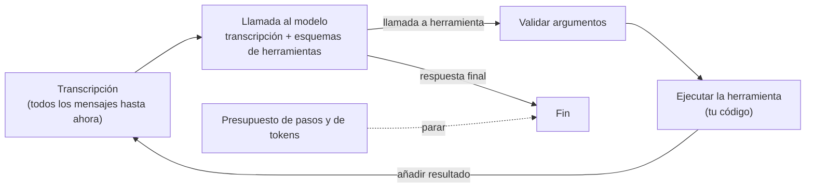

## El gancho

El modelo nunca ejecuta tus herramientas. No puede consultar tu base de datos, llamar a tu API ni sumar dos números con una calculadora. Lo único que puede hacer es devolver un fragmento de salida estructurada que dice "quiero que se llame a `inventory_lookup` con `{"sku": "SKU-42"}`". Es tu código el que decide si ejecutarlo, lo ejecuta y pega el resultado de vuelta en la conversación.

Ese es todo el truco detrás de un "agente": un bucle `while` en tu código alrededor de un modelo que emite peticiones de herramientas. Y tiene un coste que sorprende a casi todo el mundo la primera vez que mira la factura. En el ejercicio de esta lección, la misma pregunta usa {{claim:ratio}} veces más tokens cuando la resuelve un agente que cuando la resuelve una secuencia fija de código, con la misma respuesta exacta.

## La explicación sencilla

Piensa en un ingeniero de soporte al teléfono con un colega sénior que no puede ver ninguna pantalla. El colega dice "busca el pedido". El ingeniero lee el resultado en voz alta. "Ahora mira el stock del dock." El ingeniero también se lo lee. Tras unas cuantas rondas, el colega dice "dile al cliente que se envía con una unidad de menos". El colega es el modelo, el ingeniero es tu bucle y las notas de la llamada son la transcripción.

Un **flujo de trabajo** (workflow) es la disposición contraria: el ingeniero sigue un procedimiento escrito (buscar el pedido, revisar cada línea, calcular el total) y solo le pide al colega que redacte el correo final.

Dónde deja de funcionar la analogía: el colega no tiene memoria entre frase y frase. Cada vez que le pides el siguiente paso, tienes que leerle las notas de la llamada completas desde el principio. Así funcionan literalmente las API de chat, y por eso el coste de un agente crece más deprisa que el número de pasos.

## Bajo el capó

### El bucle

Un agente es una llamada al modelo dentro de un bucle. Cada iteración envía la transcripción completa más las definiciones de herramientas, y el modelo responde con una llamada a herramienta o con una respuesta final:

```python
messages = [{"role": "user", "content": task}]
for step in range(max_steps):
    reply = model(tools=TOOLS, messages=messages)
    messages.append(reply)
    if not reply.get("tool_calls"):
        return reply["content"]
    for call in reply["tool_calls"]:
        result = run_tool(call["name"], call["arguments"])
        messages.append({"role": "tool", "tool_call_id": call["id"], "content": json.dumps(result)})
return "stopped: step budget"
```

El artículo de ReAct (Yao et al., 2022) planteó este patrón como intercalar razonamiento y acciones, de modo que cada observación del entorno condiciona el paso siguiente. Las API de los proveedores difieren en los nombres de los campos (un bloque de contenido `tool_use` y un `stop_reason` igual a `tool_use` en la Messages API de Anthropic, una lista `tool_calls` y un rol `tool` en otras), pero la forma es la misma: el modelo propone y tu código dispone.



### Esquemas de herramientas

La definición de una herramienta es un nombre, una descripción y un JSON Schema para sus parámetros. Es salida estructurada (lección 8) apuntando a tus propias funciones:

```json
{"name": "inventory_lookup",
 "description": "Return stock and unit price for a SKU.",
 "parameters": {"type": "object",
                "properties": {"sku": {"type": "string"}},
                "required": ["sku"]}}
```

La descripción forma parte del prompt. El modelo elige herramientas leyendo nombres y descripciones, así que las vagas ("helper", "process data") producen llamadas equivocadas. El esquema tampoco es una garantía: valida los argumentos en tu bucle antes de ejecutar nada, igual que validarías el cuerpo de una petición en un controlador de ASP.NET. El ejercicio lo hace y devuelve un error de herramienta en lugar de lanzar una excepción. Además, todas las definiciones se reenvían en cada llamada: las tres pequeñas herramientas del ejercicio ya cuestan {{claim:tooldefs}} tokens por llamada.

### La transcripción es el estado

El modelo no tiene estado. La única memoria del agente es la lista `messages` que tu código guarda y reenvía. No hay ninguna sesión oculta en el lado del proveedor que "recuerde" lo que devolvió la herramienta si tú no lo vuelves a incluir. Eso tiene tres consecuencias:

- Cada paso alarga el prompt. En el ejercicio, la primera llamada envía {{claim:prompt1}} tokens y la sexta, {{claim:prompt6}}. El total de tokens en `n` pasos crece aproximadamente con `n²`.
- Para persistir, reanudar o depurar una ejecución, guardas la transcripción. Es tu registro de auditoría.
- Todo lo que devuelve una herramienta, incluido texto escrito por un desconocido, se convierte en entrada del modelo en el turno siguiente. La lección 12 explica por qué eso importa.

### Terminación

Un bucle necesita condiciones de salida que controles tú. La salida normal es una respuesta sin llamada a herramienta: la respuesta final del modelo. Las demás son presupuestos que impone tu código:

| Salida | Quién decide | Qué protege |
|---|---|---|
| Respuesta final | El modelo | Nada; es el camino feliz |
| Presupuesto de pasos (`max_steps`) | Tu código | Bucles infinitos, llamadas fallidas repetidas |
| Presupuesto de tokens o de coste | Tu código | Tu factura y la latencia |
| Tiempo límite de reloj | Tu código | Usuarios esperando, herramientas colgadas |

Cuando salta un presupuesto, devuelve un resultado claro de "detenido" en lugar de una conjetura. Una respuesta parcial que se hace pasar por completa es peor que un fallo honesto.

### Agente frente a flujo de trabajo

El artículo "Building effective agents" de Anthropic (2024) traza la línea así: en un **flujo de trabajo**, los LLM y las herramientas se orquestan mediante rutas de código predefinidas; en un **agente**, el modelo dirige su propio proceso y su uso de herramientas. Dicho llanamente: ¿quién elige el siguiente paso, tu código o el modelo?

Si puedes escribir los pasos de antemano, como en "busca el pedido, revisa cada línea, suma los precios", debe elegirlos el código. Obtienes una llamada al modelo en lugar de varias, un flujo de control determinista, pruebas unitarias y errores que se lanzan donde puedes verlos. Los agentes justifican su coste cuando el camino depende de verdad de lo que devuelven las herramientas y no se puede enumerar: depuración abierta, investigación, análisis que cruzan varios sistemas. El mismo artículo recomienda empezar por lo más simple que funcione y añadir comportamiento agéntico solo cuando ayude de forma medible.

## La conexión con la ingeniería

- **Modelo de costes.** El coste de un agente es la suma, paso a paso, de (prompt de sistema + definiciones de herramientas + transcripción hasta ese momento). Los resultados largos de herramientas, muchas herramientas y muchos pasos se multiplican entre sí. Recorta la salida de las herramientas a lo que el modelo necesita y usa la caché de prompts cuando tu proveedor la ofrezca, ya que el prefijo se repite en cada llamada.
- **Pon siempre presupuestos.** `max_steps`, un techo de tokens y un tiempo límite van en la primera versión, no después del primer incidente. Registra cuál de ellos saltó.
- **Valida y luego ejecuta.** Trata los argumentos de las herramientas como entrada no confiable. Comprueba tipos y campos obligatorios, aplica los permisos dentro de la propia herramienta y devuelve los errores como resultados de herramienta para que el modelo pueda recuperarse.
- **Devuelve errores útiles.** `{"error": "unknown sku"}` no le da al modelo nada con lo que actuar. `"unknown sku SKU-99; valid SKUs look like SKU-08"` quizá sí. Un modelo que reintenta una y otra vez la misma llamada fallida es un fallo común que se come el presupuesto.
- **Prefiere flujos de trabajo cuando el camino es conocido.** La mayoría de los procesos de negocio (comprobación de pedidos, cadenas de procesamiento de documentos, clasificación con categorías fijas) son flujos de trabajo con una o dos llamadas al modelo. Usa un agente para la parte en la que el camino es realmente desconocido, y mantenlo pequeño.
- **Guarda la traza.** Almacena cada paso (herramienta, argumentos, resultado, tokens). Es la única forma de depurar un agente, y la lección 15 se apoya en ello.

## Reto práctico

Archivo: `courses/ai-engineering/exercises/lesson_13_first_agent.py`. Solo la biblioteca estándar. Implementa el bucle del agente con diccionarios de mensajes al estilo de una API de chat, tres herramientas con parámetros parecidos a JSON Schema (una consulta de pedidos, una consulta de inventario sobre una tabla dentro del script y una calculadora segura) y una política guionizada que lee la transcripción y decide la siguiente llamada. La política es un sustituto determinista de un LLM, así que la ejecución es repetible; los tokens se estiman como los caracteres de la carga JSON divididos entre 4, una regla aproximada, no un tokenizador real. Resuelve una tarea como agente y como flujo de trabajo, y luego choca con un presupuesto de tokens y con uno de pasos. Unos 10 minutos.

**Predice antes de ejecutar:**

1. El pedido A-1001 tiene tres líneas. ¿Cuántas llamadas al modelo necesitará el agente, contando la que escribe la respuesta final?
2. ¿Cuántas llamadas al modelo necesita el flujo de trabajo para la misma respuesta?
3. ¿Cuántas veces más tokens usará el agente que el flujo de trabajo?
4. En la tarea 2 el pedido contiene un SKU que no está en el inventario, y la política reintenta las consultas fallidas. ¿Qué salida la detiene?

::: predict
P: calls | number | claim:agent_calls | 0 | ¿Cuántas llamadas al modelo hace el agente para el pedido A-1001?
P: ratio | number | claim:ratio | 4 | ¿Cuántas veces más tokens usa el agente que el flujo de trabajo?
P: exit | choice:answer=La respuesta final;steps=El presupuesto de pasos;tokens=El presupuesto de tokens | steps | | ¿Qué salida detiene la tarea 2?
:::

El comando para ejecutarlo está al final de esta página.

<details>
<summary>Lo que el script me imprimió (ábrelo después de predecir)</summary>

- La traza del agente: un `order_lookup`, tres llamadas a `inventory_lookup`, después `calculator` con `{{claim:calc_expr}}` y por último una respuesta final. {{claim:agent_calls}} llamadas al modelo en total.
- Los dos caminos responden "{{claim:agent_answer}}".
- Agente: {{claim:agent_calls}} llamadas al modelo, {{claim:agent_tokens}} tokens. Flujo de trabajo: {{claim:workflow_calls}} llamada al modelo, {{claim:workflow_tokens}} tokens. Proporción {{claim:ratio}}. Parte de la diferencia se debe a que la única llamada del flujo de trabajo no necesita definiciones de herramientas; la mayor parte es la transcripción reenviada en cada paso, de {{claim:prompt1}} tokens en la primera llamada a {{claim:prompt6}} en la última.
- Con un presupuesto de 1500 tokens, la misma tarea termina con "{{claim:token_budget}}". El bucle comprueba el presupuesto antes de cada llamada, así que se niega a empezar una llamada que no puede pagar.
- La tarea 2 repite la misma consulta fallida hasta "{{claim:loop_result}}". Un modelo real puede comportarse mejor, pero nada lo garantiza; el presupuesto sí.

</details>

Ampliaciones: haz que la herramienta de inventario devuelva un error útil que enumere los SKU válidos y enseña a la política a rendirse tras un fallo. Deja que la política pida las tres consultas de inventario en una sola respuesta (llamadas a herramientas en paralelo) y compara el número de tokens. Añade una cuarta herramienta que la política nunca necesite y observa cómo crece cada prompt.

## Ideas clave

1. Un agente es un bucle en tu código: llama al modelo con la transcripción y los esquemas de herramientas, ejecuta la herramienta que pide, añade el resultado y repite hasta una respuesta final o hasta que un presupuesto lo detenga.
2. La transcripción es el único estado. Reenviarla en cada paso hace que el coste del agente crezca más deprisa que el número de pasos, así que los presupuestos y la salida recortada de las herramientas son obligatorios.
3. En un flujo de trabajo tu código elige los pasos; en un agente los elige el modelo. Usa un flujo de trabajo siempre que puedas escribir los pasos.

**Pregunta de control:** un compañero propone un agente con diez herramientas para procesar las facturas entrantes, que siempre pasan por las mismas cuatro comprobaciones. ¿Qué construirías en su lugar y dónde, si acaso, seguiría teniendo sentido una llamada al modelo?

**A continuación:** MCP, un protocolo estándar para exponer herramientas y datos a los modelos sin tener que escribir a mano cada definición de herramienta en cada aplicación.

::: quiz
Q: ¿Quién ejecuta una llamada a herramienta en un agente: el modelo o tu código?
A: Tu código. El modelo solo devuelve salida estructurada que nombra una herramienta y sus argumentos. Tu bucle valida los argumentos, ejecuta la herramienta y añade el resultado a la transcripción.
Q: ¿Por qué el uso de tokens de un agente crece más deprisa que su número de pasos?
A: El modelo no tiene estado, así que cada llamada reenvía la transcripción completa más las definiciones de herramientas. El prompt de cada paso es más largo que el anterior, y el total en `n` pasos crece aproximadamente con `n²`.
Q: Nombra dos condiciones de salida que debe imponer tu código, además de la respuesta final del modelo.
A: Un presupuesto de pasos (máximo de llamadas al modelo) y un presupuesto de tokens o de coste. Un tiempo límite de reloj es una tercera. Detienen bucles como el de un modelo que reintenta la misma llamada fallida.
Q: ¿Qué separa a un agente de un flujo de trabajo?
A: Quién decide el siguiente paso. En un flujo de trabajo los pasos están predefinidos en el código y el modelo rellena partes; en un agente el modelo elige qué herramienta llamar a continuación según los resultados obtenidos hasta ese momento.
:::

## Referencias

- Yao et al., "ReAct: Synergizing Reasoning and Acting in Language Models" (2022), intercalar razonamiento y acciones con herramientas: https://arxiv.org/abs/2210.03629
- Anthropic, "Building effective agents" (2024), flujos de trabajo frente a agentes y cuándo usar cada uno: https://www.anthropic.com/research/building-effective-agents
- Schick et al., "Toolformer: Language Models Can Teach Themselves to Use Tools" (2023), modelos que aprenden cuándo llamar a API: https://arxiv.org/abs/2302.04761
- JSON Schema, la especificación con la que se escriben los parámetros de las herramientas: https://json-schema.org/
