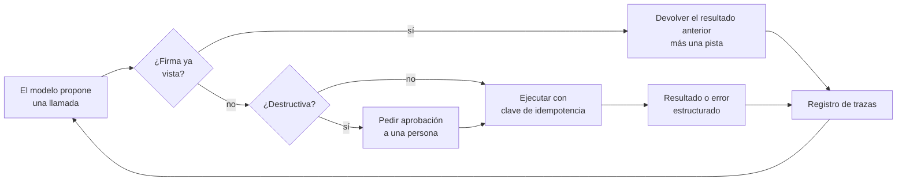

## El gancho

Tu agente de soporte gestiona un ticket de reembolso. Busca el pedido, actualiza la dirección, emite el reembolso y entonces una llamada de lectura agota el tiempo de espera. En el turno siguiente el modelo no reintenta la lectura. Vuelve a emitir el reembolso. Y otra vez. El harness sigue ejecutando todo lo que el modelo pide, la ventana de contexto se llena de resultados idénticos y, 40 llamadas después, la ejecución se detiene con "max iterations reached". Al cliente le han reembolsado decenas de veces, y el panel muestra una sola tarea fallida.

Nada en esa historia exige un mal modelo. Cada llamada, por separado, parecía razonable. El fallo vive en el bucle que rodea al modelo: qué ejecuta, qué le devuelve y qué se niega a hacer dos veces.

## La explicación sencilla

Un agente es un compañero junior que recorre una lista de tareas con un teléfono, donde cada llamada cuesta dinero y algunas llamadas mueven dinero. Un buen responsable no se limita a esperar que el compañero acierte en cada paso. Lleva un registro de llamadas, se da cuenta cuando la misma llamada se hace por quinta vez, da mensajes de error claros en lugar de "algo ha ido mal", hace que el banco deduplique los pagos, pone un límite de tiempo y exige una firma antes de cualquier cosa irreversible.

Dónde deja de funcionar la analogía: el compañero olvida. Un modelo no tiene memoria fuera de su ventana de contexto, así que su idea de "lo que ya he hecho" solo es tan buena como el historial que le das. Y, a diferencia de una persona, puede repetir el mismo error en la siguiente ejecución con una probabilidad que puedes medir, así que la fiabilidad es una estadística, no un rasgo de carácter.

## Bajo el capó

### Error compuesto

Si cada paso de una tarea tiene éxito de forma independiente con probabilidad `p`, una tarea de `n` pasos tiene éxito con probabilidad `p**n`. Eso decae más rápido de lo que sugiere la intuición:

| éxito por paso | 5 pasos | 10 pasos | 20 pasos | 50 pasos |
|---|---|---|---|---|
| 0.95 | 0.774 | 0.599 | 0.358 | 0.077 |
| 0.99 | 0.951 | 0.904 | 0.818 | 0.605 |

Son valores exactos de la fórmula. Dos consecuencias. Primera: las tareas largas necesitan una fiabilidad por paso muy superior a la que parece "buena" en una demo de chat. Segunda: la fórmula supone que no hay recuperación: un paso fallido mata la ejecución. Cada protección de esta lección funciona rompiendo esa suposición, convirtiendo un paso fatal en uno recuperable. Además, los fallos reales no son independientes (un malentendido en el paso 2 envenena el paso 7), lo que normalmente empeora las cosas respecto a `p**n`.

### Trazas: qué registrar

No puedes depurar un agente a partir de su respuesta final. Registra un registro estructurado por cada turno del modelo y por cada llamada a herramienta, enlazados por un id de ejecución:

- los mensajes exactos enviados al modelo (o un hash más un puntero al contenido almacenado), el modelo y sus parámetros, y la respuesta en bruto con las llamadas a herramientas;
- el nombre de cada llamada, sus argumentos, el resultado o el error, la latencia y si tuvo efectos secundarios;
- el número de tokens por turno, para ver cómo crece el contexto;
- las decisiones de las protecciones: bloqueada por duplicada, denegada por permisos, aprobada por una persona, detenida por presupuesto.

Con eso, el gancho se lee en segundos: la misma firma `(herramienta, argumentos)` aparece decenas de veces seguidas. Sin eso, tienes "la tarea falló". Las herramientas de trazado basadas en spans al estilo OpenTelemetry encajan bien, pero para empezar basta una tabla con id de ejecución, número de paso y columnas JSON en tu base de datos actual.

### Bucles y llamadas repetidas

Los modelos repiten llamadas por razones corrientes: un resultado llegó truncado o era ambiguo, un mensaje de error no daba ninguna pista de qué cambiar, o el historial ya no muestra que el paso se hizo. Una protección barata y eficaz es una **comprobación de firma**: calcula un hash de `(nombre de herramienta, argumentos canónicos)` y, cuando el modelo emite una firma que ya emitió en esta ejecución, no la ejecutes. Devuelve el resultado anterior con una nota breve ("ya llamaste a esto con estos argumentos; este es el resultado"). Las lecturas se pueden servir sin riesgo desde esa caché; las escrituras no deben volver a ejecutarse en silencio.



Un **presupuesto de pasos** (máximo de turnos, tokens o coste por ejecución) es la red de seguridad. No hace al agente más listo. Acota el daño de cada fallo que no anticipaste.

### Errores de herramientas y contexto inflado

Un error de herramienta es una entrada para el modelo, así que escríbelo para el modelo. `Error` o una traza de pila de 300 líneas no le dan nada con qué actuar. Un error estructurado dice qué falló, por qué y cómo es una llamada válida:

```json
{"error": "invalid_argument", "field": "date", "got": "21/10/2026", "expected": "YYYY-MM-DD", "retryable": false}
```

Distingue los errores que debe corregir el modelo (argumentos incorrectos, id desconocido) de los que debe gestionar el harness (timeouts, límites de tasa, 503). Los segundos los debe reintentar el código con espera exponencial (backoff), no el modelo.

El contexto inflado es la versión lenta del mismo problema. Cada resultado de herramienta se queda en el historial, así que unos cuantos JSON grandes o un bucle de resultados idénticos empujan muy atrás las instrucciones originales, encarecen y ralentizan cada turno posterior y diluyen la atención del modelo sobre lo que importa. Recorta la salida de las herramientas a los campos que la tarea necesita, resume o descarta los resultados antiguos y guarda los artefactos grandes fuera del contexto con un identificador que el modelo pueda pedir.

### Efectos secundarios: permisos, aprobación e idempotencia

Trata cada herramienta como una capacidad con un radio de impacto. Da al agente las credenciales más restringidas que completen la tarea (un usuario de base de datos de solo lectura para análisis, una herramienta de reembolsos limitada al importe del pedido). Marca las herramientas como de lectura, de escritura o destructivas, y exige aprobación humana explícita antes de acciones destructivas o irreversibles, mostrando los argumentos exactos. El juicio del propio modelo no es un sistema de permisos, sobre todo cuando hay texto no confiable (lección 12) en el contexto.

Los timeouts vuelven ambiguas las escrituras: la petición puede haberse confirmado antes de que se cortara la conexión. Un reintento a ciegas cobra dos veces. La solución estándar de las APIs de pago es una **clave de idempotencia**: quien llama genera una clave única por operación lógica, la envía en cada intento, y el servidor guarda el primer resultado para esa clave y lo devuelve ante las repeticiones en lugar de volver a ejecutar. Genera la clave en el harness, derivada de la ejecución y del paso, no en el modelo, para que una llamada reemitida corresponda a la misma clave.

### Evaluar agentes: pass@k frente a pass^k

Los agentes son estocásticos, así que una ejecución por tarea dice poco. Ejecuta cada tarea muchas veces e informa de la **tasa de éxito por tarea**. Luego ten claro qué pregunta estás haciendo:

- **pass@k**: la probabilidad de que al menos uno de `k` intentos tenga éxito. Es la adecuada cuando un verificador barato puede elegir el intento bueno (tests para código generado).
- **pass^k**: la probabilidad de que los `k` intentos tengan éxito. El artículo de τ-bench la introdujo para agentes que atienden a usuarios, porque un cliente no se queda con el mejor de tres reembolsos.

Con `c` éxitos en `n` ensayos de una tarea, las estimaciones insesgadas son `1 - C(n-c, k) / C(n, k)` para pass@k y `C(c, k) / C(n, k)` para pass^k, promediadas sobre las tareas. Al crecer `k`, pass@k sube hacia 1 y pass^k baja hacia la fracción de tareas que el agente resuelve todas y cada una de las veces. Esa distancia es tu problema de fiabilidad.

## La conexión con la ingeniería

- **Pon las protecciones en el código, no en el prompt.** "No llames dos veces a la misma herramienta" en un prompt de sistema es una sugerencia. Una comprobación de firma en el harness es una garantía. Lo mismo vale para presupuestos, permisos y aprobaciones.
- **Primero registra, luego depura.** Entrega el esquema de trazas con la primera versión del agente. Añadirlo después de un incidente significa que ese incidente no se puede depurar.
- **La idempotencia es un requisito del backend.** Si una herramienta puede mover dinero, enviar mensajes o crear registros, la API que hay detrás necesita claves de idempotencia o una restricción única natural. Los agentes lo vuelven urgente, porque reemiten llamadas con mucha más frecuencia que una interfaz manejada por una persona.
- **Separa las capas de reintento.** Errores de transporte: los reintenta el harness con backoff y la misma clave de idempotencia. Errores semánticos: se devuelven al modelo como errores estructurados. Mezclarlos quema turnos del modelo en fallos de red pasajeros.
- **Presupuesta el coste, no solo el éxito.** Una ejecución que entra en bucle hasta el límite cuesta varias veces lo que una normal. Crea alertas para las ejecuciones que agotan el presupuesto: son tus informes de errores.
- **Informa de pass^k junto a la tasa de éxito.** Un 85% de media puede esconder tareas que salen bien una de cada tres veces. Para cualquier cosa de cara al cliente, sigue la proporción de tareas que tienen éxito en cada una de `k` ejecuciones, y la batería de regresión de la lección 11 debería ejecutar cada caso varias veces.

## Reto práctico

Archivo: `courses/ai-engineering/exercises/lesson_15_agent_failures.py`. Solo la biblioteca estándar de Python, y es explícitamente una simulación con semilla, no un modelo real. Un agente simulado resuelve una tarea de reembolso de 8 llamadas en la que cada llamada puede elegir la herramienta equivocada, enviar argumentos mal formados, sufrir un timeout transitorio o repetir su última llamada completada. Ejecuta 1000 episodios por configuración añadiendo las protecciones de una en una, compara `p**n` con la simulación, calcula pass@3 y pass^3 e imprime una traza fallida. Unos 15 minutos.

**Predice antes de ejecutar:**

1. Sin protecciones, ¿qué fracción de tareas de 8 llamadas tendrá éxito?
2. Si añades solo un presupuesto de pasos (16 llamadas en lugar de un límite de contexto de 40): ¿el éxito sube o baja?
3. ¿Qué protección elimina por completo los efectos secundarios duplicados?
4. En 50 tareas de dificultad variable y con todas las protecciones activas, ¿cuánto se separarán pass@3 y pass^3?

::: predict
P: none | number | claim:none_success | 0.08 | ¿Tasa de éxito sin protecciones (de 0 a 1)?
P: budget | choice:up=El éxito sube;same=Más o menos igual;down=El éxito baja | down | | Si añades solo un presupuesto de pasos, ¿qué le pasa al éxito?
P: passhat | number | claim:passhat3 | 0.1 | ¿pass^3 con todas las protecciones (de 0 a 1)?
:::

El comando para ejecutarlo está al final de esta página.

<details>
<summary>Lo que el script me imprimió (ábrelo después de predecir)</summary>

- Sin protecciones: éxito {{claim:none_success}}, {{claim:none_calls}} llamadas por episodio de media para una tarea de 8 llamadas, tasa de bucles {{claim:none_loop_rate}} y {{claim:none_dups}} efectos secundarios duplicados en 1000 episodios. La mayoría de los duplicados vienen de bucles que vuelven a ejecutar una escritura; el resto, de reemitir una escritura que se había confirmado antes de un timeout.
- Solo el presupuesto de pasos: el éxito baja a {{claim:budget_success}}. Cortar las ejecuciones en 16 llamadas mata algunas que se habrían recuperado de un bucle largo o de una llamada mal formada persistente. Aun así se gana su sitio: menos llamadas y muchos menos duplicados, porque los bucles se cortan antes. Un presupuesto limita el coste, no añade fiabilidad.
- Detección de bucles: {{claim:loop_success}}. Errores estructurados: {{claim:struct_success}}, porque ahora las llamadas mal formadas se corrigen dentro del presupuesto. Reintentos idempotentes: {{claim:retry_success}} con {{claim:retry_dups}} efectos secundarios duplicados y cerca del mínimo de 8 llamadas.
- Error compuesto: con `p = 0.95` la simulación da {{claim:p95n10_sim}} para 10 pasos y {{claim:p95n50_sim}} para 50, frente a los valores analíticos 0.599 y 0.077. Las diferencias son ruido de muestreo de 1000 episodios.
- Fiabilidad con todas las protecciones: pass@1 {{claim:pass1}}, pass@3 {{claim:passat3}}, pass^3 {{claim:passhat3}}. Reintentar hasta que algo funcione parece casi perfecto; acertar siempre es mucho más difícil.
- La traza fallida es el gancho: un timeout y después `issue_refund` ejecutado {{claim:trace_repeat}} veces más hasta el límite de 40 llamadas. Un reembolso emitido muchas veces, y la tarea registrada solo como "step limit".

</details>

Ampliaciones: cambia `STEPS` a 20 y observa qué protección importa más. Iguala `P_FIX_STRUCTURED` a `P_FIX_OPAQUE` para medir cuánto valen unos mensajes de error claros. Calcula pass^k para k de 1 a 10 y representa lo rápido que cae.

## Ideas clave

1. La fiabilidad por paso se compone: `p**n` cae deprisa, así que las tareas largas solo funcionan cuando los pasos fallidos se vuelven recuperables.
2. Las soluciones viven en el harness: trazas, detección de bucles por firma, errores estructurados, reintentos en el harness con claves de idempotencia, presupuestos, herramientas con mínimo privilegio y aprobación humana para las acciones destructivas.
3. Evalúa los agentes con muchas ejecuciones por tarea e informa de pass^k en el trabajo de cara al usuario. pass@k mide lo que es posible; pass^k mide aquello con lo que se puede contar.

**Pregunta de control:** la evaluación de tu agente muestra un 90% de pass@1 y aun así los usuarios se quejan de que no es fiable. ¿Qué medirías a continuación y qué buscarías en las trazas de las ejecuciones fallidas?

**A continuación:** un cambio de bloque. Construir una pequeña red neuronal desde cero en PyTorch, para ver el bucle de entrenamiento que hay detrás de los modelos a los que llaman estos agentes.

::: quiz
Q: Una tarea necesita 20 llamadas a herramientas y cada una tiene éxito de forma independiente con probabilidad 0.97, sin recuperación. ¿Cuál es, aproximadamente, la tasa de éxito de la tarea?
A: 0.97 elevado a 20, alrededor de 0.54. Casi la mitad de las ejecuciones fallan aunque cada paso parezca muy fiable.
Q: Una llamada a una herramienta de pagos agota el tiempo de espera. ¿Por qué es peligroso un reintento simple y qué lo hace seguro?
A: El cobro puede haberse confirmado antes del timeout, así que un reintento puede cobrar dos veces. Una clave de idempotencia generada una vez por operación lógica y enviada en cada intento permite al servidor devolver el primer resultado en lugar de volver a ejecutar.
Q: ¿Por qué la protección contra llamadas repetidas debe estar en el harness y no en el prompt de sistema?
A: El prompt es una petición que el modelo puede ignorar, sobre todo cuando su historial es confuso. El código que comprueba la firma (herramienta, argumentos) antes de ejecutar se aplica en cada llamada.
Q: Un agente tiene un pass@3 de 0.95 y un pass^3 de 0.60. ¿Qué significa eso para un despliegue de cara al cliente?
A: La mayoría de las tareas se pueden resolver, pero muchas no se resuelven de forma consistente. Un cliente tiene un solo intento, así que el número más bajo se parece más a su experiencia. Trabaja en las tareas que fallan algunas veces.
:::

## Referencias

- Yao, Shinn, Razavi, Narasimhan, "τ-bench: A Benchmark for Tool-Agent-User Interaction in Real-World Domains" (2024), introduce pass^k: https://arxiv.org/abs/2406.12045
- Chen et al., "Evaluating Large Language Models Trained on Code" (2021), el estimador insesgado de pass@k: https://arxiv.org/abs/2107.03374
- Yao et al., "ReAct: Synergizing Reasoning and Acting in Language Models" (2022), el bucle razonar-actuar-observar que usan la mayoría de los agentes: https://arxiv.org/abs/2210.03629
- Anthropic, "Building effective agents" (2024), cuándo usar agentes, condiciones de parada y diseño de herramientas: https://www.anthropic.com/research/building-effective-agents
- Referencia de la API de Stripe, "Idempotent requests": https://docs.stripe.com/api/idempotent_requests
