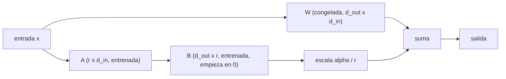

## El gancho

Un equipo hace fine-tuning de un modelo abierto con 3000 tickets de soporte antiguos para que "conozca el producto". Una semana después responde con el estilo de la casa impecable, usa el saludo correcto, se despide como toca y cita con total seguridad una política de devoluciones que se retiró hace dos años. Aprendió la voz a la perfección y los datos, mal.

Ese es el resultado normal, no un fallo. El fine-tuning es muy bueno cambiando *cómo* se comporta un modelo y sorprendentemente malo añadiendo de forma fiable *lo que* sabe. Saber cuál de las dos cosas necesitas ahorra semanas de GPU.

## La explicación sencilla

Piensa en un consultor sénior que se incorpora a tu empresa. El prompting es entregarle una guía de estilo cada mañana. La recuperación (retrieval) es darle acceso a la wiki para que consulte lo que necesite. El fine-tuning es un mes de práctica en el puesto: después redacta los informes en tu formato sin que se lo pidas, pero su recuerdo de cifras concretas de ese mes es difuso, y algunas costumbres de trabajos anteriores se han desvanecido.

LoRA es la versión barata de esa práctica: en lugar de reentrenar a la persona entera, le añades encima un pequeño conjunto de hábitos extra que puedes quitar en cualquier momento.

Dónde deja de funcionar la analogía: una persona sabe cuándo no está segura. Un modelo ajustado que recuerda un dato a medias lo produce con la misma fluidez que uno que conoce bien, que es justo lo que pasaba en el gancho.

## Por dentro

### Cuándo el fine-tuning es la herramienta adecuada

Prueba las opciones por orden de coste y detente en la primera que alcance tu objetivo de evaluación:

| Necesidad | Primera opción | Por qué |
|---|---|---|
| Un formato de salida, tono o conjunto de etiquetas fijo | Prompting con ejemplos y después fine-tuning | El comportamiento es lo que el ajuste cambia bien |
| Datos que cambian o que hay que citar | Recuperación (lecciones 6 y 7) | Se actualiza el índice, no los pesos |
| Una tarea acotada con mucho volumen | Fine-tuning de un modelo más pequeño | Prompts más cortos, menos latencia y coste |
| Conocimiento sobre el que el modelo debe razonar | Recuperación más un modelo capaz | Los datos metidos con ajuste son difíciles de verificar o borrar |

El fine-tuning compensa cuando el prompting funciona pero es demasiado largo, lento o inconsistente, y tienes ejemplos del comportamiento exacto que quieres. Es la herramienta equivocada para "el modelo debe conocer nuestros documentos": cambian, necesitan citas y puede que haya que eliminarlos por motivos legales, y nada de eso es posible una vez repartidos entre miles de millones de pesos.

### Fine-tuning completo frente a métodos eficientes en parámetros

El fine-tuning completo sigue entrenando todos los pesos con tus datos y la misma pérdida del siguiente token de la lección 5, normalmente solo sobre los tokens de la respuesta. Es la opción más expresiva y la más cara. Con el optimizador Adam en precisión mixta, una estimación habitual es de unos 16 bytes por parámetro entre pesos, gradientes y estado del optimizador, sin contar las activaciones. Un modelo de 7000 millones de parámetros supera así los 100 GB, y cada variante ajustada es otra copia completa del modelo que almacenar y servir.

El fine-tuning eficiente en parámetros (PEFT) congela los pesos preentrenados y entrena un número pequeño de pesos nuevos. Los adapters insertan capas pequeñas; el prompt tuning aprende unos pocos vectores de entrada; LoRA, el método dominante hoy, aprende una corrección de rango bajo sobre matrices de pesos existentes. Los gradientes y el estado del optimizador solo existen para los parámetros nuevos, así que la memoria baja mucho, y cada variante es un archivo de megabytes en lugar de un checkpoint completo.

### LoRA: una actualización de rango bajo

Hu et al. (2021) plantearon, y respaldaron con experimentos, que el cambio que el fine-tuning produce en una matriz de pesos tiene un rango intrínseco bajo. Así que, en lugar de aprender una actualización completa `ΔW` de forma `d_out x d_in`, LoRA aprende dos matrices delgadas:

```
W_effective = W + (alpha / r) * B @ A
A: r x d_in    (random init)
B: d_out x r   (zero init)
W: frozen
```

- **El rango `r`** fija la capacidad. Los parámetros entrenables son `r * (d_in + d_out)` en lugar de `d_in * d_out`. Para una proyección de 4096 x 4096 con `r = 8` son {{claim:r8_params}}, aproximadamente el 0.39 % de los 16 777 216 pesos de la matriz. Adaptar las proyecciones de query y value de un modelo de 32 capas con esa anchura da {{claim:stack_params}} parámetros entrenables.
- **`B` empieza en cero**, así que `B @ A = 0` y el modelo en el paso 0 es exactamente el preentrenado. El entrenamiento parte de un comportamiento conocido en lugar de una perturbación aleatoria.
- **`alpha`** escala la actualización. Dividir entre `r` mantiene el tamaño de la actualización más o menos comparable al cambiar el rango, para no tener que reajustar la tasa de aprendizaje cada vez. Muchas recetas fijan `alpha` en `r` o `2r`.
- **Qué capas.** El artículo original adaptaba las matrices de query y value de la atención. Trabajos posteriores, entre ellos QLoRA, vieron que hace falta adaptar todas las capas lineales de cada bloque, atención y MLP, para acercarse a la calidad del fine-tuning completo.
- **Sin coste en inferencia si se fusiona.** `W + (alpha / r) B A` es una matriz normal, así que puedes integrar el adapter antes de servir. Si lo mantienes aparte, un mismo modelo base puede servir muchos adapters, intercambiados por petición.



### QLoRA: la misma idea sobre una base de 4 bits

Dettmers et al. (2023) guardan el modelo base congelado en 4 bits (su formato NormalFloat4, más una doble cuantización de las constantes de cuantización) y retropropagan a través de él hasta adapters LoRA mantenidos en mayor precisión. Los optimizadores paginados absorben los picos de memoria. El artículo hizo fine-tuning de un modelo de 65 000 millones de parámetros en una sola GPU de 48 GB. El precio son pasos más lentos por descuantizar sobre la marcha, y el adapter se entrenó contra una base cuantizada, así que sírvelo con esa misma base cuantizada o vuelve a evaluar después de fusionarlo.

### Datos, olvido y la línea base

**Formato.** Entrena exactamente con lo que enviará producción: el mismo prompt de sistema, la misma plantilla de chat y el mismo esquema de salida. Un desajuste aquí es la causa más común de que un modelo ajustado se porte bien en el notebook y mal en la aplicación.

**Tamaño y calidad.** Para comportamiento y formato, a menudo bastan de cientos a unos pocos miles de ejemplos limpios; el artículo LIMA obtuvo un asistente sólido con 1000 ejemplos seleccionados con cuidado. Diez ejemplos erróneos enseñan lo incorrecto con la misma eficacia con la que diez correctos enseñan lo correcto. Elimina duplicados, corrige etiquetas y cubre los casos difíciles a propósito.

**Conjunto reservado.** Separa los datos antes de mirarlos y guarda un conjunto de prueba que nunca toque el entrenamiento. Con conjuntos pequeños el modelo puede memorizar por completo el de entrenamiento, como muestra el ejercicio.

**Olvido catastrófico.** Los pasos de gradiente en la tarea B mueven pesos de los que dependía la tarea A. No lo verás si no lo mides: mantén una evaluación general (capacidades anteriores, comportamiento de seguridad, otros idiomas) y ejecútala antes y después. Un rango menor, menos pasos, una tasa de aprendizaje más baja o mezclar algo de datos generales reducen el olvido, normalmente con algún coste en la tarea B. Biderman et al. (2024) lo resumen en su título: LoRA aprende menos y olvida menos que el fine-tuning completo.

**Línea base.** Compara con el modelo sin ajustar y tu mejor prompt, sobre el mismo conjunto reservado y con la misma métrica. Si el modelo ajustado no lo supera por un margen que te importe, has comprado una carga de mantenimiento a cambio de nada.

## La conexión con la ingeniería

- **Versiona los adapters como código.** Un adapter está ligado a un modelo base, un tokenizador y una plantilla de chat exactos. Guarda con él el identificador y el hash del modelo base; actualizar el modelo base implica reentrenar el adapter.
- **Servicio multiinquilino.** Un modelo base en la memoria de la GPU más adapters pequeños por cliente es mucho más barato que un modelo completo por cliente. Los servidores de inferencia que permiten cargar varios adapters LoRA lo hacen práctico.
- **La evaluación es el producto.** Construye el conjunto reservado y el script de puntuación antes de la primera ejecución de entrenamiento, igual que escribirías tests antes de una refactorización. Los hábitos de evaluación de las lecciones 6 y 11 se aplican sin cambios.
- **El olvido es una regresión.** Trata una caída en el conjunto general como un test que falla. Síguela en cada versión, no una sola vez.
- **Gobierno de datos.** Lo que esté en el conjunto de entrenamiento puede volver a salir del modelo. No hagas fine-tuning con secretos o datos personales que no podrías publicar, porque después no puedes borrar un registro de los pesos.
- **Revisión de costes.** Un modelo pequeño ajustado puede sustituir a uno grande con un prompt few-shot largo. Compara el coste total por petición, incluidos los tokens de prompt que dejas de enviar.

## Reto práctico

Archivo: `courses/ai-engineering/exercises/lesson_17_lora.py`. Solo NumPy, una capa lineal de 64 x 64 con semilla fija y gradientes escritos a mano. Preentrena con la tarea A y luego se adapta a la tarea B (un cambio de comportamiento de rango 4, con solo 48 ejemplos de entrenamiento) sin ajuste, con fine-tuning completo y con LoRA de rangos 1, 4 y 16, e informa del error de prueba en las tareas B y A. Unos 15 minutos.

**Predice antes de ejecutar:**

1. ¿Cuál es la mayor diferencia entre `W + BA` y `W` antes del primer paso de LoRA?
2. Con 4096 pesos entrenables y solo 48 ejemplos, ¿qué error tendrá el fine-tuning completo en el conjunto de *entrenamiento* de la tarea B?
3. ¿Qué método tendrá el menor error de *prueba* en la tarea B?
4. ¿Qué método olvidará menos la tarea A?

::: predict
P: gap | number | claim:init_gap | 0.001 | ¿Diferencia máxima entre W + BA y W antes de entrenar?
P: best | choice:full=Fine-tuning completo;r1=LoRA r=1;r4=LoRA r=4;r16=LoRA r=16 | r4 | | ¿Menor error de prueba en la tarea B?
P: forget | choice:full=Fine-tuning completo;r1=LoRA r=1;r4=LoRA r=4;r16=LoRA r=16 | r1 | | ¿Cuál olvida menos la tarea A?
:::

El comando para ejecutarlo está al final de esta página.

<details>
<summary>Lo que el script me imprimió (ábrelo después de predecir)</summary>

- Antes de cualquier paso, `max |(W + BA) - W| = {{claim:init_gap}}` en todos los rangos. Con una `B` aleatoria en lugar de cero, la diferencia sería {{claim:random_gap}}: un modelo ya dañado antes de empezar a entrenar.
- El modelo preentrenado obtiene {{claim:pre_b}} en la tarea B. Todos los errores son error cuadrático medio; el ruido de las etiquetas tiene desviación típica 0.3, así que ningún modelo puede bajar mucho de 0.09 en un conjunto de prueba.
- El fine-tuning completo llega a {{claim:full_b_train}} en el conjunto de entrenamiento de la tarea B (memoriza el ruido), pero solo a {{claim:full_b}} en el de prueba.
- LoRA r=1 se queda corto para un cambio de rango 4: {{claim:r1_b}} en la tarea B. LoRA r=4 coincide con la estructura del cambio y es el mejor, {{claim:r4_b}}. LoRA r=16 tiene más margen para ajustar ruido y empeora hasta {{claim:r16_b}}.
- Olvido: el error en la tarea A pasa de {{claim:pre_a}} antes del ajuste a {{claim:r1_a}} con r=1, {{claim:r4_a}} con r=4 y {{claim:full_a}} con fine-tuning completo. Los propios pesos verdaderos de la tarea B obtienen {{claim:trueb_a}} en la tarea A, porque aquí la tarea B contradice de verdad a la tarea A sobre las mismas entradas. La mayor parte de ese olvido es el precio del nuevo comportamiento; r=1 olvida menos porque también aprende menos.
- La aritmética de parámetros del final es la imagen de producción: {{claim:r8_params}} parámetros entrenables por cada matriz de 4096 x 4096 con r=8.

</details>

Ampliaciones: sube la tarea B a 500 ejemplos y comprueba si el fine-tuning completo alcanza a LoRA. Pon `alpha` en `2 * rank` y compara. Cambia `true_rank` a 1 y mira qué rango de LoRA gana ahora.

## Ideas clave

1. Haz fine-tuning para comportamiento, formato y coste; usa recuperación para datos que cambian o que hay que citar. Prueba primero con prompting y mantenlo como línea base.
2. LoRA entrena `B @ A` junto a una `W` congelada. Una `B` inicializada a cero hace que el entrenamiento empiece exactamente en el modelo preentrenado, y el rango fija a la vez la capacidad y el coste.
3. Mide en un conjunto reservado de la tarea y en uno general, antes y después. El fine-tuning siempre cambia algo del comportamiento antiguo por el nuevo; solo decides el precio si lo mides.

**Pregunta de control:** tu adapter LoRA acierta el 98 % de sus ejemplos de entrenamiento y no mejora al modelo base con prompt en el conjunto reservado. ¿Qué ha pasado y qué dos cosas cambiarías?

**A continuación:** cuantización y memoria, la misma idea de 4 bits en la que se apoya QLoRA, aplicada al servicio.

::: quiz
Q: Un adapter LoRA de rango 16 sobre una matriz de 4096 x 4096: ¿cuántos parámetros entrenables tiene y qué fracción de la matriz son?
A: 16 x (4096 + 4096) = 131 072, aproximadamente el 0.78 % de los 16 777 216 pesos de la matriz completa.
Q: ¿Por qué `B` se inicializa a cero y no con valores aleatorios?
A: Para que `B @ A` sea cero y el modelo adaptado sea idéntico al preentrenado en el paso 0. El entrenamiento parte de un comportamiento conocido en lugar de un modelo perturbado al azar.
Q: Un equipo quiere que el modelo conozca la lista de precios de esta semana. ¿Fine-tuning o recuperación?
A: Recuperación. Los precios cambian, deben ser exactos y trazables, y los datos aprendidos con fine-tuning son poco fiables y no se pueden actualizar ni borrar sin reentrenar.
Q: ¿Cómo detectas el olvido catastrófico?
A: Mantén una evaluación reservada de las capacidades que ya tenías, ejecútala sobre el modelo base y sobre el ajustado, y compara. La pérdida de entrenamiento en la tarea nueva no dice nada de eso.
:::

## Referencias

- Hu et al., "LoRA: Low-Rank Adaptation of Large Language Models" (2021): https://arxiv.org/abs/2106.09685
- Dettmers et al., "QLoRA: Efficient Finetuning of Quantized LLMs" (2023): https://arxiv.org/abs/2305.14314
- Zhou et al., "LIMA: Less Is More for Alignment" (2023), calidad de los datos por encima de la cantidad: https://arxiv.org/abs/2305.11206
- Biderman et al., "LoRA Learns Less and Forgets Less" (2024): https://arxiv.org/abs/2405.09673
