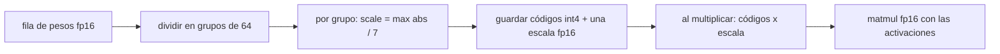

## El gancho

Un modelo de 70 000 millones de parámetros almacenado en flotantes de 16 bits necesita 140 GB solo para sus pesos. Una GPU de centro de datos habitual, como la A100 o la H100, tiene 80 GB. Guarda esos mismos pesos en 4 bits y ocupan 35 GB, que caben en una sola tarjeta y aún dejan sitio para la caché KV.

La arquitectura no ha cambiado en nada. Solo has cambiado cuántos bits recibe cada número. Lo sorprendente es la poca calidad que se pierde cuando se hace con cuidado, y la mucha que se pierde cuando unos pocos valores inusualmente grandes se tratan sin cuidado.

## La explicación sencilla

La cuantización es compresión con pérdida para números, parecida en espíritu a guardar un precio como un número entero de céntimos en lugar de un `double`. Eliges una **escala** (un céntimo), guardas cada valor como un entero pequeño que cuenta cuántas escalas contiene y vuelves a multiplicar cuando necesitas el valor.

El compromiso es el de siempre: una escala mayor cubre un rango más amplio pero redondea más grueso. Con 8 bits tienes 256 escalones; con 4 bits, solo 16.

Dónde deja de funcionar la analogía: los céntimos funcionan porque los precios comparten un rango conocido. Los pesos y las activaciones de una red neuronal no. La mayoría de los valores son diminutos, unos pocos son enormes, y una escala compartida tiene que estirarse hasta cubrir los enormes, lo que desperdicia la mayoría de los 16 escalones en espacio vacío.

## Bajo el capó

### Formatos numéricos

| Formato | Bits | Estructura (signo, exponente, mantisa) | Para qué sirve |
|---|---|---|---|
| fp32 | 32 | 1, 8, 23 | Pesos maestros de entrenamiento, estado del optimizador |
| bf16 | 16 | 1, 8, 7 | Entrenamiento e inferencia; mismo rango que fp32, menos precisión |
| fp16 | 16 | 1, 5, 10 | Inferencia; más precisión que bf16, valor máximo 65 504, así que puede desbordarse |
| int8 | 8 | entero de -128 a 127 más una escala | Pesos y, en hardware compatible, también activaciones |
| int4 | 4 | entero de -8 a 7 más una escala | En la práctica, solo pesos |

Los formatos de coma flotante llevan su propio exponente en cada valor, así que manejan rangos amplios por sí solos. Los formatos enteros no llevan ninguno, de modo que todo el manejo del rango pasa a la escala que elijas. **fp8** queda en medio: Micikevicius et al. (2022) propusieron dos variantes de flotante de 8 bits, E4M3 (más precisión) y E5M2 (más rango), que tienen soporte en hardware en generaciones recientes de NVIDIA como Hopper. Si tu GPU no lo soporta de forma nativa, fp8 ahorra memoria pero no cómputo.

### Aritmética de memoria

La memoria de los pesos es el número de parámetros por los bytes por parámetro. Un modelo de 7B ocupa 14 GB en fp16, 7 GB en int8 y 3,5 GB en int4. Los formatos de 4 bits por grupos guardan además una escala por grupo, así que el coste real queda algo por encima de 4 bits por peso.

Los pesos no son toda la factura. En inferencia también pagas:

- **Caché KV:** `2 x layers x kv_heads x head_dim x bytes` por token (el 2 son las claves y los valores), multiplicado por la longitud de contexto y por el número de secuencias concurrentes. No se reduce cuando cuantizas los pesos.
- **Activaciones:** los tensores intermedios de la capa que se está ejecutando. En inferencia de un solo usuario son pequeñas frente a los pesos; crecen con el tamaño de lote y con la longitud del prompt durante el prefill.
- **Sobrecarga del runtime:** búferes del framework, contexto de CUDA, fragmentación. Deja margen y mide en la máquina real.

El ejercicio imprime ambas tablas. Un modelo que "cabe" por el tamaño de sus pesos puede fallar igualmente con tu longitud de contexto y tu concurrencia reales por culpa de la caché KV.

### Escalas y puntos cero

La cuantización **simétrica (absmax)** usa `scale = max(|x|) / 127` para int8 (o `/ 7` para int4), guarda `q = round(x / scale)` y reconstruye `x ≈ q x scale`. El cero se representa exactamente como cero, y la multiplicación de matrices puede hacerse con enteros y una sola multiplicación por la escala al final.

La cuantización **asimétrica** añade un **punto cero** (zero point): `scale = (max - min) / 15` para 4 bits, `q = round(x / scale) + zero_point`, con `q` entre 0 y 15. Compensa cuando los valores están a un solo lado del cero, como las salidas de una ReLU, donde un esquema simétrico desperdicia la mitad de sus códigos en números negativos que nunca aparecen. El ejercicio lo muestra con salidas de ReLU. El coste es un poco de aritmética extra para el punto cero.

### Granularidad: por tensor, por canal y por grupos

Cuanto más fina es la escala, menos daño puede hacer un valor grande a sus vecinos:

- **Por tensor:** una escala para toda la matriz. Lo más barato y lo más frágil.
- **Por canal:** una escala por fila de salida. Lo estándar para pesos int8.
- **Por grupos:** una escala por bloque de 32, 64 o 128 pesos consecutivos a lo largo de la dimensión de entrada. Lo estándar para pesos de 4 bits.



### Valores atípicos

Dettmers et al. (2022) descubrieron que los transformers grandes desarrollan **características atípicas** (outlier features): un pequeño número de dimensiones ocultas cuyas activaciones son mucho mayores que todo lo demás y que se vuelven sistemáticas cuando los modelos superan varios miles de millones de parámetros. Con una sola escala por tensor, esos pocos valores fijan la escala y todos los valores normales se redondean a un puñado de códigos o a cero. Su método LLM.int8() mantiene esas dimensiones atípicas en fp16 y ejecuta el resto de la multiplicación en int8.

El ejercicio planta el mismo patrón en una matriz de pesos: tres canales de entrada mucho mayores que el resto. De ahí salen dos lecciones. Recortar los valores atípicos para salvar la escala es un desastre, porque esos valores llevan señal real. Apartarlos en precisión completa, como hace LLM.int8(), recupera casi todo.

### Métodos solo de pesos: GPTQ y AWQ

El redondeo al más cercano a 4 bits deja un error apreciable. Dos métodos posteriores al entrenamiento, muy usados, lo reducen con un pequeño conjunto de calibración y sin reentrenar:

- **GPTQ** (Frantar et al., 2022) cuantiza los pesos de una capa columna a columna y ajusta los pesos aún sin cuantizar para compensar el error que se acaba de introducir, usando información de segundo orden obtenida de las activaciones de calibración. El objetivo es que la salida de la capa se mantenga cercana, no cada peso.
- **AWQ** (Lin et al., 2023) observa que una pequeña fracción de los canales de pesos es la que más importa, y la identifica por la magnitud de las activaciones que los alimentan. Escala esos canales hacia arriba antes de cuantizar (y las entradas hacia abajo para compensar), de modo que reciben más resolución, en lugar de guardarlos en precisión mixta.

Ambos son **solo de pesos**: los pesos se guardan en 4 bits y se descuantizan a fp16 sobre la marcha. Generar cada token lee todos los pesos de memoria, así que la decodificación suele estar limitada por el ancho de banda de memoria, y menos bytes por peso significan tokens más rápidos aunque la aritmética siga siendo fp16.

## La conexión con la ingeniería

- **Empieza por la factura de memoria.** Pesos en el formato elegido, más la caché KV con tu contexto y tu concurrencia reales, más margen. Si bf16 cabe con ese margen, sirve en bf16 y no sigas.
- **Ajusta el formato al hardware.** bf16 necesita GPU NVIDIA de clase Ampere o posteriores; las tarjetas más antiguas usan fp16. El cómputo nativo en fp8 necesita generaciones recientes como Hopper. En CPU y en Apple Silicon, runtimes como llama.cpp usan formatos enteros por grupos (archivos GGUF), y 4 bits es la elección habitual.
- **Qué se degrada primero.** La perplejidad media puede moverse poco mientras comportamientos concretos se mueven más: razonamiento largo de varios pasos, aritmética, código, idiomas menos frecuentes. Por debajo de 4 bits la calidad cae mucho más deprisa; Dettmers y Zettlemoyer (2022) encontraron que 4 bits es casi universalmente óptimo para la precisión zero-shot con un número total de bits del modelo fijo. Evalúa con tu propio conjunto de tareas, no con una clasificación pública.
- **La caché KV es un mando aparte.** Cuantizar la caché a 8 bits la reduce a la mitad y aumenta cuántos usuarios caben, con su propia comprobación de calidad. La cuantización de pesos no la toca.
- **Este sitio también lo hace.** El MiniLM que se ejecuta en el navegador para los ejercicios de embeddings y el modo por significado de Pregunta al curso guarda su tabla de embeddings de palabras en int8 (una escala por fila) y el resto de los pesos en fp16. Int8 en todo no era opción: CI compara las similitudes coseno del modelo del navegador con las de PyTorch, y con todas las matrices en int8 el error superaba el presupuesto. La opción mixta conserva la mayor parte del ahorro de descarga, porque la tabla de embeddings es la matriz individual más grande, y se mantiene dentro del presupuesto.
- **Prefiere checkpoints cuantizados ya publicados** con GPTQ o AWQ para los modelos populares, y conserva los pesos en precisión completa para poder volver a cuantizar cuando mejoren las herramientas.

## Reto práctico

Archivo: `courses/ai-engineering/exercises/lesson_18_quantization.py`. Solo NumPy. Construye una matriz de pesos de 128x256 con semilla fija, con tres canales de entrada atípicos, y un lote de 64 activaciones; cuantiza los pesos a int8 e int4 con escalas por tensor, por canal y por grupos; prueba a recortar los atípicos frente a apartarlos; compara códigos simétricos y asimétricos, e imprime tablas de memoria y de caché KV a partir de las fórmulas. Unos 15 minutos.

**Predice antes de ejecutar:**

1. ¿Qué granularidad da el menor error de salida en int4: por tensor, por canal o por grupos de 32?
2. Los atípicos son columnas de entrada. ¿Ayudará mucho una escala por fila de salida?
3. Si recortas la escala en el percentil 99, ¿int4 por tensor mejora o empeora?
4. Con salidas de ReLU, ¿qué gana a 4 bits: simétrica o asimétrica?
5. ¿Cuántos GB ocupa un modelo de 70B en int4, y qué tamaño tiene la caché KV para 32 capas, 8 cabezas KV de dimensión 128, 8192 tokens y 8 usuarios en fp16?

::: predict
P: perchannel | choice:much=Mucho mejor que por tensor;little=Solo algo mejor | little | | Con atípicos en columnas de entrada, ¿cuánto mejora int4 por canal respecto a por tensor?
P: clip | choice:better=Mejor;worse=Peor | worse | | Recortar la escala de int4 por tensor en el percentil 99 deja el error de salida...
P: kv | number | claim:kv_total | 0.1 | ¿Caché KV en GB para 32 capas, 8 cabezas KV, dimensión de cabeza 128, 8192 tokens, 8 usuarios, fp16?
:::

El comando para ejecutarlo está al final de esta página.

<details>
<summary>Lo que el script me imprimió (ábrelo después de predecir)</summary>

- Las columnas atípicas son {{claim:outlier_ratio}} veces mayores que una columna típica.
- Error relativo de salida en int8: {{claim:int8_tensor_out}} por tensor y {{claim:int8_g64_out}} con grupos de 64. Incluso la versión tosca es utilizable a 8 bits.
- Error relativo de salida en int4: {{claim:int4_tensor_out}} por tensor, {{claim:int4_channel_out}} por canal y {{claim:int4_g32_out}} con grupos de 32 (coseno {{claim:int4_g32_cos}}). Por canal apenas ayuda porque cada fila de salida contiene las columnas atípicas; los grupos a lo largo de la dimensión de entrada encierran cada atípico en su propio grupo.
- Quitar los atípicos por completo baja int4 por tensor a {{claim:clean_out}}, así que eran el problema dominante. Lo que queda es el coste puro de tener solo 16 niveles, que es lo que atacan GPTQ y AWQ.
- Recortar en el percentil 99 sube el error a {{claim:clip99_out}}: los valores recortados eran señal. Mantener las tres columnas atípicas en precisión completa y el resto en int4 por tensor da {{claim:mixed_out}}.
- Salidas de ReLU a 4 bits: simétrica {{claim:relu_sym}}, asimétrica {{claim:relu_asym}}.
- Tabla de memoria:

```
{{claim:memory_table}}
```

- Int4 con grupos de 64 y escalas fp16 cuesta {{claim:group_bits}} bits por peso. La caché KV para la configuración indicada ocupa {{claim:kv_total}} GB en fp16, además de los pesos.

</details>

Ampliaciones: cambia el tamaño de grupo a 128 y a 16 y representa el error frente a los bits por peso incluidas las escalas. Haz que los atípicos aparezcan en las activaciones en lugar de en los pesos y mira qué granularidad sigue ayudando. Recalcula la caché KV con 32 cabezas de atención en lugar de 8 cabezas KV.

## Ideas clave

1. La memoria es parámetros por bytes, más una caché KV que crece con el contexto y los usuarios y que la cuantización de pesos no toca.
2. Una escala compartida es tan buena como su valor más grande. Una granularidad más fina (por canal, por grupos) y el tratamiento de los atípicos deciden si 4 bits funciona.
3. Los pesos de 4 bits con GPTQ o AWQ son la elección habitual cuando bf16 no cabe; verifica la calidad con tus propias tareas, porque algunas capacidades se degradan antes que las medias.

**Pregunta de control:** un modelo de 13B en int4 cabe holgadamente en tu GPU de 24 GB, pero las peticiones fallan con 32 000 tokens de contexto y varios usuarios. ¿Qué dejaste fuera de la cuenta y cuáles son dos formas de arreglarlo?

**A continuación:** el serving de inferencia, donde el batching y la caché KV deciden el rendimiento.

::: quiz
Q: ¿Cuánta memoria necesitan los pesos de un modelo de 13B en fp16, int8 e int4?
A: Unos 26 GB, 13 GB y 6,5 GB, de multiplicar los parámetros por 2, 1 y 0,5 bytes. Int4 por grupos añade un poco por las escalas, y la caché KV y la sobrecarga del runtime van aparte.
Q: ¿Por qué un solo valor atípico grande perjudica tanto a la cuantización int4 por tensor?
A: La escala la fija el mayor valor absoluto, así que los 16 niveles se reparten por un rango que casi ningún valor usa. Los valores normales se redondean a unos pocos códigos o a cero.
Q: ¿Cuándo compensa la cuantización asimétrica con punto cero?
A: Cuando los valores están a un solo lado o descentrados, como las salidas de una ReLU. Los códigos simétricos desperdiciarían la mitad del rango en valores que nunca aparecen.
Q: ¿Por qué la cuantización int4 solo de pesos acelera la generación de tokens aunque la multiplicación siga en fp16?
A: La decodificación lee cada peso una vez por token y suele estar limitada por el ancho de banda de memoria, así que mover una cuarta parte de los bytes la acelera.
:::

## Referencias

- Dettmers et al., "LLM.int8(): 8-bit Matrix Multiplication for Transformers at Scale" (2022): https://arxiv.org/abs/2208.07339
- Frantar et al., "GPTQ: Accurate Post-Training Quantization for Generative Pre-trained Transformers" (2022): https://arxiv.org/abs/2210.17323
- Lin et al., "AWQ: Activation-aware Weight Quantization for LLM Compression and Acceleration" (2023): https://arxiv.org/abs/2306.00978
- Micikevicius et al., "FP8 Formats for Deep Learning" (2022): https://arxiv.org/abs/2209.05433
- Dettmers y Zettlemoyer, "The case for 4-bit precision: k-bit Inference Scaling Laws" (2022): https://arxiv.org/abs/2212.09720
