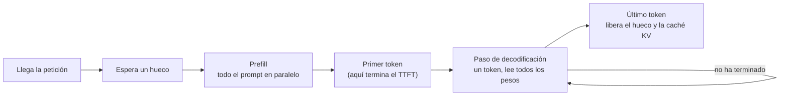

## El gancho

Cargas un modelo de 7B en una GPU y le envías una petición. Si la GPU tiene, por ejemplo, 2 TB/s de ancho de banda de memoria, genera como mucho unos 140 tokens por segundo. Le envías 32 peticiones a la vez y el total sube a muchas veces esa cifra, mientras que cada usuario solo nota una ralentización modesta.

En casi cualquier software, ejecutar 32 trabajos a la vez en una sola máquina hace que cada uno vaya más lento. Aquí sale casi gratis, hasta cierto punto. La razón es que una sola petición en decodificación deja las unidades aritméticas de la GPU ociosas la mayor parte del tiempo, esperando a la memoria. Servir bien un LLM consiste sobre todo en aprovechar esa capacidad ociosa sin disparar la latencia ni quedarse sin memoria.

## La explicación sencilla

Piensa en un autobús que tiene que recorrer la ruta completa en cada parada, lleve los pasajeros que lleve. El coste del viaje es la conducción (leer de memoria todos los pesos del modelo una vez por cada token generado). Un pasajero (una secuencia) añade muy poco. Llevar a un solo pasajero por viaje es un desperdicio; llevar a 32 cuesta casi el mismo combustible.

**El batching estático** es un autobús que sale lleno y no admite pasajeros nuevos hasta que el último ha llegado a la parada final, aunque la mayoría se haya bajado antes. **El batching continuo** deja subir a alguien en cada parada en cuanto queda un asiento libre.

Dónde falla la analogía: cada pasajero lleva un equipaje que crece en cada parada (la caché KV), y lo que suele agotarse primero es el portaequipajes, la memoria de la GPU, no los asientos.

## Bajo el capó

### Prefill y decodificación

Una petición se sirve en dos fases con costes muy distintos.

- **El prefill** procesa todo el prompt en una sola pasada hacia delante, con todas las posiciones en paralelo, igual que el teacher forcing del entrenamiento. Escribe las claves y los valores de cada token del prompt en la caché KV (lección 3) y produce el primer token de salida. Es una multiplicación de matrices grande, así que está **limitado por cómputo**: el coste crece con la longitud del prompt.
- **La decodificación** genera un token por paso. Cada paso multiplica un único vector nuevo por secuencia por todas las matrices de pesos, así que la GPU tiene que traer todos los pesos de memoria para hacer muy poca aritmética. Está **limitada por el ancho de banda de memoria**.

Las dos latencias que percibe el usuario corresponden a estas fases. **El tiempo hasta el primer token (TTFT)** es la espera en cola más el prefill. **La latencia entre tokens** (tiempo por token de salida) es la duración de un paso de decodificación. La latencia de extremo a extremo es, aproximadamente, el TTFT más la longitud de la salida multiplicada por la latencia entre tokens.



### Una cota con un cálculo rápido

Supón un modelo de 7B parámetros en fp16 (2 bytes por parámetro, es decir, 14 GB de pesos) y supón 2 TB/s de ancho de banda de memoria. Cada paso de decodificación tiene que leer los 14 GB al menos una vez:

```
step time >= bytes read per step / memory bandwidth = 14e9 / 2e12 = 7 ms
tokens per second per sequence <= 1 / 7 ms, about 143
```

Es una cota superior para una secuencia; los sistemas reales alcanzan una fracción. También explica la lección 18: cuantizar los pesos a 4 bits reduce unas 4 veces los bytes leídos por paso, y la cota sube en la misma proporción. Una aritmética más rápida no ayudaría en absoluto.

### Intensidad aritmética y por qué ayuda el batching

**La intensidad aritmética** son los FLOP realizados por cada byte movido. Un producto matriz-vector con pesos fp16 hace 2 FLOP (una multiplicación y una suma) por cada peso de 2 bytes: 1 FLOP por byte. Con un lote de `B` secuencias, los mismos pesos se leen una vez y se usan `B` veces, así que la intensidad pasa a ser de `B` FLOP por byte.

El modelo roofline compara esa cifra con la relación entre cómputo y ancho de banda del hardware. Supón 300 TFLOP/s de cómputo: 300e12 / 2e12 = 150 FLOP/byte. Por debajo de ese punto de inflexión el paso está limitado por memoria y su duración apenas cambia al crecer el lote, así que el rendimiento sube casi linealmente con `B`. Por encima, el paso pasa a estar limitado por cómputo y las secuencias adicionales empiezan a costar tiempo de verdad. Por eso las 32 peticiones del gancho salían casi gratis.

Aun así, el batching no es gratis indefinidamente. Cada secuencia también lee su propia caché KV en cada paso, y ese tráfico sí crece con el tamaño del lote y la longitud del contexto. El ejercicio lo modela como un pequeño coste fijo por secuencia.

### Batching estático frente a batching continuo

Con **batching estático**, el servidor agrupa peticiones, las ejecuta juntas y no acepta trabajo nuevo hasta que termina el lote completo. Las longitudes de salida varían mucho, así que durante la mayor parte de la vida del lote muchos huecos contienen secuencias que ya han terminado, y las peticiones nuevas esperan en la cola detrás de la respuesta más larga.

Yu et al. (2022) introdujeron en Orca la **planificación a nivel de iteración**: el planificador decide qué secuencias forman el lote en cada paso de decodificación. Una secuencia terminada sale de inmediato y una petición en espera entra en el paso siguiente, tras su prefill. Hoy se suele llamar **batching continuo** y es el comportamiento por defecto de los motores de serving modernos. El precio es la complejidad: las secuencias de un mismo lote tienen longitudes y posiciones distintas, y el prefill de una recién llegada comparte el paso con la decodificación de todas las demás, lo que les provoca un breve pico de latencia entre tokens. Los motores lo mitigan troceando los prompts largos (chunked prefill).

### Memoria de la caché KV y PagedAttention

Por cada token del contexto, cada capa guarda un vector de clave y otro de valor. Para un modelo de la clase 7B con 32 capas, tamaño oculto 4096 y fp16, sin grouped-query attention:

```
KV bytes per token = 2 (K and V) * 32 layers * 4096 * 2 bytes = 524,288 bytes = 0.5 MiB
```

Una conversación de 2048 tokens ocupa, por tanto, 1 GiB de caché. Con batching, a menudo es la caché KV, y no los pesos, la que decide cuántas peticiones caben.

Los primeros servidores reservaban un bloque contiguo por petición dimensionado para la longitud máxima, porque no podían saber cuánto mediría la respuesta. La mayoría de las peticiones son mucho más cortas, así que casi toda esa memoria quedaba sin usar. Kwon et al. (2023) tomaron prestada la memoria virtual de los sistemas operativos: **PagedAttention**, implementado en vLLM, guarda la caché en bloques pequeños de tamaño fijo y mantiene una tabla de bloques por secuencia, de modo que la memoria se asigna solo a medida que se generan tokens y el único desperdicio es la parte sin llenar del último bloque. El artículo indica que los sistemas anteriores dedicaban bastante menos de la mitad de su memoria KV a estados de tokens reales, y que liberarla permite al planificador ejecutar lotes más grandes. Los bloques también abaratan compartir un prefijo de prompt común entre peticiones.

### Decodificación especulativa

La decodificación deja el cómputo ocioso, así que puedes gastarlo en adivinar. Leviathan et al. (2023) usan un **modelo borrador** pequeño para proponer varios tokens y luego ejecutan el modelo grande una sola vez sobre todos ellos en paralelo, como un prefill corto, y aceptan el prefijo más largo con el que coincide. Una regla de muestreo por rechazo mantiene la distribución de salida exactamente igual que la del modelo grande. Cuando el borrador acierta a menudo, obtienes varios tokens por cada lectura cara de los pesos; cuando falla a menudo, pagas el borrador y ganas poco.

## La conexión con la ingeniería

- **Mide por separado el TTFT y la latencia entre tokens, en p50 y p95.** Los prompts largos perjudican el TTFT (prefill); las salidas largas y los lotes grandes perjudican la latencia entre tokens. Una media de extremo a extremo oculta cuál de las dos es el problema.
- **Rendimiento y latencia se compensan a través del tamaño del lote.** Los lotes más grandes aumentan los tokens por segundo por GPU y reducen el coste por token, pero cada paso se hace más lento en cuanto sales de la región limitada por memoria y la caché KV se llena. Fija un objetivo de latencia y sube el tamaño del lote hasta él, no más allá.
- **La memoria es el verdadero límite de capacidad.** La memoria de GPU libre tras cargar los pesos dividida entre los bytes KV por token es el total de tokens en vuelo. Los contextos largos reducen directamente la concurrencia. Los pesos cuantizados, la caché KV cuantizada y la grouped-query attention permiten más tokens concurrentes.
- **Usa un motor de serving, no escribas el bucle tú.** El batching continuo y la caché KV paginada son estándar en motores como vLLM. Una llamada ingenua a `generate()` dentro de un handler web procesa una petición cada vez y desperdicia casi toda la GPU.
- **Merece la pena cachear los prefijos compartidos.** Un prompt de sistema largo repetido en cada petición es trabajo de prefill que puedes hacer una sola vez; los motores y las API alojadas ofrecen caché de prefijos o de prompts justo para esto.
- **Los precios de las API alojadas reflejan estos costes.** Los tokens de entrada (prefill, en paralelo) suelen costar menos que los de salida (decodificación, secuencial y limitada por ancho de banda).

## Reto práctico

Archivo: `courses/ai-engineering/exercises/lesson_19_inference_serving.py`. Solo NumPy. Es un modelo de costes, no un benchmark: calcula la cota de ancho de banda y la intensidad aritmética para un hardware supuesto, simula 300 peticiones con semilla fija en 16 huecos con batching estático y continuo, y mide el desperdicio de caché KV con reserva contigua frente a páginas de 16 tokens. Unos 15 minutos.

**Predice antes de ejecutar:**

1. Con 14 GB de pesos y 2 TB/s, ¿cuál es la mejor velocidad de decodificación posible para una sola secuencia?
2. ¿Qué política tiene peor mediana de tiempo hasta el primer token, y por cuánto, aproximadamente?
3. ¿Qué fracción de los pasos-hueco dedica el batching estático a trabajo útil?
4. Si cada petición reserva 2048 tokens de caché KV, ¿qué fracción de esa memoria se desperdicia con esta mezcla de peticiones?

::: predict
P: bound | number | claim:bound1 | 5 | Cota superior de tokens por segundo en decodificación con lote 1
P: ttft | choice:static=Batching estático;continuous=Batching continuo | static | | ¿Qué política tiene una mediana de tiempo hasta el primer token más alta?
P: waste | number | claim:waste_contig | 0.1 | Fracción de memoria KV desperdiciada con reserva contigua de 2048 tokens
:::

El comando para ejecutarlo está al final de esta página.

<details>
<summary>Lo que el script me imprimió (ábrelo después de predecir)</summary>

- Lectura de pesos por paso de {{claim:weight_ms}} ms, así que como mucho {{claim:bound1}} tokens/s para una secuencia. Hasta el punto de inflexión, la duración del paso no se mueve al crecer el lote.
- Rendimiento: estático {{claim:static_tput}} tokens/s, continuo {{claim:cont_tput}} tokens/s. Las peticiones llegan más deprisa de lo que el batching estático puede atenderlas, así que su cola crece durante toda la ejecución; el batching continuo da abasto y su rendimiento lo marca el ritmo de llegada.
- Mediana del TTFT: estático {{claim:static_ttft_p50}} s, continuo {{claim:cont_ttft_p50}} s. La cifra continua es poco más que un prefill. La estática es casi toda espera en cola y crece con la duración de la ejecución, porque el sistema está sobrecargado.
- Latencia de extremo a extremo p95: estático {{claim:static_lat_p95}} s, continuo {{claim:cont_lat_p95}} s.
- Utilización de huecos: estático {{claim:static_util}}, continuo {{claim:cont_util}}. El batching estático pasa la mayoría de los pasos-hueco reteniendo secuencias que ya han terminado. El continuo tampoco va lleno, lo que significa que aún tiene margen con esta carga.
- La caché KV ocupa {{claim:kv_token}} MiB por token. La reserva contigua de 2048 tokens desperdicia {{claim:waste_contig}} de la memoria reservada; las páginas de 16 tokens desperdician {{claim:waste_paged}}. En un presupuesto KV de 40 GiB eso son {{claim:fit_contig}} peticiones frente a {{claim:fit_paged}} de media.

</details>

Ampliaciones: reduce a la mitad el intervalo medio entre llegadas y observa cómo también se satura el batching continuo. Sube `SLOTS` a 64 y compáralo con cuántas peticiones caben en 40 GiB según la sección KV. Pon `BYTES_PER_PARAM = 0.5` para modelar pesos de 4 bits.

## Ideas clave

1. El prefill es paralelo y está limitado por cómputo; la decodificación es secuencial y está limitada por el ancho de banda de memoria. Una primera estimación de la velocidad de decodificación es el ancho de banda dividido entre los bytes leídos por paso.
2. El batching aumenta el rendimiento casi gratis mientras la decodificación esté limitada por memoria. El batching continuo mantiene los huecos ocupados admitiendo peticiones nuevas en cada paso en lugar de esperar a la secuencia más lenta.
3. La caché KV crece con cada token y suele limitar la concurrencia. La asignación paginada elimina casi todo el desperdicio de reservar para la longitud máxima.

**Pregunta de control:** el tiempo hasta el primer token de tu servicio está bien, pero los usuarios se quejan de que las respuestas llegan despacio cuando hay mucho tráfico. ¿Qué fase es el cuello de botella y qué dos parámetros revisarías primero?

**A continuación:** coste, latencia y fiabilidad en producción: convertir esta mecánica en presupuestos, SLO y planes de contingencia.

::: quiz
Q: ¿Por qué duplicar el tamaño del lote de 1 a 2 apenas cambia la duración de un paso de decodificación?
A: Con lotes pequeños, el paso está dominado por la lectura de todos los pesos desde memoria. Una segunda secuencia reutiliza los mismos pesos y solo añade un poco de aritmética y sus propias lecturas de caché KV, así que el paso sigue limitado por memoria.
Q: Con batching estático, un lote tiene nueve respuestas de 50 tokens y una de 800. ¿Qué pasa con los otros nueve huecos?
A: Se quedan ociosos (o calculando relleno) hasta que termina la respuesta de 800 tokens, y las peticiones en cola no pueden usarlos. El batching continuo daría cada hueco liberado a una petición en espera en el paso siguiente.
Q: Un modelo de 7B en fp16 se ejecuta en un hardware con un ancho de banda de memoria supuesto de 1 TB/s. ¿Cuál es, aproximadamente, el techo de decodificación para una secuencia, y qué le hace la cuantización a 4 bits?
A: 14 GB por paso a 1 TB/s son 14 ms, es decir, unos 70 tokens por segundo. Con pesos de 4 bits el modelo ocupa unos 3,5 GB, así que el techo sube unas cuatro veces, hasta unos 280 tokens por segundo.
Q: ¿Qué problema resuelve PagedAttention?
A: Reservar para cada petición una región contigua de caché KV con la longitud máxima desperdicia casi toda esa región, porque las peticiones reales son más cortas. Los bloques de tamaño fijo asignados bajo demanda solo desperdician parte del último bloque, así que caben más peticiones en la misma memoria.
:::

## Referencias

- Yu et al., "Orca: A Distributed Serving System for Transformer-Based Generative Models" (OSDI 2022), planificación a nivel de iteración: https://www.usenix.org/conference/osdi22/presentation/yu
- Kwon et al., "Efficient Memory Management for Large Language Model Serving with PagedAttention" (SOSP 2023), el artículo de vLLM: https://arxiv.org/abs/2309.06180
- Leviathan, Kalman y Matias, "Fast Inference from Transformers via Speculative Decoding" (ICML 2023): https://arxiv.org/abs/2211.17192
- Pope et al., "Efficiently Scaling Transformer Inference" (2022), costes de memoria y cómputo del prefill y la decodificación: https://arxiv.org/abs/2211.05102
- Williams, Waterman y Patterson, "Roofline: An Insightful Visual Performance Model for Multicore Architectures" (Communications of the ACM, 2009): https://doi.org/10.1145/1498765.1498785
