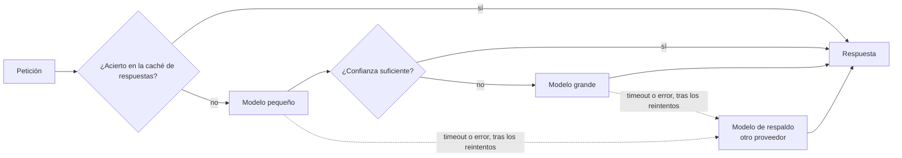

## El gancho

Tu funcionalidad con un LLM superó todas las evaluaciones, salió a producción y la primera factura mensual triplicó la estimación. Nadie tocó el código. El uso creció, el prompt de sistema creció con cada regla nueva que alguien añadía, y cada petición volvía a pagar esos tokens extra.

Esa misma semana tu proveedor tuvo una caída parcial. Tus clientes reintentaron de inmediato, todos en el mismo instante, y los reintentos mantuvieron al proveedor sobrecargado varios minutos más. Tu panel mostraba una latencia media de unos pocos segundos, mientras uno de cada cien usuarios esperaba medio minuto.

Nada de esto tiene que ver con la calidad del modelo. Es ingeniería de sistemas distribuidos de toda la vida, con una nueva unidad de cuenta: el token.

## La explicación sencilla

Piensa en la API de un modelo como en una dependencia remota, con contador y a veces lenta, como una pasarela de pagos que factura por carácter. Ya conoces el manual: cachea lo que puedas, manda el trabajo barato a servicios baratos, pon un timeout a cada llamada, reintenta con cuidado, ten un plan B y vigila la cola lenta en lugar de la media.

Dónde falla la analogía: la salida de una llamada a un LLM no es determinista ni fácil de comprobar. Un acierto de caché o un modelo más barato pueden devolver una respuesta *incorrecta* que parece correcta, y un modelo de respaldo puede comportarse de forma distinta al principal. Por eso cada optimización de coste o de latencia es también una decisión de calidad, y tiene que pasar las mismas evaluaciones que un cambio de prompt.

## Bajo el capó

### La aritmética del coste por token

Los proveedores ponen precio por separado a los tokens de entrada y a los de salida, y los de salida suelen costar varias veces más. Muchos ofrecen además una tarifa más baja para la entrada cacheada. El coste de una petición es:

```
cost = (fresh_input * price_in + cached_input * price_cached + output * price_out) / 1_000_000
```

Todos los precios de esta lección y del ejercicio son inventados, números redondos elegidos para guardar una proporción verosímil. No los copies nunca en un presupuesto; consulta la página de precios actual de tu proveedor.

De aquí salen dos consecuencias. Primera: los prompts largos no salen gratis porque las respuestas sean cortas; en cargas de RAG y de agentes, el lado de la entrada (prompt de sistema, definiciones de herramientas, fragmentos recuperados, historial) suele dominar. Segunda: `max_tokens` es un límite de coste además de un límite de longitud. Estima el coste por petición a partir de registros de tráfico real, multiplícalo por las peticiones al mes y síguelo por funcionalidad.

### Caché de prompts y caché de respuestas

Son dos cosas distintas.

**La caché de prompts** (prompt caching o caché de prefijos) la hace el proveedor o tu pila de serving. Si muchas peticiones empiezan con exactamente el mismo prefijo de tokens, se pueden reutilizar las claves y valores de atención de ese prefijo (la caché KV de la lección 3). Pagas una tarifa menor por esos tokens de entrada y el tiempo hasta el primer token suele bajar. Solo funciona con un prefijo idéntico, así que pon primero el contenido estable (prompt de sistema, definiciones de herramientas, ejemplos fijos) y al final el variable (pregunta del usuario, fragmentos recuperados). Las cachés caducan tras un periodo de inactividad y algunos proveedores cobran un extra por escribir en ella, así que revisa las reglas del tuyo.

**La caché de respuestas** la haces tú: guardas la respuesta final con una clave construida a partir de la petición normalizada y, si hay acierto, te saltas la llamada al modelo. Ahorra todo el coste y casi toda la latencia, pero puede servir respuestas obsoletas o incorrectas, y solo es segura cuando la misma entrada merece de verdad la misma salida. Incluye la versión del prompt y el modelo en la clave, pon un tiempo de vida y no compartas nunca respuestas cacheadas entre usuarios cuando la respuesta depende de sus datos. Una caché semántica (que compara por similitud de embeddings en lugar de por texto exacto) sube la tasa de aciertos y también el riesgo de devolver la respuesta a otra pregunta.

### Enrutado de modelos y escalado

La mayor parte del tráfico es más fácil que tus casos más difíciles. Un router envía cada petición primero a un modelo pequeño, barato y rápido, y la escala a un modelo grande cuando una señal de confianza es baja. La señal puede ser un clasificador sobre la entrada, las probabilidades de los tokens del propio modelo pequeño, una autoverificación o un validador (¿se puede parsear el JSON?, ¿compila el SQL?). FrugalGPT estudió este tipo de cascada.

Las peticiones escaladas pagan las dos llamadas y esperan a las dos, así que el enrutado baja la latencia mediana y el coste, pero puede empeorar la cola. El umbral es un dial entre coste y calidad, y la única forma honesta de fijarlo es ejecutar tu conjunto de evaluación (lección 11) con varios umbrales y elegir un punto que puedas defender.



### Timeouts, reintentos y fallbacks

**Timeouts.** Una llamada sin timeout puede retener un hilo, una conexión y a un usuario todo el tiempo que le apetezca al proveedor. Con streaming, pon un timeout corto al tiempo hasta el primer token, un timeout de inactividad entre fragmentos y un tope generoso para el total, porque una respuesta larga es lenta con razón y una conexión en silencio no.

**Reintentos.** Reintenta solo lo transitorio: timeouts, errores de conexión, 429 (límite de tasa) y la mayoría de respuestas 5xx. No reintentes un 400 ni un rechazo por contenido; fallará igual. Usa backoff exponencial para que cada espera sea más larga que la anterior y añade **jitter** (una parte aleatoria en la espera) para que los clientes que fallaron a la vez no reintenten a la vez. Sin jitter, una caída convierte miles de clientes en oleadas sincronizadas que golpean al proveedor en el mismo instante cada vez que intenta recuperarse. Limita el número de intentos y mantén un presupuesto de reintentos (por ejemplo, que los reintentos no superen una pequeña fracción del tráfico total) para que no multipliquen la carga durante un incidente. Respeta la cabecera `Retry-After` cuando el proveedor la envíe.

**Fallbacks.** Tras el último reintento, envía la petición a otro modelo u otro proveedor en lugar de fallar. Un modelo de respaldo es otro modelo: su calidad, su adherencia al formato y su comportamiento de seguridad son distintos, así que tiene que estar en tus evaluaciones, y debes registrar qué modelo respondió realmente. Un circuit breaker que deja de llamar a un principal que no para de fallar te ahorra el tiempo que perderías esperando sus timeouts.

### Límites de tasa y streaming

Los proveedores imponen límites como peticiones por minuto y tokens por minuto, por cuenta o por modelo, y responden con HTTP 429 cuando los superas. Trata tu cuota como un recurso compartido: pon delante un limitador o una cola en el cliente, da prioridad al tráfico interactivo sobre los trabajos por lotes y lleva lo que pueda esperar a una interfaz de procesamiento por lotes si tu proveedor la ofrece.

El streaming no hace que la generación sea más rápida. Cambia lo que espera el usuario: los primeros tokens llegan tras el prefill en lugar de tras la respuesta completa. En una interfaz de chat esa es la latencia que se percibe. En una respuesta JSON que tu código tiene que parsear entera, el streaming ayuda mucho menos.

### Monitorización y versionado

Las distribuciones de latencia de las llamadas a un LLM tienen colas largas, porque la longitud de la salida varía y los reintentos añaden segundos enteros. Informa con percentiles: p50 para el usuario típico, p95 y p99 para los que tienen mala suerte. Una media oculta justo las peticiones que generan quejas. En cada petición registra el modelo y su versión, la versión del prompt, los tokens de entrada, cacheados y de salida, el coste, el tiempo hasta el primer token, la latencia total, los reintentos, si respondió un fallback y el resultado. Así podrás representar la tasa de errores, el coste por petición y el coste por tarea resuelta, por funcionalidad.

Trata el prompt y el modelo como una única unidad versionada, junto con la configuración de recuperación y parámetros como la temperatura. Fija versiones o snapshots del modelo cuando el proveedor lo permita, porque un alias que pasa en silencio a un modelo más nuevo es un despliegue sin probar. Cualquier cambio en cualquiera de las piezas pasa por la puerta de evaluación: ejecuta el conjunto de evaluación, compara calidad, coste y latencia con la versión actual y despliega a una pequeña parte del tráfico antes que a todo el mundo.

## La conexión con la ingeniería

- **Presupuesta en tokens, no en peticiones.** El coste por petición es una distribución. Vigila el lado de la entrada: un prompt de sistema que crece unos cientos de tokens se paga en cada llamada.
- **Ordena los prompts pensando en la caché.** Prefijo estable primero, contenido variable al final. Mover una marca de tiempo o el nombre del usuario al principio del prompt puede desactivar sin avisar la caché de prefijos.
- **Toda optimización es un cambio de calidad.** Los umbrales de enrutado, las políticas de caché y los modelos de respaldo pasan por la misma puerta de evaluación que las ediciones de prompt.
- **La configuración de resiliencia va en configuración.** Timeouts, número de intentos, base del backoff y orden de fallback deben poder ajustarse durante un incidente sin desplegar.
- **Los fallos pueden parecer baratos.** Las peticiones que fallan pronto a menudo no cuestan nada, así que una gráfica de coste puede mejorar durante una caída. Lee siempre el coste junto a la disponibilidad y la calidad.
- **Alerta sobre la cola.** Latencia p95 y p99, tasa de errores y coste por petición por funcionalidad, con el modelo y la versión del prompt como dimensiones.

## Reto práctico

Archivo: `courses/ai-engineering/exercises/lesson_20_cost_latency_reliability.py`. Solo NumPy y la biblioteca estándar. Genera con semilla fija una carga de 10.000 peticiones con número de tokens y una puntuación de dificultad, y simula seis configuraciones: un único modelo grande, un router que escala según una confianza simulada, caché de prompts, una caché de respuestas con un 25 % de aciertos y un proveedor principal inestable con y sin timeouts, reintentos con backoff y jitter y un fallback. Todos los precios, latencias y tasas de fallo son ilustrativos. Termina con una tormenta de reintentos de 1.000 clientes. Unos 15 minutos.

**Predice antes de ejecutar:**

1. ¿Cuánto costarán 1.000 peticiones con un único modelo grande, dado el tamaño de las peticiones y los precios ilustrativos que se imprimen al principio?
2. ¿Mejorará el router todas las columnas o sacrificará algo?
3. ¿Qué percentil dañará más el proveedor inestable sin protecciones: p50 o p99?
4. Cuando 1.000 clientes reintentan con el mismo backoff fijo, ¿cuántos caen en el intervalo de 100 ms más concurrido?

::: predict
P: cost_large | number | claim:cost_large | 1.5 | ¿Coste por cada 1.000 peticiones con un único modelo grande, en dólares ilustrativos?
P: router_tradeoff | choice:all=Mejor en todas las columnas;trade=Más barato, pero con menos calidad y peor cola | trade | | ¿Qué hace el router?
P: flaky_tail | choice:p50=p50;p99=p99 | p99 | | ¿Qué percentil daña más el proveedor inestable sin protecciones?
P: storm | number | claim:storm_plain | 0 | ¿Peticiones en el intervalo de 100 ms más concurrido en el primer reintento, sin jitter?
:::

El comando para ejecutarlo está al final de esta página.

<details>
<summary>Lo que imprimió el script en mi ejecución (ábrelo después de predecir)</summary>

- Coste por cada 1.000 peticiones: {{claim:cost_large}} con un único modelo grande, {{claim:cost_router}} con el router, {{claim:cost_prompt_cache}} al añadir caché de prompts sobre el prefijo compartido de 1.200 tokens y {{claim:cost_response_cache}} con una caché de respuestas del 25 % encima.
- El router escaló {{claim:escal_router}} de las peticiones y la calidad bajó de {{claim:quality_large}} a {{claim:quality_router}}. La latencia p95 subió de {{claim:p95_large}} a {{claim:p95_router}} s, porque las peticiones escaladas esperan a dos modelos. Más barato y más rápido en la mediana no es lo mismo que mejor.
- La caché de prompts solo cambió el coste. La simulación no modela su efecto en el tiempo hasta el primer token, que en sistemas reales también suele mejorar.
- El principal inestable sin protecciones solo respondió {{claim:avail_flaky}} de las peticiones, y las conexiones colgadas llevaron el p99 a {{claim:p99_flaky}} s. Además parece más barato, porque aquí las llamadas fallidas no cuestan nada. Con un timeout de 3 s al primer token, dos reintentos con backoff con jitter y un fallback, el p99 volvió a {{claim:p99_resilient}} s. Los fallos se sortean de forma independiente en cada intento y se supone que el proveedor de respaldo está sano, así que las caídas reales, que están correlacionadas, son más difíciles.
- Streaming: el p50 del tiempo hasta el primer token del modelo grande fue de {{claim:ttft_p50}} s, una fracción del tiempo de la respuesta completa.
- Tormenta de reintentos: sin jitter, los {{claim:storm_plain}} clientes reintentaron en el mismo intervalo de 100 ms en cada intento. Con jitter completo, el intervalo más concurrido del primer reintento tuvo {{claim:storm_jitter}}, y el pico siguió bajando en los intentos posteriores a medida que crecían las esperas.

</details>

Ampliaciones: recorre el umbral de confianza de 0.3 a 0.7 y representa el coste frente a la calidad. Haz que los fallos estén correlacionados (una ventana de caída en lugar de sorteos independientes) y observa qué pueden arreglar los reintentos por sí solos y qué no. Añade un presupuesto de reintentos y cuenta cuántas llamadas extra recibe el proveedor durante la caída.

## Ideas clave

1. El coste es aritmética de tokens: entrada, entrada cacheada y salida con precios distintos. La caché de prompts necesita un prefijo estable; la caché de respuestas se salta la llamada, pero puede devolver respuestas obsoletas o incorrectas.
2. Enrutar a un modelo pequeño con escalado reduce el coste y la latencia mediana, pero sacrifica algo de calidad y de latencia de cola. Fija el umbral con tu conjunto de evaluación.
3. Pon timeouts en todas las llamadas, reintenta solo errores transitorios con backoff exponencial limitado y jitter, recurre a otro modelo como respaldo y monitoriza p95, p99, tasa de errores y coste por petición, registrando el modelo y la versión del prompt.

**Pregunta de control:** tras cambiar el orden de fallback, el coste mensual baja y la latencia media mejora, pero suben las incidencias de soporte. ¿Qué métricas mirarías primero y qué cambiarías?

**A continuación:** modelos de razonamiento y cómputo en tiempo de inferencia, donde gastar más tokens de salida por petición puede comprar precisión y desplaza la aritmética de costes de esta lección hacia el lado de la salida.

::: quiz
Q: ¿Por qué un router puede empeorar la latencia p95 a la vez que mejora la p50?
A: Las peticiones fáciles terminan rápido en el modelo pequeño, y eso baja la mediana. Las escaladas ejecutan el modelo pequeño y después el grande, así que esperan a los dos y quedan en la cola lenta.
Q: ¿Qué añade el jitter al backoff exponencial y por qué importa durante una caída?
A: Una parte aleatoria en cada espera. Sin ella, los clientes que fallaron en el mismo momento reintentan en el mismo momento, en oleadas sincronizadas que mantienen sobrecargado a un proveedor ya sobrecargado. El jitter reparte los reintentos en el tiempo.
Q: Tu prompt empieza con la fecha actual y el nombre del usuario, seguidos de un prompt de sistema largo y fijo. ¿Por qué no ayuda la caché de prompts?
A: La caché de prefijos solo reutiliza un prefijo de tokens idéntico. Un contenido variable al principio hace que todos los prefijos sean distintos. Pon primero el prompt de sistema fijo y las herramientas, y al final las partes variables.
Q: ¿Por qué el modelo de respaldo tiene que estar en tus evaluaciones?
A: Es otro modelo, con calidad, formato y comportamiento de seguridad distintos. Si responde durante una caída sin haber sido evaluado, estás sirviendo una configuración sin probar a usuarios reales.
:::

## Referencias

- Marc Brooker, "Exponential Backoff And Jitter", AWS Architecture Blog (2015): https://aws.amazon.com/blogs/architecture/exponential-backoff-and-jitter/
- Dean y Barroso, "The Tail at Scale", Communications of the ACM (2013): https://doi.org/10.1145/2408776.2408794
- Chen, Zaharia y Zou, "FrugalGPT: How to Use Large Language Models While Reducing Cost and Improving Performance" (2023): https://arxiv.org/abs/2305.05176
- Google, Site Reliability Engineering, "Addressing Cascading Failures": https://sre.google/sre-book/addressing-cascading-failures/
