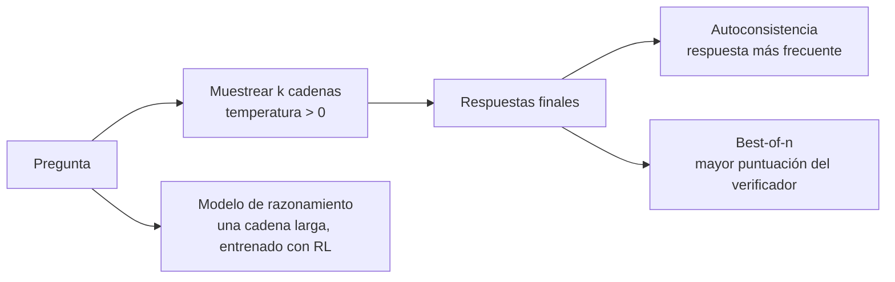

## El gancho

Cambias un clasificador de soporte a un modelo de razonamiento porque "razona mejor". La precisión no se mueve, la factura sube un orden de magnitud y la latencia p95 pasa de menos de un segundo a decenas de segundos. Esa misma semana, una compañera hace el mismo cambio en un proceso que revisa migraciones SQL en busca de errores de orden, y detecta problemas que el modelo anterior se saltaba.

Los dos resultados son normales. Los tokens de pensamiento compran precisión en problemas que necesitan varios pasos dependientes entre sí, y casi nada en problemas que necesitan uno. Esta lección trata de distinguir unos de otros, y de las formas más baratas de gastar cómputo en inferencia que existían antes de los modelos de razonamiento.

## La explicación sencilla

Pide a un compañero que multiplique 47 por 38 de cabeza y conteste al instante, y puede equivocarse. Dale un papel y escribirá los productos parciales, los sumará y acertará. Su cerebro no ha cambiado; ha tenido espacio para trabajar. Pregúntale cinco veces en cinco hojas y quédate con la respuesta más repetida, y un despiste en una hoja queda en minoría.

El **cómputo en inferencia** (test-time compute) es ese papel. Gastas más tokens por pregunta en la inferencia en lugar de entrenar un modelo más grande.

Dónde falla la analogía: las cuentas de una persona son la forma en que de verdad calculó la respuesta. El razonamiento escrito de un modelo es más texto generado, y nada garantiza que sea la causa real de la respuesta final. Y cinco hojas de la misma persona comparten los mismos errores de concepto, así que votar no corrige un error que todos cometen.

## Bajo el capó

### Cadena de pensamiento: tokens como memoria de trabajo

Un transformer hace una cantidad fija de cómputo por cada token generado: una pasada hacia delante por todas sus capas. Un problema que necesita diez pasos dependientes no cabe en el cómputo de un solo token. Si el modelo escribe los pasos intermedios como texto, cada token posterior puede atender a esos resultados anteriores (lección 3), y el cómputo se reparte entre muchas pasadas.

Wei et al. (2022) lo mostraron con el **prompting de cadena de pensamiento** (chain of thought): ejemplos few-shot que incluyen los pasos resueltos antes de la respuesta. Mejoró tareas de aritmética, sentido común y razonamiento simbólico, y las mejoras aparecieron sobre todo en modelos grandes. Los modelos pequeños producían cadenas fluidas pero erróneas. La frase "Let's think step by step" consigue un efecto parecido sin ejemplos.

El coste es directo: cada paso es un token de salida, generado de forma secuencial.

### Autoconsistencia: muestrear muchas veces y votar

Wang et al. (2022) propusieron la **autoconsistencia** (self-consistency): muestrear varias cadenas de pensamiento con temperatura distinta de cero (lección 5), extraer la respuesta final de cada una y devolver la más frecuente. Caminos de razonamiento distintos que llegan a la misma respuesta son evidencia a su favor.

En esa frase se esconden dos condiciones:

- Las respuestas finales tienen que ser comparables. Un número o la letra de una opción múltiple sirven. Dos párrafos de prosa no, salvo que los normalices de algún modo.
- El voto converge a la **respuesta individual más probable**, no a la respuesta correcta. Si los errores se reparten entre muchos valores distintos, la respuesta correcta gana aunque una sola muestra acierte menos de la mitad de las veces. Si el modelo tiende a cometer el *mismo* error, una trampa común, el voto lo amplifica.

El coste crece de forma lineal con el número de muestras `k`. La latencia no tiene por qué: las muestras son independientes y pueden ejecutarse en paralelo, así que el tiempo real es aproximadamente el de la muestra más larga.

### Best-of-n y verificadores

En lugar de votar, genera `n` candidatos y deja que un **verificador** elija el mejor. Cobbe et al. (2021) entrenaron un modelo para juzgar si la solución de un problema matemático de enunciado era correcta y lo usaron para ordenar muchas soluciones muestreadas. En código, el verificador puede ser real: ejecuta las pruebas unitarias y quédate con un candidato que las pase.

Cuando el verificador es exacto (pruebas, un comprobador de tipos, un solver), best-of-n es la más potente de estas técnicas. Cuando es un modelo aprendido, se equivoca, y más candidatos le dan más ocasiones de dejarse engañar por una respuesta errónea que por casualidad puntúa alto. Cobbe et al. indican que, a partir de cierto número de candidatos, el rendimiento empieza a caer justo por eso.

### Modelos de razonamiento: RL con recompensas verificables

El prompting y el muestreo usan el modelo tal cual. Los **modelos de razonamiento** se entrenan para pensar. Tras el preentrenamiento y el post-entrenamiento de la lección 10, pasan por una etapa de aprendizaje por refuerzo sobre problemas cuya respuesta se puede comprobar automáticamente: matemáticas con un resultado conocido, código con pruebas. El modelo genera una cadena larga seguida de una respuesta, un programa comprueba la respuesta y la recompensa sube la probabilidad de las cadenas que llevaron a respuestas correctas. Nadie escribe los pasos del razonamiento; solo se califica el resultado.

El informe de DeepSeek-R1 de DeepSeek-AI (2025) lo describe abiertamente. Su modelo R1-Zero se entrenó con RL directamente a partir de un modelo base, con recompensas basadas en reglas para la exactitud de la respuesta y el formato de salida en lugar de un modelo de recompensa aprendido, en parte para evitar el reward hacking. Durante el entrenamiento sus respuestas se alargaron y empezó a revisar su propio trabajo. La salida de R1-Zero era poco legible y mezclaba idiomas, así que el R1 publicado añadió una pequeña cantidad de datos seleccionados de "arranque en frío" (cold start) y varias etapas de entrenamiento más. También destilaron las salidas de R1 en modelos abiertos más pequeños.

En los productos, el pensamiento suele ser un bloque aparte antes de la respuesta. Algunos proveedores lo muestran, otros muestran un resumen y otros lo ocultan, y muchas API ofrecen un control de cuánto pensar (un presupuesto de tokens o un nivel de esfuerzo). Los tokens de pensamiento se generan como cualquier otra salida y los pagas los veas o no; consulta la página de precios de tu proveedor para conocer las reglas exactas.

### Lo que los benchmarks muestran y lo que no

Los modelos de razonamiento se anuncian con mejoras en benchmarks. Léelas con tres preguntas:

- **Contaminación.** Los problemas de test populares y sus soluciones están en la web, y la web es dato de entrenamiento. Una puntuación alta puede ser en parte memoria. Los problemas nuevos publicados después de la fecha de corte del entrenamiento son mejor señal que los antiguos.
- **Saturación.** Cuando varios modelos están cerca del máximo de un benchmark, las diferencias entre ellos son pequeñas comparadas con el ruido. Algunos benchmarks de matemáticas populares tienen solo unas pocas decenas de problemas, así que un problema mueve la puntuación varios puntos.
- **Respuestas comprobables.** El RL con recompensas verificables funciona mejor donde un programa puede calificar la respuesta, y los benchmarks también. Una gran mejora en matemáticas de competición dice poco sobre redactar un buen resumen de incidente, seguir tu guía de estilo o tomar una decisión de criterio.

La cadena visible tampoco es un registro de auditoría. Hay investigación que muestra que los modelos pueden dejarse influir por pistas del prompt que su razonamiento escrito nunca menciona. Trata la cadena como una pista para depurar, no como una prueba.

### Cuándo compensa pagar por pensar

| Tarea | ¿Ayuda pensar más? | Por qué |
|---|---|---|
| Matemáticas de varios pasos, análisis cuantitativo | Normalmente | Muchos pasos dependientes, resultado comprobable |
| Código con pruebas, depuración | Normalmente | Los pasos dependen unos de otros; existe un verificador |
| Planificación, calendarios, problemas con restricciones | A menudo | Búsqueda entre opciones, vuelta atrás |
| Consulta, preguntas basadas en recuperación | Rara vez | La respuesta está en el contexto o no; pensar no añade hechos |
| Extracción, cambio de formato | Rara vez | Un solo paso; importa más la salida estructurada |
| Clasificación sencilla | Rara vez | Una sola decisión; los errores vienen de la ambigüedad, no de pasos que faltan |

La regla práctica: si una persona cuidadosa necesitaría papel para hacer cuentas, pensar ayuda. Si contestaría de un vistazo, estás pagando un camino más largo hacia la misma respuesta. Snell et al. (2024) llegan a una conclusión parecida para el muestreo y la búsqueda con verificador: la mejor forma de gastar cómputo en inferencia depende de lo difícil que sea el prompt, así que asignarlo por prompt supera a un presupuesto fijo para todas las peticiones.

## La conexión con la ingeniería

- **Mide en tu tarea, no en benchmarks.** Construye un pequeño conjunto de evaluación (lección 11) y compara un modelo rápido, un modelo rápido con `k` votos y un modelo de razonamiento en precisión, coste por elemento y latencia p95. Elige por ruta, no por empresa.
- **Pon presupuesto al pensamiento.** Los tokens de pensamiento son tokens de salida: se facturan, normalmente al precio más alto de salida, y se generan de forma secuencial. Fija explícitamente el presupuesto de pensamiento o el nivel de esfuerzo y limita el total de tokens de salida, o una petición difícil puede tardar minutos.
- **Enruta según la dificultad.** Manda las peticiones fáciles a un modelo rápido y escala cuando falle una comprobación barata (JSON inválido, pruebas que fallan, poco acuerdo entre dos muestras). Es la forma habitual de conseguir la mayor parte de la precisión por una fracción del coste.
- **Usa verificadores reales donde existan.** Pruebas, validación de esquema, un `EXPLAIN` de SQL, una calculadora. Un programa que comprueba la respuesta es mejor que un modelo que la juzga, y hace seguro el best-of-n.
- **El acuerdo es una señal, no una garantía.** Si cinco muestras coinciden, el modelo es consistente, no necesariamente correcto. Los modos de fallo compartidos producen respuestas erróneas unánimes y seguras.
- **No enseñes la cadena a los usuarios como explicación.** Puede ser errónea con la respuesta correcta, y sonar correcta con la respuesta errónea. Algunos proveedores también restringen lo que puedes hacer con ella.

## Reto práctico

Archivo: `courses/ai-engineering/exercises/lesson_21_reasoning_models.py`. Solo NumPy: una simulación con semilla fija, sin ningún modelo real. Un "solucionador" ficticio responde 3000 problemas aritméticos de enunciado de tres niveles de dificultad, y cada muestra acierta con una probabilidad fija `p` por nivel. Compara una respuesta directa, el voto por mayoría sobre `k` = 1, 3, 5, 9, 15 cadenas y best-of-k con un verificador ruidoso, en un mundo donde los errores están repartidos (A) y en otro donde los problemas difíciles comparten una respuesta trampa (B). Después estudia un único problema con `p` = 0.40. Unos 15 minutos.

**Predice antes de ejecutar:**

1. En el mundo A, una sola cadena acierta de media alrededor del 64% de las veces. ¿A cuánto llegará un voto con 15 muestras?
2. ¿Cuántos tokens por problema cuesta ese voto, si una cadena tiene de media unos 440 tokens?
3. En el mundo B, ¿qué le pasa a la precisión en los problemas difíciles al pasar de 1 muestra a un voto con 15?
4. Un problema que cada muestra acierta el 40% de las veces. ¿Un voto con 15 muestras queda por encima o por debajo de 0.40 si todos los errores caen en la misma trampa? ¿Y si se reparten entre 30 valores?
5. ¿Qué configuración tiene la mejor precisión por cada 1000 tokens, y la convierte eso en la mejor elección?

::: predict
P: vote15 | number | claim:a_vote15 | 0.05 | Mundo A: ¿precisión de un voto por mayoría con 15 muestras?
P: tokens | number | claim:a_vote15_tokens | 500 | Mundo A: ¿tokens medios por problema del voto con 15 muestras?
P: hardvote | choice:up=Sube;flat=Se queda más o menos igual;down=Baja | down | | Mundo B, problemas difíciles: de 1 muestra a un voto con 15, la precisión...
P: trap | number | claim:c_trap15 | 0.1 | Un problema, p = 0.40, todos los errores en la misma trampa: ¿precisión de un voto con 15 muestras?
:::

El comando para ejecutarlo está al final de esta página.

Lo que el script me imprimió (ábrelo después de predecir)

- Respuesta directa, sin cadena: precisión {{claim:direct_acc}}. Una cadena: {{claim:single_acc}} con {{claim:single_tokens}} tokens por problema.
- Mundo A, errores independientes: el voto con 15 muestras llega a {{claim:a_vote15}} con {{claim:a_vote15_tokens}} tokens por problema. Best-of-15 con el verificador ruidoso solo llega a {{claim:a_best15}}: con errores repartidos, votar juzga mejor que un verificador imperfecto.
- Mundo B, errores correlacionados: el voto sube hasta {{claim:b_vote9}} con k = 9 y se estanca en {{claim:b_vote15}} con k = 15. En los problemas difíciles empeora, de {{claim:b_hard_single}} con una muestra a {{claim:b_hard_vote15}} con quince, porque ahí la trampa es la respuesta más común. Best-of-15 lo hace mejor aquí, {{claim:b_best15}}, porque el verificador sigue prefiriendo de media las respuestas correctas.
- Un problema con `p` = 0.40: con los errores repartidos, un voto con 15 muestras acierta {{claim:c_spread15}} de las veces. Con todos los errores en una trampa acierta solo {{claim:c_trap15}}, y sigue bajando al crecer `k`. El umbral no es `p` > 0.5; es si la respuesta correcta es la más probable de todas.
- La precisión por cada 1000 tokens baja de {{claim:a_per1k_single}} con una cadena a {{claim:a_per1k_vote15}} con el voto de 15 muestras, y la respuesta directa gana esa columna de lejos. Si solo miraras la eficiencia elegirías la configuración que se equivoca más de la mitad de las veces; primero necesitas un objetivo de precisión y luego la forma más barata de alcanzarlo.
- La columna de latencia supone que las muestras se ejecutan en paralelo: crece mucho más despacio que el coste en tokens. El verificador añade un paso después de la muestra más larga.
- Las probabilidades, los recuentos de tokens y las proporciones de la trampa son inventados para mostrar la mecánica. Los modelos reales están en algún punto entre el mundo A y el mundo B, y solo tu propia evaluación te dice dónde.

Ampliaciones: haz el verificador más fino (baja su ruido) y busca dónde best-of-k supera al voto en el mundo A. Añade un enrutador que mande a `k` = 9 solo los problemas en los que las dos primeras muestras no coinciden, y compara sus tokens por problema con un `k` = 9 fijo. Sube la proporción de la trampa en los problemas medios hasta que votar también empiece a perjudicar ahí.

## Ideas clave

1. La cadena de pensamiento reparte el cómputo entre más tokens. Ayuda en problemas de varios pasos y cuesta tokens de salida y latencia en cada petición.
2. El voto converge a la respuesta más común y un verificador solo es tan bueno como su criterio. Los errores correlacionados rompen el voto; un verificador débil se deja engañar más cuanto mayor es `k`.
3. Los modelos de razonamiento se entrenan con RL sobre respuestas comprobables para pensar más tiempo. Los benchmarks reflejan justo esas tareas comprobables, así que mide en tu propio trabajo antes de pagar por el pensamiento.

**Pregunta de control:** cinco muestras de un modelo de razonamiento coinciden en la misma respuesta errónea para un problema de planificación de horarios. ¿Ayudaría subir `k` a 25? ¿Qué añadirías en su lugar?

**A continuación:** modelos que ven y oyen. Los modelos multimodales meten imágenes y audio en el mismo flujo de tokens.

::: quiz
Q: ¿Por qué escribir pasos intermedios ayuda a un transformer a resolver problemas de varios pasos?
A: Cada token recibe una cantidad fija de cómputo. Escribir los resultados intermedios como tokens permite que los tokens posteriores atiendan a ellos, así que un cálculo largo se reparte entre muchas pasadas hacia delante.
Q: Una sola muestra acierta el 40% de las veces. ¿Puede el voto por mayoría llevar la precisión cerca del 100%?
A: Solo si ninguna respuesta errónea concreta es más probable que la correcta. Si los errores se reparten entre muchos valores, sí. Si el 60% de las muestras caen en la misma respuesta errónea, el voto converge a esa respuesta errónea.
Q: ¿Cuándo supera best-of-n con un verificador al voto, y cuándo puede empeorar al crecer n?
A: Gana cuando el verificador es preciso, idealmente exacto como unas pruebas unitarias, y sobre todo cuando los errores están correlacionados. Con un verificador aprendido y ruidoso, más candidatos dan más ocasiones de que uno erróneo saque la puntuación más alta.
Q: Tu tarea es extraer campos de facturas a JSON. ¿Deberías usar un modelo de razonamiento?
A: Probablemente no. Es una tarea de un solo paso en la que los errores vienen de la ambigüedad o de contexto que falta, no de pasos que faltan. La salida estructurada y una validación de esquema ayudan más, por una fracción del coste y la latencia.
:::

## Referencias

- Wei et al., "Chain-of-Thought Prompting Elicits Reasoning in Large Language Models" (2022): https://arxiv.org/abs/2201.11903
- Wang et al., "Self-Consistency Improves Chain of Thought Reasoning in Language Models" (2022): https://arxiv.org/abs/2203.11171
- Cobbe et al., "Training Verifiers to Solve Math Word Problems" (2021), verificadores y best-of-n sobre GSM8K: https://arxiv.org/abs/2110.14168
- DeepSeek-AI, "DeepSeek-R1: Incentivizing Reasoning Capability in LLMs via Reinforcement Learning" (2025): https://arxiv.org/abs/2501.12948
- Snell et al., "Scaling LLM Test-Time Compute Optimally can be More Effective than Scaling Model Parameters" (2024): https://arxiv.org/abs/2408.03314
