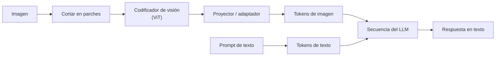

## El gancho

Le envías a un modelo una captura de pantalla de una factura y lee correctamente el proveedor, las líneas y el total. Luego le preguntas cuántas líneas hay y dice nueve cuando hay once. Después le envías una foto de un tique hecha con el móvil, reducida para ahorrar dinero, y se inventa un total que no aparece en el papel.

Nada de eso es aleatorio. Un transformer solo procesa secuencias de vectores, así que una imagen tiene que trocearse y convertirse en "tokens" antes de que el modelo vea nada. Cómo se trocea decide lo que cuesta, lo que sobrevive y lo que se pierde.

## La explicación sencilla

Piensa en un mosaico hecho de teselas cuadradas. El modelo nunca mira la imagen en su conjunto. Recibe una lista de teselas, cada una resumida como un vector, más una nota que indica en qué lugar de la cuadrícula estaba. A partir de ahí, esos vectores conviven en la misma secuencia que los tokens de texto, y la atención (lección 3) los mezcla como a cualquier otro token.

El audio funciona igual, con porciones de tiempo en lugar de teselas: se corta la forma de onda en tramos cortos que se solapan y se describe cada uno.

Dónde deja de funcionar la analogía: una tesela no es una palabra. No tiene significado por sí sola, y todo lo que sea más pequeño que una tesela, como el trazo fino de una letra pequeña, queda fundido en un único vector junto con todo lo que lo rodea. El modelo tiene que aprender, a partir de enormes cantidades de datos emparejados, qué significan las combinaciones de teselas.

## Bajo el capó

### De píxeles a tokens de parche

El Vision Transformer (ViT, Dosovitskiy et al., 2020) lo concretó. Toma una imagen de 224x224, córtala en parches (patches) de 16x16 píxeles y obtienes una cuadrícula de 14x14, es decir, 196 parches. Aplana cada parche (16 x 16 x 3 = 768 números en RGB) y multiplícalo por una única matriz aprendida: esa **proyección lineal** convierte cada parche en un embedding del ancho del modelo. Suma un **embedding de posición** para que el modelo sepa de dónde venía cada parche y ejecuta sobre la secuencia un codificador transformer normal.

Sin posiciones, dos parches idénticos de fondo blanco serían indistinguibles y la imagen sería una bolsa de teselas. ViT aprende sus embeddings de posición; el ejercicio usa posiciones fijas de senos y cosenos, que cumplen la misma función en esta demostración.

```
patches   = image cut into (H/16) x (W/16) squares, each flattened
tokens    = patches @ W_proj + position_embeddings
sequence  = transformer_encoder(tokens)
```

### Los tokens de imagen crecen con la resolución

El número de parches es `(H / p) x (W / p)` para un tamaño de parche `p`. Si duplicas el lado de una imagen cuadrada, obtienes cuatro veces más parches. Si pasas de 224 a 1344 píxeles, seis veces el lado, obtienes 36 veces más parches. El coste de la atención sobre esos parches crece con el cuadrado de esa cantidad (lección 3).

Por eso los proveedores redimensionan, dividen en mosaicos o comprimen las imágenes antes de que lleguen al modelo, y por eso algunas arquitecturas fusionan parches vecinos o los remuestrean en un número fijo de tokens. La regla exacta varía según el modelo y el proveedor, y cambia con el tiempo, así que lee la documentación de tu proveedor y mide el uso de tokens que te reporta en lugar de adivinarlo.

### Embeddings contrastivos de imagen y texto

CLIP (Radford et al., 2021) entrena dos codificadores, uno para imágenes y otro para texto, de modo que una imagen y su pie de foto queden cerca en un mismo espacio de embeddings compartido (lección 2). Se entrenó con 400 millones de pares imagen-texto recopilados de internet.

La señal de entrenamiento es contrastiva. En un lote de `N` pares, calcula la matriz `N x N` de similitudes coseno. La diagonal contiene los pares verdaderos. Trata cada fila como un problema de clasificación, "¿qué pie de foto corresponde a esta imagen?", y cada columna como "¿qué imagen corresponde a este pie de foto?", y aplica entropía cruzada a ambos (la pérdida InfoNCE), con las similitudes divididas por una temperatura. La pérdida acerca los pares verdaderos y separa todas las demás combinaciones.

La recompensa es la **clasificación zero-shot**: calcula el embedding de los textos "a photo of a cat", "a photo of an invoice", etc., calcula el de la imagen y elige el texto con mayor similitud. No se ha entrenado ningún clasificador para esas etiquetas. El mismo espacio sirve para buscar imágenes con una consulta de texto y para detectar imágenes duplicadas o casi duplicadas.

### Conectar un codificador de visión a un LLM

Un modelo de visión y lenguaje (VLM) suele reutilizar un codificador de visión preentrenado, a menudo un ViT de estilo CLIP, y un LLM preentrenado. La pieza nueva es un pequeño **proyector** o **adaptador** que lleva los vectores de salida del codificador al espacio de embeddings de entrada del LLM. En LLaVA (Liu et al., 2023) ese proyector era una única capa lineal. Los vectores de imagen proyectados se insertan en la secuencia de tokens junto al texto, y el LLM los atiende como si fueran palabras que nunca ha visto escritas.



Existen otros diseños: algunos comprimen la imagen en un conjunto pequeño y fijo de tokens de consulta aprendidos; otros hacen que el LLM lea las características de la imagen mediante capas adicionales de atención cruzada en lugar de colocarlas en la secuencia. El entrenamiento suele alinear primero el proyector con pares imagen-pie de foto y después ajusta el modelo con conversaciones de tipo instrucción sobre imágenes.

### El audio se convierte en tramas

Los modelos de voz suelen partir de un **espectrograma**. Se corta la forma de onda en ventanas cortas solapadas, normalmente de 25 ms cada 10 ms, se aplica una transformada de Fourier a cada una y se conservan las magnitudes, normalmente proyectadas sobre una escala de frecuencias mel y en logaritmo. Eso da unas 100 tramas por segundo, cada una un vector de energías por frecuencia. Whisper (Radford et al., 2022) funciona así con audio a 16 kHz en fragmentos de 30 segundos, y su codificador reduce a la mitad la tasa de tramas con una convolución con paso 2 antes del transformer.

La otra vía es un **códec de audio neuronal**: un codificador aprendido comprime la forma de onda en una secuencia de códigos discretos, a menudo varios índices de libro de códigos (codebook) por paso de tiempo, y un decodificador puede volver a convertir los códigos en sonido. Los códigos discretos se parecen a los tokens de texto, y eso es lo que hace viables los modelos que entienden y generan voz.

### En qué aciertan y en qué fallan los modelos de visión y lenguaje

Puntos fuertes: leer documentos, formularios, gráficos y tablas, describir capturas de pantalla, transcribir texto impreso nítido y responder preguntas que combinan una imagen con conocimiento del mundo.

Puntos débiles, que conviene probar antes de confiar en ellos: **contar** muchos objetos parecidos, las **relaciones espaciales precisas** (a la izquierda de, encima de, en qué celda está un valor en una cuadrícula densa), las coordenadas exactas y el **texto pequeño a baja resolución**. Si el trazo de un carácter es más fino de lo que sobrevive al redimensionado, la información desaparece antes de que se ejecute el modelo, y aun así el modelo puede producir una conjetura fluida y verosímil.

## La conexión con la ingeniería

- **Facturas y formularios.** Un VLM puede sustituir a un pipeline de OCR basado en plantillas cuando los diseños son caóticos. Pide salida estructurada (JSON con un esquema) y valídala: los totales deben coincidir con la suma de las líneas y las fechas deben poder analizarse. Trata la lectura del modelo como un borrador que comprueban unas reglas.
- **La resolución es un mando de coste.** El número de tokens crece con el área en píxeles. Recorta la región que necesitas antes de ampliar la página entera. Una tabla recortada en alta resolución suele ser más barata y más precisa que una página completa comprimida para que quepa.
- **Prefiere el texto cuando lo tengas.** Si el PDF tiene capa de texto o la interfaz tiene un árbol de accesibilidad o un DOM, envía eso. Usa la imagen para el diseño y para lo que la extracción de texto no capta.
- **Capturas de interfaz y agentes.** Las capturas permiten a un agente ver una interfaz, pero las coordenadas y las etiquetas pequeñas son justo los puntos débiles. Acompaña la imagen con listas de elementos cuando sea posible y verifica las acciones comprobando el estado, no fiándote de la descripción.
- **Diagramas.** Los modelos leen razonablemente bien diagramas de arquitectura y de flujo cuando las etiquetas son legibles. Los diagramas densos con flechas que se cruzan chocan con la debilidad de las relaciones espaciales.
- **Evalúa con tus propias imágenes.** Construye un pequeño conjunto etiquetado a partir de entradas reales de producción (fotos de móvil, escaneos, páginas giradas) y mide la precisión por campo, como en la lección 11. Las cifras de los benchmarks públicos rara vez se parecen a tus datos.
- **Embeddings de CLIP para búsqueda.** Para "encuentra imágenes como este texto" o para deduplicar, un modelo de embeddings con un índice vectorial es muchísimo más barato que preguntar a un VLM por cada imagen.

## Reto práctico

Archivo: `courses/ai-engineering/exercises/lesson_22_multimodal.py`. Solo NumPy. Corta una imagen sintética en tokens de parche de 16x16 a varias resoluciones, los proyecta a embeddings con posiciones, muestra lo que el submuestreo hace con los trazos finos, ejecuta un montaje contrastivo de juguete al estilo de CLIP con InfoNCE y clasificación zero-shot, y divide una señal de audio sintética en tramas para obtener un espectrograma. Unos 10 minutos.

**Predice antes de ejecutar:**

1. ¿Cuántos parches de 16x16 produce una imagen de 224x224? ¿Y una de 1344x1344?
2. Dos parches de fondo tienen píxeles idénticos. ¿Son idénticos sus embeddings una vez sumadas las posiciones?
3. Se dibujan rayas de un píxel de ancho a 896 px. ¿Qué le pasa a su contraste cuando la imagen se promedia hasta 448 px?
4. ¿La pérdida InfoNCE de los pares bien emparejados queda por encima o por debajo de `ln(4)`, la pérdida de un modelo que no distingue cuatro pares? ¿Y la de los pares barajados?
5. ¿Cuántas tramas produce un segundo de audio a 16 kHz con ventanas de 25 ms y un salto de 10 ms?

::: predict
P: tokens | number | claim:tokens1344 | 0 | ¿Cuántos tokens de parche de 16x16 produce una imagen de 1344x1344?
P: stripes | choice:kept=Casi intacto;half=Más o menos la mitad;gone=Desaparece | gone | | Unas rayas de un píxel dibujadas a 896 px se promedian hasta 448 px. ¿Qué queda de su contraste?
P: frames | number | claim:frames1s | 3 | ¿Cuántas tramas de 25 ms con un salto de 10 ms caben en un segundo de audio?
:::

El comando para ejecutarlo está al final de esta página.

<details>
<summary>Lo que el script me imprimió (ábrelo después de predecir)</summary>

- 224x224 da una cuadrícula de {{claim:grid224}} parches. 896 px da {{claim:tokens896}} y 1344 px da {{claim:tokens1344}}, que es {{claim:ratio1344}} veces la cantidad de 224. Seis veces el lado, 36 veces los tokens.
- La proyección produce embeddings de forma `{{claim:embshape}}`, un vector por parche. Los parches de fondo idénticos obtienen embeddings distintos solo gracias a las posiciones.
- Las rayas de un píxel a 448 px tienen un contraste de {{claim:contrast448}}. Cada píxel promediado cubre una columna oscura y una clara, así que todos los píxeles se vuelven del mismo gris. Este es el fallo del "texto pequeño a baja resolución" en su forma más pura: ningún modelo puede recuperar lo que el redimensionado ha borrado.
- Los pares bien emparejados dan una pérdida InfoNCE de {{claim:nce_matched}} y los barajados, {{claim:nce_shuffled}}. La temperatura baja de 0.07 hace que la pérdida sea muy tajante en ambos sentidos.
- La precisión zero-shot es de {{claim:zs1}} con poco ruido y cae a {{claim:zs6}} con mucho ruido (el azar da 0.25). Los embeddings son vectores aleatorios alrededor de cuatro anclas, no un modelo entrenado; lo que importa es la mecánica.
- Un segundo de audio da {{claim:frames1s}} tramas (la última ventana incompleta se descarta), y un fragmento de 30 segundos da {{claim:frames30}}. La frecuencia dominante en la segunda mitad es {{claim:dom2}} Hz, recuperada con la FFT de cada trama.

</details>

Ampliaciones: cambia el tamaño de parche a 14 y vuelve a calcular el número de tokens. Sube la temperatura de `info_nce` a 1.0 y observa cómo la pérdida de los pares correctos se acerca a `ln(4)`. Añade un tercer tono a 1020 Hz y comprueba si un ancho de bin de 40 Hz basta para separarlo de 1000 Hz.

## Ideas clave

1. Las imágenes se convierten en tokens cortándolas en parches, proyectando cada parche a un vector y sumando posiciones. El número de tokens crece con el área en píxeles, así que la resolución es un compromiso directo entre coste y precisión.
2. El entrenamiento contrastivo al estilo de CLIP coloca imágenes y texto en un mismo espacio de embeddings, lo que permite la clasificación zero-shot y la búsqueda de imágenes por texto. Los VLM suelen conectar un codificador de visión de este tipo a un LLM mediante un pequeño proyector.
3. El audio se convierte en unas 100 tramas de espectrograma por segundo o en una secuencia de códigos de un códec. Los VLM leen bien documentos y capturas de pantalla y fallan al contar, con las relaciones espaciales precisas y con los detalles que se pierden al submuestrear.

**Pregunta de control:** un pipeline que analiza tiques lee mal los totales en las fotos de móvil, pero no en los escaneos. Nombra dos causas que tengan que ver con cómo las imágenes se convierten en tokens y un cambio en el pipeline para cada una.

**A continuación:** lleva una funcionalidad multimodal a producción con los hábitos de evaluación de la lección 11 y la planificación de coste y latencia de la lección 20.

::: quiz
Q: Un modelo usa parches de 16x16. ¿Cuántos tokens de parche produce una imagen de 448x448 y qué ocurre si duplicas el lado hasta 896?
A: 28 x 28 = 784 parches. Al duplicar el lado se obtienen 56 x 56 = 3136, cuatro veces más, porque la cantidad crece con el área.
Q: En el entrenamiento de CLIP, ¿qué acerca la pérdida InfoNCE y qué separa?
A: Acerca cada imagen a su propio pie de foto (la diagonal de la matriz de similitud) y la aleja de todos los demás pies de foto del lote, en ambos sentidos.
Q: ¿Qué hace el proyector en un modelo de visión y lenguaje?
A: Lleva los vectores de salida del codificador de visión al espacio de embeddings de entrada del LLM, para que las características de la imagen puedan estar en la misma secuencia de tokens que el texto.
Q: ¿Por qué un VLM puede no leer un texto pequeño aunque lea perfectamente uno grande?
A: Si la imagen se reduce antes de cortarla en parches, los trazos más finos que el nuevo tamaño de píxel se promedian y desaparecen. La información se pierde antes de que se ejecute el modelo, y aun así este puede inventar una respuesta fluida.
:::

## Referencias

- Dosovitskiy et al., "An Image is Worth 16x16 Words: Transformers for Image Recognition at Scale" (2020): https://arxiv.org/abs/2010.11929
- Radford et al., "Learning Transferable Visual Models From Natural Language Supervision" (2021), CLIP: https://arxiv.org/abs/2103.00020
- Liu et al., "Visual Instruction Tuning" (2023), LLaVA: https://arxiv.org/abs/2304.08485
- Radford et al., "Robust Speech Recognition via Large-Scale Weak Supervision" (2022), Whisper: https://arxiv.org/abs/2212.04356
