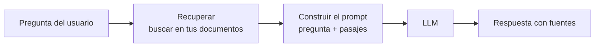

## La versión corta

**Generación aumentada por recuperación (retrieval-augmented generation, RAG)** significa lo siguiente: antes de hacerle una pregunta al modelo, *buscas* en tus propios datos los pasajes relevantes, los pegas en el prompt y dejas que el modelo responda a partir de ese texto.

Es búsqueda más prompt más LLM. El modelo no se vuelve a entrenar. Lee los pasajes en el momento de la pregunta, como en un examen a libro abierto.

## Por qué existe

- Un modelo solo sabe lo que había en sus datos de entrenamiento, hasta una fecha de corte. No sabe nada de tus documentos privados.
- Meterlo todo en el prompt es imposible: el contexto es limitado (lección 3) y se paga por token (lección 1).
- Anclar la respuesta en el texto recuperado reduce, aunque no elimina, las respuestas inventadas (lección 5), y te permite mostrar las fuentes.

## El pipeline

1. **Indexar (offline).** Divide los documentos en fragmentos (chunks), genera el embedding de cada fragmento (lección 2) y guarda el texto y los vectores.
2. **Recuperar (en cada pregunta).** Genera el embedding de la pregunta y busca los fragmentos más cercanos. Los sistemas más avanzados combinan la búsqueda por palabras clave con la búsqueda vectorial y pueden aplicar un reranker (lección 6).
3. **Aumentar.** Construye un prompt: instrucciones, los fragmentos recuperados y la pregunta.
4. **Generar.** El LLM responde a partir de los fragmentos. Pídele que los cite y que diga "no encontrado" cuando la respuesta no esté.

## Dónde falla

- **Fallos de recuperación.** Si no se recupera el fragmento correcto, el modelo no puede usarlo. En la práctica, una gran parte de los fallos de RAG son fallos de búsqueda, y por eso la lección 6 mide la recuperación por separado.
- **Mala fragmentación (chunking).** Los fragmentos que parten por la mitad una tabla o una idea pierden significado.
- **Contexto ignorado.** El modelo puede preferir su propia memoria o perder las evidencias en un prompt largo.
- **Inyección de prompts.** El texto recuperado es una entrada no fiable. Un documento puede contener instrucciones dirigidas al modelo.
- **Datos obsoletos o contradictorios.** El índice necesita una estrategia de actualización.

## RAG frente a fine-tuning

RAG inyecta *conocimiento* en el momento de la pregunta y es fácil de actualizar. El fine-tuning cambia sobre todo el *comportamiento y el estilo*; suele ser una forma poco fiable de añadir hechos concretos, y esos hechos no se pueden actualizar sin volver a entrenar. Muchos sistemas empiezan con RAG y solo recurren al fine-tuning para cubrir una carencia clara.

## Cómo evaluarlo

Evalúa dos cosas por separado: si la recuperación devolvió el pasaje correcto (hit@k, MRR) y, dado ese pasaje, si el modelo respondió de forma correcta y fiel. La lección 6 cubre lo primero.
