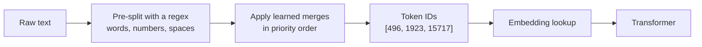

## The hook

Ask a frontier model how many times the letter "r" appears in "strawberry" and, for a long time, many of them got it wrong. The model can write a sonnet, but it cannot reliably do what a first grader does.

That is not stupidity. It is an interface problem, and you already know the genre: it is like asking a REST API about a property it never serialized. The model never receives the letters. It receives a list of integers.

> **Predict:** how many tokens does the word `strawberry` take? One, three, ten? Keep your guess for the exercise.

## The simple explanation

A language model cannot read text. Before anything else happens, a **tokenizer** chops your string into pieces called **tokens** and replaces each piece with an integer ID from a fixed vocabulary. The model only ever sees those IDs.

Think of a Scrabble set with some unusual tiles. Instead of 26 single letters you have about 100,000 tiles: common words (` the`), word fragments (`berry`), single characters, even common code snippets. To spell something you apply the tokenizer's merge rules, learned once from a large corpus, and you usually end up with a handful of tiles per word.

Where the analogy stops: a Scrabble player chooses tiles; a tokenizer does not optimize anything at encode time, it replays a fixed list of merges. The same word can be cut differently depending on a leading space or a capital letter.

Three consequences you can already predict:

- The model sees `strawberry` as a few chunks, not ten letters, so letter counting is a guess about spelling it has to have memorized.
- You pay and are limited per token, not per character or per word.
- Languages that were rare in the tokenizer's training data get cut into more pieces, so they cost more.

## Under the hood

### Byte Pair Encoding (BPE)

Most modern tokenizers use a variant of **byte pair encoding**. Training the tokenizer is a counting game over a large text corpus:

1. Start with the smallest units, bytes (or characters).
2. Count every adjacent pair. Merge the most frequent pair into a new symbol.
3. Repeat until the vocabulary reaches the target size (tens or hundreds of thousands of entries).

The ordered list of merges *is* the tokenizer. To encode new text you replay the merges in order.

The IDs in the diagram are illustrative. You will see real ones in the exercise.

### Details that surprise people

- **Spaces belong to tokens.** ` strawberry` (with a leading space) and `strawberry` are split into different token sequences, with different IDs. So are `Strawberry` and `strawberry`.
- **Numbers are chopped by a rule, not by value.** The pre-split regex used by `cl100k_base` cuts digit runs into groups of up to three digits, so `12345678` does not stay one unit. Models are bad at arithmetic partly because "the number" is not a single object to them.
- **It is lossless.** Tokenization is a reversible mapping. `decode(encode(text))` returns the original text. Because the base alphabet is bytes, any UTF-8 input can be encoded, including emoji and strings the tokenizer never saw.
- **Vocabularies are tied to models.** Token IDs from one tokenizer mean nothing to another model. Counting tokens with the wrong tokenizer gives wrong costs.

### Rules of thumb for English

OpenAI's own guidance puts it at roughly 4 characters or three quarters of a word per token for English (see the references). Code, JSON with lots of punctuation, and non-English text usually need more tokens per character. Treat these numbers as estimates and measure with the real tokenizer.

## The engineering connection

**Cost.** API pricing is per token, usually with different prices for input and output tokens. A prompt template that wastes 300 tokens per call is a recurring tax. Compare it to a query that returns 300 unneeded columns.

**Context window.** The context window is a token budget shared by the system prompt, the conversation, retrieved documents and the answer. Estimating it in characters is how you get a production error at 3 a.m.

**Language fairness.** The same sentence in Spanish typically needs more tokens than in English because the tokenizer was trained on more English. That means higher cost and a smaller effective context for Spanish users. The exercise measures this on one sentence pair.

**Failure modes caused by tokens:**

- letter counting, reversing strings, anagrams and spelling puzzles;
- arithmetic on long numbers and exact ID comparison;
- glitchy behavior on rare strings the tokenizer split in odd ways;
- prompts that look identical to you but differ by whitespace, which changes the tokens and can change the output.

**What to do in code.** Count tokens before you send. In Python use `tiktoken` for OpenAI-family encodings. In .NET, the `Microsoft.ML.Tokenizers` package offers equivalent encoders. Always use the tokenizer that matches the target model, and keep a safety margin because the chat format adds a few tokens per message.

## Hands-on challenge

File: `lessons/lesson_01_tokenization.py`. It prints the token count, IDs and pieces for six strings, then compares an English and a Spanish sentence. About 10 minutes. The first run downloads the `cl100k_base` vocabulary file (about 2 MB), so it needs network access once.

Before running it, write answers to these in the box at the bottom of the page:

1. How many tokens will `strawberry`, ` strawberry` (leading space) and `Strawberry` take? Will they be the same?
2. How will `12345678` be split?
3. Will `fresa` (Spanish for strawberry) need more or fewer tokens than `strawberry`?
4. Which is longer in tokens, the English refund sentence or its Spanish translation? By roughly what percentage?

Then run it (the command is at the bottom of this page).

Follow-ups, if you have time:

- Add your own name and your company name. Which get cut into the most pieces?
- Encode a small JSON object and the same data as a sentence. Compare counts.
- Explain, using the pieces printed for `strawberry`, why asking for the number of r's is hard.

Hints, no spoilers

The pre-split regex separates letters, digits and spaces before merges are applied. Check where the space ended up in the output pieces. For the Spanish comparison, compare tokens per character, not only totals.

## Takeaways

1. The model sees token IDs from a fixed vocabulary, never letters. Letter-level tasks are indirect for it.
2. BPE builds the vocabulary by repeatedly merging the most frequent adjacent pair. Spaces, case and language all change the tokens.
3. Tokens are the unit of cost, speed and context. Count them with the right tokenizer instead of guessing.

**Check question:** a customer reports that your support bot answers in Spanish are cut off earlier than in English with the same `max_tokens` setting. Give the cause and two ways to fix it.

**Next up:** embeddings. Once text is a list of IDs, how does a number like 15717 become something that carries meaning? That is lesson 2.

::: quiz
Q: Why can a model that writes fluent prose fail to count the letters in a word?
A: It never sees letters. The tokenizer hands it integer IDs for chunks such as `str`, `aw`, `berry`, so spelling-level facts have to be memorized rather than read off the input.
Q: You switch a prompt from English to Spanish. What happens to cost and effective context, and why?
A: Both get worse. The vocabulary was trained mostly on English, so Spanish text is cut into more, smaller pieces. More tokens means more cost per call and less room before the context window fills.
Q: Does BPE pick the token split with the fewest tokens?
A: No. It replays a fixed, ordered list of merges learned during tokenizer training. The result is usually compact, but nothing optimizes the count at encode time.
:::

## References

- Sennrich, Haddow and Birch, "Neural Machine Translation of Rare Words with Subword Units" (2016), the paper that brought BPE to NLP: https://arxiv.org/abs/1508.07909
- OpenAI, `tiktoken` repository and the "What are tokens" guidance (about 4 characters per token in English): https://github.com/openai/tiktoken and https://platform.openai.com/tokenizer
- Microsoft, `Microsoft.ML.Tokenizers` package for .NET: https://www.nuget.org/packages/Microsoft.ML.Tokenizers
