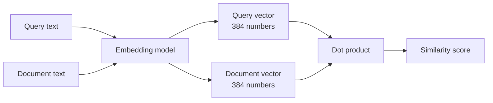

## The hook

You search "How do I get my money back?" and the best result is a document titled "Refund policy: returns within 30 days". They share almost no words, and the search still found it. How can a computer know that "money back" and "refund" are neighbors?

The answer is also the source of the strangest search bug you will meet: the same system may rank "Order #48213 has shipped" and "Order #48231 has shipped" as nearly identical, because to the model they are.

## The simple explanation

An **embedding** is a list of numbers (a vector) that represents a piece of text. The key property: texts with similar meaning get vectors that point in similar directions.

Picture a map where every sentence is a pin. "Refund" and "money back" are pins in the same neighborhood; "cat on a windowsill" is in another city. Search becomes "find the pins nearest to my question".

Where the analogy stops: a map has two dimensions and the distance means kilometers. An embedding has hundreds of dimensions, nobody labeled the axes, and "near" means *similar in the ways the model learned to care about*, which is not always the ways you care about.

## Under the hood

### From tokens to vectors

An embedding model is a neural network trained so that related texts end up close together. In the exercise, `all-MiniLM-L6-v2` turns any text into **384 numbers**. Training pushes pairs that belong together (a question and its answer, two paraphrases) closer, and pushes unrelated pairs apart. Meaning is not stored anywhere explicitly. It is geometry that emerged from that pressure.

### Cosine similarity

To compare two vectors we ask how aligned they are:

```
cosine(a, b) = (a . b) / (|a| * |b|)
```

It is 1 for the same direction, 0 for unrelated (perpendicular) and negative for opposite. If vectors are normalized to length 1, the formula collapses to a plain dot product. The exercise passes `normalize_embeddings=True` so `va @ vb` *is* the cosine similarity.



### Two kinds of embeddings

Do not confuse the embedding table *inside* an LLM (a lookup from token ID to vector, learned during training; lesson 4 shows where it sits in the stack) with an embedding *model* like MiniLM, which is a full network that outputs one vector for a whole text. They share an idea, not an API.

### What these vectors do badly

An embedding model compresses a sentence into a fixed-size summary. Compression loses things:

- **Negation.** "The movie was great" and "The movie was not great" are about the same topic, so they tend to land close together.
- **Identifiers and exact values.** Order numbers, error codes, SKUs and dates differ by a few characters, which barely moves the vector.
- **Rare words and names** the model saw little of.
- **Direction of relationships.** "A sued B" and "B sued A" look very similar.

Similarity means *topically related*, not *equivalent* and not *true*.

## The engineering connection

Embeddings are the backbone of semantic search, recommendation, duplicate detection, clustering and retrieval for LLMs (see the RAG concept note). The practical workflow:

1. Embed every document once, offline, and store the vectors.
2. At query time embed the query, then find the nearest vectors.
3. Return the top few.

Storage options you already know: a table with a `VARBINARY` or array column for small data; the native `vector` type in recent SQL Server and Azure SQL; PostgreSQL with pgvector; or a dedicated vector database. For a few thousand documents, a brute-force dot product over a NumPy array is fine. Approximate nearest-neighbor indexes (HNSW and friends) only matter at scale.

Trade-offs to remember:

- **Model lock-in.** Vectors from different models are incompatible. Changing the model means re-embedding everything.
- **Dimensions cost memory.** 384 floats at 4 bytes is about 1.5 KB per document before index overhead.
- **Chunking.** Long documents must be split. Chunk size changes what each vector means.
- **No exact match guarantee.** A vector search can miss the document that contains your exact string. Lesson 6 measures this and fixes it.

## Hands-on challenge

File: `lessons/lesson_02_embeddings.py`. It embeds five sentence pairs and prints their cosine similarities. The first run downloads a model of about 90 MB. About 10 minutes.

The pairs:

1. "The movie was great" vs "The film was wonderful"
2. "The movie was great" vs "The movie was not great"
3. "Order #48213 has shipped" vs "Order #48231 has shipped"
4. "How do I get my money back?" vs "Refund policy: returns within 30 days"
5. "How do I get my money back?" vs "The cat sat on the warm windowsill"

**Predict before you run:**

1. Rank the five pairs from highest to lowest similarity.
2. Which pair is most surprising if you think of similarity as "means the same thing"?
3. Will pair 2 score higher or lower than pair 4? What does that tell you about using a threshold to decide "relevant"?

The run command is at the bottom of this page.

Follow-ups:

- Add a pair that differs only by a number in a price ("costs $10" vs "costs $1000").
- Add a pair in Spanish and English with the same meaning. Does the model connect them?
- Print the first five numbers of one vector. Can you read anything from them? (You should not be able to.)

## Takeaways

1. An embedding maps text to a vector so that closeness approximates relatedness of meaning.
2. Cosine similarity compares directions. With normalized vectors it is just a dot product.
3. Embeddings are blind to negation, exact identifiers and precise values. Never assume high similarity means "correct".

**Check question:** your support search returns the article for order status when the user types a specific order number that does not exist. Why does the embedding approach produce this, and what other signal would you add?

**Next up:** attention, the mechanism that lets a model decide which earlier tokens matter for the next one.

::: quiz
Q: Two sentences get a cosine similarity of 0.85. What can you conclude, and what can you not conclude?
A: They are about closely related things in the ways the model learned to care about. You cannot conclude they mean the same thing, that one is true, or that they agree: negations and swapped identifiers often score this high.
Q: Why is the dot product enough to compare the vectors in the exercise?
A: The vectors are normalized to length 1, so the cosine formula's denominator is 1 and the dot product is the cosine similarity.
Q: You change the embedding model in production. What has to happen to the stored vectors?
A: All of them must be recomputed. Vectors from different models live in unrelated spaces, so mixing them makes nearest-neighbor search meaningless.
:::

## References

- Reimers and Gurevych, "Sentence-BERT: Sentence Embeddings using Siamese BERT-Networks" (2019), the training idea behind MiniLM-style models: https://arxiv.org/abs/1908.10084
- Sentence-Transformers documentation and the `all-MiniLM-L6-v2` model card: https://www.sbert.net and https://huggingface.co/sentence-transformers/all-MiniLM-L6-v2
- pgvector, vector similarity search for PostgreSQL: https://github.com/pgvector/pgvector
