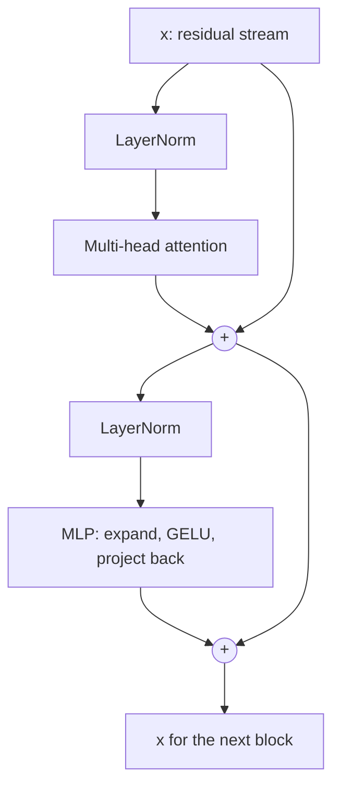

## The hook

GPT-style models with 7 billion or 700 billion parameters look, structurally, like the same small recipe copied dozens of times. There is no special module for grammar, none for facts and none for reasoning. Just one block repeated.

If you understand that block, and the idea of a **residual stream** running through it, you can read the diagram of almost any modern LLM.

## The simple explanation

Picture a conveyor belt carrying one vector per token. At each station along the belt (a **block**) two workers may *add notes* to the vector but never erase it:

1. The **attention** worker lets the token look at other tokens and write what it learned back onto the belt.
2. The **MLP** worker thinks about the token on its own and writes back a refined version.

The belt is the **residual stream**. After many stations, the vector at the last position holds enough to predict the next token, and a final step converts it into probabilities over the vocabulary.

Where the analogy stops: the "notes" are added vectors, not text, and many facts are spread across many dimensions rather than stored in readable places.

## Under the hood

### One block

A common modern layout (pre-norm):

```
x = x + Attention(LayerNorm(x))
x = x + MLP(LayerNorm(x))
```



### The residual connection

The `x + ...` is the key trick. Each sublayer computes an *update* and adds it. Consequences:

- The original token information survives to the top of the stack, as long as updates are modest. The ablation section of the exercise shows cosine similarity near 0.9 between the final vector and the original embedding with residuals, and near 0 without them.
- Gradients have a direct path from the loss back to early layers, which is what makes very deep stacks trainable.
- You can think of layers as *reading from and writing to a shared workspace*. This view is the basis of much interpretability research.

### The MLP

The MLP processes each position independently: a linear layer that expands the dimension (typically by 4x), a non-linearity (GELU or a gated variant), then a linear layer back down. Attention moves information *between* tokens. The MLP transforms information *within* a token, and it holds the larger share of parameters. With the 4x expansion, the MLP has twice the parameters of the attention projections (`8d^2` versus `4d^2`), and the exercise prints exactly that ratio. A widespread, still partly speculative, view is that MLPs store much of the model's factual associations.

### Layer normalization

Layer norm rescales each token vector to zero mean and unit variance across its dimensions (then, in real models, applies a learned scale). It stops activations from drifting in size as depth grows. In the exercise, rows with standard deviations 0.6, 6.5 and 93 all come out at exactly 1.

Pre-norm (normalize *before* each sublayer, as above) trains more stably in deep stacks than the original post-norm design, and modern models mostly use it, often with RMSNorm, a cheaper variant.

### Stacking and the unembedding

Stack `L` identical blocks (different weights each): 12 in small GPT-2, 32 to 100+ in large models. After the last block:

1. Normalize the final vector.
2. Multiply by the **unembedding** matrix, shape `d_model x vocab_size`. Many models reuse the transposed token embedding matrix here, as the exercise does.
3. The result is one **logit** per vocabulary token. Softmax turns logits into probabilities.

Only the last position's output is used to pick the next token, but all positions are computed in parallel during training (lesson 5).

### What is still missing

Position information. Attention by itself ignores order, so models add positional information, such as rotary embeddings in many current models. The toy exercise leaves this out.

## The engineering connection

- **Where parameters live.** Parameters per block are about `12 d^2`; total is roughly `12 * L * d^2` plus embeddings. That gives you a way to sanity check any model spec.
- **Depth versus width.** More layers give more sequential processing; more width gives more capacity per layer. Model families pick ratios that scale well.
- **Memory arithmetic.** Weights in 16-bit take 2 bytes per parameter, so a 7B model needs about 14 GB just for weights before the KV cache (lesson 3). This is why quantization matters in later lessons.
- **Mental model for debugging.** Early layers tend to handle local, syntactic features, later layers more abstract ones. This is a tendency, not a rule.
- **MoE.** Mixture-of-experts models replace the single MLP with many expert MLPs and route each token to a few. Same block, bigger conditional capacity.

## Hands-on challenge

File: `lessons/lesson_04_transformer_block.py`. Numpy only. It builds a 4-block stack with random weights, so the *predictions are meaningless*, but the structure is real. About 10 minutes.

**Predict before you run:**

1. Which sublayer has more parameters, attention or MLP, and by what ratio?
2. As the vector passes through 4 blocks, does its norm grow, shrink or stay flat?
3. Remove the residual connections. Will the output stay similar to the input embedding?
4. What does layer norm do to a row whose values are 100 times larger?
5. What is the shape of the logits and what do the probabilities add up to?

```bash
python lessons/lesson_04_transformer_block.py
```

<details>
<summary>What the script printed for me (open after predicting)</summary>

- Attention 1024 parameters, MLP 2048 per block: ratio 2.0.
- Mean norm of the stream: 3.44 at the embeddings, then 3.47, 3.55, 3.57, 3.61. It grows slowly, because each block adds a small update (mean update size about 0.8 to 0.9).
- Cosine to the original embedding: 0.87 to 0.94 with residuals; between -0.21 and 0.18 without.
- Layer norm: input stds 0.63, 6.49, 92.89 all become 1.0, means 0.
- Logits shape `(8,)`, probabilities sum to 1.0. The top prediction is arbitrary because the weights are random.

</details>

Follow-ups: set the weight scale back to 0.3 and watch the residual stream explode. Add a second head count. Compute the parameter count of a 12-layer, 768-wide model and compare it with the known figure for GPT-2 small (about 124 million, which includes embeddings).

## Takeaways

1. A block is attention plus MLP, each added to a residual stream. The stream carries information up the stack.
2. Layer norm keeps scale stable. The residual path keeps token identity alive and makes deep training possible.
3. Stacking identical blocks and finishing with an unembedding plus softmax is the whole recipe for the next-token distribution.

**Check question:** if you deleted the MLP from every block, what ability would the model keep, and what would it lose?

**Next up:** training and generation. How do random weights become useful, and how do we sample text from the probabilities?
