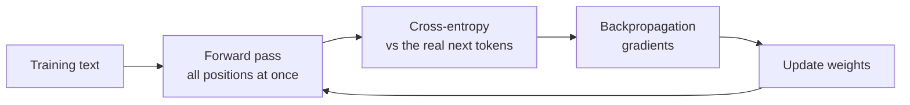

## The hook

Nobody programs a language model to answer questions. The only thing it is ever asked to do, trillions of times, is this: given the text so far, assign high probability to the word that actually came next.

Everything else, translation, code, reasoning-like behavior, falls out of doing that one thing extremely well. And when you chat with it, the "same" model gives different answers on every run, because the output is *sampled*, not computed.

## The simple explanation

**Training** is practice with an answer key. Take a sentence from the internet. Hide the last word. Make the model guess the probabilities of all possible words, then measure how much probability it put on the right one. Nudge the weights so that next time it puts a bit more there. Repeat for an enormous amount of text.

**Generation** is the opposite direction: ask the model for probabilities of the next token, pick one, append it, and repeat.

Where the analogy stops: the model never "knows" it is being quizzed on meaning. It is rewarded for matching the statistics of its training text, and that is both the source of its abilities and of its confident mistakes.

## Under the hood

### The training objective

At each position the model outputs logits, softmax makes probabilities `p`, and the loss for that position is the **cross-entropy** against the true next token `y`:

```
loss = -log p[y]
```

If the model gives the right token probability 1, the loss is 0. If it gives probability 0.1, the loss is about 2.3. The loss is averaged over all positions and all examples.

A model that knows nothing assigns equal probability to every token in a vocabulary of size `V`. Its loss is `ln(V)`. For `V = 10` that is 2.3026, which the exercise confirms: a freshly initialized model starts almost exactly there. Training lowers it.

### Teacher forcing

During training, at every position the model is fed the *true* previous tokens, not its own earlier guesses. Because of the causal mask (lesson 3), one forward pass over a sequence of length `n` produces `n - 1` predictions and loss terms at once. That parallelism is why training scales to enormous data. At generation time there is no such luxury: each token depends on the previous sampled one, so decoding is sequential.

### Gradient descent

The loss is a function of the weights. Backpropagation computes its gradient, the direction in which each weight should move to reduce loss, and the optimizer takes a step of size `lr` (the learning rate). For softmax with cross-entropy, the gradient with respect to the logits has a very clean form: `p - onehot(y)`. The exercise uses exactly that to train a bigram model with a few lines of NumPy.



### The loss floor

Loss does not reach 0 on natural text, or in the exercise. After "the", the corpus is followed by cat, dog, mat or rug with different frequencies; no model can know which. The best possible loss on that data is the conditional entropy of the text, about 0.59 for the toy corpus. The exercise gets close, around 0.64 after 300 steps. Real language models face the same irreducible uncertainty, which is also why overfitting to 0 on the training set means memorization.

### From probabilities to text

The model gives a distribution. You choose how to draw from it:

- **Greedy:** always take the highest probability token. Deterministic, often repetitive.
- **Temperature `T`:** divide logits by `T` before softmax. `T < 1` sharpens the distribution (more predictable), `T > 1` flattens it (more random). As `T` approaches 0 it becomes greedy; as `T` grows it approaches uniform.
- **Top-k:** keep only the `k` most likely tokens.
- **Top-p (nucleus):** keep the smallest set of tokens whose cumulative probability reaches `p`, so the cutoff adapts to how confident the model is.

Low temperature does not make a model correct. It makes it consistent. A wrong answer can be sampled every time.

## The engineering connection

- **Why outputs vary.** Sampling is built in. Set temperature near 0 for extraction, classification or tests. Use higher values for brainstorming. Even at 0, different hardware and batching can cause small nondeterminism, so never rely on bit-exact repeats.
- **Why hallucination exists.** The objective rewards plausible continuations, not truth. When the training data does not determine the answer, the model still has to put its probability somewhere.
- **Training versus inference economics.** Training is a huge, one-off, parallel job. Inference is repeated, sequential per token and memory-bound. This shapes both pricing and architecture.
- **Phases beyond next-token training.** Pretraining is this lesson. Instruction tuning and reinforcement learning from human or verifier feedback then shape behavior. The base objective stays the same underneath.
- **Structured output.** Constrained decoding masks tokens that would break a schema before sampling. It is the same mechanism as top-p, with a hard filter.

## Hands-on challenge

File: `lessons/lesson_05_training_generation.py`. Numpy only. It trains a tiny bigram model on a 42-word corpus with hand-written gradients, then generates text under different sampling settings. About 10 minutes.

**Predict before you run:**

1. What is the loss of the untrained model? Compute `ln(V)` first.
2. Will training reach loss 0? If not, what is the lowest it can reach, and why?
3. After the word "the", what will the learned distribution look like?
4. What does temperature do to the entropy of that distribution at 0.2 and at 5?
5. Which setting will produce the most repetitive text, and which the most chaotic?

```bash
python lessons/lesson_05_training_generation.py
```

<details>
<summary>What the script printed for me (open after predicting)</summary>

- `V = 10`, `ln(V) = 2.3026`, untrained loss 2.3027.
- Loss: 2.24 after step 1, 1.45 at step 20, 0.99 at step 50, 0.78 at step 100, 0.64 at step 300. It plateaus, and does not go to 0.
- After "the": cat 0.33, dog 0.33, mat 0.16, rug 0.16.
- Entropy after "the": 0.82 at T=0.2, 1.47 at T=1, 2.23 at T=5 (the maximum possible for 10 tokens is 2.30).
- Low temperature gives loops like "sat on the dog sat on the cat". High temperature with no top-p gives word salad; top-p 0.5 trims the tail even at T=3.
- The sampled lines are identical on every run because of the fixed seed.

</details>

Follow-ups: increase the corpus and watch the floor move. Replace the bigram table with a two-token context. Implement top-k and compare it with top-p at the same temperature.

## Takeaways

1. Training minimizes cross-entropy on next-token prediction. A model that knows nothing has loss `ln(V)`, and the loss floor is the unpredictability of the data.
2. Teacher forcing makes training parallel across positions. Generation is inherently sequential.
3. Temperature reshapes the distribution and top-p truncates its tail. They control randomness, not correctness.

**Check question:** you set temperature to 0 for a classification task and still see wrong answers every time for one input. What does that tell you, and what would you change instead of the temperature?

**Next up:** putting this to work. Retrieval and context are how we give a frozen model knowledge it was never trained on.
