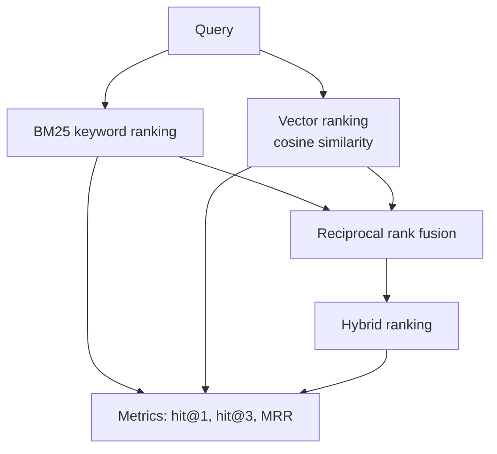

## The hook

Everyone says "semantic search is better than keyword search". Is it? Better at what, measured how?

Without measurement, search quality is vibes. Someone tries three queries, likes the results, and ships. A week later a customer types `ERR-4012` and gets the page for `ERR-4021`. This lesson gives you the smallest honest way to find that out before the customer does.

## The simple explanation

Build a tiny **evaluation set**: real-looking queries paired with the one document that should come first. Run each search method, and count how often the right document lands at the top, in the top three, and how high on average. Now you can compare methods with numbers.

Then combine two methods that fail on different queries. Keyword search is precise on exact strings and blind to paraphrase. Vector search understands paraphrase and blurs exact strings. A hybrid takes the best of both.

It is the same discipline as unit tests, with one difference: results are ranked lists rather than pass or fail, so the metrics are slightly richer.

## Under the hood

### The setup in the exercise

- 12 short support documents (refund, password, shipping, two near-identical error codes, invoice, cancel, damaged goods, privacy, two-factor, address, student discount).
- The keyword ranker only returns documents with a non-zero score. A query with no overlapping words gets an empty keyword list, which is honest: BM25 has no opinion, and the fusion should not be fed dictionary-order noise.
- 12 queries, each labeled with exactly one correct document. Some are paraphrases ("Stop my plan" should find the cancel document), some are exact codes (`ERR-4012`).
- Three rankers: **BM25** (keyword), **vector** (MiniLM embeddings, lesson 2) and **hybrid**.



### BM25 in one paragraph

BM25 scores a document by summing, over each query word it contains, three things: how rare the word is across the collection (**IDF**: rare words matter more), how often it appears in the document with diminishing returns (parameter `k1`), and a length normalization so long documents do not win just by being long (parameter `b`). The script implements it in about twenty lines of NumPy and plain Python. Its tokenizer keeps hyphens inside tokens, so `err-4021` is one token and `ERR-4012` matches only the right document.

### Reciprocal rank fusion (RRF)

The two rankers produce scores on different scales, so you cannot just add them. RRF ignores scores and uses only positions:

```
score(doc) = sum over rankers of 1 / (k + rank)
```

Here `k` is 60 in the script and `rank` starts at 1. A document ranked high by *both* lists wins; a document ranked first by only one still scores well. The only knob is `k`, and the original paper found results insensitive to it (Cormack et al., 2009, in the references). Little tuning and no score calibration is why it is a default in production hybrid search.

### The metrics

- **hit@1**: share of queries where the correct document is first.
- **hit@3**: share where it is in the top three. This is what matters if you pass three chunks to an LLM.
- **MRR** (mean reciprocal rank): average of `1 / position of the correct document`. A first place gives 1, second 0.5, third 0.33. It rewards being near the top, not merely present.

Your 12-query set is far too small to trust a difference of one query. Treat it as a teaching tool and a template. Real evaluation sets have dozens to hundreds of queries, drawn from real logs.

## The engineering connection

**Evaluation before optimization.** Chunk size, embedding model, top-k, reranker, hybrid weights: every one of these is a hypothesis. A labeled set turns each into a measurable experiment, and a regression test you can run in CI when someone swaps the model.

**Where each method fails:**

| Method | Wins on | Loses on |
|--------|---------|----------|
| Keyword (BM25) | exact codes, names, rare terms | paraphrase, synonyms, other languages |
| Vector | paraphrase, intent, vague wording | near-identical identifiers, negation |
| Hybrid | both, usually | extra latency and moving parts |

**Practical notes:**

- Label from real queries. Invented queries flatter your system.
- Keep the misses list. The exercise prints each method's top-1 misses. Reading them is the most valuable ten minutes in the whole process.
- The next improvement after hybrid is usually a **reranker**, a slower model that re-scores the top 20 candidates. Measure it with the same set.
- Most search stacks give you the pieces: Azure AI Search, Elasticsearch and OpenSearch have hybrid retrieval with RRF built in; PostgreSQL gives you full-text search and pgvector, and you write the fusion in SQL yourself. The evaluation harness is still yours in every case.

## Hands-on challenge

File: `lessons/lesson_06_semantic_search.py`. It builds BM25 from scratch, embeds the documents, evaluates three methods and prints the top-1 misses for each. About 15 minutes (the model download is the same one as lesson 2).

**Predict before you run:**

1. Which method will have the *lowest* hit@1, and which queries will it miss?
2. Which queries will keyword search miss completely? Name two.
3. Will the vector ranker get both `ERR-4021` and `ERR-4012` right? Why or why not?
4. Will hybrid beat the best single method on every metric, or only on some? Could it ever be worse than the best single method?

The run command is at the bottom of this page. There is no "what the script printed" block for this lesson on purpose: paste the three metric lines and the misses into your notes below and compare them with your predictions.

Then experiment:

- Change `k` in the fusion from 60 to 5 and then to 1000. What does it do to the result?
- Add three queries of your own with their labels. Do the metrics move?
- Write a query that fools *both* methods and add it to the set.
- Replace the fusion with a weighted score sum. Why is that harder to get right?

## Takeaways

1. Search quality needs a labeled query set and metrics (hit@k, MRR). Without them, tuning is guesswork.
2. Keyword and vector search fail on different queries, so combining them is a strong default.
3. Reciprocal rank fusion merges rankings by position, so there is no score calibration to maintain.

**Check question:** after you swap the embedding model, hit@3 rises but hit@1 drops. Using MRR and the printed misses, how do you decide whether the change is an improvement?

**Next up:** what happens after retrieval. Read the RAG concept note for how search, prompt and LLM fit together.

::: quiz
Q: hit@3 goes up and hit@1 goes down after a change. Is the system better?
A: It depends on the consumer. If three chunks go to an LLM, hit@3 is what matters. Use MRR for a single number that rewards rank, and read the misses to see which queries moved.
Q: Why fuse by rank rather than by adding BM25 and cosine scores?
A: The scores live on different scales (BM25 is unbounded, cosine is in [-1, 1]), so a sum is dominated by whichever is larger. Ranks are comparable without calibration.
Q: Name a query type that keyword search wins and one that vector search wins.
A: Keyword wins exact identifiers such as `ERR-4012`. Vector wins paraphrase such as "Stop my plan" for the cancellation document.
:::

## References

- Cormack, Clarke and Buettcher, "Reciprocal Rank Fusion outperforms Condorcet and individual Rank Learning Methods" (SIGIR 2009): https://doi.org/10.1145/1571941.1572114
- Robertson and Zaragoza, "The Probabilistic Relevance Framework: BM25 and Beyond" (2009): https://doi.org/10.1561/1500000019
- Reimers and Gurevych, "Sentence-BERT" (2019), the embedding model family used here: https://arxiv.org/abs/1908.10084
