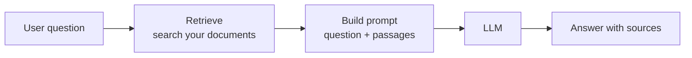

## The short version

**Retrieval-augmented generation (RAG)** means: before asking the model a question, *search* your own data for relevant passages, paste them into the prompt, and let the model answer using that text.

It is search plus prompt plus LLM. The model is not retrained. It reads the passages at question time, like an open-book exam.

## Why it exists

- A model only knows what was in its training data, up to a cutoff. It knows nothing about your private documents.
- Putting everything in the prompt is impossible: context is limited (lesson 3) and priced per token (lesson 1).
- Grounding the answer in retrieved text reduces, but does not eliminate, made-up answers (lesson 5), and lets you show sources.

## The pipeline

1. **Index (offline).** Split documents into chunks, embed each chunk (lesson 2), store text and vectors.
2. **Retrieve (per question).** Embed the question, find the nearest chunks. Better systems combine keyword and vector search and may rerank (lesson 6).
3. **Augment.** Build a prompt: instructions, the retrieved chunks, the question.
4. **Generate.** The LLM answers from the chunks. Ask it to cite them and to say "not found" when the answer is missing.

## Where it fails

- **Retrieval misses.** If the right chunk is not retrieved, the model cannot use it. Most RAG failures are search failures, which is why lesson 6 measures retrieval separately.
- **Bad chunking.** Chunks that cut a table or a thought in half lose meaning.
- **Ignored context.** The model may prefer its own memory, or lose evidence in a long prompt.
- **Prompt injection.** Retrieved text is untrusted input. A document can contain instructions aimed at the model.
- **Stale or conflicting data.** The index needs an update strategy.

## RAG versus fine-tuning

RAG injects *knowledge* at question time and is easy to update. Fine-tuning changes *behavior and style* of the model and is a poor way to add facts. Many systems use RAG first and fine-tune only for a clear gap.

## How to evaluate it

Evaluate two things separately: did retrieval return the right passage (hit@k, MRR), and given the passage, did the model answer correctly and faithfully? Lesson 6 covers the first.
