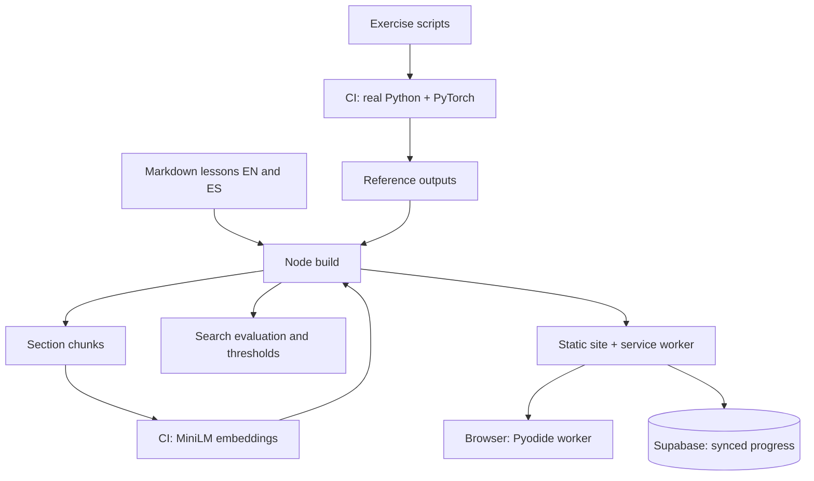

## The problem

Most course sites, including AI ones, share three weaknesses. The numbers in the text were typed by hand once and drift from the code. The code examples have to be run somewhere else. And nothing measures whether the site's own features, such as search, actually work.

I wanted a course on AI engineering that practices what it teaches: the reader runs the real exercise next to the text, every result quoted in a lesson is checked by a machine, and the one AI feature on the site has an evaluation set and a quality gate, like a production retrieval system should.

Constraints: a static site on GitHub Pages, free tiers only, works offline, bilingual (English and Spanish), usable on a phone.

## Architecture

- **Build.** A dependency-light Node script turns Markdown into pages in two languages, with syntax highlighting at build time and diagrams at run time.
- **Python in the browser.** Pyodide (CPython compiled to WebAssembly) runs in a Web Worker. Everything is self-hosted and cached by the service worker, so an exercise that ran once runs offline.
- **Progress.** Local first in the browser, then synced through Supabase with row-level security. Notes that change on two devices are merged, not overwritten.
- **CI.** Every push installs real PyTorch, runs every exercise, embeds the course, measures search, runs two browser test suites and only then deploys.

## Decision: a NumPy MiniLM instead of a JavaScript model runtime

The embedding lessons use `sentence_transformers`, which needs PyTorch, which does not run in the browser. The usual answer is Transformers.js plus ONNX Runtime, which means rewriting the exercises in JavaScript.

Instead I wrote the MiniLM forward pass (WordPiece tokenizer, 6 BERT layers, mean pooling) in about 200 lines of NumPy, behind the same `SentenceTransformer` API. The lesson scripts run unchanged. CI exports the real weights, tries int8, mixed and float16 storage, and keeps the smallest one whose cosine similarities stay within 0.005 of PyTorch. The current build differs by at most {{q:minilm}}.

The same trick covers `tiktoken`: a pure-Python byte pair encoder over the real `cl100k_base` ranks, which CI requires to produce output identical to the real package.

## Decision: claims as code

A lesson that says "the cosine similarity is 0.971" is making a claim about code. In this course such numbers are placeholders, each with a pattern that extracts it from the exercise's real output. CI runs the exercise, the build fills the placeholders, and a mismatch stops the deploy. {{q:claims}} numbers and tables are verified this way.

This caught a real error while building it: the semantic search lesson said hybrid search beats either method alone. On its own test set, vector search alone scored better. The lesson now says so, and teaches the lesson that follows from it: measure, do not assume.

## Decision: evaluate the search like a product

"Ask the course" on the home page is a small retrieval system: lessons are split into section chunks, ranked with BM25 instantly, and optionally fused with MiniLM similarity through reciprocal rank fusion. The model only downloads if the reader asks for it.

It has a labeled set of {{q:queries}} questions per language, each mapped to the section that answers it. CI embeds the chunks and the questions with real PyTorch, computes hit@1, hit@3 and MRR for keywords, meaning and hybrid, publishes them on the [quality page](quality.html), and fails the deploy below stored thresholds.

| English | hit@1 | hit@3 | MRR |
|---|---|---|---|
| Keywords (BM25) | {{q:en.bm25.hit1}} | {{q:en.bm25.hit3}} | {{q:en.bm25.mrr}} |
| Meaning (MiniLM) | {{q:en.vector.hit1}} | {{q:en.vector.hit3}} | {{q:en.vector.mrr}} |
| Hybrid (RRF) | {{q:en.hybrid.hit1}} | {{q:en.hybrid.hit3}} | {{q:en.hybrid.mrr}} |
| Meaning (multilingual E5) | {{q:en.e5.hit1}} | {{q:en.e5.hit3}} | {{q:en.e5.mrr}} |
| Hybrid, E5 (RRF) | {{q:en.hybrid-e5.hit1}} | {{q:en.hybrid-e5.hit3}} | {{q:en.hybrid-e5.mrr}} |

| Spanish | hit@1 | hit@3 | MRR |
|---|---|---|---|
| Keywords (BM25) | {{q:es.bm25.hit1}} | {{q:es.bm25.hit3}} | {{q:es.bm25.mrr}} |
| Meaning (MiniLM) | {{q:es.vector.hit1}} | {{q:es.vector.hit3}} | {{q:es.vector.mrr}} |
| Hybrid (RRF) | {{q:es.hybrid.hit1}} | {{q:es.hybrid.hit3}} | {{q:es.hybrid.mrr}} |
| Meaning (multilingual E5) | {{q:es.e5.hit1}} | {{q:es.e5.hit3}} | {{q:es.e5.mrr}} |
| Hybrid, E5 (RRF) | {{q:es.hybrid-e5.hit1}} | {{q:es.hybrid-e5.hit3}} | {{q:es.hybrid-e5.mrr}} |

These tables are filled by the build, so they are the numbers of the deployed version. all-MiniLM-L6-v2 was trained on English; multilingual-e5-small is built on a multilingual encoder. Running E5 in the browser needed a second piece of work: a SentencePiece Unigram tokenizer in pure Python, checked token for token against Hugging Face in CI, and a vocabulary trimmed to Latin-script pieces so the download stays reasonable. For each language the build ships the model with the best hybrid MRR whose browser version passed its accuracy check, and only that model's vectors: {{q:en.shipped}} in English, {{q:es.shipped}} in Spanish. Keywords stay the default mode; meaning is one tap away.

## Learning features that use the same machinery

- **Predictions with calibration.** Before running an exercise the reader commits to a number or a choice and a confidence. The site scores it against the verified output, and the home page shows calibration: when you say 80 % sure, how often are you right?
- **Labs.** A model inspector shows MiniLM's attention for any sentence, per head and per layer. A training lab trains a small language model in the browser and lets you scrub through checkpoints and sample from them.
- **Shareable experiments.** An edited exercise compresses into a link; opening it runs the edit without overwriting your own.
- **Provenance.** Each lesson states how it was drafted, which claims are verified, how its exercise behaves in the browser and whether a person reviewed it.

## What I would do next

- Grow the evaluation set from real reader questions, with a review step before a question becomes a label.
- Rerank the top results with a small cross-encoder and let the quality page decide whether it earns its latency.
- Replace the runtime Mermaid bundle with diagrams rendered at build time.
