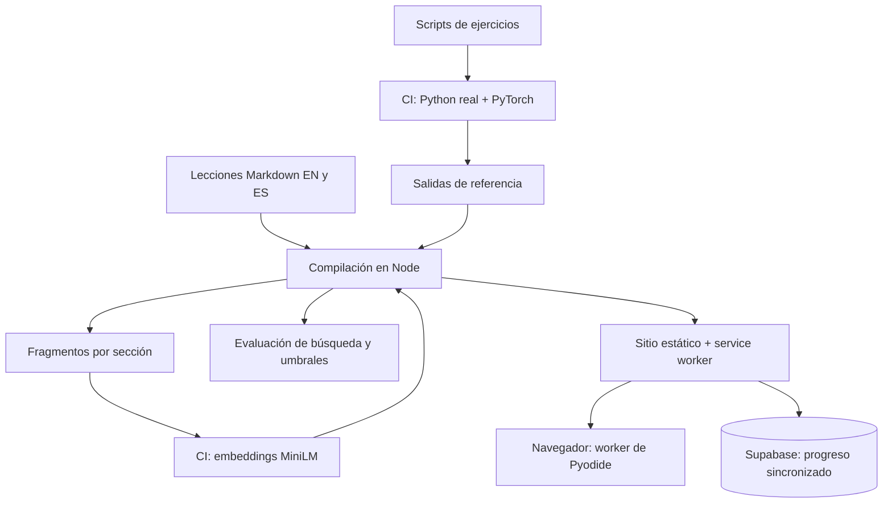

## El problema

La mayoría de los sitios de cursos, también los de IA, comparten tres debilidades. Los números del texto se escribieron a mano una vez y se alejan del código. Los ejemplos hay que ejecutarlos en otro sitio. Y nada mide si las funciones del propio sitio, como la búsqueda, funcionan de verdad.

Quería un curso de ingeniería de IA que practique lo que enseña: quien lee ejecuta el ejercicio real junto al texto, cada resultado citado en una lección lo comprueba una máquina, y la única función de IA del sitio tiene un conjunto de evaluación y un control de calidad, como debería tenerlo un sistema de recuperación en producción.

Restricciones: un sitio estático en GitHub Pages, solo planes gratuitos, funciona sin conexión, bilingüe (inglés y español) y usable en un teléfono.

## Arquitectura

- **Compilación.** Un script de Node con pocas dependencias convierte Markdown en páginas en dos idiomas, con resaltado de sintaxis al compilar y diagramas al ejecutar.
- **Python en el navegador.** Pyodide (CPython compilado a WebAssembly) corre en un Web Worker. Todo está alojado en el propio sitio y lo guarda el service worker, así que un ejercicio que se ejecutó una vez funciona sin conexión.
- **Progreso.** Primero local en el navegador y luego sincronizado con Supabase con seguridad a nivel de fila. Las notas que cambian en dos dispositivos se combinan, no se sobrescriben.
- **CI.** Cada push instala PyTorch real, ejecuta todos los ejercicios, calcula los embeddings del curso, mide la búsqueda, pasa dos baterías de pruebas en navegador y solo entonces despliega.

## Decisión: un MiniLM en NumPy en lugar de un runtime de modelos en JavaScript

Las lecciones de embeddings usan `sentence_transformers`, que necesita PyTorch, que no funciona en el navegador. La respuesta habitual es Transformers.js con ONNX Runtime, lo que obliga a reescribir los ejercicios en JavaScript.

En su lugar escribí el paso hacia delante de MiniLM (tokenizador WordPiece, 6 capas BERT, pooling por media) en unas 200 líneas de NumPy, detrás de la misma API `SentenceTransformer`. Los scripts de las lecciones se ejecutan sin cambios. La CI exporta los pesos reales, prueba almacenamiento int8, mixto y float16, y se queda con el más pequeño cuyas similitudes coseno no se alejan más de 0,005 de PyTorch. La compilación actual difiere como máximo {{q:minilm}}.

El mismo truco cubre `tiktoken`: un codificador BPE en Python puro sobre los rangos reales de `cl100k_base`, que la CI exige que produzca una salida idéntica al paquete real.

## Decisión: las afirmaciones como código

Una lección que dice «la similitud coseno es 0,971» hace una afirmación sobre código. En este curso esos números son marcadores, cada uno con un patrón que lo extrae de la salida real del ejercicio. La CI ejecuta el ejercicio, la compilación rellena los marcadores y una discrepancia detiene el despliegue. Así se verifican {{q:claims}} números y tablas.

Esto encontró un error real durante la construcción: la lección de búsqueda semántica decía que la búsqueda híbrida supera a cada método por separado. En su propio conjunto de prueba, la búsqueda vectorial sola puntuaba mejor. La lección ahora lo dice y enseña la conclusión que se sigue: mide, no supongas.

## Decisión: evaluar la búsqueda como un producto

«Pregunta al curso», en la página de inicio, es un pequeño sistema de recuperación: las lecciones se dividen en fragmentos por sección, se ordenan al instante con BM25 y, si se pide, se combinan con la similitud de MiniLM mediante fusión por rango recíproco. El modelo solo se descarga si quien lee lo solicita.

Tiene un conjunto etiquetado de {{q:queries}} preguntas por idioma, cada una asociada a la sección que la responde. La CI calcula los embeddings de los fragmentos y de las preguntas con PyTorch real, mide hit@1, hit@3 y MRR para palabras clave, significado e híbrido, los publica en la [página de calidad](quality.html) y detiene el despliegue por debajo de los umbrales guardados.

| Inglés | hit@1 | hit@3 | MRR |
|---|---|---|---|
| Palabras clave (BM25) | {{q:en.bm25.hit1}} | {{q:en.bm25.hit3}} | {{q:en.bm25.mrr}} |
| Significado (MiniLM) | {{q:en.vector.hit1}} | {{q:en.vector.hit3}} | {{q:en.vector.mrr}} |
| Híbrido (RRF) | {{q:en.hybrid.hit1}} | {{q:en.hybrid.hit3}} | {{q:en.hybrid.mrr}} |

| Español | hit@1 | hit@3 | MRR |
|---|---|---|---|
| Palabras clave (BM25) | {{q:es.bm25.hit1}} | {{q:es.bm25.hit3}} | {{q:es.bm25.mrr}} |
| Significado (MiniLM) | {{q:es.vector.hit1}} | {{q:es.vector.hit3}} | {{q:es.vector.mrr}} |
| Híbrido (RRF) | {{q:es.hybrid.hit1}} | {{q:es.hybrid.hit3}} | {{q:es.hybrid.mrr}} |

La compilación rellena estas tablas, así que son los números de la versión desplegada. all-MiniLM-L6-v2 se entrenó en inglés. En inglés, la búsqueda por significado encuentra lo que las palabras clave no ven; en español el mismo modelo es débil y combinarlo puede quedar por debajo de las palabras clave solas. Por eso las palabras clave son el modo por defecto, y por eso el siguiente paso de abajo es un modelo multilingüe medido con las mismas preguntas.

## Funciones de aprendizaje que usan la misma maquinaria

- **Predicciones con calibración.** Antes de ejecutar un ejercicio, quien lee se compromete con un número o una opción y un nivel de confianza. El sitio lo puntúa contra la salida verificada y la página de inicio muestra la calibración: cuando dices que estás seguro al 80 %, ¿cuántas veces aciertas?
- **Laboratorios.** Un inspector de modelos muestra la atención de MiniLM para cualquier frase, por cabeza y por capa. Un laboratorio de entrenamiento entrena un pequeño modelo de lenguaje en el navegador y permite recorrer sus checkpoints y generar texto con ellos.
- **Experimentos que se comparten.** Un ejercicio editado se comprime en un enlace; al abrirlo se ejecuta la edición sin sobrescribir la tuya.
- **Procedencia.** Cada lección indica cómo se redactó, qué afirmaciones están verificadas, cómo se comporta su ejercicio en el navegador y si una persona la revisó.

## Lo que haría después

- Ampliar el conjunto de evaluación con preguntas reales de lectores, con un paso de revisión antes de que una pregunta se convierta en etiqueta.
- Añadir un modelo de embeddings multilingüe como tercer modo y dejar que la página de calidad decida si merece su descarga.
- Sustituir el paquete de Mermaid en tiempo de ejecución por diagramas generados al compilar.
